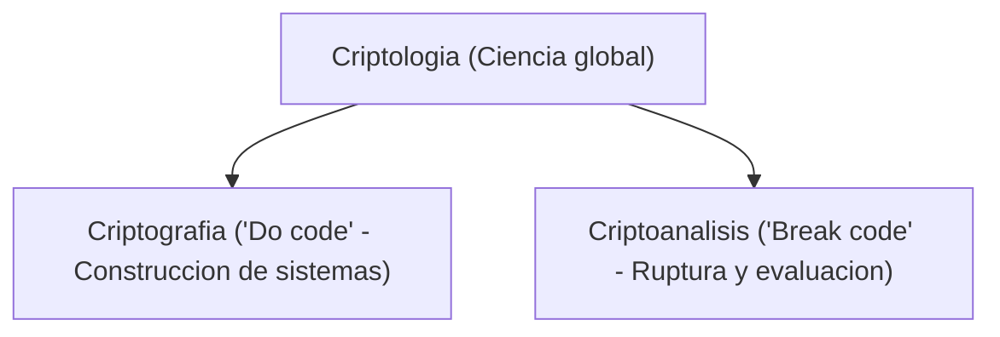
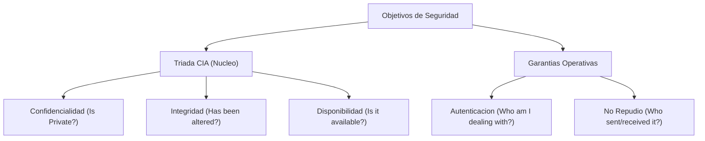
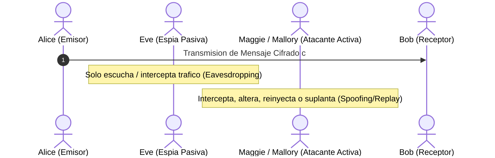

[← Volver a Curso.md](../Curso.md)

# Introduccion a la Criptografia y Seguridad de la Informacion

> **Materia**: Criptografia | **Fuente**: [part 1.pdf](../Documentos/part 1.pdf)  
> `criptografia`, `criptoanalisis`, `criptologia`, `triada cia`, `confidencialidad`, `integridad`, `autenticacion`, `disponibilidad`, `no repudio`, `spoofing`, `adversario activo`, `adversario pasivo`, `one-time pad`, `secreto perfecto`, `xor`, `adicion mod 2`, `seguridad incondicional`, `seguridad computacional`, `principio de kerckhoffs`

---

## 1. Definiciones y Disciplinas Fundamentales

- **Etimologia**: Del griego $\kappa\rho\upsilon\pi\tau\text{ó}$ (*krypto*, oculto/secreto) y $\gamma\rho\alpha\phi\acute{\iota}\alpha$ (*graphia*, escritura) $\implies$ "escritura secreta".
- **Criptografia (*Cryptography*)**: Estudio de tecnicas matematicas para satisfacer objetivos fundamentales de seguridad; arte/ciencia de codificar o cifrar mensajes ("*do code*").
- **Criptoanalisis (*Cryptoanalysis*)**: Arte/ciencia de descifrar, inspeccionar o romper criptogramas sin autorizacion ni posesion previa de la clave ("*break code*").
- **Criptologia (*Cryptology*)**: Disciplina cientifica sombrilla que engloba tanto a la criptografia como al criptoanalisis.



### Componentes de un Criptosistema
- **Texto Plano / Claro (`Plaintext` / `Cleartext` - $m \in \mathcal{M}$)**: Mensaje legible original en reposo o transito.
- **Cifrado (`Encryption` - $E_k$)**: Algoritmo de transformacion biyectiva que convierte $m$ en un formato ininteligible mediante una clave $k$.
- **Criptograma / Texto Cifrado (`Ciphertext` - $c \in \mathcal{C}$)**: Mensaje codificado resultante transmitido por canales inseguros.
- **Descifrado (`Decryption` - $D_k$)**: Operacion inversa que recupera el texto plano original: $D_k(c) = D_k(E_k(m)) = m$.
- **Clave (`Key` - $k \in \mathcal{K}$)**: Parametro confidencial que particulariza la transformacion del algoritmo.

---

## 2. Metas de la Seguridad de la Informacion

Marco teorico-practico compuesto por la **Triada CIA** y garantias de origen:



| Meta | Objetivo Tecnico | Amenaza Asociada | Requisitos Operativos |
| :--- | :--- | :--- | :--- |
| **Confidencialidad** (*Privacy / Secrecy*) | Impedir el acceso no autorizado a los datos | *Interception* (adversario pasivo) | 1. Ningun observador accede al contenido de $m$.<br>2. Ningun observador puede correlacionar identidades de emisor/receptor (anonimato/trafico). |
| **Integridad** | Garantizar que los datos no sean modificados sin deteccion | *Modification* (adversario activo) | 1. Mensaje intacto (sin modificacion ni perdida).<br>2. Sin bloqueo de entrega.<br>3. Prevencion de duplicados (*replay attacks*). |
| **Autenticacion** | Validar identidad de entidades o el origen genuino de los datos | *Spoofing* / Suplantacion | 1. Certeza de que el mensaje alcanza unica y exclusivamente al receptor previsto.<br>2. Certeza de que el mensaje proviene del emisor legitimo. |
| **Disponibilidad** | Garantizar acceso oportuno y confiable a los recursos | *Denial of Service* (DoS / DDoS) | Funcionamiento correcto de: hardware/sistemas, controles de seguridad y canales de comunicacion. |
| **No Repudio** | Impedir la negacion irrefutable de transacciones | Reclamacion fraudulenta | 1. El emisor no puede negar el envio (*origen*).<br>2. El receptor no puede negar la recepcion (*destino*). |

---

## 3. Modelo de Adversarios y Actores Estandar

Originados formalmente por Ron Rivest en el paper fundacional de RSA (1978), basados en personajes de *Alicia en el Pais de las Maravillas*:



- **Alice & Bob**: Extremos legitimos de comunicacion.
- **Eve (*Eavesdropper*)**: Atacante **pasivo**. Solo escucha/intercepta trafico; viola confidencialidad sin alterar paquetes.
- **Maggie / Mallory (*Malicious attacker*)**: Atacante **activo**. Modifica cargas utiles, sustituye mensajes, inyecta paquetes falsos y ejecuta repeticiones (*replay attacks*). La defensa ante Maggie es exponencialmente mas compleja que ante Eve.
- **Peggy (*Prover*)**: Entidad que demuestra la posesion de un secreto o identidad en protocolos criptograficos.
- **Victor (*Verifier*)**: Entidad que valida la prueba suministrada por Peggy.

---

## 4. One-Time Pad (OTP / Cifrado de Vernam)

Propuesto por Gilbert Sandford Vernam (AT&T, 1917). Cifrado de flujo simetrico polialfabetico con bloque aleatorio de un solo uso (*pad*).

### Reglas Operativas Obligatorias
1. **Longitud de Clave**: $|k| \ge |m|$ (clave tan larga como el mensaje).
2. **Aleatoriedad Estricta**: La clave debe generarse a partir de una fuente verdaderamente aleatoria (*True Random*).
3. **Uso Unico (*One-Time*)**: Jamas reutilizar una clave.

### Cifrado Binario (XOR / $\mathbb{Z}_2$)
- Operador $\oplus$ (disyuncion exclusiva / suma modulo 2: $a \oplus b \equiv a + b \pmod 2$).
- **Cifrado**: $c_i = m_i \oplus k_i$
- **Descifrado**: $m_i = c_i \oplus k_i = (m_i \oplus k_i) \oplus k_i = m_i \oplus 0 = m_i$

| $a$ | $b$ | $c = a \oplus b$ |
| :---: | :---: | :---: |
| 0 | 0 | 0 |
| 0 | 1 | 1 |
| 1 | 0 | 1 |
| 1 | 1 | 0 |

### Variante Modular ($\mathbb{Z}_{26}$)
- Mapeo alfabetico: $A=0, B=1, \dots, Z=25$.
- **Cifrado**: $c_i = (m_i + k_i) \pmod{26}$
- **Descifrado**: $m_i = (c_i - k_i) \pmod{26}$
- **Espacio de Claves**: Para una longitud $n$, existen $|\mathcal{K}| = 26^n$ claves equiprobables con probabilidad $\Pr[K = k] = 26^{-n}$.

### Ejemplo de Cifrado y Descifrado

```text
Texto Claro:    H (7)    E (4)    L (11)   L (11)   O (14)
Clave (OTP):    E (4)    O (14)   X (23)   J (9)    F (5)
------------------------------------------------------------
Suma Mod 26:    L (11)   S (18)   I (8)    U (20)   T (19)  -> Criptograma: LSIUT

Descifrado:
Criptograma:    L (11)   S (18)   I (8)    U (20)   T (19)
- Clave:      - E (4)  - O (14) - X (23) - J (9)  - F (5)
------------------------------------------------------------
Resta Mod 26:   H (7)    E (4)    L (11)*  L (11)   O (14)  -> Plaintext: HELLO
*(8 - 23 = -15 ≡ 11 mod 26)
```

---

## 5. Teoria de la Informacion y Secreto Perfecto (*Perfect Secrecy*)

Formulado por Claude Shannon en la decada de 1940:

### Definicion Formal
Un criptosistema posee **Secreto Perfecto** si y solo si la observacion del criptograma no aporta informacion adicional sobre el texto plano:

$$\Pr[M = m \mid C = c] = \Pr[M = m] \quad \forall m \in \mathcal{M}, \, c \in \mathcal{C}$$

### Demostracion de Secreto Perfecto en OTP
- Sean los bits del mensaje con distribucion arbitraria: $\Pr[m_i = 0] = x$, $\Pr[m_i = 1] = 1 - x$.
- Clave aleatoria uniforme: $\Pr[k_i = 0] = \Pr[k_i = 1] = \frac{1}{2}$.
- Analisis de eventos para $c_i = m_i \oplus k_i$:

| $m_i$ | $\Pr[M = m_i]$ | $k_i$ | $\Pr[K = k_i]$ | $c_i = m_i \oplus k_i$ | Probabilidad Conjunta |
| :---: | :---: | :---: | :---: | :---: | :---: |
| 0 | $x$ | 0 | $1/2$ | **0** | $x / 2$ |
| 0 | $x$ | 1 | $1/2$ | **1** | $x / 2$ |
| 1 | $1-x$ | 0 | $1/2$ | **1** | $(1-x) / 2$ |
| 1 | $1-x$ | 1 | $1/2$ | **0** | $(1-x) / 2$ |

- Probabilidad marginal del criptograma:
  $$\Pr[c_i = 0] = \frac{x}{2} + \frac{1-x}{2} = \frac{1}{2}, \quad \Pr[c_i = 1] = \frac{x}{2} + \frac{1-x}{2} = \frac{1}{2}$$
- Dado que $\Pr[C = c] = \frac{1}{2}$ y $\Pr[C = c \mid M = m] = \frac{1}{2}$:
  $$\Pr[M = m \mid C = c] = \frac{\Pr[C = c \mid M = m] \cdot \Pr[M = m]}{\Pr[C = c]} = \frac{\frac{1}{2} \cdot \Pr[M = m]}{\frac{1}{2}} = \Pr[M = m]$$
- **Conclusion**: El criptograma se comporta como ruido blanco uniforme; un adversario con potencia computacional infinita no puede deducir nada mas alla de adivinar al azar.

---

## 6. Seguridad Incondicional vs. Seguridad Computacional

| Dimension | Seguridad Incondicional (*Information-Theoretic*) | Seguridad Computacional (*Complexity-Theoretic*) |
| :--- | :--- | :--- |
| **Poder del Atacante** | Recursos de tiempo y computo infinitos | Recursos de tiempo y hardware acotados polinomialmente |
| **Condicion de Seguridad** | Inviolable matematicamente ($\Pr[M \mid C] = \Pr[M]$) | Ataque requiere tiempo no razonable (ej. $> 10^6$ años) o prob. residual insignificante (ej. $\le 2^{-64}$) |
| **Requisito de Clave** | $|\mathcal{K}| \ge |\mathcal{M}|$ (clave de longitud $\ge$ mensaje) | Claves cortas y fijas reutilizables (128, 256 bits) |
| **Base Matematica** | Teoria de la Informacion y Entropia de Shannon | Dificultad computacional de problemas matematicos duros |
| **Problemas Base** | Ninguno (independiente de complejidad) | Factorizacion de enteros grandes (IFP - RSA), Logaritmo Discreto (DLP / ECDLP) |
| **Viabilidad Practica** | Impractico para uso general masivo | Estandar de la industria moderna (AES, RSA, ECC, TLS) |

---

## 7. Principio de Kerckhoffs y Seguridad Abierta

Formulado por Auguste Kerckhoffs (1883) y sintetizado por Claude Shannon:

> *"A cryptosystem should be secure even if everything about the system, except the key, is public knowledge."*  
> **Maxima de Shannon**: *"The enemy knows the system"* (El enemigo conoce el sistema).

### Contraste Fundamental
- **Principio de Kerckhoffs (Seguridad Abierta)**: La confidencialidad depende exclusivamente del secreto de la clave $k$, nunca del algoritmo.
- **Seguridad por Oscuridad (*Security by Obscurity*)**: Dependencia del ocultamiento del diseño algoritmico o implementacion interna. **Falacia critica**: la ingenieria inversa, fugas o desensamblado comprometen irreparablemente todo el sistema.

### Ventajas del Diseño Abierto
1. **Escrutinio Publico Masivo**: Revision exhaustiva por la comunidad cientifica global; eleva exponencialmente la confianza.
2. **Inmunidad a Ingenieria Inversa**: El atacante ya posee las especificaciones completas del algoritmo.
3. **Estandarizacion e Interoperabilidad**: Facilita el desarrollo de estandares abiertos auditables (NIST, IETF, ISO).

---

## 8. Puntos Criticos de Examen y Trampas Frecuentes

- **Reutilizacion de Pad (*Two-Time Pad Attack*)**:
  - Si una clave OTP $k$ se reutiliza para cifrar dos mensajes distintos $m_1$ y $m_2$:
    $$c_1 \oplus c_2 = (m_1 \oplus k) \oplus (m_2 \oplus k) = m_1 \oplus m_2$$
  - Al cancelar la clave, el resultado es la disyuncion exclusiva directa de ambos textos claros, susceptible a analisis de frecuencias y tecnicas linguisticas triviales.
- **Paradoja de Distribucion de OTP**:
  - OTP traslada el problema de transmitir un mensaje confidencial al problema identico de transmitir una clave secreta del mismo tamaño por un canal seguro previo.
- **Seguridad Teorica vs. Practica**:
  - Que un algoritmo posea seguridad incondicional teorica no garantiza seguridad en implementacion: generadores pseudoaleatorios defectuosos (PRNGs no criptograficos), canales laterales (*side-channel attacks*) o fallos en el borrado de pads en memoria rompen la seguridad.
- **Confidencialidad vs. Integridad**:
  - OTP proporciona confidencialidad perfecta, pero **cero integridad**: un atacante activo (Maggie) que modifique un bit en $c_i$ ($c'_i = c_i \oplus 1$) alterara predeciblemente el bit correspondiente del texto claro ($m'_i = m_i \oplus 1$) sin ser detectado si no existe un MAC o firma digital.

