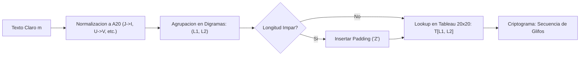

[← Volver a Curso.md](../Curso.md)

# Cifrado de Porta (Porta Polygraphic Cipher)

> **Materia**: Criptografia | **Fuente**: [part 2.pdf](../Documentos/part 2.pdf)  
> `porta cipher`, `cifrado poligrafico`, `monoalfabetico`, `tableau 20x20`, `digramas`, `glifos`, `giovanni battista della porta`

---

## 1. Mecanismo Operativo y Estructura del Tableau

Propuesto por el erudito napolitano **Giovanni Battista della Porta** en su tratado *De Furtivis Literarum Notis* (1563). Constituye uno de los primeros sistemas de sustitución poligráfica documentados en la historia criptográfica.



### El Alfabeto Latino de 20 Letras ($\mathcal{A}_{20}$)
Porta utilizo el alfabeto italiano/latino clasico renacentista de **20 caracteres**:
$$\mathcal{A}_{20} = \{\text{A, B, C, D, E, F, G, H, I, L, M, N, O, P, Q, R, S, T, V, Z}\}$$

- **Letras excluidas del alfabeto moderno**:
  - $\text{J} \implies$ asimilada a $\text{I}$.
  - $\text{U} \implies$ asimilada a $\text{V}$.
  - $\text{K, W, X, Y} \implies$ ausentes del latin clasico (en transcripcion moderna se sustituyen o descartan).

### Estructura de la Matriz ($20 \times 20$)
- **Filas**: Representan la primera letra del digrama ($L_1 \in \mathcal{A}_{20}$).
- **Columnas**: Representan la segunda letra del digrama ($L_2 \in \mathcal{A}_{20}$).
- **Celdas internas**: Exactamente $20 \times 20 = 400$ **glifos unicos** inventados por Della Porta (simbolos geometricos con lineas, puntos y formas curvilineas).
- **Formalizacion matematica**:
  - Espacio de entrada: Pares ordenados $(L_1, L_2) \in \mathcal{A}_{20} \times \mathcal{A}_{20}$.
  - Espacio de salida: Conjunto discreto de 400 glifos $\mathcal{G} = \{g_1, g_2, \dots, g_{400}\}$.
  - Transformacion biyectiva estatica:
    $$E(L_1, L_2) = T[L_1, L_2] \in \mathcal{G}$$
    $$D(g) = T^{-1}(g) = (L_1, L_2) \in \mathcal{A}_{20} \times \mathcal{A}_{20}$$

---

## 2. Algoritmo Practico de Cifrado y Descifrado

### Procedimiento de Cifrado
1. **Normalizacion**:
   - Convertir todo el texto plano $m$ a mayusculas.
   - Mapear caracteres ausentes: $\text{J} \to \text{I}$, $\text{U} \to \text{V}$, $\text{W} \to \text{VV}$. Suprimir espacios y signos de puntuacion.
2. **Segmentacion en Digramas**:
   - Agrupar los simbolos de dos en dos: $m = (m_1, m_2)(m_3, m_4)\dots(m_{2k-1}, m_{2k})$.
3. **Regla de Padding**:
   - Si la longitud total $|m|$ es impar, anexar un caracter de relleno preestablecido (habitualmente `Z` o `A`) al final para completar el ultimo par:
     $$m_{\text{ultimo}} = (m_{|m|}, \text{'Z'})$$
4. **Sustitucion Directa**:
   - Para cada par $(L_1, L_2)$, localizar la fila de $L_1$ y la columna de $L_2$ en el tableau.
   - Escribir en el criptograma el glifo unico situado en la interseccion $T[L_1, L_2]$.

### Procedimiento de Descifrado
1. **Identificacion del Glifo**: Para cada simbolo grafico $g \in \mathcal{C}$, localizar su casilla dentro del tableau de $20 \times 20$.
2. **Extraccion de Coordenadas**:
   - Leer la etiqueta de fila $\implies L_1$.
   - Leer la etiqueta de columna $\implies L_2$.
3. **Reconstruccion del Texto Claro**:
   - Concatenar los digramas recuperados: $m = L_1 L_2 \dots$
   - Si el ultimo caracter corresponde a un caracter de padding previamente convenido sin sentido sintactico, descartarlo.

---

## 3. Ejemplo Practico Detallado

### Caso 1: Cifrado de Mensaje Par `"ROMA"`
- **Paso 1: Normalizacion**:
  `"ROMA"` $\implies$ Todas las letras pertenecen a $\mathcal{A}_{20}$. Longitud $|m| = 4$ (par).
- **Paso 2: Segmentacion**:
  $$\text{Digrama 1} = (R, O), \quad \text{Digrama 2} = (M, A)$$
- **Paso 3: Cifrado de Digrama 1 $(R, O)$**:
  - Fila: $R$ (indice 15 de $\mathcal{A}_{20}$).
  - Columna: $O$ (indice 12 de $\mathcal{A}_{20}$).
  - Interseccion: $T[R, O] \implies \text{Glifo}_{(R, O)}$.
- **Paso 4: Cifrado de Digrama 2 $(M, A)$**:
  - Fila: $M$ (indice 10 de $\mathcal{A}_{20}$).
  - Columna: $A$ (indice 0 de $\mathcal{A}_{20}$).
  - Interseccion: $T[M, A] \implies \text{Glifo}_{(M, A)}$.
- **Resultado Cifrado**:
  $$c = [\text{Glifo}_{(R, O)}, \ \text{Glifo}_{(M, A)}]$$

### Caso 2: Cifrado de Mensaje Impar con Padding `"SOL"`
- **Paso 1: Segmentacion y Deteccion de Longitud Impar**:
  Longitud $|m| = 3$. Primer par: $(S, O)$. Elemento residual: `L`.
- **Paso 2: Aplicacion de Padding**:
  Se agrega caracter `Z` $\implies$ Segundo par: $(L, Z)$.
- **Paso 3: Mapeo de Pares**:
  - $(S, O) \implies T[S, O] = \text{Glifo}_{(S, O)}$.
  - $(L, Z) \implies T[L, Z] = \text{Glifo}_{(L, Z)}$.
- **Resultado Cifrado**:
  $$c = [\text{Glifo}_{(S, O)}, \ \text{Glifo}_{(L, Z)}]$$

---

## 4. Implementacion de Referencia en Python

Script funcional que modela el tableau de $20 \times 20$, normaliza el alfabeto clasico latino, gestiona el padding y ejecuta cifrado/descifrado bidireccional:

```python
"""
Implementacion del Cifrado Poligrafico Monoalfabetico de Porta (1563).
Modela la cuadricula de 20x20 y sustitucion de digramas por identificadores de glifos.
"""

ALPHABET_20 = "ABCDEFGHILMNOPQRSTVZ"
PAD_CHAR = "Z"

# Generacion determinista del tableau 20x20 con 400 identificadores de glifos unicos
# En la practica de Porta, cada celda corresponde a un simbolo grafico exclusivo.
TABLEAU = {
    (r, c): f"GLYPH_{r}{c}" 
    for r in ALPHABET_20 
    for c in ALPHABET_20
}

# Tabla inversa para lookup en tiempo O(1) durante el descifrado
INVERSE_TABLEAU = {glyph: pair for pair, glyph in TABLEAU.items()}


def normalize_plaintext(text: str) -> str:
    """Filtra y mapea caracteres al alfabeto clasico de 20 letras."""
    replacements = {"J": "I", "U": "V", "W": "VV", "K": "C", "Y": "I", "X": "S"}
    clean_chars = []
    for char in text.upper():
        if char in replacements:
            clean_chars.append(replacements[char])
        elif char in ALPHABET_20:
            clean_chars.append(char)
    return "".join(clean_chars)


def encrypt_porta(plaintext: str) -> list[str]:
    """Cifra un texto plano agrupando en digramas mediante el tableau de 20x20."""
    normalized = normalize_plaintext(plaintext)
    if len(normalized) % 2 != 0:
        normalized += PAD_CHAR  # Regla de padding para mensajes impares
    
    ciphertext = []
    for i in range(0, len(normalized), 2):
        row = normalized[i]
        col = normalized[i + 1]
        glyph = TABLEAU[(row, col)]
        ciphertext.append(glyph)
    return ciphertext


def decrypt_porta(ciphertext: list[str]) -> str:
    """Descifra una lista de glifos recuperando los pares originales."""
    recovered_chars = []
    for glyph in ciphertext:
        row, col = INVERSE_TABLEAU[glyph]
        recovered_chars.extend([row, col])
    return "".join(recovered_chars)


# --- Demostracion de Ejecucion ---
if __name__ == "__main__":
    msg = "ROMA"
    c_glyphs = encrypt_porta(msg)
    p_recov = decrypt_porta(c_glyphs)
    print(f"Original:   {msg}")
    print(f"Cifrado:    {c_glyphs}")
    print(f"Descifrado: {p_recov}")

    msg_impar = "SOL"
    c_impar = encrypt_porta(msg_impar)
    p_impar = decrypt_porta(c_impar)
    print(f"\nOriginal Impar: {msg_impar}")
    print(f"Cifrado:        {c_impar}")
    print(f"Descifrado:     {p_impar} (con padding '{PAD_CHAR}')")
```

---

## 5. Criptoanalisis Practico y Puntos Criticos de Examen

### ¿Por que es Monoalfabetico si Cifra Pares de Letras?
- **Definicion rigurosa**: Un cifrado es **monoalfabetico** cuando la transformacion asigna a cada elemento del alfabeto de entrada un unico e invariable elemento del alfabeto de salida a lo largo de todo el texto.
- En el cifrado de Porta:
  - El alfabeto del texto plano no son letras aisladas ($\Sigma$), sino pares ordenados de letras ($\Sigma^2$).
  - Dado cualquier par $(L_1, L_2)$, su sustituto es **siempre el mismo glifo $T[L_1, L_2]$**, sin importar su posicion temporal, indice en el mensaje ni dependencia de rondas anteriores.
  - No existe progresion de clave (a diferencia de Vigenère o Hill), por lo cual **no es polialfabetico**.

### Comparativa: Cifrado Monografico vs Poligrafico de Porta

| Criterio | Sustitucion Monografica Simple (ej. Cesar) | Sustitucion Poligrafica de Porta |
| :--- | :--- | :--- |
| **Unidad de Cifrado** | 1 caracter individual ($t=1$) | Bloque de 2 caracteres / digrama ($t=2$) |
| **Espacio de Simbolos** | 20 a 26 caracteres | $20^2 = 400$ digramas / glifos |
| **Distribucion de Frecuencia** | Refleja fielmente la frecuencia monografica de letras del idioma (la `E` o `A` sobresalen directamente) | Destruye el histograma monografico; refleja la **frecuencia de bigramas** del idioma (ej. `QU`, `ER`, `ES`) |
| **Resistencia al Criptoanalisis** | Trivial: rompible con $< 50$ letras mediante conteo monografico | Requiere mayor volumen de texto ($\sim 10^2 - 10^3$ caracteres) para que las frecuencias de los 400 pares converjan, pero se rompe con el mismo principio estadistico |

### Trampas de Examen y Errores Conceptuales Frecuentes
1. **Clasificacion Erronea**: Asumir que por emplear una tabla bidimensional es un cifrado polialfabetico. **Es monoalfabetico poligrafico**.
2. **Alfabeto Utilizado**: Asumir una matriz de $26 \times 26$. El tableau historico de Porta tiene estrictamente **$20 \times 20$** (alfabeto italiano del siglo XVI; omite `J, K, U, W, X, Y`).
3. **No Conmutatividad del Par**: $T[L_1, L_2] \neq T[L_2, L_1]$. La primera letra determina la fila y la segunda la columna. Invertir el orden produce un glifo completamente distinto.
4. **Omision del Padding en Longitudes Impares**: Un mensaje de longitud impar sin caracter de relleno es irresoluble en el ultimo caracter.
