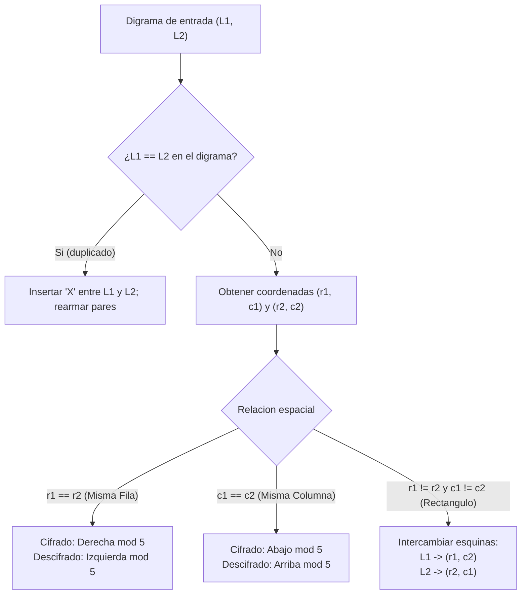

[← Volver a Curso.md](../Curso.md)

# Cifrado Playfair (Playfair Cipher)

> **Materia**: Criptografia | **Fuente**: [part 2.pdf](../Documentos/part 2.pdf)  
> `playfair cipher`, `cifrado poligrafico`, `matriz 5x5`, `digramas`, `regla del rectangulo`, `charles wheatstone`, `lyon playfair`

---

## 1. Construccion de la Matriz 5x5 y Reglas Operativas

- **Clasificacion**: Cifrado por **sustitucion monoalfabetica poligrafica** (opera estrictamente sobre bloques de dos letras o digramas).
- **Origen historico**: Inventado por Sir Charles Wheatstone (1854); promovido militar y politicamente por Lyon Playfair (1er Baron Playfair). Empleado en combate desde la Segunda Guerra Boer hasta la Segunda Guerra Mundial.
- **Alfabeto de definicion**: $\Sigma = 25$ caracteres. Se fusionan las letras `I` y `J` en una misma celda (`IJ`) para ajustar el alfabeto ingles (26 letras) a una matriz cuadrada de $5 \times 5$.

### Construccion de la Matriz Cuadrada
1. Se selecciona una palabra clave (en el material de clase, derivada de `YOAN PINZON`).
2. Se registran las letras unicas de la clave de izquierda a derecha y de arriba a abajo, suprimiendo caracteres duplicados.
3. Las posiciones vacantes se rellenan con las letras restantes del alfabeto en riguroso orden alfabetico (omitiendo la `J` si ya se registro `I`).

```text
Matriz Playfair (Clave: YOAN PINZON):
       c=0   c=1   c=2   c=3   c=4
r=0 [  Y  |  O  |  A  |  N  |  P  ]
r=1 [ IJ  |  Z  |  B  |  C  |  D  ]
r=2 [  E  |  F  |  G  |  H  |  K  ]
r=3 [  L  |  M  |  Q  |  R  |  S  ]
r=4 [  T  |  U  |  V  |  W  |  X  ]
```

---

### Reglas de Preprocesamiento del Texto Claro

1. **Estandarizacion**: Convertir todo a mayusculas; suprimir espacios y signos de puntuacion; reemplazar cualquier ocurrencia de `J` por `I`.
2. **Descomposicion en Digramas**: Segmentar la cadena en pares consecutivos de dos caracteres.
3. **Desempate de Duplicados**: Si las dos letras de un mismo par son identicas ($L_1 = L_2$), se inserta una letra nula de separacion (`X`) entre ellas y se recalcula el agrupamiento desde ese punto (e.g., `BALLOON` $\to$ `BA LX LO ON`).
4. **Relleno Final (*Padding*)**: Si el total de letras resulta impar tras las inserciones, se añade una `X` final para cerrar el ultimo digrama.

---

### Reglas de Movimiento: Cifrado vs. Descifrado

Dado un digrama claro $(P_1, P_2)$ con coordenadas $(r_1, c_1)$ y $(r_2, c_2)$ en la grilla $5 \times 5$:

| Caso Geometrico | Condicion | Regla de Cifrado ($E$) | Regla de Descifrado ($D = E^{-1}$) |
| :--- | :--- | :--- | :--- |
| **Misma Fila** | $r_1 = r_2$ | Desplazar a la **derecha** $(\bmod\ 5)$:<br>$c_1' = (c_1 + 1) \bmod 5$<br>$c_2' = (c_2 + 1) \bmod 5$ | Desplazar a la **izquierda** $(\bmod\ 5)$:<br>$c_1' = (c_1 - 1) \bmod 5$<br>$c_2' = (c_2 - 1) \bmod 5$ |
| **Misma Columna** | $c_1 = c_2$ | Desplazar hacia **abajo** $(\bmod\ 5)$:<br>$r_1' = (r_1 + 1) \bmod 5$<br>$r_2' = (r_2 + 1) \bmod 5$ | Desplazar hacia **arriba** $(\bmod\ 5)$:<br>$r_1' = (r_1 - 1) \bmod 5$<br>$r_2' = (r_2 - 1) \bmod 5$ |
| **Rectangulo** | $r_1 \neq r_2 \land c_1 \neq c_2$ | **Intercambio horizontal de columnas**:<br>$C_1 = (r_1, c_2)$<br>$C_2 = (r_2, c_1)$ | **Intercambio horizontal simetrico**:<br>$P_1 = (r_1, c_2)$<br>$P_2 = (r_2, c_1)$ |



---

## 2. Resolucion Paso a Paso del Ejemplo del PDF

- **Mensaje**: `"THIS SECRET MESSAGE IS ENCRYPTED"`
- **Segmentacion con reglas de separacion y padding**:
  - `TH` `IS` `SE` `CR` `ET` `ME`
  - En `MESSAGE`, tras `ME` sigue `SS` $\implies$ duplicado en mismo par $\to$ insertar `X` $\implies$ digrama `SX`.
  - La segunda `S` se agrupa con `A` $\implies$ `SA`, seguido de `GE`.
  - `IS` `EN` `CR` `YP` `TE`.
  - La `D` final queda impar $\implies$ relleno con `X` $\implies$ `DX`.
  - **Digramas resultantes (15 pares)**: `TH IS SE CR ET ME SX SA GE IS EN CR YP TE DX`.

### Traza Exhaustiva de Cifrado

| # | Par Claro | Posición $P_1$ | Posición $P_2$ | Caso Geométrico | Transformación Aplicada | Cifrado |
| :-: | :---: | :---: | :---: | :---: | :---: | :---: |
| 1 | `TH` | `T`(4,0) | `H`(2,3) | Rectángulo | `T`(4,3)=`W`, `H`(2,0)=`E` | `WE` |
| 2 | `IS` | `I`(1,0) | `S`(3,4) | Rectángulo | `I`(1,4)=`D`, `S`(3,0)=`L` | `DL` |
| 3 | `SE` | `S`(3,4) | `E`(2,0) | Rectángulo | `S`(3,0)=`L`, `E`(2,4)=`K` | `LK` |
| 4 | `CR` | `C`(1,3) | `R`(3,3) | Misma Columna ($c=3$) | `C` $\downarrow$ `H`(2,3), `R` $\downarrow$ `W`(4,3) | `HW` |
| 5 | `ET` | `E`(2,0) | `T`(4,0) | Misma Columna ($c=0$) | `E` $\downarrow$ `L`(3,0), `T` $\downarrow$ `Y`(0,0) [circular] | `LY` |
| 6 | `ME` | `M`(3,1) | `E`(2,0) | Rectángulo | `M`(3,0)=`L`, `E`(2,1)=`F` | `LF` |
| 7 | `SX` | `S`(3,4) | `X`(4,4) | Misma Columna ($c=4$) | `S` $\downarrow$ `X`(4,4), `X` $\downarrow$ `P`(0,4) [circular] | `XP` |
| 8 | `SA` | `S`(3,4) | `A`(0,2) | Rectángulo | `S`(3,2)=`Q`, `A`(0,4)=`P` | `QP` |
| 9 | `GE` | `G`(2,2) | `E`(2,0) | Misma Fila ($r=2$) | `G` $\to$ `H`(2,3), `E` $\to$ `F`(2,1) | `HF` |
| 10 | `IS` | `I`(1,0) | `S`(3,4) | Rectángulo | `I`(1,4)=`D`, `S`(3,0)=`L` | `DL` |
| 11 | `EN` | `E`(2,0) | `N`(0,3) | Rectángulo | `E`(2,3)=`H`, `N`(0,0)=`Y` | `HY` |
| 12 | `CR` | `C`(1,3) | `R`(3,3) | Misma Columna ($c=3$) | `C` $\downarrow$ `H`(2,3), `R` $\downarrow$ `W`(4,3) | `HW` |
| 13 | `YP` | `Y`(0,0) | `P`(0,4) | Misma Fila ($r=0$) | `Y` $\to$ `O`(0,1), `P` $\to$ `Y`(0,0) [circular] | `OY` |
| 14 | `TE` | `T`(4,0) | `E`(2,0) | Misma Columna ($c=0$) | `T` $\downarrow$ `Y`(0,0), `E` $\downarrow$ `L`(3,0) | `YL` |
| 15 | `DX` | `D`(1,4) | `X`(4,4) | Misma Columna ($c=4$) | `D` $\downarrow$ `K`(2,4), `X` $\downarrow$ `P`(0,4) [circular] | `KP` |

**Criptograma final consolidado**:
```text
WE DL LK HW LY LF XP QP HF DL HY HW OY YL KP
```

---

## 3. Resolucion Completa del Ejercicio del PDF

- **Criptograma a descifrar (85 digramas / 170 caracteres)**:
```text
ZO MH LC HY ZK MN SO NQ DL KT OQ CY KI EC LK SO YI EQ PQ RX EY KR WM NS 
DL GY LD GF AB YA QN YE AP GN IX PG HY YS NB HT EC TL KF VN RP YT PU PF 
CY EB YA WM KI MP LF UZ LH TC YH NP CK KL LY YT KI GB DH CY EC RD GN CL 
GO IH YE TY KI XO UY VN SC LX KF MX PW
```

### Tabla de Descifrado Par a Par

| # | $C_1 C_2$ | Coordenadas Cifradas | Regla Geometrica | Operacion Inversa | Par Descifrado |
| :-: | :---: | :---: | :---: | :---: | :---: |
| 1 | `ZO` | `Z`(1,1), `O`(0,1) | Misma Columna ($c=1$) | $\uparrow$ circular: `Z`$\to$`O`(0,1), `O`$\to$`U`(4,1) | `OU` |
| 2 | `MH` | `M`(3,1), `H`(2,3) | Rectangulo | `M`$\to$(3,3)=`R`, `H`$\to$(2,1)=`F` | `RF` |
| 3 | `LC` | `L`(3,0), `C`(1,3) | Rectangulo | `L`$\to$(3,3)=`R`, `C`$\to$(1,0)=`I` | `RI` |
| 4 | `HY` | `H`(2,3), `Y`(0,0) | Rectangulo | `H`$\to$(2,0)=`E`, `Y`$\to$(0,3)=`N` | `EN` |
| 5 | `ZK` | `Z`(1,1), `K`(2,4) | Rectangulo | `Z`$\to$(1,4)=`D`, `K`$\to$(2,1)=`F` | `DF` |
| 6 | `MN` | `M`(3,1), `N`(0,3) | Rectangulo | `M`$\to$(3,3)=`R`, `N`$\to$(0,1)=`O` | `RO` |
| 7 | `SO` | `S`(3,4), `O`(0,1) | Rectangulo | `S`$\to$(3,1)=`M`, `O`$\to$(0,4)=`P` | `MP` |
| 8 | `NQ` | `N`(0,3), `Q`(3,2) | Rectangulo | `N`$\to$(0,2)=`A`, `Q`$\to$(3,3)=`R` | `AR` |
| 9 | `DL` | `D`(1,4), `L`(3,0) | Rectangulo | `D`$\to$(1,0)=`I`, `L`$\to$(3,4)=`S` | `IS` |
| 10 | `KT` | `K`(2,4), `T`(4,0) | Rectangulo | `K`$\to$(2,0)=`E`, `T`$\to$(4,4)=`X` | `EX` |
| 11 | `OQ` | `O`(0,1), `Q`(3,2) | Rectangulo | `O`$\to$(0,2)=`A`, `Q`$\to$(3,1)=`M` | `AM` |
| 12 | `CY` | `C`(1,3), `Y`(0,0) | Rectangulo | `C`$\to$(1,0)=`I`, `Y`$\to$(0,3)=`N` | `IN` |
| 13 | `KI` | `K`(2,4), `I`(1,0) | Rectangulo | `K`$\to$(2,0)=`E`, `I`$\to$(1,4)=`D` | `ED` |
| 14 | `EC` | `E`(2,0), `C`(1,3) | Rectangulo | `E`$\to$(2,3)=`H`, `C`$\to$(1,0)=`I` | `HI` |
| 15 | `LK` | `L`(3,0), `K`(2,4) | Rectangulo | `L`$\to$(3,4)=`S`, `K`$\to$(2,0)=`E` | `SE` |
| 16 | `SO` | `S`(3,4), `O`(0,1) | Rectangulo | `S`$\to$(3,1)=`M`, `O`$\to$(0,4)=`P` | `MP` |
| 17 | `YI` | `Y`(0,0), `I`(1,0) | Misma Columna ($c=0$) | $\uparrow$ circular: `Y`$\to$`T`(4,0), `I`$\to$`Y`(0,0) | `TY` |
| 18 | `EQ` | `E`(2,0), `Q`(3,2) | Rectangulo | `E`$\to$(2,2)=`G`, `Q`$\to$(3,0)=`L` | `GL` |
| 19 | `PQ` | `P`(0,4), `Q`(3,2) | Rectangulo | `P`$\to$(0,2)=`A`, `Q`$\to$(3,4)=`S` | `AS` |
| 20 | `RX` | `R`(3,3), `X`(4,4) | Rectangulo | `R`$\to$(3,4)=`S`, `X`$\to$(4,3)=`W` | `SW` |
| 21 | `EY` | `E`(2,0), `Y`(0,0) | Misma Columna ($c=0$) | $\uparrow$ circular: `E`$\to$`I`(1,0), `Y`$\to$`T`(4,0) | `IT` |
| 22 | `KR` | `K`(2,4), `R`(3,3) | Rectangulo | `K`$\to$(2,3)=`H`, `R`$\to$(3,4)=`S` | `HS` |
| 23 | `WM` | `W`(4,3), `M`(3,1) | Rectangulo | `W`$\to$(4,1)=`U`, `M`$\to$(3,3)=`R` | `UR` |
| 24 | `NS` | `N`(0,3), `S`(3,4) | Rectangulo | `N`$\to$(0,4)=`P`, `S`$\to$(3,3)=`R` | `PR` |
| 25 | `DL` | `D`(1,4), `L`(3,0) | Rectangulo | `D`$\to$(1,0)=`I`, `L`$\to$(3,4)=`S` | `IS` |
| 26 | `GY` | `G`(2,2), `Y`(0,0) | Rectangulo | `G`$\to$(2,0)=`E`, `Y`$\to$(0,2)=`A` | `EA` |
| 27 | `LD` | `L`(3,0), `D`(1,4) | Rectangulo | `L`$\to$(3,4)=`S`, `D`$\to$(1,0)=`I` | `SI` |
| 28 | `GF` | `G`(2,2), `F`(2,1) | Misma Fila ($r=2$) | $\leftarrow$ circular: `G`$\to$`F`(2,1), `F`$\to$`E`(2,0) | `FE` |
| 29 | `AB` | `A`(0,2), `B`(1,2) | Misma Columna ($c=2$) | $\uparrow$ circular: `A`$\to$`V`(4,2), `B`$\to$`A`(0,2) | `VA` |
| 30 | `YA` | `Y`(0,0), `A`(0,2) | Misma Fila ($r=0$) | $\leftarrow$ circular: `Y`$\to$`P`(0,4), `A`$\to$`O`(0,1) | `PO` |
| 31 | `QN` | `Q`(3,2), `N`(0,3) | Rectangulo | `Q`$\to$(3,3)=`R`, `N`$\to$(0,2)=`A` | `RA` |
| 32 | `YE` | `Y`(0,0), `E`(2,0) | Misma Columna ($c=0$) | $\uparrow$ circular: `Y`$\to$`T`(4,0), `E`$\to$`I`(1,0) | `TI` |
| 33 | `AP` | `A`(0,2), `P`(0,4) | Misma Fila ($r=0$) | $\leftarrow$ circular: `A`$\to$`O`(0,1), `P`$\to$`N`(0,3) | `ON` |
| 34 | `GN` | `G`(2,2), `N`(0,3) | Rectangulo | `G`$\to$(2,3)=`H`, `N`$\to$(0,2)=`A` | `HA` |
| 35 | `IX` | `I`(1,0), `X`(4,4) | Rectangulo | `I`$\to$(1,4)=`D`, `X`$\to$(4,0)=`T` | `DT` |
| 36 | `PG` | `P`(0,4), `G`(2,2) | Rectangulo | `P`$\to$(0,2)=`A`, `G`$\to$(2,4)=`K` | `AK` |
| 37 | `HY` | `H`(2,3), `Y`(0,0) | Rectangulo | `H`$\to$(2,0)=`E`, `Y`$\to$(0,3)=`N` | `EN` |
| 38 | `YS` | `Y`(0,0), `S`(3,4) | Rectangulo | `Y`$\to$(0,4)=`P`, `S`$\to$(3,0)=`L` | `PL` |
| 39 | `NB` | `N`(0,3), `B`(1,2) | Rectangulo | `N`$\to$(0,2)=`A`, `B`$\to$(1,3)=`C` | `AC` |
| 40 | `HT` | `H`(2,3), `T`(4,0) | Rectangulo | `H`$\to$(2,0)=`E`, `T`$\to$(4,3)=`W` | `EW` |
| 41 | `EC` | `E`(2,0), `C`(1,3) | Rectangulo | `E`$\to$(2,3)=`H`, `C`$\to$(1,0)=`I` | `HI` |
| 42 | `TL` | `T`(4,0), `L`(3,0) | Misma Columna ($c=0$) | $\uparrow$ circular: `T`$\to$`L`(3,0), `L`$\to$`E`(2,0) | `LE` |
| 43 | `KF` | `K`(2,4), `F`(2,1) | Misma Fila ($r=2$) | $\leftarrow$ circular: `K`$\to$`H`(2,3), `F`$\to$`E`(2,0) | `HE` |
| 44 | `VN` | `V`(4,2), `N`(0,3) | Rectangulo | `V`$\to$(4,3)=`W`, `N`$\to$(0,2)=`A` | `WA` |
| 45 | `RP` | `R`(3,3), `P`(0,4) | Rectangulo | `R`$\to$(3,4)=`S`, `P`$\to$(0,3)=`N` | `SN` |
| 46 | `YT` | `Y`(0,0), `T`(4,0) | Misma Columna ($c=0$) | $\uparrow$ circular: `Y`$\to$`T`(4,0), `T`$\to$`L`(3,0) | `TL` |
| 47 | `PU` | `P`(0,4), `U`(4,1) | Rectangulo | `P`$\to$(0,1)=`O`, `U`$\to$(4,4)=`X` | `OX` |
| 48 | `PF` | `P`(0,4), `F`(2,1) | Rectangulo | `P`$\to$(0,1)=`O`, `F`$\to$(2,4)=`K` | `OK` |
| 49 | `CY` | `C`(1,3), `Y`(0,0) | Rectangulo | `C`$\to$(1,0)=`I`, `Y`$\to$(0,3)=`N` | `IN` |
| 50 | `EB` | `E`(2,0), `B`(1,2) | Rectangulo | `E`$\to$(2,2)=`G`, `B`$\to$(1,0)=`I` | `GI` |
| 51 | `YA` | `Y`(0,0), `A`(0,2) | Misma Fila ($r=0$) | $\leftarrow$ circular: `Y`$\to$`P`(0,4), `A`$\to$`O`(0,1) | `PO` |
| 52 | `WM` | `W`(4,3), `M`(3,1) | Rectangulo | `W`$\to$(4,1)=`U`, `M`$\to$(3,3)=`R` | `UR` |
| 53 | `KI` | `K`(2,4), `I`(1,0) | Rectangulo | `K`$\to$(2,0)=`E`, `I`$\to$(1,4)=`D` | `ED` |
| 54 | `MP` | `M`(3,1), `P`(0,4) | Rectangulo | `M`$\to$(3,4)=`S`, `P`$\to$(0,1)=`O` | `SO` |
| 55 | `LF` | `L`(3,0), `F`(2,1) | Rectangulo | `L`$\to$(3,1)=`M`, `F`$\to$(2,0)=`E` | `ME` |
| 56 | `UZ` | `U`(4,1), `Z`(1,1) | Misma Columna ($c=1$) | $\uparrow$ circular: `U`$\to$`M`(3,1), `Z`$\to$`O`(0,1) | `MO` |
| 57 | `LH` | `L`(3,0), `H`(2,3) | Rectangulo | `L`$\to$(3,3)=`R`, `H`$\to$(2,0)=`E` | `RE` |
| 58 | `TC` | `T`(4,0), `C`(1,3) | Rectangulo | `T`$\to$(4,3)=`W`, `C`$\to$(1,0)=`I` | `WI` |
| 59 | `YH` | `Y`(0,0), `H`(2,3) | Rectangulo | `Y`$\to$(0,3)=`N`, `H`$\to$(2,0)=`E` | `NE` |
| 60 | `NP` | `N`(0,3), `P`(0,4) | Misma Fila ($r=0$) | $\leftarrow$ circular: `N`$\to$`A`(0,2), `P`$\to$`N`(0,3) | `AN` |
| 61 | `CK` | `C`(1,3), `K`(2,4) | Rectangulo | `C`$\to$(1,4)=`D`, `K`$\to$(2,3)=`H` | `DH` |
| 62 | `KL` | `K`(2,4), `L`(3,0) | Rectangulo | `K`$\to$(2,0)=`E`, `L`$\to$(3,4)=`S` | `ES` |
| 63 | `LY` | `L`(3,0), `Y`(0,0) | Misma Columna ($c=0$) | $\uparrow$ circular: `L`$\to$`E`(2,0), `Y`$\to$`T`(4,0) | `ET` |
| 64 | `YT` | `Y`(0,0), `T`(4,0) | Misma Columna ($c=0$) | $\uparrow$ circular: `Y`$\to$`T`(4,0), `T`$\to$`L`(3,0) | `TL` |
| 65 | `KI` | `K`(2,4), `I`(1,0) | Rectangulo | `K`$\to$(2,0)=`E`, `I`$\to$(1,4)=`D` | `ED` |
| 66 | `GB` | `G`(2,2), `B`(1,2) | Misma Columna ($c=2$) | $\uparrow$ circular: `G`$\to$`B`(1,2), `B`$\to$`A`(0,2) | `BA` |
| 67 | `DH` | `D`(1,4), `H`(2,3) | Rectangulo | `D`$\to$(1,3)=`C`, `H`$\to$(2,4)=`K` | `CK` |
| 68 | `CY` | `C`(1,3), `Y`(0,0) | Rectangulo | `C`$\to$(1,0)=`I`, `Y`$\to$(0,3)=`N` | `IN` |
| 69 | `EC` | `E`(2,0), `C`(1,3) | Rectangulo | `E`$\to$(2,3)=`H`, `C`$\to$(1,0)=`I` | `HI` |
| 70 | `RD` | `R`(3,3), `D`(1,4) | Rectangulo | `R`$\to$(3,4)=`S`, `D`$\to$(1,3)=`C` | `SC` |
| 71 | `GN` | `G`(2,2), `N`(0,3) | Rectangulo | `G`$\to$(2,3)=`H`, `N`$\to$(0,2)=`A` | `HA` |
| 72 | `CL` | `C`(1,3), `L`(3,0) | Rectangulo | `C`$\to$(1,0)=`I`, `L`$\to$(3,3)=`R` | `IR` |
| 73 | `GO` | `G`(2,2), `O`(0,1) | Rectangulo | `G`$\to$(2,1)=`F`, `O`$\to$(0,2)=`A` | `FA` |
| 74 | `IH` | `I`(1,0), `H`(2,3) | Rectangulo | `I`$\to$(1,3)=`C`, `H`$\to$(2,0)=`E` | `CE` |
| 75 | `YE` | `Y`(0,0), `E`(2,0) | Misma Columna ($c=0$) | $\uparrow$ circular: `Y`$\to$`T`(4,0), `E`$\to$`I`(1,0) | `TI` |
| 76 | `TY` | `T`(4,0), `Y`(0,0) | Misma Columna ($c=0$) | $\uparrow$ circular: `T`$\to$`L`(3,0), `Y`$\to$`T`(4,0) | `LT` |
| 77 | `KI` | `K`(2,4), `I`(1,0) | Rectangulo | `K`$\to$(2,0)=`E`, `I`$\to$(1,4)=`D` | `ED` |
| 78 | `XO` | `X`(4,4), `O`(0,1) | Rectangulo | `X`$\to$(4,1)=`U`, `O`$\to$(0,4)=`P` | `UP` |
| 79 | `UY` | `U`(4,1), `Y`(0,0) | Rectangulo | `U`$\to$(4,0)=`T`, `Y`$\to$(0,1)=`O` | `TO` |
| 80 | `VN` | `V`(4,2), `N`(0,3) | Rectangulo | `V`$\to$(4,3)=`W`, `N`$\to$(0,2)=`A` | `WA` |
| 81 | `SC` | `S`(3,4), `C`(1,3) | Rectangulo | `S`$\to$(3,3)=`R`, `C`$\to$(1,4)=`D` | `RD` |
| 82 | `LX` | `L`(3,0), `X`(4,4) | Rectangulo | `L`$\to$(3,4)=`S`, `X`$\to$(4,0)=`T` | `ST` |
| 83 | `KF` | `K`(2,4), `F`(2,1) | Misma Fila ($r=2$) | $\leftarrow$ circular: `K`$\to$`H`(2,3), `F`$\to$`E`(2,0) | `HE` |
| 84 | `MX` | `M`(3,1), `X`(4,4) | Rectangulo | `M`$\to$(3,4)=`S`, `X`$\to$(4,1)=`U` | `SU` |
| 85 | `PW` | `P`(0,4), `W`(4,3) | Rectangulo | `P`$\to$(0,3)=`N`, `W`$\to$(4,4)=`X` | `NX` |

---

### Reconstruccion del Texto Claro Legible

1. **Cadena bruta de digramas descifrados**:
   ```text
   OU RF RI EN DF RO MP AR IS EX AM IN ED HI SE MP TY GL AS SW IT HS UR PR IS EA SI FE VA PO RA TI ON HA DT AK EN PL AC EW HI LE HE WA SN TL OX OK IN GI PO UR ED SO ME MO RE WI NE AN DH ES ET TL ED BA CK IN HI SC HA IR FA CE TI LT ED UP TO WA RD ST HE SU NX
   ```

2. **Supresion de letras nulas (`X`) de relleno/separacion**:
   - `TL OX OK` $\implies$ Proviene del doblete `OO` en `LOOKING` separado obligatoriamente como `O X O K` $\implies$ `LOOK`.
   - `SU NX` $\implies$ Proviene de `SUN` rellenado al final con `X` por longitud impar $\implies$ `SUN`.

3. **Texto claro final estructurado en ingles** (cita de *A Year in Provence*, Peter Mayle, 1989):
   > **"Our friend from Paris examined his empty glass with surprise, as if evaporation had taken place while he wasn't looking. I poured some more wine and he settled back in his chair, face tilted up towards the sun."**

---

## 4. Implementacion en Python

Script de grado de produccion para cifrado y descifrado con soporte de reglas clasicas Playfair:

```python
from typing import List, Tuple

class PlayfairCipher:
    def __init__(self, key: str):
        self.key = key
        self.matrix, self.pos_map = self._build_matrix(key)

    def _build_matrix(self, key: str) -> Tuple[List[List[str]], dict]:
        clean_key = []
        for ch in key.upper():
            if ch == 'J':
                ch = 'I'
            if ch.isalpha() and ch not in clean_key:
                clean_key.append(ch)

        alphabet = "ABCDEFGHIKLMNOPQRSTUVWXYZ"  # 25 letras sin J
        for ch in alphabet:
            if ch not in clean_key:
                clean_key.append(ch)

        matrix = [clean_key[i * 5:(i + 1) * 5] for i in range(5)]
        pos_map = {}
        for r in range(5):
            for c in range(5):
                pos_map[matrix[r][c]] = (r, c)
        return matrix, pos_map

    def _prepare_plaintext(self, text: str) -> List[Tuple[str, str]]:
        clean = [ch if ch != 'J' else 'I' for ch in text.upper() if ch.isalpha()]
        pairs = []
        i = 0
        while i < len(clean):
            first = clean[i]
            if i + 1 < len(clean):
                second = clean[i + 1]
                if first == second:
                    pairs.append((first, 'X'))
                    i += 1
                else:
                    pairs.append((first, second))
                    i += 2
            else:
                pairs.append((first, 'X'))
                i += 1
        return pairs

    def encrypt(self, plaintext: str) -> str:
        pairs = self._prepare_plaintext(plaintext)
        ciphertext = []
        for p1, p2 in pairs:
            r1, c1 = self.pos_map[p1]
            r2, c2 = self.pos_map[p2]

            if r1 == r2:      # Misma fila: derecha mod 5
                ciphertext.append(self.matrix[r1][(c1 + 1) % 5])
                ciphertext.append(self.matrix[r2][(c2 + 1) % 5])
            elif c1 == c2:    # Misma columna: abajo mod 5
                ciphertext.append(self.matrix[(r1 + 1) % 5][c1])
                ciphertext.append(self.matrix[(r2 + 1) % 5][c2])
            else:             # Rectangulo: intercambio de columnas
                ciphertext.append(self.matrix[r1][c2])
                ciphertext.append(self.matrix[r2][c1])
        return " ".join("".join(ciphertext[i:i + 2]) for i in range(0, len(ciphertext), 2))

    def decrypt(self, ciphertext: str) -> str:
        clean = [ch for ch in ciphertext.upper() if ch.isalpha()]
        plaintext = []
        for i in range(0, len(clean), 2):
            c1_char, c2_char = clean[i], clean[i + 1]
            r1, c1 = self.pos_map[c1_char]
            r2, c2 = self.pos_map[c2_char]

            if r1 == r2:      # Misma fila: izquierda mod 5
                plaintext.append(self.matrix[r1][(c1 - 1) % 5])
                plaintext.append(self.matrix[r2][(c2 - 1) % 5])
            elif c1 == c2:    # Misma columna: arriba mod 5
                plaintext.append(self.matrix[(r1 - 1) % 5][c1])
                plaintext.append(self.matrix[(r2 - 1) % 5][c2])
            else:             # Rectangulo: intercambio simetrico
                plaintext.append(self.matrix[r1][c2])
                plaintext.append(self.matrix[r2][c1])
        return "".join(plaintext)

# --- Verificacion rapida con los ejemplos del curso ---
if __name__ == "__main__":
    cipher = PlayfairCipher("YOAN PINZON")
    
    # 1. Ejemplo Slide 12
    msg = "THIS SECRET MESSAGE IS ENCRYPTED"
    encrypted = cipher.encrypt(msg)
    print("Cifrado obtenido :", encrypted)
    print("Esperado slide 12:", "WE DL LK HW LY LF XP QP HF DL HY HW OY YL KP")
    assert encrypted == "WE DL LK HW LY LF XP QP HF DL HY HW OY YL KP"

    # 2. Ejercicio Slide 12
    exercise_cipher = (
        "ZO MH LC HY ZK MN SO NQ DL KT OQ CY KI EC LK SO YI EQ PQ RX EY KR WM NS "
        "DL GY LD GF AB YA QN YE AP GN IX PG HY YS NB HT EC TL KF VN RP YT PU PF "
        "CY EB YA WM KI MP LF UZ LH TC YH NP CK KL LY YT KI GB DH CY EC RD GN CL "
        "GO IH YE TY KI XO UY VN SC LX KF MX PW"
    )
    decrypted = cipher.decrypt(exercise_cipher)
    print("Descifrado ejercicio:", decrypted)
```

---

## 5. Criptoanalisis y Trampas de Examen

### 1. Invarianza de Rectangulo y Digramas Inversos
- **Propiedad matematica**: Si el par $(A, B)$ se cifra como $(C, D)$ mediante la regla del rectangulo ($r_A \neq r_B \land c_A \neq c_B$):
  $$E(AB) = CD \iff E(BA) = DC$$
- **Consecuencia**: La relacion geometrica entre las diagonales del rectangulo es completamente reversible. No ocurre lo mismo en pares en la misma fila o misma columna (desplazamientos no simetricos).

### 2. Teorema de Autofirma Nula
- **Regla absoluta**: Una letra **nunca puede cifrarse a si misma** en Playfair:
  $$\forall L \in \Sigma, \quad E(L \star)_1 \neq L$$
- **Trampa de parcial**: Si en un ejercicio manual un estudiante obtiene $E(A \cdot) = A \cdot$, el calculo es 100% incorrecto. En la misma fila avanza a la derecha, en la columna avanza hacia abajo, y en el rectangulo adopta la columna vecina.

### 3. Falsa Division de Dobles Letras
- La regla de insertar `X` aplica **unicamente si ambas letras identicas coinciden dentro del mismo digrama par**:
  - En `MESSAGE` $\to$ pares `ME`, luego `SS` $\implies$ debe insertarse `X` $\to$ `SX`, `SA`.
  - En `SETTLED` (del ejercicio resuelto) $\to$ agrupado como `... DH ES ET TL ED ...`. Las dos letras `T` quedaron separadas en digramas contiguos (`ET` y `TL`); por tanto, **no se inserta `X`**.
  - Si la letra repetida a separar es `X` (e.g., `BOXXER`), la norma estandar reemplaza la letra de relleno por `Q` o `Z` (`BO XQ XE RX`).

### 4. Ambigüedad Semantica $I \equiv J$
- Al descifrar `I`, el criptoanalista debe inferir segun el lexico si la letra original era `I` o `J` (e.g., `IUSTICE` $\to$ `JUSTICE`, `IN` $\to$ `IN`).

### 5. Resistencia al Criptoanalisis Estadistico
- **Monogramas aplanados**: La distribucion clasica de frecuencias uniletricas en ingles ($E \approx 12.7\%$, $T \approx 9.1\%$) se destruye por completo.
- **Vulnerabilidad a Frecuencia de Digramas**: El espacio de texto cifrado consta de $25 \times 24 = 600$ digramas validos (no existen pares repetidos como `AA` o `EE`). Digramas ingleses comunes (`TH`, `HE`, `IN`, `ER`, `AN`, `RE`) se mapean consistentemente a los mismos digramas cifrados, permitiendo romper el sistema mediante ataques de solo texto cifrado (*Ciphertext-Only Attack*) con fragmentos mayores a 100-200 pares.
