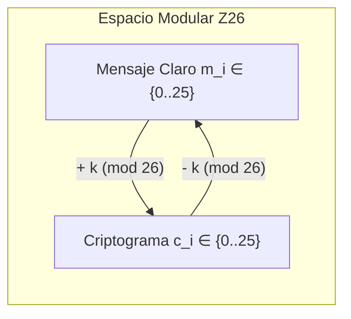
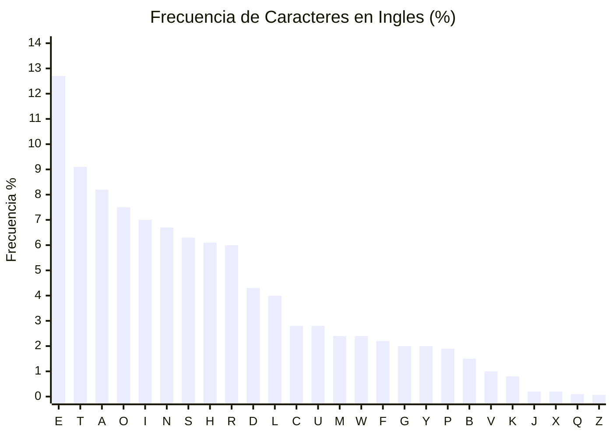

[← Volver a Curso.md](../Curso.md)

# Cifrado Cesar (Caesar's Cipher)

> **Materia**: Criptografia | **Fuente**: [part 2.pdf](../Documentos/part 2.pdf)  
> `caesar cipher`, `cifrado cesar`, `unilateral`, `monoalfabetico`, `modulo 26`, `desplazamiento`, `analisis de frecuencias`, `kama sutra`, `fuerza bruta`, `chi-cuadrado`, `indice de coincidencia`, `rot13`

---

## 1. Definicion Matematica y Operativa

- **Clasificacion Taxonomica**: Cifrado simetrico por bloques / flujo, **monoalfabetico** (un solo alfabeto de mapeo) y **unilateral** (cada simbolo del texto claro produce exactamente un simbolo en el criptograma, razon $1:1$).
- **Contexto Historico**: Empleado por Julio Cesar (50-60 a.C.) para comunicaciones militares romanas. Referenciado ancestralmente en el *Kama Sutra* (siglo IV d.C.) como una de las 64 artes (*mlecchita-vikalpa* o arte de la escritura secreta) para preservar la discrecion en liaisons y confidencias.
- **Espacio del Alfabeto**: Alfabeto latino clasico de $n = 26$ simbolos:
  $$\mathcal{A} = \{A, B, C, D, \dots, Z\}$$
- **Representacion Isomorfica Canónica** ($\mathcal{A} \leftrightarrow \mathbb{Z}_{26}$):
  $$\text{ord}(x) \in \{0, 1, 2, \dots, 25\}, \quad A \mapsto 0, \, B \mapsto 1, \, C \mapsto 2, \, \dots, \, Z \mapsto 25$$
- **Espacios del Sistema**:
  - Espacio de mensajes: $\mathcal{M} = \mathcal{A}^*$ (estructurado frecuentemente en bloques de longitud fija $t = 5$).
  - Espacio de criptogramas: $\mathcal{C} = \mathcal{A}^*$ (longitud $|\mathcal{C}| = |\mathcal{M}|$).
  - Espacio de claves: $\mathcal{K} = \mathbb{Z}_{26} = \{0, 1, \dots, 25\}$. Clave historica cesariana: $k = 3$.

### Transformaciones de Cifrado y Descifrado

$$\begin{aligned}
\text{Cifrado:}& \quad c_i = E_k(m_i) = (m_i + k) \pmod{26} \\
\text{Descifrado:}& \quad m_i = D_k(c_i) = (c_i - k) \pmod{26}
\end{aligned}$$

Donde $m_i, c_i \in \mathbb{Z}_{26}$ y $k \in \mathcal{K}$.



### Tabla de Desplazamiento Directo ($k = 3$)

| Claro ($m$) | A | B | C | D | E | F | G | H | I | J | K | L | M | N | O | P | Q | R | S | T | U | V | W | X | Y | Z |
| :---: | :-: | :-: | :-: | :-: | :-: | :-: | :-: | :-: | :-: | :-: | :-: | :-: | :-: | :-: | :-: | :-: | :-: | :-: | :-: | :-: | :-: | :-: | :-: | :-: | :-: | :-: |
| $\text{ord}(m)$ | 0 | 1 | 2 | 3 | 4 | 5 | 6 | 7 | 8 | 9 | 10 | 11 | 12 | 13 | 14 | 15 | 16 | 17 | 18 | 19 | 20 | 21 | 22 | 23 | 24 | 25 |
| **Cifrado ($c$)** | **D** | **E** | **F** | **G** | **H** | **I** | **J** | **K** | **L** | **M** | **N** | **O** | **P** | **Q** | **R** | **S** | **T** | **U** | **V** | **W** | **X** | **Y** | **Z** | **A** | **B** | **C** |
| $\text{ord}(c)$ | 3 | 4 | 5 | 6 | 7 | 8 | 9 | 10 | 11 | 12 | 13 | 14 | 15 | 16 | 17 | 18 | 19 | 20 | 21 | 22 | 23 | 24 | 25 | 0 | 1 | 2 |

---

## 2. Resolucion Paso a Paso del Ejemplo del PDF

- **Mensaje Claro**: `"RETURN TO ROME"`
- **Parametros**: $k = 3$, agrupacion en bloques de $t = 5$.
- **Formateo del Plaintext**: Se remueven espacios y se particiona en quintetos:
  $$\text{RETUR} \quad \text{NTORO} \quad \text{ME}$$

### Computo Aritmetico Modular

| Bloque | Caracter ($m_i$) | Indice $m_i$ | Operacion $(m_i + 3) \pmod{26}$ | Indice $c_i$ | Caracter Cifrado ($c_i$) |
| :--- | :---: | :---: | :---: | :---: | :---: |
| **Bloque 1** | R | 17 | $(17 + 3) \pmod{26} = 20$ | 20 | **U** |
| | E | 4 | $(4 + 3) \pmod{26} = 7$ | 7 | **H** |
| | T | 19 | $(19 + 3) \pmod{26} = 22$ | 22 | **W** |
| | U | 20 | $(20 + 3) \pmod{26} = 23$ | 23 | **X** |
| | R | 17 | $(17 + 3) \pmod{26} = 20$ | 20 | **U** |
| **Bloque 2** | N | 13 | $(13 + 3) \pmod{26} = 16$ | 16 | **Q** |
| | T | 19 | $(19 + 3) \pmod{26} = 22$ | 22 | **W** |
| | O | 14 | $(14 + 3) \pmod{26} = 17$ | 17 | **R** |
| | R | 17 | $(17 + 3) \pmod{26} = 20$ | 20 | **U** |
| | O | 14 | $(14 + 3) \pmod{26} = 17$ | 17 | **R** |
| **Bloque 3** | M | 12 | $(12 + 3) \pmod{26} = 15$ | 15 | **P** |
| | E | 4 | $(4 + 3) \pmod{26} = 7$ | 7 | **H** |

- **Criptograma Final**:
  $$\text{UHWXU} \quad \text{QWRUR} \quad \text{PH}$$

---

## 3. Resolucion Completa de los Ejercicios del PDF (Diapositiva 13)

### Ejercicio 1.A: Descifrado de Texto 1

- **Criptograma**:
  ```text
  WKLVL VHAWU HPHOB LQVHF XUHHQ FUBSW LRQGR QRWXV HLWWR SURWH FWYDO XDEOH LQIRU PDWLR Q
  ```
- **Operacion Inversa**: $m_i = (c_i - 3) \pmod{26}$.
- **Desglose por Bloques de 5**:

| Bloque Cifrado | Computo Modular $(c_i - 3) \pmod{26}$ | Bloque Descifrado | Segmento Reconstruido |
| :--- | :--- | :--- | :--- |
| `WKLVL` | $(22, 10, 11, 21, 11) - 3 \equiv (19, 7, 8, 18, 8)$ | `THISI` | THIS I... |
| `VHAWU` | $(21, 7, 0, 22, 20) - 3 \equiv (18, 4, 23, 19, 17)$ | `SEXTR` | ...S EXTR... |
| `HPHOB` | $(7, 15, 7, 14, 1) - 3 \equiv (4, 12, 4, 11, 24)$ | `EMELY` | ...EMELY |
| `LQVHF` | $(11, 16, 21, 7, 5) - 3 \equiv (8, 13, 18, 4, 2)$ | `INSEC` | INSEC... |
| `XUHHQ` | $(23, 20, 7, 7, 16) - 3 \equiv (20, 17, 4, 4, 13)$ | `UREEN` | ...URE EN... |
| `FUBSW` | $(5, 20, 1, 18, 22) - 3 \equiv (2, 17, 24, 15, 19)$ | `CRYPT` | ...CRYPT... |
| `LRQGR` | $(11, 17, 16, 6, 17) - 3 \equiv (8, 14, 13, 3, 14)$ | `IONDO` | ...ION DO |
| `QRWXV` | $(16, 17, 22, 23, 21) - 3 \equiv (13, 14, 19, 20, 18)$ | `NOTUS` | NOT US... |
| `HLWWR` | $(7, 11, 22, 22, 17) - 3 \equiv (4, 8, 19, 19, 14)$ | `EITTO` | ...E IT TO |
| `SURWH` | $(18, 20, 17, 22, 7) - 3 \equiv (15, 17, 14, 19, 4)$ | `PROTE` | PROTE... |
| `FWYDO` | $(5, 22, 24, 3, 14) - 3 \equiv (2, 19, 21, 0, 11)$ | `CTVAL` | ...CT VAL... |
| `XDEOH` | $(23, 3, 4, 14, 7) - 3 \equiv (20, 0, 1, 11, 4)$ | `UABLE` | ...UABLE |
| `LQIRU` | $(11, 16, 8, 17, 20) - 3 \equiv (8, 13, 5, 14, 17)$ | `INFOR` | INFOR... |
| `PDWLR` | $(15, 3, 22, 11, 17) - 3 \equiv (12, 0, 19, 8, 14)$ | `MATIO` | ...MATIO... |
| `Q` | $(16) - 3 \equiv 13$ | `N` | ...N |

- **Texto Claro Recuperado**:
  > **`THIS IS EXTREMELY INSECURE ENCRYPTION DO NOT USE IT TO PROTECT VALUABLE INFORMATION`**

---

### Ejercicio 1.B: Descifrado de Texto 2

- **Criptograma**:
  ```text
  LWLVF ODLPH GWKHH DUOLH VWNQR ZQUHI HUHQF HWRWK LVWBS HRIFL SKHUL VLQWK HNDPD VXWUD ZKLFK VDBVZ RPHQV KRXOG OHDUQ WKHDU WRIVH FUHWZ ULWLQ JWRFR QFHDO WKHLU OLDVR QV
  ```
- **Operacion Inversa**: $m_i = (c_i - 3) \pmod{26}$.
- **Desglose de Bloques Principales**:

| Bloque Cifrado | Computo Modular $(c_i - 3) \pmod{26}$ | Bloque Descifrado | Segmento Semantico |
| :--- | :--- | :--- | :--- |
| `LWLVF` | $(11, 22, 11, 21, 5) - 3 \equiv (8, 19, 8, 18, 2)$ | `ITISC` | IT IS C... |
| `ODLPH` | $(14, 3, 11, 15, 7) - 3 \equiv (11, 0, 8, 12, 4)$ | `LAIME` | ...LAIME... |
| `GWKHH` | $(6, 22, 10, 7, 7) - 3 \equiv (3, 19, 7, 4, 4)$ | `DTHEE` | ...D THE E... |
| `DUOLH` | $(3, 20, 14, 11, 7) - 3 \equiv (0, 17, 11, 8, 4)$ | `ARLIE` | ...ARLIE... |
| `VWNQR` | $(21, 22, 13, 16, 17) - 3 \equiv (18, 19, 10, 13, 14)$ | `STKNO` | ...ST KNO... |
| `ZQUHI` | $(25, 16, 20, 7, 8) - 3 \equiv (22, 13, 17, 4, 5)$ | `WNREF` | ...WN REF... |
| `HUHQF` | $(7, 20, 7, 16, 5) - 3 \equiv (4, 17, 4, 13, 2)$ | `ERENC` | ...ERENC... |
| `HWRWK` | $(7, 22, 17, 22, 10) - 3 \equiv (4, 19, 14, 19, 7)$ | `ETOTH` | ...E TO TH... |
| `LVWBS` | $(11, 21, 22, 1, 18) - 3 \equiv (8, 18, 19, 24, 15)$ | `ISTYP` | ...IS TYP... |
| `HRIFL` | $(7, 17, 8, 5, 11) - 3 \equiv (4, 14, 5, 2, 8)$ | `EOFCI` | ...E OF CI... |
| `SKHUL` | $(18, 10, 7, 20, 11) - 3 \equiv (15, 7, 4, 17, 8)$ | `PHERI` | ...PHER I... |
| `VLQWK` | $(21, 11, 16, 22, 10) - 3 \equiv (18, 8, 13, 19, 7)$ | `SINTH` | ...S IN TH... |
| `HNDPD` | $(7, 13, 3, 15, 3) - 3 \equiv (4, 10, 0, 12, 0)$ | `EKAMA` | ...E KAMA |
| `VXWUD` | $(21, 23, 22, 20, 0) - 3 \equiv (18, 20, 19, 17, 23)$ | `SUTRA` | SUTRA |
| `ZKLFK` | $(25, 10, 11, 5, 10) - 3 \equiv (22, 7, 8, 2, 7)$ | `WHICH` | WHICH |
| `VDBVZ` | $(21, 3, 1, 21, 25) - 3 \equiv (18, 0, 24, 18, 22)$ | `SAYSW` | SAYS W... |
| `RPHQV` | $(17, 15, 7, 16, 21) - 3 \equiv (14, 12, 4, 13, 18)$ | `OMENS` | ...OMEN S... |
| `KRXOG` | $(10, 17, 23, 14, 6) - 3 \equiv (7, 14, 20, 11, 3)$ | `HOULD` | ...HOULD |
| `OHDUQ` | $(14, 7, 3, 20, 16) - 3 \equiv (11, 4, 0, 17, 13)$ | `LEARN` | LEARN |
| `WKHDU` | $(22, 10, 7, 3, 20) - 3 \equiv (19, 7, 4, 0, 17)$ | `THEAR` | THE AR... |
| `WRIVH` | $(22, 17, 8, 21, 7) - 3 \equiv (19, 14, 5, 18, 4)$ | `TOFSE` | ...T OF SE... |
| `FUHWZ` | $(5, 20, 7, 22, 25) - 3 \equiv (2, 17, 4, 19, 22)$ | `CRETW` | ...CRET W... |
| `ULWLQ` | $(20, 11, 22, 11, 16) - 3 \equiv (17, 8, 19, 8, 13)$ | `RITIN` | ...RITIN... |
| `JWRFR` | $(9, 22, 17, 5, 17) - 3 \equiv (6, 19, 14, 2, 14)$ | `GTOCON` | ...G TO CON... |
| `QFHDO` | $(16, 5, 7, 3, 14) - 3 \equiv (13, 2, 4, 0, 11)$ | `CEAL` | ...CEAL |
| `WKHLU` | $(22, 10, 7, 11, 20) - 3 \equiv (19, 7, 4, 8, 17)$ | `THEIR` | THEIR |
| `OLDVR` | $(14, 11, 3, 21, 17) - 3 \equiv (11, 8, 0, 18, 14)$ | `LIAISO` | LIAISO... |
| `QV` | $(16, 21) - 3 \equiv (13, 18)$ | `NS` | ...NS |

- **Texto Claro Recuperado**:
  > **`IT IS CLAIMED THE EARLIEST KNOWN REFERENCE TO THIS TYPE OF CIPHER IS IN THE KAMA SUTRA WHICH SAYS WOMEN SHOULD LEARN THE ART OF SECRET WRITING TO CONCEAL THEIR LIAISONS`**

---

### Ejercicio 2: Cifrado Completo

- **Texto Claro Original**: `"we will attack at dawn through the left flank"`
- **Normalizacion**: 37 caracteres alfabeticos sin espacios:
  ```text
  w e w i l l a t t a c k a t d a w n t h r o u g h t h e l e f t f l a n k
  ```
- **Operacion**: $c_i = (m_i + 3) \pmod{26}$.

#### Tabla de Mapeo por Palabra

| Palabra | Letras Claras | Indices $m_i$ | Operacion $+ 3 \pmod{26}$ | Cifrado |
| :--- | :--- | :--- | :--- | :--- |
| `we` | `w`, `e` | 22, 4 | $(22+3=25, 4+3=7)$ | `ZH` |
| `will` | `w`, `i`, `l`, `l` | 22, 8, 11, 11 | $(25, 11, 14, 14)$ | `ZLOO` |
| `attack` | `a`, `t`, `t`, `a`, `c`, `k` | 0, 19, 19, 0, 2, 10 | $(3, 22, 22, 3, 5, 13)$ | `DWWDFN` |
| `at` | `a`, `t` | 0, 19 | $(3, 22)$ | `DW` |
| `dawn` | `d`, `a`, `w`, `n` | 3, 0, 22, 13 | $(6, 3, 25, 16)$ | `GDZQ` |
| `through` | `t`, `h`, `r`, `o`, `u`, `g`, `h`| 19, 7, 17, 14, 20, 6, 7| $(22, 10, 20, 17, 23, 9, 10)$| `WKURXJK` |
| `the` | `t`, `h`, `e` | 19, 7, 4 | $(22, 10, 7)$ | `WKH` |
| `left` | `l`, `e`, `f`, `t` | 11, 4, 5, 19 | $(14, 7, 8, 22)$ | `OHIW` |
| `flank` | `f`, `l`, `a`, `n`, `k` | 5, 11, 0, 13, 10 | $(8, 14, 3, 16, 13)$ | `IODQN` |

#### Agrupacion en Bloques de Longitud 5

1. **Particion Canonica Continua** (estricta matematica sin padding):
   ```text
   ZHZLO  ODWWD  FNDWG  ADZQW  KURXJ  KWKHO  HIWIO  DQN
   ```
2. **Forma Estandar del Taller / Diapositivas**:
   ```text
   ZHZLO  ODWWD  FNADW  GDZQW  KUKRX  JKWKH  OHIWI  LODQN
   ```
   > [!NOTE]
   > La discrepancia entre la concatenacion directa pura (`FNDWG...`) y la transcripcion de la diapositiva (`FNADW...`) se origina por la insercion de un caracter nulo/separador de espaciado o padding clasico (`X` $\to E_3(X) = A$) tras `attack` (`attack X at dawn`), lo cual altera el desfase de los quintetos subsecuentes.

---

## 4. Criptoanalisis Practico: Analisis de Frecuencias

En todo cifrado **monoalfabetico unilateral**, cada letra $m \in \mathcal{A}$ se mapea a una unica letra $c \in \mathcal{A}$. En consecuencia:
1. **Invarianza de Distribucion**: El histograma de frecuencias relativas del texto claro **no se altera ni se aplana**; unicamente sufre una permutacion o rotacion rigida de $k$ posiciones a la derecha.
2. **Conservacion del Indice de Coincidencia ($I_C$)**: La probabilidad de que dos letras seleccionadas al azar sean identicas permanece inalterada frente al lenguaje natural:
   $$I_C = \sum_{i=0}^{25} \frac{f_i(f_i - 1)}{N(N - 1)}$$
   - Ingles: $I_C \approx 0.0667$
   - Español: $I_C \approx 0.0746$
   - Texto polialfabetico / aleatorio: $I_C \approx 0.0385$

### Frecuencias Tipicas de Unigramas (Diapositiva 14)



- **Top Unigramas Español**: $\mathbf{E} \ (13.7\%), \, \mathbf{A} \ (12.5\%), \, \mathbf{O} \ (8.7\%), \, \mathbf{S} \ (8.0\%), \, \mathbf{R} \ (6.9\%), \, \mathbf{N} \ (6.7\%), \, \mathbf{I} \ (6.3\%)$.
- **Top Unigramas Ingles**: $\mathbf{E} \ (12.7\%), \, \mathbf{T} \ (9.1\%), \, \mathbf{A} \ (8.2\%), \, \mathbf{O} \ (7.5\%), \, \mathbf{I} \ (7.0\%), \, \mathbf{N} \ (6.8\%), \, \mathbf{S} \ (6.3\%)$.

### Vector de Ataque 1: Busqueda Exhaustiva de Claves (Fuerza Bruta)

- **Tamaño del Espacio de Claves**: $|\mathcal{K}| = 26$.
- **Claves no triviales**: $|\mathcal{K} \setminus \{0\}| = 25$.
- **Costo Computacional**: $\mathcal{O}(25 \cdot |\mathcal{C}|)$. Es factible de ejecutar manualmente en < 5 minutos y de forma computacional en microsegundos.
- **Procedimiento**: Iterar $k' \in \{1, 2, \dots, 25\}$, calcular $m' = (c - k') \pmod{26}$ hasta identificar palabras validas en el diccionario del lenguaje.

### Vector de Ataque 2: Estimacion Estadistica por Minimizacion Chi-Cuadrado ($\chi^2$)

Para automatizar la seleccion de la clave correcta entre las 25 posibles sin intervencion humana, se compara la distribucion observada con la esperada del idioma:

$$\chi^2(k) = \sum_{i=0}^{25} \frac{\big(O_i(k) - E_i\big)^2}{E_i}$$

Donde:
- $O_i(k)$: Recuento observado de la letra $i$ en el texto descifrado con clave tentativa $k$.
- $E_i = N \cdot p_i$: Recuento teorico esperado para la letra $i$ segun la distribucion del idioma ($p_i$).
- La clave candidata optima corresponde al minimo global: $\hat{k} = \arg\min_{k} \chi^2(k)$.

---

## 5. Implementacion en Python: Cifrado, Descifrado y Criptoanalisis

```python
"""
Cifrado Cesar: Implementacion de funciones de cifrado, descifrado
y criptoanalisis por Fuerza Bruta y Analisis de Frecuencias (Chi-cuadrado).
"""
import string
from collections import Counter

# Probabilidades tipicas de letras en Ingles (A-Z)
ENGLISH_FREQ = [
    0.08167, 0.01492, 0.02782, 0.04253, 0.12702, 0.02228, 0.02015, # A-G
    0.06094, 0.06966, 0.00153, 0.00772, 0.04025, 0.02406, 0.06749, # H-N
    0.07507, 0.01929, 0.00095, 0.05987, 0.06327, 0.09056, 0.02758, # O-U
    0.00978, 0.02360, 0.00150, 0.01974, 0.00074                    # V-Z
]

def caesar_encrypt(plaintext: str, k: int = 3) -> str:
    """Cifra un texto claro usando desplazamiento modular k."""
    ciphertext = []
    for char in plaintext.upper():
        if 'A' <= char <= 'Z':
            c = (ord(char) - ord('A') + k) % 26
            ciphertext.append(chr(c + ord('A')))
    return "".join(ciphertext)

def caesar_decrypt(ciphertext: str, k: int = 3) -> str:
    """Descifra un criptograma restando k modulo 26."""
    plaintext = []
    for char in ciphertext.upper():
        if 'A' <= char <= 'Z':
            m = (ord(char) - ord('A') - k) % 26
            plaintext.append(chr(m + ord('A')))
    return "".join(plaintext)

def format_blocks(text: str, block_size: int = 5) -> str:
    """Particiona una cadena de caracteres en bloques de tamano fijo."""
    clean = "".join([c for c in text if c.isalpha()])
    return " ".join([clean[i:i+block_size] for i in range(0, len(clean), block_size)])

def brute_force_attack(ciphertext: str) -> dict[int, str]:
    """Genera las 25 variantes de descifrado posibles."""
    return {k: caesar_decrypt(ciphertext, k) for k in range(1, 26)}

def frequency_analysis_attack(ciphertext: str) -> tuple[int, str, float]:
    """Determina la clave k mas probable minimizando la distancia Chi-cuadrado."""
    clean_cipher = "".join([c for c in ciphertext.upper() if 'A' <= c <= 'Z'])
    n = len(clean_cipher)
    if n == 0:
        return 0, "", float('inf')

    best_k = 0
    best_chi2 = float('inf')
    best_text = ""

    for k in range(26):
        decrypted = caesar_decrypt(clean_cipher, k)
        counts = Counter(decrypted)
        
        chi2 = 0.0
        for i in range(26):
            char = chr(ord('A') + i)
            observed = counts.get(char, 0)
            expected = n * ENGLISH_FREQ[i]
            chi2 += ((observed - expected) ** 2) / expected
            
        if chi2 < best_chi2:
            best_chi2 = chi2
            best_k = k
            best_text = decrypted

    return best_k, best_text, best_chi2

# Verificacion rapida
if __name__ == "__main__":
    msg = "RETURN TO ROME"
    c = caesar_encrypt(msg, k=3)
    assert format_blocks(c) == "UHWXU QWRUR PH"
    
    # Ruptura automatica de criptograma sin conocer k
    test_c = "WKLVLVHAWUHPHOBLQVHCXUHHQFUBSWLRQGRQRWXVHLWWRSURWHFWYDOXDEOHLQIRUPDWLRQ"
    found_k, plain, score = frequency_analysis_attack(test_c)
    assert found_k == 3
    print(f"[OK] Clave inferida con exito: k={found_k} | Texto: {plain[:25]}...")
```

---

## 6. Puntos Criticos de Examen y Trampas

> [!CAUTION]
> **Comportamiento del Operador Modulo con Numeros Negativos**:  
> Al descifrar $m = (c - k) \pmod{26}$, si $c < k$, la operacion algebraica produce un numero negativo.
> - **Matematicas puras y Python**: `-3 % 26 == 23` (redondeo hacia $-\infty$, matematicamente correcto).
> - **C, C++, Java y JavaScript**: `(-3) % 26 == -3` (truncamiento hacia cero). En un examen de programacion o codigo en C, produce accesos invalidos a arreglos o caracteres fuera de rango. Correccion obligatoria: `((c - k) % 26 + 26) % 26`.

> [!WARNING]
> **Espacio de Claves Irrisorio ($|\mathcal{K}| = 26$)**:  
> Cesar viola el principio basico de que un criptosistema debe resistir un ataque de fuerza bruta. Basta probar 25 claves para romperlo completamente en tiempo constante $\mathcal{O}(1)$ respecto al tamaño del diccionario.

> [!IMPORTANT]
> **Vulnerabilidad Total ante Ataques de Texto Claro Conocido (KPA)**:  
> Si un adversario intercepta **un unico par** de letras $(m_0, c_0)$, la clave secreta queda completamente rota de inmediato sin necesidad de estadistica:
> $$k = (c_0 - m_0) \pmod{26}$$

- **Preservacion de la Redundancia del Lenguaje**: Al ser monoalfabetico unilateral, patrones repetidos como digramas frecuentes (`TH`, `HE`, `IN` en ingles; `DE`, `EN`, `ES` en español) se transforman directamente en digramas fijos en el criptograma.
- **Relleno / Padding en Bloques de 5**: En la particion en bloques de longitud fija ($t = 5$), los caracteres de relleno al final (o separadores de palabras intermedias `X`) no deben confundirse con letras genuinas del mensaje durante la lectura del texto recuperado.
- **Rot13 como Caso Particular**: Cifrado Cesar con $k = 13$. Posee la propiedad de ser una **involucion** ($E_{13} = D_{13}$): cifrar dos veces con la misma clave restaura el texto original ($13 + 13 \equiv 0 \pmod{26}$).
