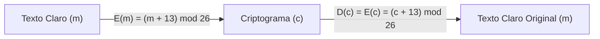
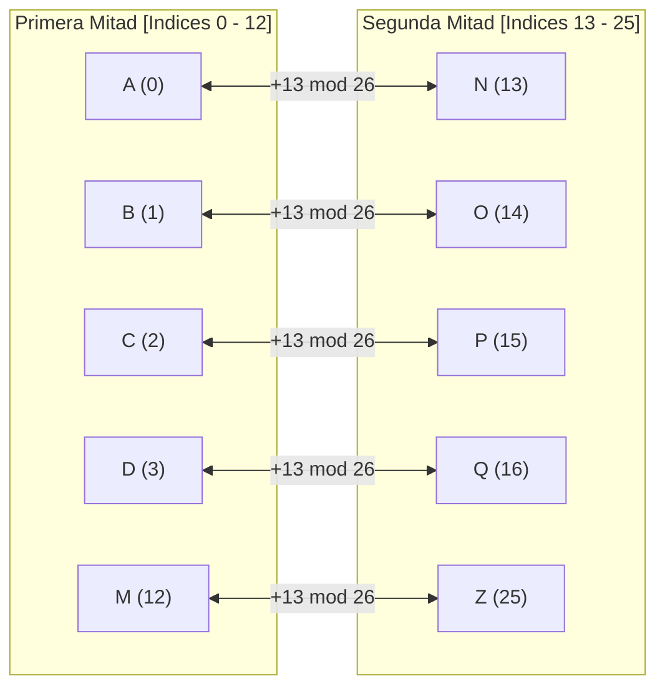

[← Volver a Curso.md](../Curso.md)

# Cifrado ROT13 (Rot13 Cipher)

> **Materia**: Criptografia | **Fuente**: [part 2.pdf](../Documentos/part 2.pdf)  
> `rot13`, `cifrado cesar k=13`, `involutivo`, `autoinverso`, `usenet`, `ofuscacion`, `monoalfabetico unilateral`

---

## 1. Fundamento Operativo y Propiedad Involutiva

- **Clasificacion**: Criptosistema clasico simetrico, **monoalfabetico unilateral** (cada simbolo del alfabeto plano $\mathcal{A}$ se transforma en exactamente un unico simbolo en $\mathcal{C}$).
- **Definicion**: Caso particular del **Cifrado Cesar** con desplazamiento estatico predefinido $k = 13$ sobre el alfabeto ingles internacional de $n = 26$ caracteres ($A=0, B=1, \dots, Z=25$):
  $$k = \frac{n}{2} = \frac{26}{2} = 13$$
- **Propiedad Involutiva (Autoinversa)**:
  - **Cifrado**:
    $$E(m) = (m + 13) \pmod{26}$$
  - **Descifrado**:
    $$D(c) = (c - 13) \pmod{26} \equiv (c + 13) \pmod{26}$$
  - Como $-13 \equiv +13 \pmod{26}$, se cumple formalmente:
    $$E(E(m)) = ((m + 13) + 13) \pmod{26} = (m + 26) \pmod{26} \equiv m \pmod{26}$$
    $$\implies D(c) = E(c)$$
- **Simetria Algoritmica**: No se requiere codigo ni circuiteria independiente para descifrar; la misma rutina que encripta desencripta.



### Tabla de Sustitucion Reciproca

La biseccion exacta de $\mathbb{Z}_{26}$ produce pares complementarios bidireccionales:

| Indice ($0 \dots 12$) | A | B | C | D | E | F | G | H | I | J | K | L | M |
| :---: | :---: | :---: | :---: | :---: | :---: | :---: | :---: | :---: | :---: | :---: | :---: | :---: | :---: |
| **Equivalencia ($\leftrightarrow$)** | **N** | **O** | **P** | **Q** | **R** | **S** | **T** | **U** | **V** | **W** | **X** | **Y** | **Z** |
| Indice ($13 \dots 25$) | 13 | 14 | 15 | 16 | 17 | 18 | 19 | 20 | 21 | 22 | 23 | 24 | 25 |



---

## 2. Resolucion de Ejemplos del PDF (Diapositiva 15)

- **Origen y Proposito**: Surgio en foros de **USENET** (`net.jokes`, mediados de los 80s) para ocultar remates de chistes (*punchlines*), soluciones de acertijos, spoilers de peliculas y contenido potencialmente ofensivo frente a lecturas involuntarias.
- **Analogia de USENET**: "*Equivalente en Usenet de una revista que imprime la solucion de un crucigrama de cabeza*".

### Pares de Palabras Involutivas (Diapositiva 15)

Palabras validas en ingles que al aplicarles $ROT13$ se transforman en otras palabras lexicas validas:

| Texto 1 | Texto 2 ($ROT13$) | Texto 1 | Texto 2 ($ROT13$) |
| :--- | :--- | :--- | :--- |
| `aha` | `nun` | `envy` | `rail` |
| `ant` | `nag` | `er` | `re` |
| `balk` | `onyx` | `errs` | `reef` |
| `bar` | `one` | `flap` | `sync` |
| `barf` | `ones` | `fur` | `she` |
| `be` | `or` | `gel` | `try` |
| `bin` | `ova` | `gnat` | `tang` |
| `ebbs` | `roof` | `irk` | `vex` |

### Demostracion Matematica Detallada

| Palabra Original | Caracter | Valor $m$ | Operacion $(m + 13) \pmod{26}$ | Valor Cifrado | Caracter Resultante | Salida |
| :--- | :---: | :---: | :---: | :---: | :---: | :--- |
| **`aha`** | `a`<br>`h`<br>`a` | 0<br>7<br>0 | $(0 + 13) \bmod 26 = 13$<br>$(7 + 13) \bmod 26 = 20$<br>$(0 + 13) \bmod 26 = 13$ | 13<br>20<br>13 | `n`<br>`u`<br>`n` | **`nun`** |
| **`envy`** | `e`<br>`n`<br>`v`<br>`y` | 4<br>13<br>21<br>24 | $(4 + 13) \bmod 26 = 17$<br>$(13 + 13) \bmod 26 = 0$<br>$(21 + 13) \bmod 26 = 34 \equiv 8$<br>$(24 + 13) \bmod 26 = 37 \equiv 11$ | 17<br>0<br>8<br>11 | `r`<br>`a`<br>`i`<br>`l` | **`rail`** |
| **`irk`** | `i`<br>`r`<br>`k` | 8<br>17<br>10 | $(8 + 13) \bmod 26 = 21$<br>$(17 + 13) \bmod 26 = 30 \equiv 4$<br>$(10 + 13) \bmod 26 = 23$ | 21<br>4<br>23 | `v`<br>`e`<br>`x` | **`vex`** |

---

## 3. Resolucion Completa del Ejercicio del PDF

> **Enunciado**:  
> *Decrypt `VSGUR AFNUN FGVZR GBERN QZLRZ NVYVJ VFUGU RLFRA QZRNO YBBQL`*

### Descomposicion Bloque a Bloque (Bloques de 5 caracteres)

Se aplica la transformacion $D(c) = (c + 13) \pmod{26}$ a cada posicion:

| Bloque Cifrado | Letras Cifradas | Valores Numericos ($c$) | $(c + 13) \pmod{26}$ | Letras Claras | Texto Segmentado |
| :---: | :---: | :---: | :---: | :---: | :--- |
| **1** | `V S G U R` | 21, 18, 6, 20, 17 | 8, 5, 19, 7, 4 | `I F T H E` | `IF THE` |
| **2** | `A F N U N` | 0, 5, 13, 20, 13 | 13, 18, 0, 7, 0 | `N S A H A` | `NSA HA` |
| **3** | `F G V Z R` | 5, 6, 21, 25, 17 | 18, 19, 8, 12, 4 | `S T I M E` | `S TIME` |
| **4** | `G B E R N` | 6, 1, 4, 17, 13 | 19, 14, 17, 4, 0 | `T O R E A` | `TO REA` |
| **5** | `Q Z L R Z` | 16, 25, 11, 17, 25 | 3, 12, 24, 4, 12 | `D M Y E M` | `D MY EM` |
| **6** | `N V Y V J` | 13, 21, 24, 21, 9 | 0, 8, 11, 8, 22 | `A I L I W` | `AIL I W` |
| **7** | `V F U G U` | 21, 5, 20, 6, 20 | 8, 18, 7, 19, 7 | `I S H T H` | `ISH TH` |
| **8** | `R L F R A` | 17, 11, 5, 17, 0 | 4, 24, 18, 4, 13 | `E Y S E N` | `EY SEN` |
| **9** | `Q Z R N O` | 16, 25, 17, 13, 14 | 3, 12, 4, 0, 1 | `D M E A B` | `D ME A B` |
| **10** | `Y B B Q L` | 24, 1, 1, 16, 11 | 11, 14, 14, 3, 24 | `L O O D Y` | `LOODY` |

### Concatenacion y Reconstruccion Lexica

- **Cadena Continua Descifrada**:  
  `IFTHENSAHASTIMETOREADMYEMAILIWISHTHEYSENDMEABLOODY`
- **Separacion Semantica en Ingles**:  
  **`"IF THE NSA HAS TIME TO READ MY EMAIL I WISH THEY SEND ME A BLOODY"`**  
  *(Cita clasica de USENET que ironiza sobre la vigilancia de la agencia y la lentitud de respuesta).*

---

## 4. Implementacion en Python

```python
import codecs

# 1. Utilizando libreria estandar de Python (optimo y nativo)
def rot13_stdlib(text: str) -> str:
    """Aplica ROT13 sobre la cadena usando el codec nativo."""
    return codecs.decode(text, 'rot_13')

# 2. Implementacion algoritmica pura con aritmetica modular
def rot13_manual(text: str) -> str:
    """
    Transforma caracteres A-Z y a-z mediante adicion modular base 26.
    Preserva intactos espacios, signos y caracteres fuera del alfabeto basico.
    """
    output = []
    for char in text:
        if 'A' <= char <= 'Z':
            base = ord('A')
            output.append(chr((ord(char) - base + 13) % 26 + base))
        elif 'a' <= char <= 'z':
            base = ord('a')
            output.append(chr((ord(char) - base + 13) % 26 + base))
        else:
            output.append(char)
    return ''.join(output)

# 3. Verificacion de propiedades operativas
if __name__ == "__main__":
    ciphertext = "VSGUR AFNUN FGVZR GBERN QZLRZ NVYVJ VFUGU RLFRA QZRNO YBBQL"
    expected = "IFTHE NSAHA STIME TOREA DMYEM AILIW ISHTH EYSEN DMEAB LOODY"
    
    decrypted = rot13_manual(ciphertext)
    assert decrypted == expected
    
    # Comprobacion de automapeo e involucion: ROT13(ROT13(x)) == x
    restored = rot13_manual(decrypted)
    assert restored == ciphertext
    print("Descifrado verificado con exito:", decrypted)
```

---

## 5. Casos Trampa y Puntos Criticos de Examen

- **Seguridad Criptografica Nula**:
  - El espacio de claves es trivial: $|\mathcal{K}| = 1$ ($k=13$ fijo por definicion).
  - Viola frontalmente el **Principio de Kerckhoffs**: el algoritmo no depende de una clave secreta variable.
  - No provee **confidencialidad**; unicamente provee **ofuscacion** basica frente a lectura incidental humana.
- **Vulnerabilidad a Analisis de Frecuencia**:
  - Al ser monoalfabetico, preserva con exactitud el perfil de frecuencias del lenguaje (la letra mas repetida en texto claro sigue siendo la mas repetida en criptograma, solo desplazada 13 casillas).
- **Involucion Directa en Enunciados**:
  - Si un ejercicio de examen pide "desarrollar un modulo de descifrado ROT13", cualquier codigo que altere la resta modular o intente bifurcar logica es innecesario: ejecutar la misma funcion de cifrado resuelve el problema.
- **Tratamiento de Caracteres Fuera de $\mathbb{Z}_{26}$**:
  - Caracteres del español (`Ñ`, `ñ`, vocales con tilde `Á`, `É`, `Í`, `Ó`, `Ú`) **no entran** en la formula $\pmod{26}$. En implementaciones convencionales pasan sin modificar, generando fugas de informacion estructural.
  - Para cubrir el rango ASCII completo imprimible existe la variante **ROT47** (desplazamiento de 47 posiciones sobre 94 caracteres ASCII, del caracter 33 al 126).
- **Diferencia Critica: ROT13 vs Cifrado Cesar**:
  - **Cesar**: Algoritmo general parametrico con $|\mathcal{K}| = 25$ claves posibles ($k \in \{1, \dots, 25\}$). Requiere probar claves o criptoanalizar.
  - **ROT13**: Instancia fija y estandarizada de Cesar donde $k = 13$, garantizando automapeo sin parametro de configuracion.
