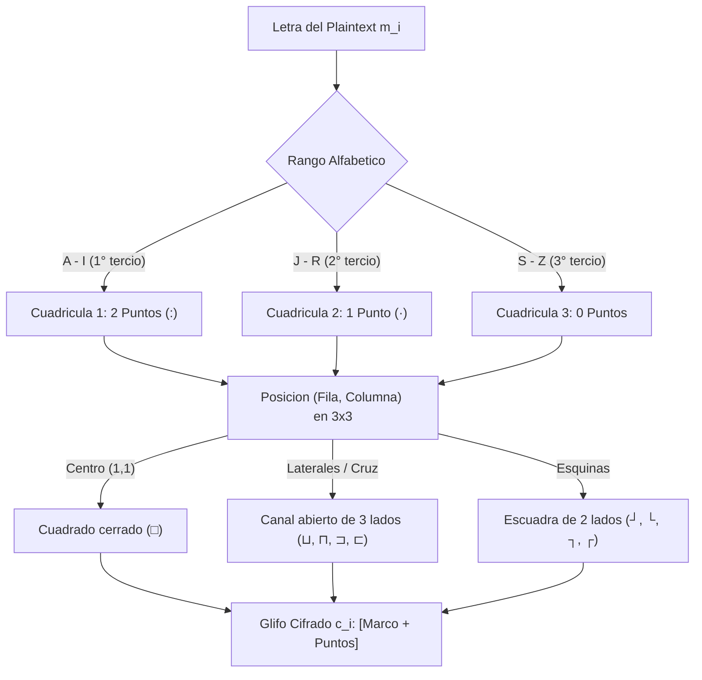
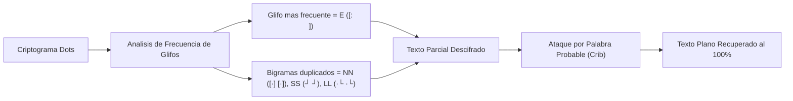

[← Volver a Curso.md](../Curso.md)

# Cifrado de Puntos (Dots Cipher)

> **Materia**: Criptografia | **Fuente**: [part 2.pdf](../Documentos/part 2.pdf)  
> `dots cipher`, `cifrado de puntos`, `pigpen`, `unilateral`, `monoalfabetico`, `sustitucion geometrica`, `simbolos graficos`

---

## 1. Arquitectura de la Cuadricula y Reglas de Sustitucion

- **Clasificacion Criptografica**: Cifrado de sustitucion **monoalfabetico unilateral** ($m_i \in \mathcal{M} \xrightarrow{1:1} c_i \in \mathcal{C}$, donde cada unidad de texto cifrado tiene longitud de exactamente un glifo grafico).
- **Mecanismo Operativo**: Variante geometrica basada en la particion del alfabeto en tres matrices cuadradas de $3 \times 3$. Cada letra queda unicamente determinada por dos componentes ortogonales:
  1. **Marco geometrico exterior**: Fronteras y bordes circundantes de la celda dentro de la cuadricula $3 \times 3$.
  2. **Densidad de puntos diacriticos**: Cantidad de puntos en el interior del marco que indica la cuadricula de origen.



---

### Cuadriculas de Referencia ($3 \times 3$)

El alfabeto de 26 letras se distribuye en orden secuencial lexicografico sobre tres cuadriculas de 9 posiciones ($3 \times 9 = 27$ celdas; la ultima celda de la tercera cuadricula queda vacia):

#### Cuadricula 1 — Dos Puntos (`:`, Colon Vertical)
```text
  A: | B: | C:
 ----+----+----
  D: | E: | F:
 ----+----+----
  G: | H: | I:
```

#### Cuadricula 2 — Un Punto Central (`·`, Middot)
```text
  J· | K· | L·
 ----+----+----
  M· | N· | O·
 ----+----+----
  P· | Q· | R·
```

#### Cuadricula 3 — Cero Puntos (Sin Marcas Diacriticas)
```text
  S  | T  | U 
 ----+----+----
  V  | W  | X 
 ----+----+----
  Y  | Z  | (vacio)
```

---

### Reglas Geometricas de Contorno

Las lineas que componen el glifo corresponden estrictamente a las fronteras interiores de la cuadricula de tres en raya (`#`) que rodean la celda respectiva:

```text
       Col 0      Col 1      Col 2
    ┌──────────┬──────────┬──────────┐
    │          │          │          │
F 0 │  (0,0)   │  (0,1)   │  (0,2)   │
    │  [┘]     │  [⊔]     │  [└]     │
    ├──────────┼──────────┼──────────┤
    │          │          │          │
F 1 │  (1,0)   │  (1,1)   │  (1,2)   │
    │  [⊐]     │  [□]     │  [⊏]     │
    ├──────────┼──────────┼──────────┤
    │          │          │          │
F 2 │  (2,0)   │  (2,1)   │  (2,2)   │
    │  [┐]     │  [⊓]     │  [┌]     │
    └──────────┴──────────┴──────────┘
```

| Tipo de Celda | Posicion $(r, c)$ | Bordes Cerrados | Lados Abiertos | Silueta de Marco | Glifo Base |
| :--- | :---: | :--- | :--- | :---: | :---: |
| **Esquina Sup-Izq** | $(0, 0)$ | Derecha, Inferior | Superior, Izquierdo | Escuadra $\lrcorner$ | `┘` |
| **Lateral Sup-Centro** | $(0, 1)$ | Izquierda, Inferior, Derecha | Superior | Canal `U` / $\sqcup$ | `|_|` |
| **Esquina Sup-Der** | $(0, 2)$ | Izquierda, Inferior | Superior, Derecho | Escuadra $\llcorner$ | `└` |
| **Lateral Med-Izq** | $(1, 0)$ | Superior, Derecha, Inferior | Izquierdo | Canal `]` / $\sqsupset$ | `]` |
| **Centro Absoluto** | $(1, 1)$ | Superior, Inferior, Izquierda, Derecha | Ninguno (Cerrado) | Caja $\square$ | `□` |
| **Lateral Med-Der** | $(1, 2)$ | Superior, Izquierda, Inferior | Derecho | Canal `[` / $\sqsubset$ | `[` |
| **Esquina Inf-Izq** | $(2, 0)$ | Superior, Derecha | Inferior, Izquierdo | Escuadra $\urcorner$ | `┐` |
| **Lateral Inf-Centro** | $(2, 1)$ | Superior, Izquierda, Derecha | Inferior | Canal invertido $\sqcap$ | `|¯|` |
| **Esquina Inf-Der** | $(2, 2)$ | Superior, Izquierda | Inferior, Derecho | Escuadra $\ulcorner$ | `┌` |

---

### Tabla Maestra de Mapeo del Alfabeto

| Letra | Cuadricula | Puntos | Fila, Col | Forma de Marco | Representacion Grafica |
| :---: | :---: | :---: | :---: | :--- | :---: |
| **A** | 1 | 2 (`:`) | $(0, 0)$ | Esquina Sup-Izq (abierta arriba/izq) | `┘:` |
| **B** | 1 | 2 (`:`) | $(0, 1)$ | Lateral Superior (abierta arriba) | `|_:|` |
| **C** | 1 | 2 (`:`) | $(0, 2)$ | Esquina Sup-Der (abierta arriba/der) | `:└` |
| **D** | 1 | 2 (`:`) | $(1, 0)$ | Lateral Izquierdo (abierta izquierda) | `:]` |
| **E** | 1 | 2 (`:`) | $(1, 1)$ | Centro (cuadrado cerrado) | `[: ]` |
| **F** | 1 | 2 (`:`) | $(1, 2)$ | Lateral Derecho (abierta derecha) | `[:` |
| **G** | 1 | 2 (`:`) | $(2, 0)$ | Esquina Inf-Izq (abierta abajo/izq) | `┐:` |
| **H** | 1 | 2 (`:`) | $(2, 1)$ | Lateral Inferior (abierta abajo) | `|¯:|` |
| **I** | 1 | 2 (`:`) | $(2, 2)$ | Esquina Inf-Der (abierta abajo/der) | `┌:` |
| **J** | 2 | 1 (`·`) | $(0, 0)$ | Esquina Sup-Izq (abierta arriba/izq) | `┘·` |
| **K** | 2 | 1 (`·`) | $(0, 1)$ | Lateral Superior (abierta arriba) | `|_·|` |
| **L** | 2 | 1 (`·`) | $(0, 2)$ | Esquina Sup-Der (abierta arriba/der) | `·└` |
| **M** | 2 | 1 (`·`) | $(1, 0)$ | Lateral Izquierdo (abierta izquierda) | `·]` |
| **N** | 2 | 1 (`·`) | $(1, 1)$ | Centro (cuadrado cerrado) | `[·]` |
| **O** | 2 | 1 (`·`) | $(1, 2)$ | Lateral Derecho (abierta derecha) | `[·` |
| **P** | 2 | 1 (`·`) | $(2, 0)$ | Esquina Inf-Izq (abierta abajo/izq) | `┐·` |
| **Q** | 2 | 1 (`·`) | $(2, 1)$ | Lateral Inferior (abierta abajo) | `|¯·|` |
| **R** | 2 | 1 (`·`) | $(2, 2)$ | Esquina Inf-Der (abierta abajo/der) | `┌·` |
| **S** | 3 | 0 | $(0, 0)$ | Esquina Sup-Izq (abierta arriba/izq) | `┘` |
| **T** | 3 | 0 | $(0, 1)$ | Lateral Superior (abierta arriba) | `|_|` |
| **U** | 3 | 0 | $(0, 2)$ | Esquina Sup-Der (abierta arriba/der) | `└` |
| **V** | 3 | 0 | $(1, 0)$ | Lateral Izquierdo (abierta izquierda) | `]` |
| **W** | 3 | 0 | $(1, 1)$ | Centro (cuadrado cerrado) | `□` |
| **X** | 3 | 0 | $(1, 2)$ | Lateral Derecho (abierta derecha) | `[` |
| **Y** | 3 | 0 | $(2, 0)$ | Esquina Inf-Izq (abierta abajo/izq) | `┐` |
| **Z** | 3 | 0 | $(2, 1)$ | Lateral Inferior (abierta abajo) | `|¯|` |

---

## 2. Resolucion Paso a Paso del Ejemplo del PDF

- **Texto Plano**: `WE TALK ABOUT FINNISH SAUNA MANY TIMES LATER`
- **Total de Caracteres**: 38 letras procesadas en 8 palabras independientes.

---

### Desglose Detallado Palabra por Palabra

#### Palabra 1: `WE`
| Letra | Cuadricula | Puntos | Celda $(r, c)$ | Marco Geometrico | Glifo Resultante |
| :---: | :---: | :---: | :---: | :--- | :---: |
| **W** | 3 | 0 | $(1, 1)$ | Centro $\implies$ Caja cerrada | `□` |
| **E** | 1 | 2 (`:`) | $(1, 1)$ | Centro $\implies$ Caja cerrada con colon | `[: ]` |

#### Palabra 2: `TALK`
| Letra | Cuadricula | Puntos | Celda $(r, c)$ | Marco Geometrico | Glifo Resultante |
| :---: | :---: | :---: | :---: | :--- | :---: |
| **T** | 3 | 0 | $(0, 1)$ | Sup-Centro $\implies$ Canal `U` | `|_|` |
| **A** | 1 | 2 (`:`) | $(0, 0)$ | Sup-Izq $\implies$ Escuadra `┘` con colon | `┘:` |
| **L** | 2 | 1 (`·`) | $(0, 2)$ | Sup-Der $\implies$ Escuadra `└` con punto | `·└` |
| **K** | 2 | 1 (`·`) | $(0, 1)$ | Sup-Centro $\implies$ Canal `U` con punto | `|_·|` |

#### Palabra 3: `ABOUT`
| Letra | Cuadricula | Puntos | Celda $(r, c)$ | Marco Geometrico | Glifo Resultante |
| :---: | :---: | :---: | :---: | :--- | :---: |
| **A** | 1 | 2 (`:`) | $(0, 0)$ | Sup-Izq $\implies$ Escuadra `┘` con colon | `┘:` |
| **B** | 1 | 2 (`:`) | $(0, 1)$ | Sup-Centro $\implies$ Canal `U` con colon | `|_:|` |
| **O** | 2 | 1 (`·`) | $(1, 2)$ | Med-Der $\implies$ Canal `[` con punto | `[·` |
| **U** | 3 | 0 | $(0, 2)$ | Sup-Der $\implies$ Escuadra `└` sin puntos | `└` |
| **T** | 3 | 0 | $(0, 1)$ | Sup-Centro $\implies$ Canal `U` sin puntos | `|_|` |

#### Palabra 4: `FINNISH`
| Letra | Cuadricula | Puntos | Celda $(r, c)$ | Marco Geometrico | Glifo Resultante |
| :---: | :---: | :---: | :---: | :--- | :---: |
| **F** | 1 | 2 (`:`) | $(1, 2)$ | Med-Der $\implies$ Canal `[` con colon | `[:` |
| **I** | 1 | 2 (`:`) | $(2, 2)$ | Inf-Der $\implies$ Escuadra `┌` con colon | `┌:` |
| **N** | 2 | 1 (`·`) | $(1, 1)$ | Centro $\implies$ Caja cerrada con punto | `[·]` |
| **N** | 2 | 1 (`·`) | $(1, 1)$ | Centro $\implies$ Caja cerrada con punto | `[·]` |
| **I** | 1 | 2 (`:`) | $(2, 2)$ | Inf-Der $\implies$ Escuadra `┌` con colon | `┌:` |
| **S** | 3 | 0 | $(0, 0)$ | Sup-Izq $\implies$ Escuadra `┘` sin puntos | `┘` |
| **H** | 1 | 2 (`:`) | $(2, 1)$ | Inf-Centro $\implies$ Canal invertido `|¯|` con colon | `|¯:|` |

#### Palabra 5: `SAUNA`
| Letra | Cuadricula | Puntos | Celda $(r, c)$ | Marco Geometrico | Glifo Resultante |
| :---: | :---: | :---: | :---: | :--- | :---: |
| **S** | 3 | 0 | $(0, 0)$ | Sup-Izq $\implies$ Escuadra `┘` sin puntos | `┘` |
| **A** | 1 | 2 (`:`) | $(0, 0)$ | Sup-Izq $\implies$ Escuadra `┘` con colon | `┘:` |
| **U** | 3 | 0 | $(0, 2)$ | Sup-Der $\implies$ Escuadra `└` sin puntos | `└` |
| **N** | 2 | 1 (`·`) | $(1, 1)$ | Centro $\implies$ Caja cerrada con punto | `[·]` |
| **A** | 1 | 2 (`:`) | $(0, 0)$ | Sup-Izq $\implies$ Escuadra `┘` con colon | `┘:` |

#### Palabra 6: `MANY`
| Letra | Cuadricula | Puntos | Celda $(r, c)$ | Marco Geometrico | Glifo Resultante |
| :---: | :---: | :---: | :---: | :--- | :---: |
| **M** | 2 | 1 (`·`) | $(1, 0)$ | Med-Izq $\implies$ Canal `]` con punto | `·]` |
| **A** | 1 | 2 (`:`) | $(0, 0)$ | Sup-Izq $\implies$ Escuadra `┘` con colon | `┘:` |
| **N** | 2 | 1 (`·`) | $(1, 1)$ | Centro $\implies$ Caja cerrada con punto | `[·]` |
| **Y** | 3 | 0 | $(2, 0)$ | Inf-Izq $\implies$ Escuadra `┐` sin puntos | `┐` |

#### Palabra 7: `TIMES`
| Letra | Cuadricula | Puntos | Celda $(r, c)$ | Marco Geometrico | Glifo Resultante |
| :---: | :---: | :---: | :---: | :--- | :---: |
| **T** | 3 | 0 | $(0, 1)$ | Sup-Centro $\implies$ Canal `U` sin puntos | `|_|` |
| **I** | 1 | 2 (`:`) | $(2, 2)$ | Inf-Der $\implies$ Escuadra `┌` con colon | `┌:` |
| **M** | 2 | 1 (`·`) | $(1, 0)$ | Med-Izq $\implies$ Canal `]` con punto | `·]` |
| **E** | 1 | 2 (`:`) | $(1, 1)$ | Centro $\implies$ Caja cerrada con colon | `[: ]` |
| **S** | 3 | 0 | $(0, 0)$ | Sup-Izq $\implies$ Escuadra `┘` sin puntos | `┘` |

#### Palabra 8: `LATER`
| Letra | Cuadricula | Puntos | Celda $(r, c)$ | Marco Geometrico | Glifo Resultante |
| :---: | :---: | :---: | :---: | :--- | :---: |
| **L** | 2 | 1 (`·`) | $(0, 2)$ | Sup-Der $\implies$ Escuadra `└` con punto | `·└` |
| **A** | 1 | 2 (`:`) | $(0, 0)$ | Sup-Izq $\implies$ Escuadra `┘` con colon | `┘:` |
| **T** | 3 | 0 | $(0, 1)$ | Sup-Centro $\implies$ Canal `U` sin puntos | `|_|` |
| **E** | 1 | 2 (`:`) | $(1, 1)$ | Centro $\implies$ Caja cerrada con colon | `[: ]` |
| **R** | 2 | 1 (`·`) | $(2, 2)$ | Inf-Der $\implies$ Escuadra `┌` con punto | `┌·` |

---

### Reconstruccion del Criptograma (Vista Diapositiva 16)

```text
Linea 1:
[W]  [E]       [T]   [A]   [L]   [K]       [A]   [B]   [O]   [U]   [T]       [F]   [I]   [N]   [N]   [I]   [S]   [H]
 □   [: ]      |_|   ┘:    ·└    |_·|      ┘:   |_:|   [·     └    |_|       [:    ┌:   [·]   [·]    ┌:    ┘   |¯:|

Linea 2:
[S]  [A]   [U]   [N]   [A]       [M]   [A]   [N]   [Y]       [T]   [I]   [M]   [E]   [S]       [L]   [A]   [T]   [E]   [R]
 ┘   ┘:     └    [·]   ┘:        ·]    ┘:   [·]    ┐        |_|    ┌:    ·]   [: ]   ┘        ·└    ┘:   |_|   [: ]   ┌·
```

---

## 3. Implementacion en Python

Script autocontenido para modelar el cifrado, descifrado y renderizado matricial de glifos en bloques de 3 lineas:

```python
"""
Modulo de Cifrado y Descifrado Dots Cipher (Sustitucion Monoalfabetica Unilateral).
Implementa representacion simbolica y renderizado de glifos en terminal.
"""

from typing import Dict, Tuple

# Estructura de definicion de marcos: (arriba, medio, abajo)
# Formato 3x3 por caracter:
GLYPH_SHAPES = {
    # Esquinas
    'TL': ("   ", "  |", "──┘"),  # Top-Left: abierta arriba/izq
    'TR': ("   ", "|  ", "└──"),  # Top-Right: abierta arriba/der
    'BL': ("──┐", "  |", "   "),  # Bottom-Left: abierta abajo/izq
    'BR': ("┌──", "|  ", "   "),  # Bottom-Right: abierta abajo/der
    # Laterales / Canales
    'TC': ("   ", "| |", "└──"),  # Top-Center: canal U abierto arriba
    'BC': ("┌──", "| |", "   "),  # Bottom-Center: canal invertido
    'ML': ("──┐", "  |", "──┘"),  # Mid-Left: canal abierto izquierda
    'MR': ("┌──", "|  ", "└──"),  # Mid-Right: canal abierto derecha
    # Centro
    'CC': ("┌─┐", "│ │", "└─┘"),  # Center: caja cerrada 4 bordes
}

DOT_MODIFIERS = {
    2: ":",   # Cuadricula 1: 2 puntos
    1: "·",   # Cuadricula 2: 1 punto central
    0: " ",   # Cuadricula 3: sin puntos
}

# Diccionario maestro: Letra -> (Shape_Key, Num_Dots)
DOTS_MAP: Dict[str, Tuple[str, int]] = {
    # Cuadricula 1 (A-I, 2 puntos)
    'A': ('TL', 2), 'B': ('TC', 2), 'C': ('TR', 2),
    'D': ('ML', 2), 'E': ('CC', 2), 'F': ('MR', 2),
    'G': ('BL', 2), 'H': ('BC', 2), 'I': ('BR', 2),
    # Cuadricula 2 (J-R, 1 punto)
    'J': ('TL', 1), 'K': ('TC', 1), 'L': ('TR', 1),
    'M': ('ML', 1), 'N': ('CC', 1), 'O': ('MR', 1),
    'P': ('BL', 1), 'Q': ('BC', 1), 'R': ('BR', 1),
    # Cuadricula 3 (S-Z, 0 puntos)
    'S': ('TL', 0), 'T': ('TC', 0), 'U': ('TR', 0),
    'V': ('ML', 0), 'W': ('CC', 0), 'X': ('MR', 0),
    'Y': ('BL', 0), 'Z': ('BC', 0),
}

INVERSE_MAP: Dict[Tuple[str, int], str] = {v: k for k, v in DOTS_MAP.items()}

# Representacion compacta Unicode en 1 caracter por glifo
COMPACT_UNICODE: Dict[str, str] = {
    'A': '┘:', 'B': '|_:|', 'C': ':└',
    'D': ':]', 'E': '[:]',  'F': '[:',
    'G': '┐:', 'H': '|¯:|', 'I': '┌:',
    'J': '┘·', 'K': '|_·|', 'L': '·└',
    'M': '·]', 'N': '[·]',  'O': '[·',
    'P': '┐·', 'Q': '|¯·|', 'R': '┌·',
    'S': '┘',  'T': '|_|',  'U': '└',
    'V': ']',  'W': '□',    'X': '[',
    'Y': '┐',  'Z': '|¯|',
}
INVERSE_UNICODE = {v: k for k, v in COMPACT_UNICODE.items()}


def encrypt_dots_compact(text: str) -> str:
    """Cifra a secuencia de glifos Unicode compactos."""
    cipher_tokens = []
    for char in text.upper():
        if char in COMPACT_UNICODE:
            cipher_tokens.append(COMPACT_UNICODE[char])
        elif char == ' ':
            cipher_tokens.append('  ')
        else:
            cipher_tokens.append(char)
    return ' '.join(cipher_tokens)


def decrypt_dots_compact(cipher_tokens_str: str) -> str:
    """Descifra una cadena de tokens separados por espacio."""
    words = cipher_tokens_str.split('   ')
    recovered_words = []
    for word in words:
        tokens = word.strip().split()
        recovered_chars = [INVERSE_UNICODE.get(tok, tok) for tok in tokens]
        recovered_words.append(''.join(recovered_chars))
    return ' '.join(recovered_words)


# Verificacion rapida
if __name__ == "__main__":
    msg = "WE TALK ABOUT FINNISH SAUNA MANY TIMES LATER"
    encrypted = encrypt_dots_compact(msg)
    decrypted = decrypt_dots_compact(encrypted)
    
    print(f"Original : {msg}")
    print(f"Cifrado  : {encrypted}")
    print(f"Descifro : {decrypted}")
    assert decrypted == msg, "Error en consistencia reversible!"
```

---

## 4. Criptoanalisis y Trampas de Examen

### Vulnerabilidad Estructural y Ruptura

- **Naturaleza Unilateral**: A pesar del uso de formas graficas compuestas (marco + puntos), cada letra produce **exactamente un glifo cifrado indivisible**. La funcion de cifrado es un mapeo biyectivo:
  $$\mathcal{E}: \Sigma \leftrightarrow \mathcal{C}, \quad |\Sigma| = 26, \quad |\mathcal{C}| = 26$$
- **Preservacion de Distribucion de Frecuencia**: El cifrado no introduce difusion ni dispersion de redundancia.
  $$\Pr(c_i = \text{Glifo}_k) = \Pr(m_i = \text{Letra}_k)$$
  - El glifo correspondiente a la letra $E$ (cuadrado cerrado con dos puntos `[: ]`) sera el de mayor frecuencia en ingles ($\approx 12.7\%$).
  - Las repeticiones en texto plano se trasladan intactas: en `FINNISH`, la doble $N$ produce de forma inmediata el bigrama identico `[·] [·]`.
- **Ruptura**:
  1. Identificar glifos aislados (en ingles corresponden a `A` $\implies$ `┘:` o `I` $\implies$ `┌:`).
  2. Sustituir las frecuencias maximas por las vocales mas comunes ($E, T, A, O, I, N$).
  3. Reconstruir trigramas frecuentes como `THE` (`|_| |¯:| [: ]`).



---

### Casos Trampa y Preguntas de Evaluacion

1. **Confusion entre Celdas Homologas (Mismo Marco, Distintos Puntos)**:
   - **El marco central (`□`)**:
     * $E \implies$ 2 puntos (`[: ]`)
     * $N \implies$ 1 punto (`[·]`)
     * $W \implies$ 0 puntos (`□`)
     * *Trampa*: Interpretar la presencia o ausencia de puntos de forma invertida altera palabras completas (ej. confundir `WE` con `NE` o `EE`).
   - **El marco superior-central (`|_|`)**:
     * $B \implies$ 2 puntos (`|_:|`)
     * $K \implies$ 1 punto (`|_·|`)
     * $T \implies$ 0 puntos (`|_|`)
   - **El marco superior-izquierdo (`┘`)**:
     * $A \implies$ 2 puntos (`┘:`)
     * $J \implies$ 1 punto (`┘·`)
     * $S \implies$ 0 puntos (`┘`)

2. **Diferenciacion Taxonomica: Unilateral vs. Multilateral**:
   - *Pregunta trampa*: "¿Es el cifrado Dots multilateral dado que requiere dos datos (marco y puntos) para identificar el simbolo?"
   - *Respuesta correcta*: **Falso. Es unilateral**. En la taxonomia de cifrados clasicos, la clasificacion "lateral" depende de la **longitud del bloque cifrado resultante por cada simbolo de entrada**:
     * **Unilateral**: Cada simbolo de texto plano genera **1 solo caracter o simbolo cifrado** (ej. Caesar, Rot13, Dots).
     * **Multilateral (Polifonico)**: Cada simbolo de texto plano genera **2 o mas caracteres cifrados** (ej. Polybius genera pares $(r, c)$, Garbage-in-between inserta caracteres nulos intermedios).

3. **Distincion Frente al Cifrado Pigpen Estandar**:
   - El Pigpen clasico (o Masonico tradicional) utiliza **dos cuadriculas de tres en raya ($3 \times 3$) y dos cruces en aspa ($X$)**, asignando 4 letras a cada aspa ($S, T, U, V$ sin punto y $W, X, Y, Z$ con punto).
   - El **Dots Cipher de la catedra** NO utiliza aspas ($X$): divide el alfabeto en **tres cuadriculas puras de $3 \times 3$** y modula la clave mediante $2$, $1$ y $0$ puntos.
