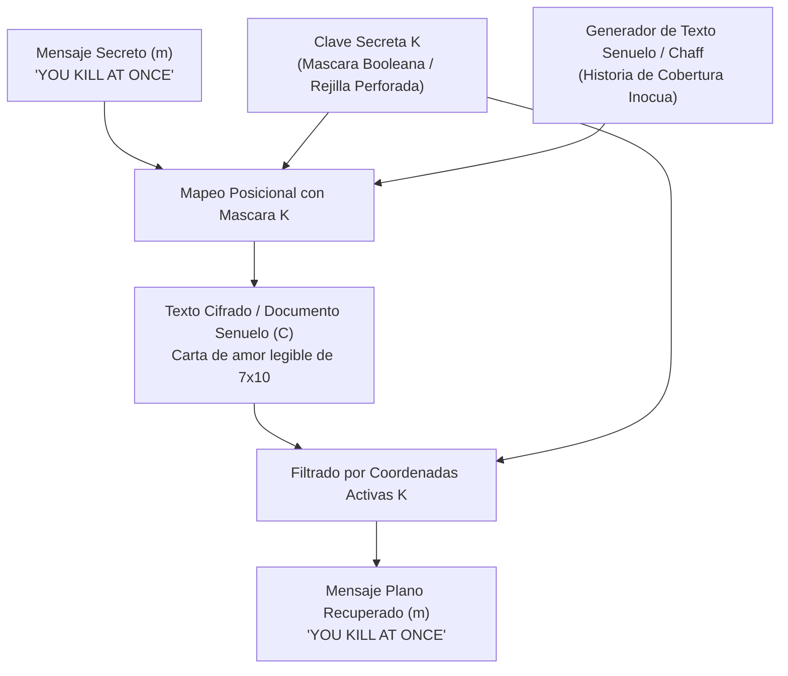

[← Volver a Curso.md](../Curso.md)

# Cifrado Garbage-in-between (Cifrado de Rejilla de Ocultamiento)

> **Materia**: Criptografia | **Fuente**: [part 2.pdf](../Documentos/part 2.pdf)  
> `garbage-in-between`, `cardinal richelieu`, `multilateral`, `polifonico`, `rejilla esteganografica`, `mascara binaria`, `caracteres de relleno`, `chaffing`, `inyeccion de ruido`, `covert story`

---

## 1. Mecanismo Operativo y Clasificacion

- **Origen Historico**: Armand Jean du Plessis, Cardenal Richelieu (Francia, 1626). Creado para comunicaciones diplomaticas y militares encubiertas, protegiendo despachos confidenciales frente a interceptores hostiles.
- **Concepto Fundamental**: El emisor escribe el mensaje confidencial $m$ en posiciones geometricas estrictamente predeterminadas por una clave compartida $K$ (rejilla con aberturas o mascara booleana). Los espacios restantes se rellenan con texto de distraccion (*garbage / chaff / nulls*) redactado deliberadamente para aparentar una carta ordinaria coherente y legitima (*covert story / decoy text*).
- **Clasificacion Criptografica**:
  - **Monoalfabetico**: Los caracteres del mensaje no sufren traslacion numerica ni mapeos de sustitucion alfabetica dinamica ($\mathcal{A} \to \mathcal{A}$).
  - **Multilateral / Polifonico (*Polyphonic*)**: La unidad de informacion de texto claro se encuentra sumergida entre secuencias multilaterales de caracteres espurios. A nivel sintactico, los caracteres del criptograma son "polifonicos" porque un observador sin la clave no puede distinguir si una letra cumple la funcion de senal (texto plano) o de ruido (relleno).



---

## 2. Resolucion Paso a Paso del Ejemplo del PDF (Diapositiva 17)

### Matriz del Criptograma (Carta de Amor Senuelo)
Matriz rectangular de $R = 7$ filas y $C = 10$ columnas (70 caracteres totales, respetando espaciado):

```text
Fila 0:  I     L O V E     Y O U
Fila 1:  I     H A V E     Y O U
Fila 2:  D E E P     U N D E R
Fila 3:  M Y     S K I N     M Y
Fila 4:  L O V E     L A S T S
Fila 5:  F O R E V E R     I N
Fila 6:  H Y P E R S P A C E
```

### Matriz de Clave / Mascara Binaria $K \in \{0, 1\}^{7 \times 10}$
Un valor `1` indica posicion activa (celda que contiene caracter de mensaje plano); `0` indica caracter de relleno (*chaff*):

| Fila \ Col | 0 | 1 | 2 | 3 | 4 | 5 | 6 | 7 | 8 | 9 |
| :---: | :---: | :---: | :---: | :---: | :---: | :---: | :---: | :---: | :---: | :---: |
| **0** | 0 | 0 | 0 | 0 | 0 | 0 | 0 | **1** | 0 | 0 |
| **1** | 0 | 0 | 0 | 0 | 0 | 0 | 0 | 0 | **1** | 0 |
| **2** | 0 | 0 | 0 | 0 | 0 | **1** | 0 | 0 | 0 | 0 |
| **3** | 0 | 0 | 0 | 0 | **1** | **1** | 0 | 0 | 0 | 0 |
| **4** | **1** | 0 | 0 | 0 | 0 | **1** | **1** | 0 | **1** | 0 |
| **5** | 0 | **1** | 0 | 0 | 0 | 0 | 0 | 0 | 0 | **1** |
| **6** | 0 | 0 | 0 | 0 | 0 | 0 | 0 | 0 | **1** | **1** |

### Mapeo Matricial Celda por Celda (Senal vs. Relleno)
Las celdas marcadas en **negrita y corchetes** corresponden a las 13 posiciones secretas filtradas por la rejilla:

| Fila | Col 0 | Col 1 | Col 2 | Col 3 | Col 4 | Col 5 | Col 6 | Col 7 | Col 8 | Col 9 | Senal Extraida |
| :---: | :---: | :---: | :---: | :---: | :---: | :---: | :---: | :---: | :---: | :---: | :--- |
| **0** | I | ` ` | L | O | V | E | ` ` | **[Y]** | O | U | `Y` |
| **1** | I | ` ` | H | A | V | E | ` ` | Y | **[O]** | U | `O` |
| **2** | D | E | E | P | ` ` | **[U]** | N | D | E | R | `U` |
| **3** | M | Y | ` ` | S | **[K]** | **[I]** | N | ` ` | M | Y | `K`, `I` |
| **4** | **[L]** | O | V | E | ` ` | **[L]** | **[A]** | S | **[T]** | S | `L`, `L`, `A`, `T` |
| **5** | F | **[O]** | R | E | V | E | R | ` ` | I | **[N]** | `O`, `N` |
| **6** | H | Y | P | E | R | S | P | A | **[C]** | **[E]** | `C`, `E` |

### Trazabilidad de Extraccion Secuencial
Lectura estandar lexicografica (por filas de arriba hacia abajo y columnas de izquierda a derecha):

1. Fila $0$, Col $7 \implies \mathbf{Y}$ (letra de `Y O U`)
2. Fila $1$, Col $8 \implies \mathbf{O}$ (letra de `Y O U`)
3. Fila $2$, Col $5 \implies \mathbf{U}$ (letra de `U N D E R`)
4. Fila $3$, Col $4 \implies \mathbf{K}$ (letra de `S K I N`)
5. Fila $3$, Col $5 \implies \mathbf{I}$ (letra de `S K I N`)
6. Fila $4$, Col $0 \implies \mathbf{L}$ (letra de `L O V E`)
7. Fila $4$, Col $5 \implies \mathbf{L}$ (letra de `L A S T S`)
8. Fila $4$, Col $6 \implies \mathbf{A}$ (letra de `L A S T S`)
9. Fila $4$, Col $8 \implies \mathbf{T}$ (letra de `L A S T S`)
10. Fila $5$, Col $1 \implies \mathbf{O}$ (letra de `F O R E V E R`)
11. Fila $5$, Col $9 \implies \mathbf{N}$ (letra de `I N`)
12. Fila $6$, Col $8 \implies \mathbf{C}$ (letra de `H Y P E R S P A C E`)
13. Fila $6$, Col $9 \implies \mathbf{E}$ (letra de `H Y P E R S P A C E`)

$$\text{Mensaje Descifrado} = \mathbf{Y\,O\,U}\;\mathbf{K\,I\,L\,L}\;\mathbf{A\,T}\;\mathbf{O\,N\,C\,E} \implies \text{"YOU KILL AT ONCE"}$$

---

## 3. Algoritmo Practico e Implementacion en Python

### Formalizacion Matematica
- Sean $R, C \in \mathbb{N}$ las dimensiones de la cuadricula.
- Criptograma: Matriz de caracteres $M_C \in \mathcal{A}^{R \times C}$.
- Clave: Mascara binaria $K \in \{0, 1\}^{R \times C}$.
- Conjunto ordenado de coordenadas activas:
  $$\Omega = \{(i, j) \in \{0, \dots, R-1\} \times \{0, \dots, C-1\} \mid K_{i,j} = 1\}$$
- Descifrado por filtrado directo:
  $$m = \prod_{(i, j) \in \Omega} M_C[i][j]$$

### Script Funcional de Demostracion (Python 3)

```python
"""
Implementacion del Cifrado Garbage-in-between (Cardinal Richelieu, 1626).
Demostracion formal de incrustacion y extraccion con matriz 7x10.
"""

from typing import List, Tuple

def extract_garbage_in_between(ciphertext_grid: List[str], key_mask: List[Tuple[int, int]]) -> str:
    """
    Extrae el mensaje secreto evaluando las coordenadas activas de la mascara.
    Las coordenadas se procesan en orden lexicografico de filas y columnas.
    """
    sorted_coords = sorted(key_mask, key=lambda pos: (pos[0], pos[1]))
    extracted = [ciphertext_grid[r][c] for r, c in sorted_coords]
    return "".join(extracted)

def embed_garbage_in_between(secret_message: str, decoy_template: List[str], key_mask: List[Tuple[int, int]]) -> List[str]:
    """
    Incrusta los caracteres del mensaje secreto en las posiciones de la mascara
    dentro de la plantilla del texto senuelo.
    """
    sorted_coords = sorted(key_mask, key=lambda pos: (pos[0], pos[1]))
    if len(secret_message) != len(sorted_coords):
        raise ValueError(f"Longitud mensaje ({len(secret_message)}) != aperturas ({len(sorted_coords)})")
    
    # Convertir lineas a listas mutables de caracteres
    grid = [list(line) for line in decoy_template]
    for char, (r, c) in zip(secret_message, sorted_coords):
        grid[r][c] = char
        
    return ["".join(row) for row in grid]

# --- Demostracion con el Caso de Estudio de la Diapositiva 17 ---
if __name__ == "__main__":
    # Matriz del texto senuelo (7 filas x 10 columnas)
    ciphertext_grid = [
        "I   LOVE   YOU",  # indices: 0..9 (I=0, ' '=1, L=2, O=3, V=4, E=5, ' '=6, Y=7, O=8, U=9)
        "I   HAVE   YOU",
        "DEEP   UNDER",
        "MY   SKIN   MY",
        "LOVE   LASTS",
        "FOREVER   IN",
        "HYPERSPACE"
    ]
    
    # Coordenadas exactas de la rejilla de Richelieu (fila, columna)
    key_mask = [
        (0, 7),         # 'Y'
        (1, 8),         # 'O'
        (2, 5),         # 'U'
        (3, 4), (3, 5), # 'K', 'I'
        (4, 0), (4, 5), (4, 6), (4, 8), # 'L', 'L', 'A', 'T'
        (5, 1), (5, 9), # 'O', 'N'
        (6, 8), (6, 9)  # 'C', 'E'
    ]
    
    # 1. Extraccion
    hidden_message = extract_garbage_in_between(ciphertext_grid, key_mask)
    print(f"Texto secreto extraido: {hidden_message}")
    assert hidden_message == "YOUKILLATONCE"
    
    # 2. Formateo legible
    formatted_msg = f"{hidden_message[0:3]} {hidden_message[3:7]} {hidden_message[7:9]} {hidden_message[9:13]}"
    print(f"Mensaje interpretado:   {formatted_msg}")
```

---

## 4. Criptoanalisis y Puntos Criticos de Examen

### Naturaleza Hibrida: Criptografia vs. Esteganografia
- **Componente Esteganografico**: Oculta la presencia del canal encubierto (*covert channel*). Un censor casual no sospecha de la existencia de una orden de asesinato tras una aparente carta de amor romantica.
- **Componente Criptografico**: La confidencialidad descansa en la ignorancia de la clave geométrica $K$ (posicion de los orificios en la plantilla fisica).
- **Debilidad frente al Principio de Kerckhoffs**: Si el enemigo sabe que se emplea el algoritmo de Richelieu (pero desconoce la clave), la proteccion esteganografica colapsa y el problema se reduce a encontrar el subconjunto de celdas semánticamente informativo.

### Vulnerabilidades Criptoanaliticas
1. **Inconsistencias Estilometricas y Gramaticales**:
   - Forzar letras obligatorias de $m$ en una historia señuelo genera construcciones forzadas, giros retoricos atipicos o anomalias de vocabulario (ej. uso repentino de `HYPERSPACE` en una declaracion amorosa clasica).
   - Un modelo de lenguaje o censor humano detecta picos de perplejidad (*perplexity spikes*) en las lineas con alta densidad de caracteres forzados.
2. **Reutilizacion de Mascara (Ataque de Mascara Fija)**:
   - Si se transmiten multiples cartas empleando la misma rejilla fisica de carton perforado, las letras de mensaje coinciden siempre en las mismas posiciones $(r, c)$.
   - La interseccion estadistica de caracteres legibles entre multiples mensajes interceptados permite reconstruir la mascara $K$ por completo.
3. **Analisis Fisico del Soporte (Canal Lateral Historico)**:
   - En correspondencia manuscrita de la epoca, las letras escritas a traves de los orificios de la rejilla presentaban diferencias microscopicas de flujo de tinta, grosor de trazo o indentaciones mecanicas respecto al texto de relleno redactado con posterioridad sin la plantilla.

### Tabla Comparativa Tecnica

| Caracteristica | Cifrado Cesar / Rot13 | Cifrado Vigenere | Turning Grille (Fleissner) | Garbage-in-between (Richelieu) |
| :--- | :--- | :--- | :--- | :--- |
| **Clasificacion** | Sustitucion Monoalfabetica Unilateral | Sustitucion Polialfabetica Periodica | Transposicion Pura | Sustitucion Monoalfabetica Multilateral / Chaffing |
| **Operacion Base** | Desplazamiento modular sobre $\mathcal{A}$ | Modulacion de indice mediante palabra clave | Permutacion de coordenadas rotacionales | Ocultamiento posicional + inyeccion de ruido (*chaff*) |
| **Alteracion de Texto** | Mensaje ilegible (*gibberish*) | Mensaje ilegible (*gibberish*) | Mensaje transpuesto ilegible | Mensaje falso legible (*decoy story*) |
| **Canal Encubierto** | No (Criptografia abierta) | No (Criptografia abierta) | No (Criptografia abierta) | Si (Hibrido Cripto-Esteganografico) |
| **Ataque Principal** | Analisis de frecuencias | Test de Kasiski / Indice de coincidencia | Fuerza bruta sobre $n \times n$ / analisis de diagramas | Deteccion estilometrica / Ataque de plantilla reutilizada |

### Casos Trampa y Preguntas de Examen
- **Trampa de Clasificacion**: ¿Es el cifrado de Richelieu un cifrado de transposicion?
  - **FALSO**: No transmuta ni reordena el orden relativo de los caracteres de un mensaje plano cerrado. Es una inyeccion de ruido / sustitucion multilateral donde el mensaje plano se inserta sin reordenarse dentro de una matriz extendida de caracteres nulos (*null injection / chaffing*).
- **Definicion de Multilateral en este contexto**:
  - Se denomina **multilateral** porque para transmitir una unica frase secreta se emite un bloque compuesto significativamente mayor de texto (*one-to-many character expansion*), donde cada caracter transmitido adquiere un rol diferencial (dato valido vs. basura) segun la mascara.
