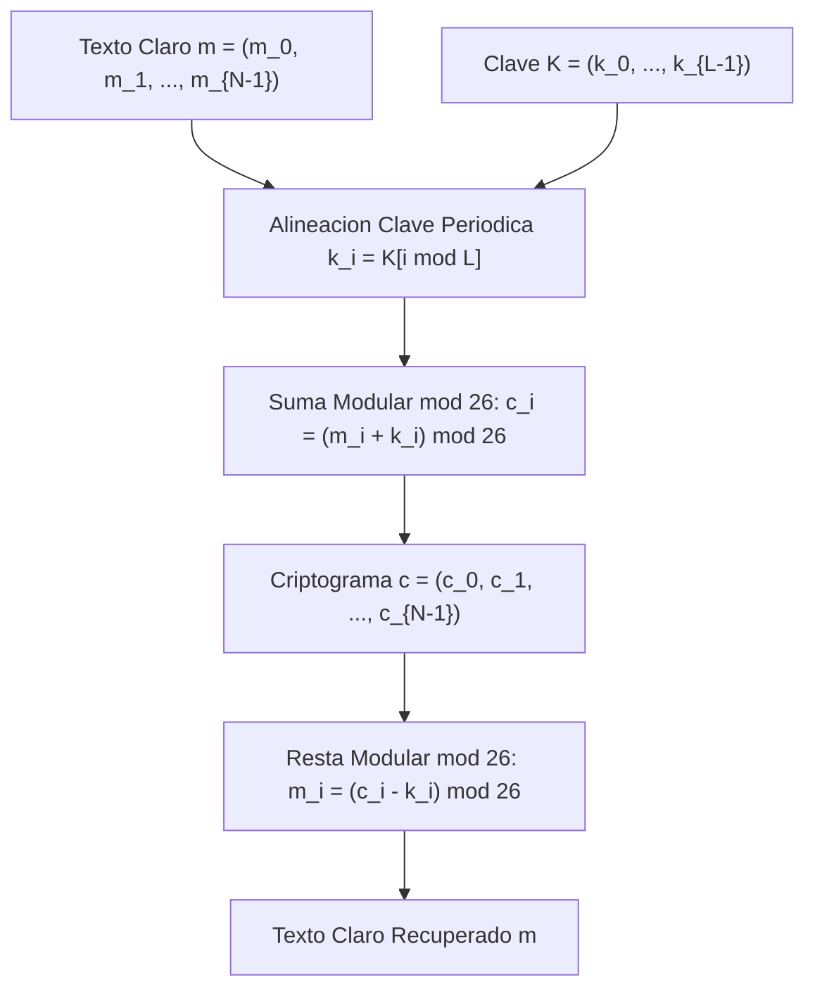
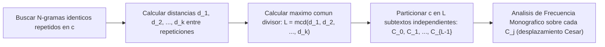

[← Volver a Curso.md](../Curso.md)

# Cifrado Vigenere (Vigenere Cipher)

> **Materia**: Criptografia | **Fuente**: [part 2.pdf](../Documentos/part 2.pdf)  
> `vigenere cipher`, `polialfabetico`, `tabula recta`, `keyword`, `kasiski`, `enigma`, `aplanamiento de frecuencias`, `blaise de vigenere`

---

## 1. Mecanismo Matematico y Operativo

Diseñado formalmente por el diplomático francés **Blaise de Vigenère** (siglo XVI, 1586), refinando ideas previas de Leon Battista Alberti y Giovan Battista Bellaso. Constituye el arquetipo de los sistemas de **sustitución polialfabética**.



### Principio Polialfabetico: Aplanamiento de Frecuencias
- **Falla de los cifrados monoalfabéticos**: Conservan una biyección estricta $1 \to 1$ entre el alfabeto plano y el cifrado; el histograma de frecuencias del criptograma reproduce directamente los picos del idioma natural (ej. `E` en inglés con $\sim 12.7\%$, `A` en español con $\sim 12.5\%$).
- **Solución Vigenère**: Un mismo carácter en claro $m_i$ se proyecta a múltiples caracteres cifrados distintos $c_i$ según la posición temporal y la letra de la clave correspondiente.
- **Efecto estadístico**: **Aplana la distribución de frecuencias** (*frequency flattening*), dispersando la entropía y neutralizando el análisis de frecuencia monográfico simple de una sola pasada.

### La Tabula Recta ($26 \times 26$)
- Matriz cuadrada de $26 \times 26$ donde cada fila sucesiva es una rotación cíclica a la izquierda del alfabeto latino estándar ($A=0, B=1, \dots, Z=25$):
  - Fila 0 (`A`): `A B C D E ... Z` (desplazamiento 0)
  - Fila 1 (`B`): `B C D E F ... A` (desplazamiento 1, rotación César $k=1$)
  - Fila $j$: Rotación de César con clave $k_j$.
- **Intersección**: El cifrado del carácter $m_i$ bajo la clave $k_j$ es el cruce entre la fila $k_j$ y la columna $m_i$.

### Formalización Algebraica en $\mathbb{Z}_{26}$
Fijando el espacio de mensaje $\mathcal{M} = \mathbb{Z}_{26}^*$, espacio de clave $\mathcal{K} = \mathbb{Z}_{26}^L$ de longitud $L$, y espacio de criptograma $\mathcal{C} = \mathbb{Z}_{26}^*$:

$$\text{Cifrado: } c_i = E_K(m_i) = (m_i + k_{i \pmod L}) \pmod{26}$$

$$\text{Descifrado: } m_i = D_K(c_i) = (c_i - k_{i \pmod L}) \pmod{26}$$

Donde los caracteres se mapean canónicamente:
$$\mathcal{A} = \{\text{A}:0, \text{B}:1, \text{C}:2, \dots, \text{Y}:24, \text{Z}:25\}$$

---

## 2. Resolucion Paso a Paso del Ejemplo del PDF

### Enunciado Oficial (Slide 20)
- **Mensaje**: `"TO BE OR NOT TO BE THAT IS THE QUESTION"`
- **Palabra Clave (*Keyword*)**: `"RELATIONS"` (longitud clave $L = 9$)
- **Longitud de Bloque de Transmisión**: $t = 5$

### Normalizacion y Alineacion
- Texto plano filtrado (sin espacios, 30 caracteres):
  `TOBEORNOTTOBETHATISTHEQUESTION`
- Clave repetida periódicamente en bloques de $t = 5$:

```text
Keyword:    RELAT  IONSR  ELATI  ONSRE  LATIO  NSREL
Plaintext:  TOBEO  RNOTT  OBETH  ATIST  HEQUE  STION
----------------------------------------------------
Ciphertext: KSMEH  ZBBLK  SMEMP  OGAJX  SEJCS  FLZSY
```

### Desglose Matematico Detallado ($\text{mod } 26$)

#### Bloque 1: `TOBEO` + `RELAT` $\implies$ `KSMEH`
1. $m_0 = \text{T}(19)$, $k_0 = \text{R}(17) \implies c_0 = (19 + 17) \pmod{26} = 36 \pmod{26} = 10 \implies \mathbf{K}$
2. $m_1 = \text{O}(14)$, $k_1 = \text{E}(4) \implies c_1 = (14 + 4) \pmod{26} = 18 \pmod{26} = 18 \implies \mathbf{S}$
3. $m_2 = \text{B}(1)$, $k_2 = \text{L}(11) \implies c_2 = (1 + 11) \pmod{26} = 12 \pmod{26} = 12 \implies \mathbf{M}$
4. $m_3 = \text{E}(4)$, $k_3 = \text{A}(0) \implies c_3 = (4 + 0) \pmod{26} = 4 \pmod{26} = 4 \implies \mathbf{E}$
5. $m_4 = \text{O}(14)$, $k_4 = \text{T}(19) \implies c_4 = (14 + 19) \pmod{26} = 33 \pmod{26} = 7 \implies \mathbf{H}$
*Resultado Bloque 1*: `KSMEH`

#### Bloque 2: `RNOTT` + `IONSR` $\implies$ `ZBBLK`
6. $m_5 = \text{R}(17)$, $k_5 = \text{I}(8) \implies c_5 = (17 + 8) \pmod{26} = 25 \pmod{26} = 25 \implies \mathbf{Z}$
7. $m_6 = \text{N}(13)$, $k_6 = \text{O}(14) \implies c_6 = (13 + 14) \pmod{26} = 27 \pmod{26} = 1 \implies \mathbf{B}$
8. $m_7 = \text{O}(14)$, $k_7 = \text{N}(13) \implies c_7 = (14 + 13) \pmod{26} = 27 \pmod{26} = 1 \implies \mathbf{B}$
9. $m_8 = \text{T}(19)$, $k_8 = \text{S}(18) \implies c_8 = (19 + 18) \pmod{26} = 37 \pmod{26} = 11 \implies \mathbf{L}$
10. $m_9 = \text{T}(19)$, $k_9 = k_0 = \text{R}(17) \implies c_9 = (19 + 17) \pmod{26} = 36 \pmod{26} = 10 \implies \mathbf{K}$
*Resultado Bloque 2*: `ZBBLK`

#### Demostración del Efecto Polialfabético
- En el bloque 1, el carácter `'O'` (índice 4) cifrado con `'T'` produce `'H'`.
- En el bloque 2, el carácter `'O'` (índice 7) cifrado con `'N'` produce `'B'`.
- En el bloque 3, el carácter `'O'` (índice 10) cifrado con `'E'` produce `'S'`.
$$\implies \text{El mismo símbolo plano } 'O' \text{ genera } \{'H', 'B', 'S'\} \text{ destruyendo la firma monoalfabética.}$$

---

## 3. Resolucion Completa del Ejercicio del PDF

### Enunciado Oficial (Slide 20)
> *"Exercise: Encrypt the message 'THERE IS A SECRET PASSAGE BEHIND THE PICTURE FRAME', keyword='CRYPTO', and t = 3."*

### Parámetros Operativos
- **Texto en claro**: `THERE IS A SECRET PASSAGE BEHIND THE PICTURE FRAME`
- **Filtro alfabético**: `THEREISASECRETPASSAGEBEHINDTHEPICTUREFRAME` (42 letras).
- **Palabra clave**: `CRYPTO` ($L = 6$). Mapeo numérico:
  $$\text{C}=2, \quad \text{R}=17, \quad \text{Y}=24, \quad \text{P}=15, \quad \text{T}=19, \quad \text{O}=14$$
- **Segmentación en bloques ($t = 3$)**:
  Como $L = 6$ y $t = 3$, la clave se divide simétricamente en 2 sub-bloques de longitud 3:
  - Sub-bloque impar: `CRY` ($k = [2, 17, 24]$)
  - Sub-bloque par: `PTO` ($k = [15, 19, 14]$)

### Tabla de Computo Modular Bloque a Bloque ($t = 3$)

| Bloque | $m_{\text{block}}$ | Valores $m$ | $k_{\text{block}}$ | Valores $k$ | Suma $(m + k)$ | $(m + k) \pmod{26}$ | Criptograma |
| :---: | :---: | :---: | :---: | :---: | :---: | :---: | :---: |
| **1** | `THE` | $(19, 7, 4)$ | `CRY` | $(2, 17, 24)$ | $(21, 24, 28)$ | $(21, 24, 2)$ | **`VYC`** |
| **2** | `REI` | $(17, 4, 8)$ | `PTO` | $(15, 19, 14)$ | $(32, 23, 22)$ | $(6, 23, 22)$ | **`GXW`** |
| **3** | `SAS` | $(18, 0, 18)$ | `CRY` | $(2, 17, 24)$ | $(20, 17, 42)$ | $(20, 17, 16)$ | **`URQ`** |
| **4** | `ECR` | $(4, 2, 17)$ | `PTO` | $(15, 19, 14)$ | $(19, 21, 31)$ | $(19, 21, 5)$ | **`TVF`** |
| **5** | `ETP` | $(4, 19, 15)$ | `CRY` | $(2, 17, 24)$ | $(6, 36, 39)$ | $(6, 10, 13)$ | **`GKN`** |
| **6** | `ASS` | $(0, 18, 18)$ | `PTO` | $(15, 19, 14)$ | $(15, 37, 32)$ | $(15, 11, 6)$ | **`PLG`** |
| **7** | `AGE` | $(0, 6, 4)$ | `CRY` | $(2, 17, 24)$ | $(2, 23, 28)$ | $(2, 23, 2)$ | **`CXC`** |
| **8** | `BEH` | $(1, 4, 7)$ | `PTO` | $(15, 19, 14)$ | $(16, 23, 21)$ | $(16, 23, 21)$ | **`QXV`** |
| **9** | `IND` | $(8, 13, 3)$ | `CRY` | $(2, 17, 24)$ | $(10, 30, 27)$ | $(10, 4, 1)$ | **`KEB`** |
| **10** | `THE` | $(19, 7, 4)$ | `PTO` | $(15, 19, 14)$ | $(34, 26, 18)$ | $(8, 0, 18)$ | **`IAS`** |
| **11** | `PIC` | $(15, 8, 2)$ | `CRY` | $(2, 17, 24)$ | $(17, 25, 26)$ | $(17, 25, 0)$ | **`RZA`** |
| **12** | `TUR` | $(19, 20, 17)$ | `PTO` | $(15, 19, 14)$ | $(34, 39, 31)$ | $(8, 13, 5)$ | **`INF`** |
| **13** | `EFR` | $(4, 5, 17)$ | `CRY` | $(2, 17, 24)$ | $(6, 22, 41)$ | $(6, 22, 15)$ | **`GWP`** |
| **14** | `AME` | $(0, 12, 4)$ | `PTO` | $(15, 19, 14)$ | $(15, 31, 18)$ | $(15, 5, 18)$ | **`PFS`** |

### Criptograma Final
```text
VYC GXW URQ TVF GKN PLG CXC QXV KEB IAS RZA INF GWP PFS
```

---

## 4. Criptoanalisis Practico y Relacion Historica

Durante casi 300 años, el cifrado Vigenère fue considerado inexpugnable, ganando el apelativo de ***le chiffre indéchiffrable***. Fue roto de forma sistemática por el oficial prusiano **Friedrich Kasiski** en 1863 (y de forma privada por Charles Babbage en 1854).

### 1. El Método de Kasiski
Se fundamenta en la repetición periódica de la clave sobre el texto. Si una secuencia de letras del texto plano (bigrama, trigrama o n-grama) coincide casualmente a una distancia que sea múltiplo de la longitud de la clave $L$, generará **exactamente el mismo n-grama cifrado**.



- **Estimación formal de la longitud**:
  $$L \mid \gcd(d_1, d_2, \dots, d_k)$$
  donde $d_i$ es la distancia entre la primera y la segunda aparición de un n-grama idéntico.

### 2. Test de Friedman (Índice de Coincidencia $I_C$)
Desarrollado por William F. Friedman en 1922. Mide la probabilidad de que dos caracteres seleccionados aleatoriamente de un texto sean idénticos:

$$I_C = \frac{\sum_{i=0}^{25} f_i (f_i - 1)}{N (N - 1)}$$

Donde $f_i$ es la frecuencia observada de la letra $i$ y $N$ es la longitud del texto.
- **Valores teóricos de referencia**:
  - Idioma natural monoalfabético (inglés): $I_C \approx 0.065 - 0.068$.
  - Distribución uniforme equiprobable (aleatorio puro): $I_C \approx \frac{1}{26} \approx 0.0385$.
- **Estimación empírica de la longitud de clave $L$**:
  $$L \approx \frac{0.027 \cdot N}{(N - 1) I_C - 0.038 N + 0.065}$$

### 3. Conexión con la Máquina Enigma (Slides 21-22)
- La **Máquina Enigma** alemana de la Segunda Guerra Mundial es fundamentalmente una extensión electromecánica del cifrado polialfabético de Vigenère.
- **Diferencia operativa con Vigenère tradicional**:
  - En Vigenère manual, la clave tiene un periodo corto ($L \in [3, 20]$), por lo que las permutaciones se repiten cíclicamente muy rápido.
  - En Enigma, un conjunto de rotores mecánicos cableados avanza con cada pulsación de tecla (como un odómetro). Esto produce un **alfabeto de sustitución diferente en cada pulsación consecutiva**, generando un período gigantesco ($26 \times 26 \times 26 = 17,576$ posiciones de rotor antes de repetirse, amplificado a cientos de billones por el clavijero o *plugboard/steckerboard*).
- **Criptoanálisis de Enigma**: Resuelto inicialmente por el matemático polaco **Marian Rejewski** (1932) mediante teoría de permutaciones y ciclos de grupos simétricos, trabajo transferido a Alan Turing y Bletchley Park para el diseño de las máquinas *Bombe*.

---

## 5. Implementacion de Referencia en Python

Código modular para cifrado, descifrado, análisis de periodicidad de Kasiski y cálculo de distancias:

```python
"""
Cifrado Vigenere y Modulo de Criptoanalisis (Kasiski & Index of Coincidence).
"""

from collections import Counter
from math import gcd
from functools import reduce


def normalize(text: str) -> str:
    """Filtra y extrae solo letras A-Z en mayusculas."""
    return "".join(c for c in text.upper() if "A" <= c <= "Z")


def encrypt_vigenere(plaintext: str, key: str) -> str:
    """Cifra mediante c_i = (m_i + k_{i mod L}) mod 26."""
    p = normalize(plaintext)
    k = normalize(key)
    L = len(k)
    k_vals = [ord(c) - 65 for c in k]
    return "".join(
        chr((ord(char) - 65 + k_vals[i % L]) % 26 + 65)
        for i, char in enumerate(p)
    )


def decrypt_vigenere(ciphertext: str, key: str) -> str:
    """Descifra mediante m_i = (c_i - k_{i mod L}) mod 26."""
    c = normalize(ciphertext)
    k = normalize(key)
    L = len(k)
    k_vals = [ord(char) - 65 for char in k]
    return "".join(
        chr((ord(char) - 65 - k_vals[i % L]) % 26 + 65)
        for i, char in enumerate(c)
    )


def kasiski_examination(ciphertext: str, seq_len: int = 3) -> dict[str, list[int]]:
    """Encuentra secuencias repetidas y calcula las distancias entre apariciones."""
    c = normalize(ciphertext)
    positions = {}
    for i in range(len(c) - seq_len + 1):
        seq = c[i:i + seq_len]
        positions.setdefault(seq, []).append(i)
    
    repeated = {k: v for k, v in positions.items() if len(v) > 1}
    distances = {}
    for seq, pos_list in repeated.items():
        diffs = [pos_list[j] - pos_list[j - 1] for j in range(1, len(pos_list))]
        distances[seq] = diffs
    return distances


def estimate_key_length_gcd(distances: dict[str, list[int]]) -> int:
    """Calcula el MCD de todas las distancias observadas."""
    all_diffs = [d for diff_list in distances.values() for d in diff_list]
    if not all_diffs:
        return 1
    return reduce(gcd, all_diffs)


def index_of_coincidence(text: str) -> float:
    """Calcula el indice de coincidencia IC de un texto."""
    t = normalize(text)
    N = len(t)
    if N <= 1:
        return 0.0
    counts = Counter(t)
    numerator = sum(f * (f - 1) for f in counts.values())
    return numerator / (N * (N - 1))


# --- Demostracion de Ejecucion del Ejercicio ---
if __name__ == "__main__":
    msg = "THERE IS A SECRET PASSAGE BEHIND THE PICTURE FRAME"
    key = "CRYPTO"
    c_out = encrypt_vigenere(msg, key)
    
    # Agrupacion en bloques de t = 3
    blocks_of_3 = [c_out[i:i + 3] for i in range(0, len(c_out), 3)]
    formatted_cipher = " ".join(blocks_of_3)
    
    print(f"Texto Plano:   {normalize(msg)}")
    print(f"Keyword:       {key}")
    print(f"Criptograma:   {formatted_cipher}")
    print(f"Descifrado:    {decrypt_vigenere(c_out, key)}")
```

---

## 6. Puntos Criticos de Examen y Trampas

### 1. Desfase entre Longitud de Bloque ($t$) y Longitud de Clave ($L$)
- Si el problema pide formatear en bloques de tamaño $t$ y la clave mide $L$:
  - Si $t \neq L$, la clave **no se alinea idénticamente con el inicio de cada bloque**.
  - **Ejemplo de la clase**: Clave `RELATIONS` ($L=9$), bloques de $t=5$. La clave se desfasa de bloque a bloque (`RELAT` en el bloque 1, `IONSR` en el bloque 2, `ELATI` en el bloque 3). No asuma que cada bloque inicia con la primera letra de la clave.
  - **Ejercicio resuelto**: Clave `CRYPTO` ($L=6$), bloques de $t=3$. Los bloques impares usan `CRY` y los pares usan `PTO`.

### 2. Aritmética Modular en Descifrado (Residuos Negativos)
- Al calcular $m_i = (c_i - k_i) \pmod{26}$, si $c_i < k_i$, la resta produce un entero negativo.
- En lenguajes de bajo nivel (C, C++, Java), el operador `%` preserva el signo negativo (ej. `-2 % 26 = -2`).
- Para normalizar siempre al rango canónico $[0, 25]$:
  $$m_i = (c_i - k_i + 26) \pmod{26}$$

### 3. Clave de Longitud Igual al Mensaje ($L = |m|$)
- Si la clave tiene la misma longitud del mensaje ($L = |m|$), no es generada por un patrón periódico, y se usa una sola vez de forma estrictamente uniforme y secreta $\implies$ el cifrado Vigenère deviene en el **One-Time Pad (OTP)** o cifrado de Vernam, alcanzando **secreto perfecto** ($H(M|C) = H(M)$).
- La debilidad de Vigenère radica exclusivamente en la **periodicidad ($L \ll |m|$)**, la cual permite a Kasiski fragmentar el criptograma en $L$ cifrados César independientes.

### 4. Manejo de Puntuación y Espacios
- En la evaluación estándar y problemas de concurso, los espacios, comas y signos ortográficos **se eliminan antes de indexar la periodicidad**; si se conservaran o cifraran sin avance del puntero de clave, filtrarían directamente la estructura sintáctica del mensaje.
