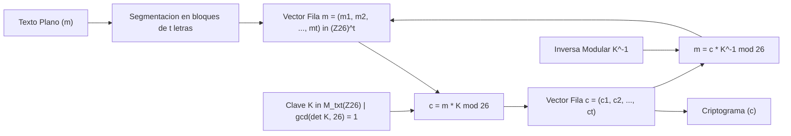
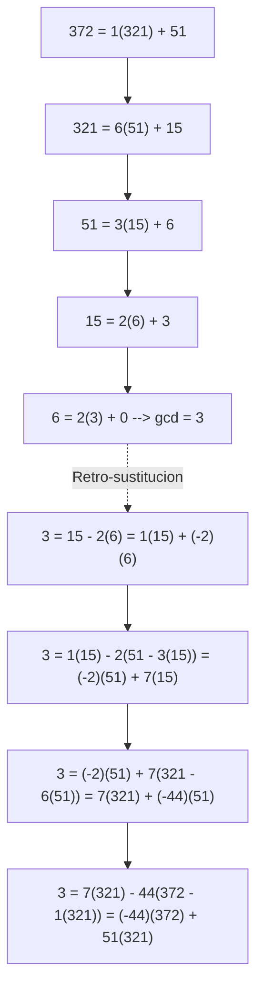
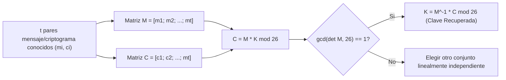

[← Volver a Curso.md](../Curso.md)

# Cifrado de Hill e Inversa Modular de Matrices

> **Materia**: Criptografia | **Fuente**: [part 2.pdf](../Documentos/part 2.pdf)  
> `hill cipher`, `algebra lineal mod 26`, `matriz clave`, `inversa modular`, `algoritmo euclides extendido`, `eea`, `adjunta`, `determinante`, `lester s hill`

---

## 1. Fundamento Operativo y Modelo Matricial

Propuesto por el matemático estadounidense **Lester S. Hill** (1929) en su artículo *"Cryptography in an Algebraic Alphabet"*. Constituye el primer cifrado de bloques polialfabético basado en transformaciones lineales sobre anillos modulares.



### Definición Formal del Criptosistema
- **Alfabeto de Definición**: $\mathcal{A} = \{\text{A}=0, \text{B}=1, \text{C}=2, \dots, \text{Z}=25\}$, isomorfo al anillo conmutativo $\mathbb{Z}_{26}$.
- **Espacio de Mensajes y Cifrados**: $\mathcal{M} = \mathcal{C} = (\mathbb{Z}_{26})^t$, donde $t \in \mathbb{Z}^+$ es la dimensión del bloque ($t=2$ digramas, $t=3$ trigramas).
- **Espacio de Claves**: $\mathcal{K} = GL(t, \mathbb{Z}_{26}) = \{K \in \mathcal{M}_{t \times t}(\mathbb{Z}_{26}) \mid \gcd(\det K, 26) = 1\}$.

### Ecuaciones Algebraicas de Cifrado y Descifrado
- **Cifrado (Vector Fila)**:
  $$\mathbf{c} = \mathbf{m} \cdot K \pmod{26}$$
  $$(c_1, c_2, \dots, c_t) = (m_1, m_2, \dots, m_t) \begin{pmatrix} K_{11} & K_{12} & \cdots & K_{1t} \\ K_{21} & K_{22} & \cdots & K_{2t} \\ \vdots & \vdots & \ddots & \vdots \\ K_{t1} & K_{t2} & \cdots & K_{tt} \end{pmatrix} \pmod{26}$$
  Expresión escalar por componente:
  $$c_j = \sum_{i=1}^t m_i K_{ij} \pmod{26}, \quad \forall j \in \{1, \dots, t\}$$

- **Descifrado**:
  $$\mathbf{m} = \mathbf{c} \cdot K^{-1} \pmod{26}$$
  Demostración: $\mathbf{c} \cdot K^{-1} \equiv (\mathbf{m} K) K^{-1} \equiv \mathbf{m} (K K^{-1}) \equiv \mathbf{m} \cdot I_t \equiv \mathbf{m} \pmod{26}$.

### Condición Necesaria y Suficiente de Invertibilidad
Una matriz $K \in \mathcal{M}_{t \times t}(\mathbb{Z}_{26})$ admite inversa multiplicativa $K^{-1}$ en $\mathbb{Z}_{26}$ si y solo si su determinante es una unidad en $\mathbb{Z}_{26}$:
$$\gcd(\det K, 26) = 1$$

Dado que $26 = 2 \times 13$, la condición exige simultáneamente:
1. $\det K \not\equiv 0 \pmod{26}$ (matriz no singular ordinaria).
2. $\det K \not\equiv 0 \pmod 2 \implies \det K \text{ debe ser un número IMPAR}$.
3. $\det K \not\equiv 0 \pmod{13} \implies \det K \text{ NO puede ser múltiplo de 13}$.

Valores admisibles de determinante $\det K \pmod{26} \in \mathbb{Z}_{26}^\times$:
$$\mathbb{Z}_{26}^\times = \{1, 3, 5, 7, 9, 11, 15, 17, 19, 21, 23, 25\} \implies \phi(26) = 26\left(1 - \frac{1}{2}\right)\left(1 - \frac{1}{13}\right) = 12 \text{ valores posibles}$$

---

## 2. Algoritmo Extendido de Euclides (EEA) para Inversa Escalar

### Identidad de Bézout
Para enteros positivos $a, b \in \mathbb{Z}^+$ con $a \ge b$:
$$\gcd(a, b) = d = a \cdot x + b \cdot y \quad (x, y \in \mathbb{Z})$$

### Cálculo de Inversa Modular
Si $\gcd(a, m) = 1$:
$$a \cdot x + m \cdot y = 1 \implies a \cdot x \equiv 1 \pmod m \implies a^{-1} \equiv x \pmod m$$
Si $x < 0$, la inversa canónica positiva se obtiene como:
$$x \equiv (x \bmod m + m) \bmod m$$

### Pseudocódigo Formal del EEA (Diapositiva 28)
```text
INPUT:  a, b in Z+, a >= b
OUTPUT: (d, x, y), d = gcd(a, b); x, y in Z : a*x + b*y = d

procedure EEA(a, b) { q <- floor(a/b) }
begin
    if b = 0 then return (a, 1, 0)
    (d', x', y') <- EEA(b, a mod b)
    (d, x, y)   <- (d', y', x' - q*y')
    return (d, x, y)
end
```

### Traza de Ejecución del Ejemplo del PDF: $\text{EEA}(372, 321)$ (Diapositiva 29)
Cálculo del máximo común divisor y coeficientes de Bézout:



| Iteración | $a$ | $b$ | $q = \lfloor a/b \rfloor$ | $d = \gcd$ | $x$ | $y$ | Ecuación de Bézout: $a \cdot x + b \cdot y = d$ |
| :---: | :---: | :---: | :---: | :---: | :---: | :---: | :--- |
| **Base** | 3 | 0 | — | 3 | 1 | 0 | $1 \times 3 + 0 \times 0 = 3$ |
| **5** | 6 | 3 | 2 | 3 | 0 | 1 | $0 \times 6 + 1 \times 3 = 3$ |
| **4** | 15 | 6 | 2 | 3 | 1 | -2 | $1 \times 15 + (-2) \times 6 = 3$ |
| **3** | 51 | 15 | 3 | 3 | -2 | 7 | $(-2) \times 51 + 7 \times 15 = 3$ |
| **2** | 321 | 51 | 6 | 3 | 7 | -44 | $7 \times 321 + (-44) \times 51 = 3$ |
| **1** | 372 | 321 | 1 | 3 | **-44** | **51** | $\mathbf{-44 \times 372 + 51 \times 321 = 3}$ |

Comprobación aritmética:
$$-44 \times 372 + 51 \times 321 = -16368 + 16371 = 3$$

---

## 3. Inversión Modular de Matrices $2\times 2$ y $3\times 3$

### Caso $2\times 2$ en $\mathbb{Z}_m$
Dada una matriz $A = \begin{pmatrix} a & b \\ c & d \end{pmatrix}$:
1. **Determinante**:
   $$\det A = (ad - bc) \pmod m$$
2. **Inversa Escalar**:
   Calcular $(\det A)^{-1} \pmod m$ mediante EEA tal que:
   $$(\det A)^{-1} \cdot \det A \equiv 1 \pmod m$$
3. **Matriz Adjunta (Traspuesta de Cofactores)**:
   $$\text{Adj}(A) = \begin{pmatrix} d & -b \\ -c & a \end{pmatrix} \pmod m$$
4. **Matriz Inversa**:
   $$A^{-1} = (\det A)^{-1} \cdot \text{Adj}(A) = (\det A)^{-1} \begin{pmatrix} d & -b \\ -c & a \end{pmatrix} \pmod m$$

### Caso $3\times 3$ en $\mathbb{Z}_m$ (Diapositivas 33 y 34)
Dada la matriz:
$$M = \begin{pmatrix} a & b & c \\ d & e & f \\ g & h & i \end{pmatrix}$$

1. **Patrón Ajedrezado de Signos**:
   $$\begin{pmatrix} + & - & + \\ - & + & - \\ + & - & + \end{pmatrix}$$

2. **Matriz de Cofactores**:
   - Fila 1:
     $$A = +\det \begin{pmatrix} e & f \\ h & i \end{pmatrix} = ei - fh, \quad B = -\det \begin{pmatrix} d & f \\ g & i \end{pmatrix} = -(di - fg), \quad C = +\det \begin{pmatrix} d & e \\ g & h \end{pmatrix} = dh - eg$$
   - Fila 2:
     $$D = -\det \begin{pmatrix} b & c \\ h & i \end{pmatrix} = -(bi - ch), \quad E = +\det \begin{pmatrix} a & c \\ g & i \end{pmatrix} = ai - cg, \quad F = -\det \begin{pmatrix} a & b \\ g & h \end{pmatrix} = -(ah - bg)$$
   - Fila 3:
     $$G = +\det \begin{pmatrix} b & c \\ e & f \end{pmatrix} = bf - ce, \quad H = -\det \begin{pmatrix} a & c \\ d & f \end{pmatrix} = -(af - cd), \quad I = +\det \begin{pmatrix} a & b \\ d & e \end{pmatrix} = ae - bd$$

3. **Determinante por Expansión de Laplace** (válido por cualquier fila o columna):
   $$\det M = aA + bB + cC = dD + eE + fF = gG + hH + iI \pmod m$$
   $$\det M = aA + dD + gG = bB + eE + hH = cC + fF + iI \pmod m$$

4. **Matriz Adjunta y Matriz Inversa**:
   $$\text{Adj}(M) = \begin{pmatrix} A & B & C \\ D & E & F \\ G & H & I \end{pmatrix}^T = \begin{pmatrix} A & D & G \\ B & E & H \\ C & F & I \end{pmatrix} \pmod m$$
   $$A^{-1} = (\det M)^{-1} \cdot \begin{pmatrix} A & D & G \\ B & E & H \\ C & F & I \end{pmatrix} \pmod m$$

---

## 4. Resolución Paso a Paso del Ejemplo del PDF

### Matriz Clave Proporcionada (Diapositivas 23, 24, 31)
$$K = \begin{pmatrix} 11 & 8 \\ 3 & 7 \end{pmatrix} \pmod{26}$$

#### Paso 1: Cálculo del Determinante
$$\det K = (11 \times 7) - (8 \times 3) = 77 - 24 = 53$$
Reducción módulo 26:
$$53 = 2 \times 26 + 1 \implies \det K \equiv 1 \pmod{26}$$

#### Paso 2: Inversa Escalar del Determinante
$$\gcd(1, 26) = 1 \implies (\det K)^{-1} = 1^{-1} \equiv 1 \pmod{26}$$

#### Paso 3: Construcción de la Adjunta y Reducción Módulo 26
$$\text{Adj}(K) = \begin{pmatrix} 7 & -8 \\ -3 & 11 \end{pmatrix}$$
Normalización modular de entradas negativas:
$$-8 \equiv -8 + 26 = 18 \pmod{26}$$
$$-3 \equiv -3 + 26 = 23 \pmod{26}$$
$$\text{Adj}(K) \equiv \begin{pmatrix} 7 & 18 \\ 23 & 11 \end{pmatrix} \pmod{26}$$

#### Paso 4: Matriz Inversa de Descifrado
$$K^{-1} = 1 \cdot \begin{pmatrix} 7 & 18 \\ 23 & 11 \end{pmatrix} = \begin{pmatrix} 7 & 18 \\ 23 & 11 \end{pmatrix} \pmod{26}$$

#### Paso 5: Verificación Formal $K \cdot K^{-1} \equiv I \pmod{26}$ (Diapositiva 24)
$$K \cdot K^{-1} = \begin{pmatrix} 11 & 8 \\ 3 & 7 \end{pmatrix} \begin{pmatrix} 7 & 18 \\ 23 & 11 \end{pmatrix} = \begin{pmatrix} 11 \times 7 + 8 \times 23 & 11 \times 18 + 8 \times 11 \\ 3 \times 7 + 7 \times 23 & 3 \times 18 + 7 \times 11 \end{pmatrix}$$
$$= \begin{pmatrix} 77 + 184 & 198 + 88 \\ 21 + 161 & 54 + 77 \end{pmatrix} = \begin{pmatrix} 261 & 286 \\ 182 & 131 \end{pmatrix}$$

Reducción individual componente a componente:
- $261 = 10 \times 26 + 1 \equiv 1 \pmod{26}$
- $286 = 11 \times 26 + 0 \equiv 0 \pmod{26}$
- $182 = 7 \times 26 + 0 \equiv 0 \pmod{26}$
- $131 = 5 \times 26 + 1 \equiv 1 \pmod{26}$
$$K \cdot K^{-1} \equiv \begin{pmatrix} 1 & 0 \\ 0 & 1 \end{pmatrix} = I_2 \pmod{26} \quad \checkmark$$

### Cifrado de la Palabra "JULY" (Diapositiva 25)
1. **Mapeo a vectores numéricos**:
   - $\text{"JU"} \implies \text{J}=9, \text{U}=20 \implies \mathbf{m}_1 = (9, 20)$
   - $\text{"LY"} \implies \text{L}=11, \text{Y}=24 \implies \mathbf{m}_2 = (11, 24)$

2. **Cifrado del Bloque 1 ("JU")**:
   $$\mathbf{c}_1 = (9, 20) \begin{pmatrix} 11 & 8 \\ 3 & 7 \end{pmatrix} = (9 \times 11 + 20 \times 3, \; 9 \times 8 + 20 \times 7) = (99 + 60, \; 72 + 140) = (159, 212)$$
   - $159 = 6 \times 26 + 3 \implies 3 \implies \text{D}$
   - $212 = 8 \times 26 + 4 \implies 4 \implies \text{E}$
   $$\mathbf{c}_1 = (3, 4) \implies \text{"DE"}$$

3. **Cifrado del Bloque 2 ("LY")**:
   $$\mathbf{c}_2 = (11, 24) \begin{pmatrix} 11 & 8 \\ 3 & 7 \end{pmatrix} = (11 \times 11 + 24 \times 3, \; 11 \times 8 + 24 \times 7) = (121 + 72, \; 88 + 168) = (193, 256)$$
   - $193 = 7 \times 26 + 11 \implies 11 \implies \text{L}$
   - $256 = 9 \times 26 + 22 \implies 22 \implies \text{W}$
   $$\mathbf{c}_2 = (11, 22) \implies \text{"LW"}$$

4. **Criptograma Final**:
   $$\text{"JULY"} \xrightarrow{K} \mathbf{\text{"DELW"}}$$

---

## 5. Resolución Completa de los Ejercicios del PDF

### Ejercicio 1 (Diapositiva 25): Descifrado de `VKFZRVWTIAZSMISGKA`
Clave de descifrado: $K^{-1} = \begin{pmatrix} 7 & 18 \\ 23 & 11 \end{pmatrix} \pmod{26}$.  
Longitud del criptograma: 18 letras $\implies 9$ digramas.

$$\mathbf{m} = \mathbf{c} \cdot K^{-1} = (c_1, c_2) \begin{pmatrix} 7 & 18 \\ 23 & 11 \end{pmatrix} = (7 c_1 + 23 c_2, \; 18 c_1 + 11 c_2) \pmod{26}$$

| Bloque | Digrama $c$ | Índices $(c_1, c_2)$ | Operación $(7 c_1 + 23 c_2, \; 18 c_1 + 11 c_2)$ | Valor Directo | Módulo 26 | Letras Descifradas |
| :---: | :---: | :---: | :--- | :---: | :---: | :---: |
| **1** | **VK** | $(21, 10)$ | $(21\cdot 7 + 10\cdot 23, \; 21\cdot 18 + 10\cdot 11)$ | $(147 + 230, \; 378 + 110) = (377, 488)$ | $(13, 20)$ | **NU** |
| **2** | **FZ** | $(5, 25)$ | $(5\cdot 7 + 25\cdot 23, \; 5\cdot 18 + 25\cdot 11)$ | $(35 + 575, \; 90 + 275) = (610, 365)$ | $(12, 1)$ | **MB** |
| **3** | **RV** | $(17, 21)$ | $(17\cdot 7 + 21\cdot 23, \; 17\cdot 18 + 21\cdot 11)$ | $(119 + 483, \; 306 + 231) = (602, 537)$ | $(4, 17)$ | **ER** |
| **4** | **WT** | $(22, 19)$ | $(22\cdot 7 + 19\cdot 23, \; 22\cdot 18 + 19\cdot 11)$ | $(154 + 437, \; 396 + 209) = (591, 605)$ | $(19, 7)$ | **TH** |
| **5** | **IA** | $(8, 0)$ | $(8\cdot 7 + 0\cdot 23, \; 8\cdot 18 + 0\cdot 11)$ | $(56 + 0, \; 144 + 0) = (56, 144)$ | $(4, 14)$ | **EO** |
| **6** | **ZS** | $(25, 18)$ | $(25\cdot 7 + 18\cdot 23, \; 25\cdot 18 + 18\cdot 11)$ | $(175 + 414, \; 450 + 198) = (589, 648)$ | $(17, 24)$ | **RY** |
| **7** | **MI** | $(12, 8)$ | $(12\cdot 7 + 8\cdot 23, \; 12\cdot 18 + 8\cdot 11)$ | $(84 + 184, \; 216 + 88) = (268, 304)$ | $(8, 18)$ | **IS** |
| **8** | **SG** | $(18, 6)$ | $(18\cdot 7 + 6\cdot 23, \; 18\cdot 18 + 6\cdot 11)$ | $(126 + 138, \; 324 + 66) = (264, 390)$ | $(4, 0)$ | **EA** |
| **9** | **KA** | $(10, 0)$ | $(10\cdot 7 + 0\cdot 23, \; 10\cdot 18 + 0\cdot 11)$ | $(70 + 0, \; 180 + 0) = (70, 180)$ | $(18, 24)$ | **SY** |

> **Texto Claro Descifrado**: `NU` `MB` `ER` `TH` `EO` `RY` `IS` `EA` `SY` $\implies$ **`"NUMBER THEORY IS EASY"`**.

---

### Ejercicio 2 (Diapositiva 32): Inversa Modular de $A = \begin{pmatrix} 14 & 5 \\ 7 & 7 \end{pmatrix} \pmod{37}$

#### Paso 1: Determinante
$$\det A = (14 \times 7) - (5 \times 7) = 98 - 35 = 63$$
Reducción módulo 37:
$$63 = 1 \times 37 + 26 \implies \det A \equiv 26 \pmod{37}$$

#### Paso 2: Cálculo de la Inversa Escalar $26^{-1} \pmod{37}$ vía EEA
1. **Divisiones Sucesivas**:
   $$37 = 1 \times 26 + 11 \implies 11 = 37 - 1(26)$$
   $$26 = 2 \times 11 + 4 \implies 4 = 26 - 2(11)$$
   $$11 = 2 \times 4 + 3 \implies 3 = 11 - 2(4)$$
   $$4 = 1 \times 3 + 1 \implies 1 = 4 - 1(3)$$
   $$3 = 3 \times 1 + 0 \implies \gcd(37, 26) = 1$$

2. **Retro-sustitución (Expresión de Bézout)**:
   $$1 = 4 - 1(3) = 4 - 1(11 - 2(4)) = 3(4) - 1(11)$$
   $$= 3(26 - 2(11)) - 1(11) = 3(26) - 7(11)$$
   $$= 3(26) - 7(37 - 1(26)) = 10(26) - 7(37)$$

3. **Inversa Modular**:
   $$10 \times 26 + (-7) \times 37 = 1 \implies 10 \times 26 \equiv 1 \pmod{37}$$
   $$(\det A)^{-1} = 26^{-1} \equiv 10 \pmod{37}$$

#### Paso 3: Matriz Adjunta
$$\text{Adj}(A) = \begin{pmatrix} 7 & -5 \\ -7 & 14 \end{pmatrix}$$
Normalización módulo 37:
$$-5 \equiv -5 + 37 = 32 \pmod{37}$$
$$-7 \equiv -7 + 37 = 30 \pmod{37}$$
$$\text{Adj}(A) \equiv \begin{pmatrix} 7 & 32 \\ 30 & 14 \end{pmatrix} \pmod{37}$$

#### Paso 4: Matriz Inversa $A^{-1} = 10 \cdot \text{Adj}(A) \pmod{37}$
$$A^{-1} = 10 \cdot \begin{pmatrix} 7 & 32 \\ 30 & 14 \end{pmatrix} = \begin{pmatrix} 70 & 320 \\ 300 & 140 \end{pmatrix} \pmod{37}$$

Reducción individual:
- $70 = 1 \times 37 + 33 \implies 33$
- $320 = 8 \times 37 + 24 \implies 24$ (o equivalentemente: $10 \times (-5) = -50 \equiv -50 + 74 = 24$)
- $300 = 8 \times 37 + 4 \implies 4$ (o equivalentemente: $10 \times (-7) = -70 \equiv -70 + 74 = 4$)
- $140 = 3 \times 37 + 29 \implies 29$

$$A^{-1} = \begin{pmatrix} 33 & 24 \\ 4 & 29 \end{pmatrix} \pmod{37}$$

#### Paso 5: Verificación Formal $A \cdot A^{-1} \equiv I \pmod{37}$
$$A \cdot A^{-1} = \begin{pmatrix} 14 & 5 \\ 7 & 7 \end{pmatrix} \begin{pmatrix} 33 & 24 \\ 4 & 29 \end{pmatrix} = \begin{pmatrix} 14 \times 33 + 5 \times 4 & 14 \times 24 + 5 \times 29 \\ 7 \times 33 + 7 \times 4 & 7 \times 24 + 7 \times 29 \end{pmatrix}$$
$$= \begin{pmatrix} 462 + 20 & 336 + 145 \\ 231 + 28 & 168 + 203 \end{pmatrix} = \begin{pmatrix} 482 & 481 \\ 259 & 371 \end{pmatrix}$$

Reducción módulo 37:
- $482 = 13 \times 37 + 1 \equiv 1 \pmod{37}$
- $481 = 13 \times 37 + 0 \equiv 0 \pmod{37}$
- $259 = 7 \times 37 + 0 \equiv 0 \pmod{37}$
- $371 = 10 \times 37 + 1 \equiv 1 \pmod{37}$

$$A \cdot A^{-1} \equiv \begin{pmatrix} 1 & 0 \\ 0 & 1 \end{pmatrix} = I_2 \pmod{37} \quad \checkmark$$

---

## 6. Implementación en Python

Script autocontenido en Python estándar (sin dependencias externas) que implementa el algoritmo extendido de Euclides, cálculo de determinantes modulares, inversas matriciales para dimensiones $2\times 2$ y $3\times 3$, cifrado y descifrado de Hill.

```python
import math

def eea(a: int, b: int) -> tuple[int, int, int]:
    """
    Algoritmo Extendido de Euclides.
    Retorna (d, x, y) tal que a*x + b*y = d = gcd(a, b).
    """
    if b == 0:
        return (a, 1, 0)
    q = a // b
    d_prime, x_prime, y_prime = eea(b, a % b)
    return (d_prime, y_prime, x_prime - q * y_prime)

def mod_inverse(a: int, m: int) -> int:
    """Calcula la inversa multiplicativa escalar a^-1 mod m."""
    a = a % m
    d, x, _ = eea(a, m)
    if d != 1:
        raise ValueError(f"No existe inversa: gcd({a}, {m}) = {d} != 1")
    return (x % m + m) % m

def matrix_mod_inv_2x2(matrix: list[list[int]], mod: int = 26) -> list[list[int]]:
    """Calcula la inversa modular de una matriz 2x2."""
    a, b = matrix[0][0], matrix[0][1]
    c, d = matrix[1][0], matrix[1][1]
    
    det = (a * d - b * c) % mod
    inv_det = mod_inverse(det, mod)
    
    # Adjunta transpuesta: [[d, -b], [-c, a]]
    adj = [
        [d % mod, (-b) % mod],
        [(-c) % mod, a % mod]
    ]
    
    return [[(inv_det * adj[i][j]) % mod for j in range(2)] for i in range(2)]

def hill_encrypt(plaintext: str, key_matrix: list[list[int]], mod: int = 26) -> str:
    """Cifra un texto plano usando el Cifrado de Hill con vector fila."""
    t = len(key_matrix)
    clean_text = "".join([c.upper() for c in plaintext if c.isalpha()])
    
    # Padding con 'X' si no es multiplo de t
    while len(clean_text) % t != 0:
        clean_text += "X"
        
    ciphertext = []
    for k in range(0, len(clean_text), t):
        block = [ord(char) - ord('A') for char in clean_text[k:k+t]]
        # Vector fila c = m * K mod 26
        cipher_block = [
            sum(block[i] * key_matrix[i][j] for i in range(t)) % mod
            for j in range(t)
        ]
        ciphertext.extend([chr(val + ord('A')) for val in cipher_block])
        
    return "".join(ciphertext)

def hill_decrypt(ciphertext: str, key_matrix: list[list[int]], mod: int = 26) -> str:
    """Descifra un criptograma usando la inversa de la clave."""
    key_inv = matrix_mod_inv_2x2(key_matrix, mod)
    t = len(key_inv)
    plaintext = []
    for k in range(0, len(ciphertext), t):
        block = [ord(char) - ord('A') for char in ciphertext[k:k+t]]
        plain_block = [
            sum(block[i] * key_inv[i][j] for i in range(t)) % mod
            for j in range(t)
        ]
        plaintext.extend([chr(val + ord('A')) for val in plain_block])
    return "".join(plaintext)

# --- Verificacion de los Ejemplos de las Diapositivas ---
if __name__ == "__main__":
    K = [[11, 8], [3, 7]]
    K_inv = matrix_mod_inv_2x2(K, 26)
    print("K^-1 mod 26:", K_inv)  # Esperado: [[7, 18], [23, 11]]
    
    # Cifrado de "JULY" -> "DELW"
    c = hill_encrypt("JULY", K)
    print("Cifrado 'JULY':", c)
    
    # Descifrado del Ejercicio 1: "VKFZRVWTIAZSMISGKA"
    msg = hill_decrypt("VKFZRVWTIAZSMISGKA", K)
    print("Descifrado Ejercicio 1:", msg)  # NUMBERTHEORYISEASY
    
    # Inversa modular Ejercicio 2 (mod 37)
    A = [[14, 5], [7, 7]]
    A_inv = matrix_mod_inv_2x2(A, 37)
    print("A^-1 mod 37:", A_inv)  # Esperado: [[33, 24], [4, 29]]
```

---

## 7. Criptoanálisis (Known-Plaintext Attack) y Puntos Críticos de Examen

### Vulnerabilidad Estructural: Linealidad Intrínseca
El cifrado de Hill carece por completo de mecanismos no lineales (no posee cajas de sustitución de grado polinomial $> 1$). Al basarse estrictamente en álgebra lineal sobre anillos finitos, es **totalmente vulnerable al Ataque por Texto Plano Conocido (*Known-Plaintext Attack - KPA*)**.



#### Formulación Matemática del KPA
Si un atacante intercepta $t$ vectores de texto claro linealmente independientes $\mathbf{m}_1, \dots, \mathbf{m}_t$ y sus correspondientes vectores cifrados $\mathbf{c}_1, \dots, \mathbf{c}_t$:
$$M = \begin{pmatrix} \mathbf{m}_1 \\ \mathbf{m}_2 \\ \vdots \\ \mathbf{m}_t \end{pmatrix}_{t \times t}, \quad C = \begin{pmatrix} \mathbf{c}_1 \\ \mathbf{c}_2 \\ \vdots \\ \mathbf{c}_t \end{pmatrix}_{t \times t}$$

Puesto que $\mathbf{c}_k = \mathbf{m}_k \cdot K \pmod{26}$, se tiene la relación matricial completa:
$$C = M \cdot K \pmod{26}$$

Si la matriz de texto plano $M$ es invertible en $\mathbb{Z}_{26}$ ($\gcd(\det M, 26) = 1$):
$$K = M^{-1} \cdot C \pmod{26}$$
> El adversario reconstruye la clave secreta $K$ de manera determinista resolviendo un único producto matricial en $O(t^3)$, requiriendo únicamente $t^2$ caracteres de texto claro conocido.

---

### Trampas Clásicas y Errores Frecuentes en Parciales

> [!WARNING] Determinantes Trampa no Invertibles en $\mathbb{Z}_{26}$
> Si un ejercicio de parcial propone una matriz y pide cifrar o descifrar, **el primer paso obligatorio es verificar $\gcd(\det K, 26) = 1$**.  
> Trampas frecuentes del evaluador:
> - $\det K$ es **par** ($\det K \in \{0, 2, 4, 6, 8, 10, 12, 14, 16, 18, 20, 22, 24\}$) $\implies \gcd(\det K, 26) \ge 2 \implies$ **NO tiene inversa**.
> - $\det K$ es **múltiplo de 13** ($\det K = 13$) $\implies \gcd(13, 26) = 13 \ne 1 \implies$ **NO tiene inversa**.  
> *Ejemplo trampa*: $K = \begin{pmatrix} 2 & 1 \\ 4 & 3 \end{pmatrix} \implies \det K = 6 - 4 = 2$. Como $\gcd(2, 26) = 2 \ne 1$, la clave es criptográficamente inválida (imposible descifrar de forma biyectiva).

> [!CAUTION] Confusión entre Convención Vector Fila vs. Vector Columna
> - **En el curso y en las diapositivas de Camargo**: Se usa **vector fila**: $\mathbf{c} = \mathbf{m} \cdot K \pmod{26}$. La matriz se multiplica por la derecha del vector.
> - **En textos de álgebra externos**: Suelen usar **vector columna**: $\mathbf{c}^T = K^T \mathbf{m}^T$ o $\mathbf{c} = K \mathbf{m}$. Si se usa vector columna, el sistema $c_j$ intercambia filas por columnas. Cometer este error en un parcial altera todo el cálculo de cofactores y multiplicación.

> [!IMPORTANT] Aritmética de Entradas Negativas en la Matriz Adjunta
> Al calcular $\text{Adj}(A) = \begin{pmatrix} d & -b \\ -c & a \end{pmatrix}$, los términos $-b$ y $-c$ deben reducirse estrictamente a residuos positivos módulo 26:
> $$-b \pmod{26} = (26 - (b \bmod 26)) \bmod 26$$
> Por ejemplo, $-8 \pmod{26} = 18$ y $-3 \pmod{26} = 23$. Aplicar incorrectamente la reducción daña la matriz de descifrado.
