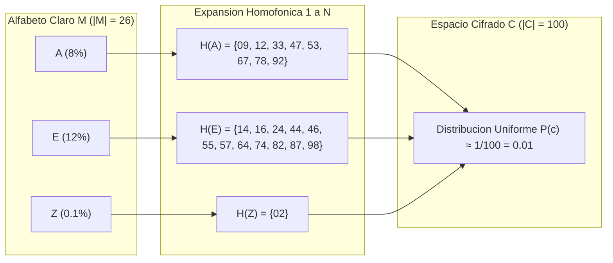
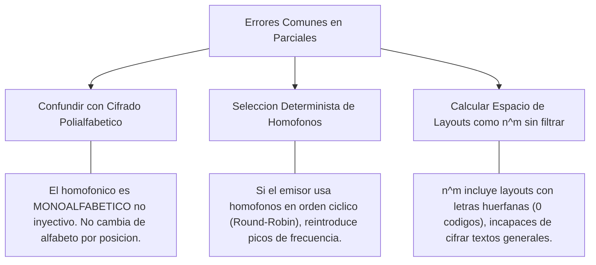

[← Volver a Curso.md](../Curso.md)

# Cifrado Homofonico (Homophonic Substitution Cipher)

> **Materia**: Criptografia | **Fuente**: [part 2.pdf](../Documentos/part 2.pdf)  
> `homophonic cipher`, `sustitucion homofonica`, `alfabeto expandido`, `frecuencia de letras`, `combinatoria de layouts`, `estirling`

---

## 1. Fundamento Operativo y Mecanismo Antianalisis

El **Cifrado Homofonico** es un criptosistema de sustitucion monoalfabetica no inyectiva donde cada simbolo del alfabeto de entrada $\mathcal{M}$ se asocia a un subconjunto disjunto de multiples simbolos cifrados (**homofonos**) en el alfabeto expandido $\mathcal{C}$.



### Reglas Operativas y Teoria de la Informacion

- **Expansion del Alfabeto**: El espacio cifrado es estrictamente mayor que el espacio claro:
  $$|\mathcal{C}| > |\mathcal{M}| \quad (\text{ej. } |\mathcal{C}| = 100 \text{ numeros } [00-99], \ |\mathcal{M}| = 26 \text{ letras [A-Z]})$$
- **Dimensionamiento Proporcional**: El cardinal del conjunto de homofonos $H(x_i) \subset \mathcal{C}$ asignado a la letra $x_i \in \mathcal{M}$ es proporcional a su frecuencia relativa natural $p(x_i)$:
  $$c_i = |H(x_i)| \approx |\mathcal{C}| \cdot p(x_i), \quad \text{donde } \sum_{i=1}^{|\mathcal{M}|} c_i = |\mathcal{C}|$$
- **Aplanamiento del Histograma Marginal**: Si el emisor selecciona cada homofono $h \in H(x_i)$ mediante distribucion pseudoaleatoria uniforme $P(h \mid x_i) = \frac{1}{c_i}$, la probabilidad de aparicion de cualquier simbolo $h \in \mathcal{C}$ en el criptograma se vuelve uniforme:
  $$P(h) = P(h \mid x_i) \cdot P(x_i) = \frac{1}{c_i} \cdot \left(\frac{c_i}{|\mathcal{C}|}\right) = \frac{1}{|\mathcal{C}|}$$
  $\implies$ Invalida por completo el criptoanalisis directo de frecuencias de primer orden (monogramas).
- **Asimetria Operativa Cifrado / Descifrado**:
  - **Cifrado (1 a N, no determinista)**: Requiere un generador de numeros aleatorios (RNG) para escoger un homofono $h \in H(m_k)$.
  - **Descifrado (N a 1, determinista y univoco)**: Dado que las particiones son mutuamente disjuntas ($H(x_i) \cap H(x_j) = \emptyset \ \forall i \neq j$), cada numero entero pertenece exactamente a una letra clara.

---

## 2. Cuadricula / Layout de Referencia del PDF

Particion canonica de $|\mathcal{C}| = 100$ enteros ($00$ al $99$) distribuidos en $|\mathcal{M}| = 26$ letras segun las frecuencias foneticas del idioma ingles (Slide 36):

| Letra ($x_i$) | Cantidad ($c_i$) | Porcentaje (%) | Conjunto de Homofonos Asignados $H(x_i)$ |
| :---: | :---: | :---: | :--- |
| **A** | 8 | 8% | `09, 12, 33, 47, 53, 67, 78, 92` |
| **B** | 2 | 2% | `48, 81` |
| **C** | 3 | 3% | `13, 41, 62` |
| **D** | 4 | 4% | `01, 03, 45, 79` |
| **E** | 12 | 12% | `14, 16, 24, 44, 46, 55, 57, 64, 74, 82, 87, 98` |
| **F** | 2 | 2% | `10, 31` |
| **G** | 2 | 2% | `06, 25` |
| **H** | 6 | 6% | `23, 39, 50, 56, 65, 68` |
| **I** | 6 | 6% | `32, 70, 73, 83, 88, 93` |
| **J** | 1 | 1% | `15` |
| **K** | 1 | 1% | `04` |
| **L** | 4 | 4% | `26, 37, 51, 84` |
| **M** | 2 | 2% | `22, 27` |
| **N** | 6 | 6% | `18, 58, 59, 66, 71, 91` |
| **O** | 7 | 7% | `00, 05, 07, 54, 72, 90, 99` |
| **P** | 2 | 2% | `38, 95` |
| **Q** | 1 | 1% | `94` |
| **R** | 6 | 6% | `29, 35, 40, 42, 77, 80` |
| **S** | 6 | 6% | `11, 19, 36, 76, 86, 96` |
| **T** | 9 | 9% | `17, 20, 30, 43, 49, 69, 75, 85, 97` |
| **U** | 3 | 3% | `08, 61, 63` |
| **V** | 1 | 1% | `34` |
| **W** | 2 | 2% | `60, 89` |
| **X** | 1 | 1% | `28` |
| **Y** | 2 | 2% | `21, 52` |
| **Z** | 1 | 1% | `02` |
| **Total** | **100** | **100%** | **Particion exacta del espacio entero $\{0, 1, \dots, 99\}$** |

---

## 3. Resolucion Paso a Paso del Ejemplo del PDF

### Enunciado (Slide 36)
> *Encrypt the message: "Crypto is fun"*

### Normalizacion y Asignacion
1. **Texto plano normalizado**: `C - R - Y - P - T - O - I - S - F - U - N` (longitud = 11).
2. **Seleccion de homofonos** (eleccion pseudoaleatoria entre las opciones de la tabla):

| Posicion | Letra ($m_k$) | Homofonos Disponibles $H(m_k)$ | Homofono Elegido (PDF) | Criptograma Acumulado |
| :---: | :---: | :--- | :---: | :--- |
| 1 | **C** | $\{13, 41, \mathbf{62}\}$ | **62** | `62` |
| 2 | **R** | $\{29, 35, \mathbf{40}, 42, 77, 80\}$ | **40** | `62 40` |
| 3 | **Y** | $\{\mathbf{21}, 52\}$ | **21** | `62 40 21` |
| 4 | **P** | $\{38, \mathbf{95}\}$ | **95** | `62 40 21 95` |
| 5 | **T** | $\{17, 20, 30, 43, 49, \mathbf{69}, 75, 85, 97\}$ | **69** | `62 40 21 95 69` |
| 6 | **O** | $\{0, 5, 7, 54, 72, \mathbf{90}, 99\}$ | **90** | `62 40 21 95 69 90` |
| 7 | **I** | $\{\mathbf{32}, 70, 73, 83, 88, 93\}$ | **32** | `62 40 21 95 69 90 32` |
| 8 | **S** | $\{11, \mathbf{19}, 36, 76, 86, 96\}$ | **19** | `62 40 21 95 69 90 32 19` |
| 9 | **F** | $\{10, \mathbf{31}\}$ | **31** | `62 40 21 95 69 90 32 19 31` |
| 10 | **U** | $\{8, \mathbf{61}, 63\}$ | **61** | `62 40 21 95 69 90 32 19 31 61` |
| 11 | **N** | $\{18, 58, 59, 66, 71, \mathbf{91}\}$ | **91** | `62 40 21 95 69 90 32 19 31 61 91` |

- **Criptograma de salida**:
  ```text
  62 40 21 95 69 90 32 19 31 61 91
  ```

---

## 4. Resolucion Completa de los Ejercicios del PDF

### Ejercicio 1: Descifrado (Slide 36 y 37)
> *Decrypt "13 5 26 0 22 81 88 47" using the same layout.*

El descifrado busca el subconjunto $H(x_i)$ tal que $c_j \in H(x_i)$:

| Bloque $c_j$ | Comprobacion de Conjunto | Letra Resuelta | Justificacion Tecnica |
| :---: | :--- | :---: | :--- |
| **13** | $13 \in H(\text{C}) = \{13, 41, 62\}$ | **C** | Pertenencia disjunta |
| **5** | $5 \in H(\text{O}) = \{0, 5, 7, 54, 72, 90, 99\}$ | **O** | Primer homofono de 'O' |
| **26** | $26 \in H(\text{L}) = \{26, 37, 51, 84\}$ | **L** | Pertenencia disjunta |
| **0** | $0 \in H(\text{O}) = \{0, 5, 7, 54, 72, 90, 99\}$ | **O** | Segundo homofono distinto para la misma letra 'O' |
| **22** | $22 \in H(\text{M}) = \{22, 27\}$ | **M** | Pertenencia disjunta |
| **81** | $81 \in H(\text{B}) = \{48, 81\}$ | **B** | Pertenencia disjunta |
| **88** | $88 \in H(\text{I}) = \{32, 70, 73, 83, 88, 93\}$ | **I** | Pertenencia disjunta |
| **47** | $47 \in H(\text{A}) = \{9, 12, 33, 47, 53, 67, 78, 92\}$ | **A** | Pertenencia disjunta |

- **Texto claro recuperado**:
  ```text
  COLOMBIA
  ```

---

### Ejercicio 2: Espacio Combinatorio de Layouts (Slide 38)
> *a) How many possible layouts do exist? Propose a way of calculating the number of layouts: $m$ = numbers, $n$ = letters.*  
> *b) Create a Python script to calculate the number of possible layouts.*

El problema presenta dos formulaciones matematicas rigurosas segun el nivel de restriccion del modelo:

#### Caso A: Particion de Frecuencias Fija (Layout Rígido del Idioma)
Si se fija la cantidad de homofonos por letra $(c_1, c_2, \dots, c_n)$ con $\sum_{i=1}^n c_i = m$, el problema equivale a contar las particiones ordenadas de un conjunto de $m$ elementos en $n$ bloques de tamaños fijos $c_1, c_2, \dots, c_n$.  
Viene dado por el **coeficiente multinomial**:

$$\text{Layouts}_{\text{fijo}} = \binom{m}{c_1, c_2, \dots, c_n} = \frac{m!}{\prod_{i=1}^n c_i!} = \frac{m!}{c_1! \cdot c_2! \cdots c_n!}$$

Para los valores del layout de la diapositiva ($m = 100, n = 26$):
$$\text{Layouts}_{\text{slide}} = \frac{100!}{8! \cdot 2! \cdot 3! \cdot 4! \cdot 12! \cdot 2! \cdot 2! \cdot 6! \cdot 6! \cdot 1! \cdot 1! \cdot 4! \cdot 2! \cdot 6! \cdot 7! \cdot 2! \cdot 1! \cdot 6! \cdot 6! \cdot 9! \cdot 3! \cdot 1! \cdot 2! \cdot 1! \cdot 2! \cdot 1!}$$

$$\text{Layouts}_{\text{slide}} \approx 5.1446 \times 10^{115} \approx 2^{384.4}$$

#### Caso B: Particion Arbitraria No Vacia (Surjecciones / Numeros de Stirling)
Si cualquier asignacion de los $m$ numeros a las $n$ letras es admisible, con la restriccion estricta de que **ninguna letra quede sin codigo** ($c_i \ge 1 \ \forall i$, condicion obligatoria para que el criptosistema pueda cifrar cualquier texto):  
Equivale al numero de **funciones sobreyectivas** de un conjunto de $m$ elementos en un conjunto de $n$ elementos:

$$\text{Layouts}_{\text{sobrey}} = n! \times S(m, n)$$

Donde $S(m, n)$ es el **Numero de Stirling de Segunda Clase**:
$$S(m, n) = \frac{1}{n!} \sum_{j=0}^{n} (-1)^{n-j} \binom{n}{j} j^m$$

Aplicando el principio de inclusion-exclusion:
$$\text{Layouts}_{\text{sobrey}} = \sum_{j=0}^{n} (-1)^{n-j} \binom{n}{j} j^m$$

Para $m = 100$ numeros y $n = 26$ letras:
$$\text{Layouts}_{\text{sobrey}} \approx 1.8299 \times 10^{141} \approx 2^{469.2}$$

> **Nota de frontera**: Si teoricamente se permitiesen letras con 0 codigos (particion debil, aunque inviable criptograficamente), el total seria $n^m = 26^{100} \approx 3.1429 \times 10^{141}$.

---

#### Script en Python: Calculo de Layouts

```python
import math

def calculate_homophonic_layouts():
    # -------------------------------------------------------------
    # Parametros del problema (Slide 36-38)
    # -------------------------------------------------------------
    counts = [8, 2, 3, 4, 12, 2, 2, 6, 6, 1, 1, 4, 2, 6, 7, 2, 1, 6, 6, 9, 3, 1, 2, 1, 2, 1]
    m = sum(counts)  # 100 numeros
    n = len(counts)  # 26 letras

    # -------------------------------------------------------------
    # Caso A: Particion fija de frecuencias (Multinomial)
    # -------------------------------------------------------------
    denom = 1
    for c in counts:
        denom *= math.factorial(c)
    
    layouts_fixed = math.factorial(m) // denom

    # -------------------------------------------------------------
    # Caso B: Particion arbitraria no vacia (Surjecciones: n! * S(m, n))
    # -------------------------------------------------------------
    layouts_surjective = 0
    for j in range(n + 1):
        sign = (-1) ** (n - j)
        term = sign * math.comb(n, j) * (j ** m)
        layouts_surjective += term

    # Caso teorico limite: particion debil con posibles letras vacias (n^m)
    layouts_all = n ** m

    # -------------------------------------------------------------
    # Salida de Resultados
    # -------------------------------------------------------------
    print("=" * 70)
    print("CALCULO DEL ESPACIO DE LAYOUTS DEL CIFRADO HOMOFONICO")
    print(f"Total numeros (m) = {m} | Total letras (n) = {n}")
    print("=" * 70)
    print(f"\n1. Caso A (Particion Fija por Frecuencias de Slide 36):")
    print(f"   Formula: m! / (c1! * c2! * ... * cn!)")
    print(f"   Total exacto : {layouts_fixed}")
    print(f"   Notacion cientifica: {layouts_fixed:.6e}")
    print(f"   Espacio en bits     : ~2^{math.log2(layouts_fixed):.2f}")

    print(f"\n2. Caso B (Asignacion Arbitraria No Vacia - Surjecciones):")
    print(f"   Formula: sum_{{j=0}}^n (-1)^(n-j) * C(n, j) * j^m")
    print(f"   Total exacto : {layouts_surjective}")
    print(f"   Notacion cientifica: {layouts_surjective:.6e}")
    print(f"   Espacio en bits     : ~2^{math.log2(layouts_surjective):.2f}")

    print(f"\n3. Limite Superior Teorico (Permite letras sin asignar):")
    print(f"   Formula: n^m")
    print(f"   Notacion cientifica: {layouts_all:.6e}")
    print("=" * 70)

if __name__ == "__main__":
    calculate_homophonic_layouts()
```

---

## 5. Criptoanalisis Practico y Puntos Criticos de Examen

### Vulnerabilidad Estructural a N-gramas (Digramas y Trigramas)
A pesar de anular la distribucion marginal de primer orden ($P(c_i) \approx \text{cte}$), el cifrado homofonico **no destruye la correlacion entre caracteres consecutivos**:
- **Digramas de alta probabilidad**: Pares como `TH`, `HE`, `IN`, `ER`, `QU` mantienen una relacion condicional estricta:
  $$P(c_{t+1} \in H(H) \mid c_t \in H(T)) \gg P(c_{t+1} \in H(Z) \mid c_t \in H(T))$$
- **Agrupamiento por Co-ocurrencia**: Un criptoanalista genera la matriz de transicion $T[u, v]$ entre simbolos del criptograma. Dos simbolos $u, w \in \mathcal{C}$ pertenecen a la misma letra clara $x_i$ si sus perfiles de frecuencia de transicion hacia los demas simbolos son casi identicos:
  $$T[u, *] \approx T[w, *] \implies u, w \in H(x_i)$$
- **Caso extremo `Q - U`**: Dado que $H(\text{Q}) = \{94\}$, cualquier simbolo que aparezca invariablemente precedido por `94` pertenece con probabilidad $\approx 1$ a $H(\text{U}) = \{08, 61, 63\}$.

### Distancia de Unicidad y Longitud Critica
- En un monoalfabetico simple, bastan $\approx 25 - 30$ caracteres para resolver la clave.
- En el cifrado homofonico con 100 codigos, se requieren entre **$500$ y $1000$ caracteres de criptograma** para acumular suficiente masa estadistica de digramas y romper el sistema mediante tecnicas de optimizacion heuristica (e.g. *Simulated Annealing* o Algoritmos Geneticos).

### Errores Frecuentes y Puntos de Evaluacion



- **Trampa 1: "El cifrado homofonico es polialfabético"**: FALSO. Es monoalfabetico multilateral. En los polialfabetico (Vigenere, Enigma), la regla de sustitucion varia segun la posicion temporal $t$ del caracter. En el homofonico, el alfabeto de mapeo $H$ es estatico e independiente del tiempo.
- **Trampa 2: Generador de Homofonos Deficiente**: Si el algoritmo de cifrado no selecciona homofonos de manera equiprobable e independiente (ej. usa siempre el menor numero disponible, o los recorre en orden secuencial fijo), se regeneran patrones predecibles que permiten resolver el texto con criptogramas de menos de 100 caracteres.
- **Trampa 3: Reversibilidad sin Clave**: Conociendo el layout, el descifrado no requiere busquedas exhaustivas ni combinatoria; es una busqueda en tabla de tiempo constante $\mathcal{O}(1)$ por caracter.
