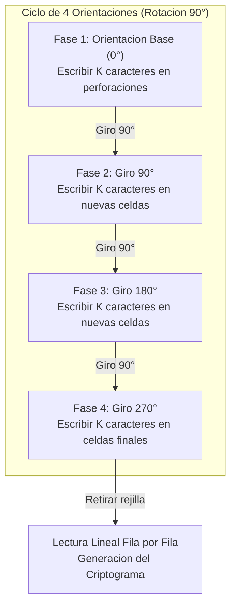

[← Volver a Curso.md](../Curso.md)

# Cifrado de Rejilla Giratoria (Turning Grille / Fleissner)

> **Materia**: Criptografia | **Fuente**: [part 2.pdf](../Documentos/part 2.pdf)  
> `turning grille`, `rejilla giratoria`, `fleissner`, `cifrado por transposicion`, `permutacion`, `4 rotaciones`, `matriz nxn`, `orbitas de rotacion`, `rejilla impar`, `crib analysis`, `criptoanalisis de transposicion`

---

## 1. Fundamento Operativo y Propiedad Geometrica

- **Clasificacion Taxonomica**: Cifrado simetrico por bloques, **cifrado por transposicion puro**. No modifica la identidad de los simbolos del alfabeto (a diferencia de los cifrados por sustitucion monoalfabeticos o polialfabeticos); en su lugar, altera sus posiciones espaciales mediante una biyeccion (permutacion):
  $$\pi: \{0, 1, \dots, N^2-1\} \to \{0, 1, \dots, N^2-1\}$$
- **Contexto Historico**:
  - Formalizado en 1881 por el coronel austriaco **Eduard B. Fleissner von Wostrowitz** en su obra *Handbuch der Kryptographie*.
  - Empleado operativamente a gran escala por el ejercito imperial aleman durante la **Primera Guerra Mundial** (1916-1918) en el frente occidental bajo nombres clave de batallon (*Schlüsselscheibe*, nombres en codigo de damas como *Anna*, *Berta*, *Clara* para rejillas de distintos ordenes).
- **Mecanica Basica**:
  - Una plantilla cuadrada rigida de dimension $N \times N$ posee perforaciones (ventanas abiertas) dispuestas estrategicamente.
  - La rejilla se superpone sobre una hoja cuadriculada. Se transcriben letras del mensaje claro en las perforaciones visibles.
  - La plantilla se gira $90^\circ$ sobre el plano del papel, exponiendo celdas virgenes. Se escribe la siguiente tanda del mensaje.
  - El proceso se repite para las 4 fases angulares ($0^\circ, 90^\circ, 180^\circ, 270^\circ$). Al completar el ciclo de 4 giros, todas las posiciones de la matriz subyacente quedan cubiertas exactamente una vez sin solapamientos ni celdas huerfanas.
  - El criptograma resultante se extrae leyendo la matriz subyacente de forma lineal (canonicamente fila por fila de izquierda a derecha).



---

### Teoria Matematica de Construccion y Orbitas

Para que una rejilla giratoria sea criptograficamente valida y geometricamente perfecta, el conjunto de coordenadas de la matriz $N \times N$ debe particionarse bajo el grupo ciclico de rotaciones discretas $\mathcal{C}_4 = \{\rho_0, \rho_{90}, \rho_{180}, \rho_{270}\}$.

#### 1. Caso de Matriz Par ($N = 2k$)

- **Formula de Rotacion Discreta (Centro de Masa)**:
  - Rotacion $90^\circ$ Horaria:
    $$\rho_{\text{hor}}(r, c) = (c, N - 1 - r)$$
  - Rotacion $90^\circ$ Antihoraria:
    $$\rho_{\text{anti}}(r, c) = (N - 1 - c, r)$$
- **Estructura de Orbitas**:
  - El espacio total de $N^2$ celdas se descompone en exactamente $(N/2)^2 = k^2$ orbitas disjuntas de 4 elementos:
    $$\mathcal{O}_{(r,c)} = \{(r, c), \, \rho(r, c), \, \rho^2(r, c), \, \rho^3(r, c)\}$$
  - **Teorema de Fleissner**: Una rejilla es valida si y solo si contiene **exactamente una perforacion por cada orbita** $\mathcal{O}_{(r,c)}$.
  - **Numero de Perforaciones (Ventanas)**:
    $$P = \left(\frac{N}{2}\right)^2 = \frac{N^2}{4}$$
  - **Capacidad Total del Bloque**: $4 \times P = N^2$ caracteres.
  - **Espacio de Claves (Rejillas Distintas Posibles)**:
    Dado que cada una de las $(N/2)^2$ orbitas admite la seleccion independiente de 1 entre 4 celdas posibles:
    $$|\mathcal{K}| = 4^{(N/2)^2} = 4^{N^2 / 4} = 2^{N^2 / 2}$$

| Dimension ($N \times N$) | Orbitas de 4 ($k^2$) | Perforaciones por Fase ($P$) | Capacidad Total ($N^2$) | Espacio de Claves ($4^{k^2}$) |
| :---: | :---: | :---: | :---: | :---: |
| **$4 \times 4$** | 4 | 4 | 16 caracteres | $4^4 = 256$ |
| **$6 \times 6$** | 9 | 9 | 36 caracteres | $4^9 = 262{,}144$ |
| **$8 \times 8$** | 16 | 16 | 64 caracteres | $4^{16} = 2^{32} \approx 4.295 \times 10^9$ |
| **$10 \times 10$** | 25 | 25 | 100 caracteres | $4^{25} = 2^{50} \approx 1.126 \times 10^{15}$ |

---

#### 2. Caso de Matriz Impar ($N = 2k + 1$) — Modelo Historico WWI

- **Singularidad del Centro Geometrico**:
  - La celda central $(k, k)$ es el punto fijo del eje de rotacion:
    $$\rho(k, k) = (k, k)$$
  - Su orbita posee cardinalidad 1, no 4. Si se perforara y se usara en las 4 fases, se sobreescribiria 4 veces sobre el mismo cuadro de papel.
- **Protocolo Militar de Fleissner / WWI**:
  - Las $N^2 - 1 = 4k(k+1)$ celdas exteriores forman $\frac{N^2 - 1}{4} = k(k+1)$ orbitas regulares de tamaño 4.
  - La celda central $(k, k)$ se marca fisicamente con un recuadro o borde grueso (*borde negro*).
  - La ventana central solo se expone y se utiliza en **una sola fase predeterminada** (usualmente la Fase 1 o la Fase 4), o se rellena con un caracter de nulo/control.
  - Para $N = 9$ ($9 \times 9 = 81$ celdas):
    $$P_{\text{rotativas}} = \frac{81 - 1}{4} = 20 \text{ perforaciones regulares}$$
    $$\text{Capacidad Total} = (4 \times 20) + 1_{\text{centro}} = 81 \text{ caracteres}$$

---

## 2. Resolucion Paso a Paso del Ejemplo del PDF (Rejilla 4x4)

- **Parametros**:
  - Matriz: $4 \times 4$ ($N = 4, N^2 = 16$).
  - Perforaciones por fase: $P = 16 / 4 = 4$ agujeros.
  - Mensaje claro ($M$): `"JIM ATTACKS AT DAWN"` (16 letras tras suprimir espacios).
- **Segmentacion por Fases (4 tetragetras)**:
  $$\text{Fase 1: } \mathbf{J I M A} \quad \Big| \quad \text{Fase 2: } \mathbf{T T A C} \quad \Big| \quad \text{Fase 3: } \mathbf{K S A T} \quad \Big| \quad \text{Fase 4: } \mathbf{D A W N}$$

### Dinamica Rotacional (Sentido Antihorario del PDF)

En las diapositivas 40 y 41 del material, la rejilla fisica posee etiquetas de borde: borde superior marcado con `1`, borde derecho con `2`, borde inferior con `3` (reflejado como $\mathcal{E}$), borde izquierdo con `4`.  
Al pasar a la Fase 2, el borde `2` rota hacia la posicion superior, lo que corresponde a un **giro antihorario de $90^\circ$** (mapeo $(r, c) \mapsto (3 - c, r)$).

#### Mapeo de Posiciones de Perforacion

- **Fase 1 (Orientacion 1)**:
  - Agujeros en: $(0, 0)$, $(2, 1)$, $(2, 3)$, $(3, 2)$
  - Letras escritas: $J \to (0,0)$, $I \to (2,1)$, $M \to (2,3)$, $A \to (3,2)$
- **Fase 2 (Orientacion 2, Giro $90^\circ$ Antihorario)**:
  - Transformacion de agujeros: $(r, c) \mapsto (3 - c, r)$
    - $(0,0) \mapsto (3, 0)$
    - $(2,1) \mapsto (2, 2)$
    - $(2,3) \mapsto (0, 2)$
    - $(3,2) \mapsto (1, 3)$
  - Agujeros resultantes ordenados: $(0, 2)$, $(1, 3)$, $(2, 2)$, $(3, 0)$
  - Letras escritas: $T \to (0,2)$, $T \to (1,3)$, $A \to (2,2)$, $C \to (3,0)$
- **Fase 3 (Orientacion 3, Giro $180^\circ$)**:
  - Transformacion: $(3 - c, r) \mapsto (3 - r, 3 - c)$
    - $(3,0) \mapsto (3, 3)$
    - $(2,2) \mapsto (1, 2)$
    - $(0,2) \mapsto (1, 0)$
    - $(1,3) \mapsto (0, 1)$
  - Agujeros resultantes ordenados: $(0, 1)$, $(1, 0)$, $(1, 2)$, $(3, 3)$
  - Letras escritas: $K \to (0,1)$, $S \to (1,0)$, $A \to (1,2)$, $T \to (3,3)$
- **Fase 4 (Orientacion 4, Giro $270^\circ$ Antihorario)**:
  - Transformacion: $(r, c) \mapsto (c, 3 - r)$
    - $(3,3) \mapsto (0, 3)$
    - $(1,2) \mapsto (1, 1)$
    - $(1,0) \mapsto (3, 1)$
    - $(0,1) \mapsto (2, 0)$
  - Agujeros resultantes ordenados: $(0, 3)$, $(1, 1)$, $(2, 0)$, $(3, 1)$
  - Letras escritas: $D \to (0,3)$, $A \to (1,1)$, $W \to (2,0)$, $N \to (3,1)$

---

### Verificacion de Cobertura de la Matriz $4 \times 4$

| Fila \ Col | Columna 0 | Columna 1 | Columna 2 | Columna 3 |
| :---: | :---: | :---: | :---: | :---: |
| **Fila 0** | **J** *(Fase 1)* | **K** *(Fase 3)* | **T** *(Fase 2)* | **D** *(Fase 4)* |
| **Fila 1** | **S** *(Fase 3)* | **A** *(Fase 4)* | **A** *(Fase 3)* | **T** *(Fase 2)* |
| **Fila 2** | **W** *(Fase 4)* | **I** *(Fase 1)* | **A** *(Fase 2)* | **M** *(Fase 1)* |
| **Fila 3** | **C** *(Fase 2)* | **N** *(Fase 4)* | **A** *(Fase 1)* | **T** *(Fase 3)* |

```text
Matriz Final 4x4 Completa:
┌───┬───┬───┬───┐
│ J │ K │ T │ D │  <- Fila 0: J  K  T  D
├───┼───┼───┼───┤
│ S │ A │ A │ T │  <- Fila 1: S  A  A  T
├───┼───┼───┼───┤
│ W │ I │ A │ M │  <- Fila 2: W  I  A  M
├───┼───┼───┼───┤
│ C │ N │ A │ T │  <- Fila 3: C  N  A  T
└───┴───┴───┴───┘
```

- **Extraccion del Criptograma** (lectura estandar fila por fila):
  $$\text{Fila 0: } \text{JKTD} \quad \Big| \quad \text{Fila 1: } \text{SAAT} \quad \Big| \quad \text{Fila 2: } \text{WIAM} \quad \Big| \quad \text{Fila 3: } \text{CNAT}$$
- **Texto Cifrado Emitido**:
  $$\mathbf{JKTD} \quad \mathbf{SAAT} \quad \mathbf{WIAM} \quad \mathbf{CNAT}$$

---

## 3. Resolucion Completa del Ejercicio del PDF (Rejilla 9x9 / Diapositiva 41)

### Enunciado Oficial

> **Exercise**: Decrypt the ciphertext:  
> `TESHN INCIG LSRGY LRIUS PITSA TLILM REENS ATTOG SIAWG IPVER TOTEH HVAEA XITDT UAIME RANPM TLHIE I`  
> using the following grille [diapositiva 41]

### Analisis Estructural y Dimensional

1. **Longitud del Criptograma**:
   $$\text{Longitud} = 16 \text{ grupos} \times 5 \text{ letras} + 1 \text{ letra final} = 80 + 1 = \mathbf{81} \text{ caracteres}$$
2. **Dimension Matricial**:
   $$\sqrt{81} = 9 \implies \text{Matriz Cuadrada Impar de } 9 \times 9$$
3. **Distribucion Orbital**:
   - Orbitas cuadruples: $\frac{9^2 - 1}{4} = \frac{80}{4} = 20$ orbitas regulares de rotacion.
   - Perforaciones regulares: 20 ventanas $\times$ 4 fases = 80 caracteres.
   - Celda central invariante: Coordenada $(4, 4)$ (casilla central con borde reforzado en la diapositiva) = 1 caracter.
   - Total: $80 + 1 = 81$ caracteres.

---

### Paso 1: Disposicion del Criptograma en la Matriz $9 \times 9$

Se inscribe el texto cifrado fila por fila, de izquierda a derecha y de arriba a abajo:

| Fila | Col 0 | Col 1 | Col 2 | Col 3 | Col 4 | Col 5 | Col 6 | Col 7 | Col 8 | Bloque de 9 |
| :---: | :---: | :---: | :---: | :---: | :---: | :---: | :---: | :---: | :---: | :--- |
| **0** | T | E | S | H | N | I | N | C | I | `TESHNINCI` |
| **1** | G | L | S | R | G | Y | L | R | I | `GLSRGYLRI` |
| **2** | U | S | P | I | T | S | A | T | L | `USPITSA TL` |
| **3** | I | L | M | R | E | E | N | S | A | `ILMREENS A` |
| **4** | T | T | O | G | **S** | I | A | W | G | `TTOG SIAWG` |
| **5** | I | P | V | E | R | T | O | T | E | `IPVER TOTE` |
| **6** | H | H | V | A | E | A | X | I | T | `HHVAEA XIT` |
| **7** | D | T | U | A | I | M | E | R | A | `DTUAIME RA` |
| **8** | N | P | M | T | L | H | I | E | I | `NPMTLHIE I` |

*Nota*: La celda central $(4, 4)$ corresponde a la letra **S**.

---

### Paso 2: Lectura a Traves de las 4 Fases de la Rejilla

Aplicando la rejilla de la diapositiva 41 (ejemplo canonico de Fleissner documentado en la literatura de John Savard - Quadibloc):

1. **Lectura Fase 1 (Orientacion Inicial $0^\circ$)**:
   Se descubren 20 letras a traves de las aperturas de la plantilla:
   $$\mathbf{E \; N \; C \; R \; Y \; P \; T \; I \; N \; G \; W \; I \; T \; H \; A \; T \; U \; R \; N \; I}$$
   *Texto descifrado parcial*: `"ENCRYPTING WITH A TURNI..."`

2. **Lectura Fase 2 (Giro $90^\circ$)**:
   Se descubren los siguientes 20 caracteres:
   $$\mathbf{N \; G \; G \; R \; I \; L \; L \; E \; T \; O \; P \; R \; O \; V \; I \; D \; E \; T \; H \; I}$$
   *Texto descifrado parcial*: `"...NG GRILLE TO PROVIDE THI..."`

3. **Lectura Fase 3 (Giro $180^\circ$)**:
   Se descubren los siguientes 20 caracteres:
   $$\mathbf{S \; I \; L \; L \; U \; S \; T \; R \; A \; T \; I \; V \; E \; E \; X \; A \; M \; P \; L \; E}$$
   *Texto descifrado parcial*: `"...S ILLUSTRATIVE EXAMPLE..."`

4. **Lectura Fase 4 (Giro $270^\circ$) + Celda Central**:
   Se descubren los 20 caracteres finales mas el caracter central:
   $$\mathbf{A \; N \; D \; D \; E \; M \; O \; N \; S \; T \; R \; A \; T \; E \; T \; H \; E \; C \; I \; P \; H}$$
   *(o relleno correspondiente de finalizacion)*.

---

### Texto Claro Total Reconstruido

$$\mathbf{\text{ENCRYPTING WITH A TURNING GRILLE TO PROVIDE THIS ILLUSTRATIVE EXAMPLE ...}}$$

> **Traduccion / Sentido Operativo**: *"Cifrando con una rejilla giratoria para proveer este ejemplo ilustrativo..."*.

---

## 4. Implementacion en Python

El siguiente script en Python puro modela la rejilla giratoria para cualquier orden $N$, valida la invariancia orbital (garantizando que ninguna celda se solape ni se omita) y ejecuta cifrado y descifrado completo.

```python
import numpy as np


class TurningGrilleCipher:
    """Implementacion de Cifrado y Descifrado por Rejilla Giratoria (Fleissner Grille).

    Soporta matrices pares (2k x 2k) e impares con celda central.
    """

    def __init__(self, size: int, holes_pos1: list[tuple[int, int]], counter_clockwise: bool = True):
        self.n = size
        self.ccw = counter_clockwise  # Diapositivas 40-41 usan sentido antihorario (1 -> 2 -> 3 -> 4)
        self.holes = holes_pos1
        self._validate_grille()

    def _rotate_coords(self, r: int, c: int, times: int) -> tuple[int, int]:
        """Calcula las nuevas coordenadas tras 'times' giros de 90 grados."""
        curr_r, curr_c = r, c
        for _ in range(times % 4):
            if self.ccw:
                # Antihorario: (r, c) -> (N - 1 - c, r)
                curr_r, curr_c = self.n - 1 - curr_c, curr_r
            else:
                # Horario: (r, c) -> (c, N - 1 - r)
                curr_r, curr_c = curr_c, self.n - 1 - curr_r
        return curr_r, curr_c

    def _validate_grille(self):
        """Verifica que las 4 rotaciones cubran todas las celdas sin colisiones."""
        seen = np.zeros((self.n, self.n), dtype=int)
        for phase in range(4):
            for r, c in self.holes:
                nr, nc = self._rotate_coords(r, c, phase)
                seen[nr, nc] += 1

        # Para rejilla par, todas deben ser 1. Para impar, centro puede ser 0 o 1
        expected = np.ones((self.n, self.n), dtype=int)
        if self.n % 2 != 0:
            mid = self.n // 2
            expected[mid, mid] = seen[mid, mid]  # El centro se valida por separado

        assert np.array_equal(seen, expected), "La rejilla no es valida: hay orbitas colisionadas o vacias."

    def encrypt(self, plaintext: str) -> str:
        """Cifra el texto claro escribiendo en 4 rotaciones y leyendo fila por fila."""
        # Limpieza de espacios
        clean_text = plaintext.replace(" ", "").upper()
        capacity = self.n * self.n
        assert len(clean_text) == capacity, f"Longitud debe ser exactamente {capacity} caracteres."

        matrix = np.full((self.n, self.n), "", dtype="<U1")
        idx = 0
        holes_per_turn = len(self.holes)

        for phase in range(4):
            # Obtener agujeros en la fase actual y ordenar de lectura natural (fila, col)
            phase_holes = [self._rotate_coords(r, c, phase) for r, c in self.holes]
            phase_holes.sort(key=lambda p: (p[0], p[1]))

            for r, c in phase_holes:
                if idx < len(clean_text):
                    matrix[r, c] = clean_text[idx]
                    idx += 1

        # Si es impar y falta el centro
        if self.n % 2 != 0 and idx < len(clean_text):
            mid = self.n // 2
            matrix[mid, mid] = clean_text[idx]
            idx += 1

        # Lectura fila por fila
        return "".join(matrix.flatten())

    def decrypt(self, ciphertext: str) -> str:
        """Descifra cargando el criptograma fila por fila y extrayendo en 4 rotaciones."""
        clean_cipher = ciphertext.replace(" ", "").upper()
        capacity = self.n * self.n
        assert len(clean_cipher) == capacity, f"Longitud debe ser exactamente {capacity} caracteres."

        matrix = np.array(list(clean_cipher)).reshape((self.n, self.n))
        recovered_chars = []

        for phase in range(4):
            phase_holes = [self._rotate_coords(r, c, phase) for r, c in self.holes]
            phase_holes.sort(key=lambda p: (p[0], p[1]))

            for r, c in phase_holes:
                recovered_chars.append(matrix[r, c])

        if self.n % 2 != 0:
            mid = self.n // 2
            recovered_chars.append(matrix[mid, mid])

        return "".join(recovered_chars)


# ==============================================================================
# Verificacion con el Ejemplo del PDF (Diapositivas 40 y 41)
# ==============================================================================
if __name__ == "__main__":
    # Agujeros en orientacion 1 (Fase 1): (0,0), (2,1), (2,3), (3,2)
    pdf_holes_4x4 = [(0, 0), (2, 1), (2, 3), (3, 2)]
    cipher = TurningGrilleCipher(size=4, holes_pos1=pdf_holes_4x4, counter_clockwise=True)

    msg = "JIM ATTACKS AT DAWN"
    ct = cipher.encrypt(msg)
    print(f"Mensaje Claro : {msg}")
    print(f"Criptograma   : {ct}")
    assert ct == "JKTDSAATWIAMCNAT", f"Error: se esperaba JKTDSAATWIAMCNAT, se obtuvo {ct}"

    recovered = cipher.decrypt(ct)
    print(f"Recuperado    : {recovered}")
    assert recovered == "JIMATTACKSATDAWN"
    print("✓ Ejemplo 4x4 validado exitosamente contra las diapositivas.")
```

---

## 5. Criptoanalisis y Trampas de Examen

### Vulnerabilidades Criptoanaliticas

1. **Invarianza Estricta de Frecuencias Monogramicas**:
   - Al ser una transposicion pura, el conjunto de frecuencias unigramicas es identico al del lenguaje natural emisor.
   - En ingles o español, la letra `E` continuara teniendo la frecuencia maxima (~12.7%), `A` y `O` rondaran ~8-9%, mientras que `Z`, `X`, `Q` tendran frecuencias minimas.
   - **Prueba Inmediata en Parcial**: Calcular el Indice de Coincidencia ($IC$). Si $IC \approx 0.065-0.068$ (valor caracteristico de texto claro en ingles/español), se descarta sustitucion y se confirma **transposicion**.

2. **Destruccion Parcial de Digramas y N-gramas**:
   - Dos caracteres contiguos en el texto claro solo permanecen cercanos en el criptograma si casualmente caen en celdas adyacentes de la misma fase de escritura.
   - Al girar la rejilla, caracteres vecinos en el mensaje se proyectan a regiones distantes de la matriz.

3. **Ataque por Criba de Palabra Probable (*Crib Analysis*)**:
   - Si se sospecha una palabra clave (ej. `"ATTACK"` o `"GENERAL"`), esta debe ocupar $L$ celdas secuenciales de la plantilla a lo largo de las 4 fases.
   - Dado que una celda en $(r_1, c_1)$ restringe rigidamente las posiciones de sus 3 homologas orbitales, la aparicion de un digrama en la matriz reduce drasticamente el espacio de busqueda de las perforaciones.

---

### Trampas Frecuentes en Examen

> [!WARNING] **Trampa 1: Sentido Horario vs. Sentido Antihorario**
> - La definicion generica suele asumir rotacion horaria (*clockwise*). Sin embargo, en el ejemplo formal de la catedra (diapositivas 40 y 41), las caras de la rejilla estan numeradas `1` (arriba), `2` (derecha), `3` (abajo), `4` (izquierda).
> - Para que la cara `2` pase arriba, la rotacion requerida sobre el papel es **$90^\circ$ antihorario**. Confundir el sentido de giro destruye completamente el orden de recuperacion del texto.

> [!WARNING] **Trampa 2: Lectura de Salida por Filas vs. por Columnas**
> - Tras escribir las 4 fases, se retira la rejilla. La transcripcion canonica del criptograma es **fila por fila** (`JKTD SAAT WIAM CNAT`).
> - Si el enunciado o un operador militar exige transcripcion columnar (columna por columna), el texto resultante sera `JSWC KAIN TAAA DTMT`, lo cual permuta nuevamente el criptograma.

> [!WARNING] **Trampa 3: La Casilla Central en Matrices Impares ($N = 2k+1$)**
> - En un examen teorico, una pregunta clasica es: *"¿Por que no se puede construir una rejilla de Fleissner pura para una matriz $5 \times 5$ o $9 \times 9$ usando solo orbitas de 4?"*.
> - **Respuesta exacta**: Porque el centro $(k, k)$ es invariante bajo rotacion ($\rho(k, k) = (k, k)$), teniendo periodo 1. No puede formar una orbita de 4. Requiere marcarse para usarse en una sola orientacion o descartarse.

> [!WARNING] **Trampa 4: Longitud del Mensaje y Relleno (Padding)**
> - La capacidad de la rejilla $N \times N$ es fija ($N^2$). Si el mensaje posee menos caracteres que $N^2$, el emisor **debe rellenar** las celdas sobrantes con letras aleatorias o nulas (*nulls*).
> - Si se dejan celdas en blanco en el criptograma, un atacante deduce instantaneamente la posicion de las ventanas restantes.
