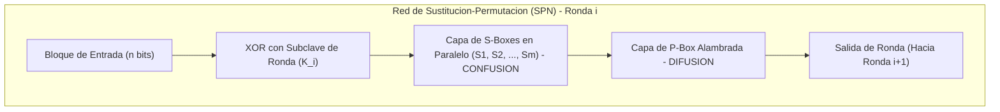

[← Volver a Curso.md](../Curso.md)

# Cifrado Lucifer y Cifrados de Producto

> **Materia**: Criptografia | **Fuente**: [part 2.pdf](../Documentos/part 2.pdf)  
> `lucifer cipher`, `cifrado de producto`, `feistel`, `s-box`, `p-box`, `confusion`, `difusion`, `des predecessor`, `red spn`

---

## 1. Arquitectura de Cifrados de Producto (Product Ciphers)

Propuestos formalmente por **Claude Shannon** en su tratado fundacional *Communication Theory of Secrecy Systems* (1949). Un cifrado de producto combina de forma alternada e iterada transformaciones elementales de **sustitucion** y **permutacion/transposicion**.



### Conceptos Operativos Fundamentales

- **Difusion (*Diffusion*)**:
  - **Mecanismo**: Disipa las propiedades y dependencias estadisticas del texto plano a lo largo de todo el criptograma.
  - **Objetivo**: Cada bit del texto plano y cada bit de la clave deben influir en la mayor cantidad posible de bits del texto cifrado (idealmente en el 50% de ellos $\implies$ **efecto avalancha** o *avalanche effect*).
  - **Propiedad algebraica**: Dos transposiciones consecutivas ($P_2 \circ P_1$) producen unicamente otra transposicion en el grupo simetrico $S_n$; redistribuyen posiciones, pero preservan intactas las frecuencias de los simbolos.

- **Confusion (*Confusion*)**:
  - **Mecanismo**: Hace que la relacion estadistica entre el texto cifrado y la clave sea lo mas compleja, no lineal e ininteligible posible.
  - **Objetivo**: Impedir que un atacante deduzca los bits de la clave mediante la observacion de sesgos o patrones en el criptograma.
  - **Propiedad algebraica**: Dos sustituciones consecutivas ($S_2 \circ S_1$) generan otra sustitucion compuesta; alteran los valores de los simbolos pero, sin dispersion espacial, mantienen la vulnerabilidad a analisis de frecuencia localizada.

- **Sinergia en Cifrados de Producto ($P \circ S$)**:
  - La aplicacion alternada de sustitucion seguida de transposicion crea un cifrado con resistencia exponencialmente superior a la de sus componentes individuales.
  - **Puente historico**: Constituye la transicion directa entre la criptografia clasica manual y los cifrados de bloque modernos en hardware y software (**DES**, **AES**).

| Operacion | Bloque Tipico | Propiedad de Shannon | Efecto sobre el Bloque | Resultado de $f \circ f$ |
| :--- | :--- | :--- | :--- | :--- |
| **Sustitucion** | S-Box ($n \to m$ bits) | **Confusion** | Mapeo no lineal de valores | Sustitucion equivalente compuesta |
| **Transposicion** | P-Box ($n \to n$ bits) | **Difusion** | Permutacion espacial de posiciones | Permutacion compuesta en $S_n$ |
| **Producto ($P \circ S$)** | Ronda SPN / Feistel | **Confusion + Difusion** | No linealidad dispersada en el bloque | Cifrado robusto con efecto avalancha |

---

## 2. Diseño y Bloques Constructivos de Lucifer (Horst Feistel, IBM, 1971)

Desarrollado bajo el liderazgo del fisico y criptografo **Horst Feistel** en IBM. Representa el primer cifrado de bloque moderno basado en arquitectura de producto en hardware y es el **predecesor directo de DES** (*Data Encryption Standard*, 1977).

- **Etimologia**: Concebido originalmente como *Demonstration Cipher* $\implies$ truncado por restricciones del sistema a *Demon* $\implies$ rebautizado formalmente como **Lucifer** (juego fonetico con *"Lu(cipher)"*).

### P-Box (Permutation Box)

Dispositivo electronico cableado (*hardwired wire-crossing*) que permuta las posiciones de los bits de entrada hacia las salidas sin alterar sus valores logicos ($\{0, 1\}$).

- **Funcion matematica**: Mapeo biyectivo de indices $\pi: \{0, 1, \dots, n-1\} \to \{0, 1, \dots, n-1\}$.
- **Rol**: Proveer **difusion**, transportando los bits resultantes de una S-box hacia multiples S-boxes distintas en la ronda subsiguiente.

```text
Entrada (16 bits)                                           Salida (16 bits)
Bit 0: 1 ───────\                                        ──> Bit 0: 0
Bit 1: 0 ──────\ \                                       ──> Bit 1: 0
Bit 2: 0 ─────\ \ \                                      ──> Bit 2: 0
Bit 3: 0 ────\ \ \ \                                     ──> Bit 3: 0
Bit 4: 0 ───\ \ \ \ \                                    ──> Bit 4: 0
Bit 5: 0 ──\ \ \ \ \ \                                   ──> Bit 5: 0
Bit 6: 0 ─\ \ \ \ \ \ \                                  ──> Bit 6: 0
Bit 7: 0 ─ \ \ \ \ \ \ \ ──────────────────────────────> ──> Bit 7: 1  <-- [Bit 0 se desvio a posicion 7]
Bit 8: 0 ── \ \ \ \ \ \ \                                ──> Bit 8: 0
...          \ \ \ \ \ \ \                               ...
Bit 15: 0 ─────────────────────────────────────────────> ──> Bit 15: 0
```

### S-Box (Substitution Box)

Dispositivo de hardware que reemplaza un bloque binario de entrada de $n$ bits por otro bloque de $n$ bits mediante una transformacion **no lineal**. Es el **unico elemento no lineal** de toda la arquitectura; confiere **confusion**.

#### Arquitectura Trifasica Interna (Slide 45, $n = 3$ bits)

1. **Transformador Low-to-High Base (Decodificador 3:8)**:
   - Convierte el vector binario de 3 bits $\vec{x} = (x_2, x_1, x_0)$ en su representacion 1-hot sobre 8 lineas fisicas ($0 \dots 7$).
   - Activa unicamente la linea cuyo indice decimal corresponde al valor numerico: $\text{linea} = x_2 \cdot 4 + x_1 \cdot 2 + x_0 \cdot 1$.
2. **Permutacion Interna de 8 Lineas**:
   - Red cableada fija que reordena las 8 lineas segun la especificacion:
     $$\text{Permutacion (1-indexada)} = (4, 8, 1, 7, 3, 5, 6, 2)$$
   - Equivalente en indices 0-indexados:
     $$\pi_{\text{interna}} = [3, 7, 0, 6, 2, 4, 5, 1]$$
   - *Ejemplo de la diapositiva*: Entrada binaria $(0, 0, 1)_2 = 1_{10} \implies$ activa la Linea 1 $\implies$ la permutacion la redirige a la **Linea 7** de salida (hilo rojo en el diagrama).
3. **Transformador High-to-Low Base (Codificador 8:3)**:
   - Convierte la linea activa resultante de regreso a su representacion binaria de 3 bits $\vec{y} = (y_2, y_1, y_0)$.
   - Para la Linea 7 activa $\implies \vec{y} = (1, 1, 1)_2$.

```text
Entrada (3 bits)     Low-to-High (3:8)     Permutacion (4,8,1,7,3,5,6,2)     High-to-Low (8:3)    Salida (3 bits)
      x0 = 0 ───┐     Linea 0 ────────────────────────> Linea 3 ────────────┐     y0 = 1
      x1 = 0 ───┼──>  Linea 1 (ACTIVA) ───────────────> Linea 7 (ACTIVA) ──┼──>  y1 = 1   ==> (1, 1, 1)
      x2 = 1 ───┘     Linea 2 ─────────> Linea 0 ───────────────────────────┤     y2 = 1
                      Linea 3 ────────────────────────> Linea 6 ────────────┤
                      Linea 4 ─────────> Linea 2 ───────────────────────────┤
                      Linea 5 ─────────────────> Linea 4 ───────────────────┤
                      Linea 6 ────────────────────────> Linea 5 ────────────┤
                      Linea 7 ─────────> Linea 1 ───────────────────────────┘
```

#### Tabla de Sustitucion Resultante de la S-Box ($3 \to 3$ bits)

| Entrada Decimal | Entrada Binaria | Linea Activa 3:8 | Linea Permutada 8:3 | Salida Decimal | Salida Binaria |
| :---: | :---: | :---: | :---: | :---: | :---: |
| **0** | `000` | 0 (1ª) | 3 (4ª) | **3** | `011` |
| **1** | `001` | 1 (2ª) | 7 (8ª) | **7** | `111` *(Caso Slide 45)* |
| **2** | `010` | 2 (3ª) | 0 (1ª) | **0** | `000` |
| **3** | `011` | 3 (4ª) | 6 (7ª) | **6** | `110` |
| **4** | `100` | 4 (5ª) | 2 (3ª) | **2** | `010` |
| **5** | `101` | 5 (6ª) | 4 (5ª) | **4** | `100` |
| **6** | `110` | 6 (7ª) | 5 (6ª) | **5** | `101` |
| **7** | `111` | 7 (8ª) | 1 (2ª) | **1** | `001` |

### Alternancia en Cascada P & S Boxes (Slide 46)

La arquitectura de Lucifer encadena multiples etapas de cajas P y S de manera alternada:

$$\text{Texto Plano} \longrightarrow [P] \longrightarrow [S] \longrightarrow [P] \longrightarrow [S] \longrightarrow [P] \longrightarrow [S] \longrightarrow \dots \longrightarrow \text{Criptograma}$$

- **Topologia de la diapositiva**: Un bloque de bits (ej. 15 bits agrupados en 5 S-boxes de 3 bits) atraviesa una P-box inicial; los bits dispersos se alimentan en paralelo a 5 S-boxes ($S_1 \dots S_5$); las salidas de las S-boxes se reconducen mediante una nueva P-box hacia el siguiente banco de S-boxes.
- **Visualizacion del Efecto Avalancha**: La presencia de un unico bit `1` en la entrada (con el resto en `0`) se ramifica en la P-box, activando multiples entradas en la siguiente etapa de S-boxes, propagando el cambio hasta alterar casi la totalidad de los bits de salida tras 5 o 6 rondas.

> [!WARNING] Advertencia de Seguridad (Slide 43)
> **Ausencia de Clave = Sistema Inseguro**: La red basica de demostracion de hardware descrita en las diapositivas no posee clave externa secreta ($e = \emptyset$); es una funcion de permutacion fija publica e invertible sin secreto. Para constituir un criptosistema real bajo el **Principio de Kerckhoffs**, se deben incorporar **subclaves de ronda** (mediante XOR con el bloque o gobernando la seleccion de S-boxes alternativas).

---

## 3. Ejemplo Practico Numerico de Ronda P-Box y S-Box

Considerese un bloque de entrada de $N = 6$ bits procesado por una mini-red SPN con 2 S-boxes de 3 bits ($S_0, S_1$) segun la especificacion de la Slide 45.

### Especificacion de Componentes

1. **Permutacion P-Box ($\pi_6$)**:
   - Definicion de mapeo (posicion $i \to \pi_6[i]$):
     $$\pi_6 = [3, 0, 4, 1, 5, 2]$$
     *(El bit 0 pasa a la pos 3, bit 1 a pos 0, bit 2 a pos 4, bit 3 a pos 1, bit 4 a pos 5, bit 5 a pos 2)*.
2. **Capa de S-Boxes**:
   - Sub-bloque superior: $B_0 = (b_0, b_1, b_2) \to S(B_0)$
   - Sub-bloque inferior: $B_1 = (b_3, b_4, b_5) \to S(B_1)$
   - Tabla de sustitucion: $S = [3, 7, 0, 6, 2, 4, 5, 1]$.

### Ejecucion Paso a Paso

- **Texto Claro de Entrada**:
  $$m = [0, 0, 1, 1, 0, 0] \quad (\text{Hex: } 0\text{x}0\text{C})$$

#### Paso 1: Transposicion mediante P-Box ($\pi_6$)

Se reubica cada bit segun la tabla de permutacion:

| Indice Entrada ($i$) | Bit Entrada $m[i]$ | Indice Destino $\pi_6[i]$ | Posicion en Vector Permutado |
| :---: | :---: | :---: | :---: |
| 0 | **0** | 3 | $v[3] = 0$ |
| 1 | **0** | 0 | $v[0] = 0$ |
| 2 | **1** | 4 | $v[4] = 1$ |
| 3 | **1** | 1 | $v[1] = 1$ |
| 4 | **0** | 5 | $v[5] = 0$ |
| 5 | **0** | 2 | $v[2] = 0$ |

- **Vector tras P-Box**:
  $$v = [v[0], v[1], v[2], v[3], v[4], v[5]] = [0, 1, 0, 0, 1, 0]$$

#### Paso 2: Particion y Sustitucion en S-Boxes

Se segmenta el vector $v$ en 2 bloques de 3 bits:

1. **Evaluacion de $S_0$**:
   - Entrada binaria: $(v[0], v[1], v[2]) = (0, 1, 0)_2 = 2_{10}$.
   - Decodificador 3:8 $\to$ activa Linea 2.
   - Permutacion interna $(4, 8, 1, 7, 3, 5, 6, 2) \to$ Linea 2 se mapea a Linea 0.
   - Codificador 8:3 $\to$ Linea 0 codifica como $(0, 0, 0)_2 = 0_{10}$.
   - Salida $S_0$: $[0, 0, 0]$.

2. **Evaluacion de $S_1$**:
   - Entrada binaria: $(v[3], v[4], v[5]) = (0, 1, 0)_2 = 2_{10}$.
   - Decodificador 3:8 $\to$ activa Linea 2.
   - Mapeo interno $\to$ Linea 0 $\implies$ Codificador 8:3 produce $(0, 0, 0)_2$.
   - Salida $S_1$: $[0, 0, 0]$.

- **Vector Cifrado tras 1 Ronda**:
  $$c = [0, 0, 0, 0, 0, 0] \quad (\text{Hex: } 0\text{x}00)$$

#### Demostracion del Efecto de la Variacion de 1 Bit (Efecto Avalancha)

Si se altera unicamente el bit 0 de la entrada original: $m' = [\mathbf{1}, 0, 1, 1, 0, 0]$:
1. **P-Box**: El bit 0 alterado viaja a la posicion 3: $v' = [0, 1, 0, \mathbf{1}, 1, 0]$.
2. **S-Boxes**:
   - $S_0$ recibe $(0, 1, 0)_2 = 2 \implies \text{Salida: } (0, 0, 0)_2$.
   - $S_1$ recibe $(\mathbf{1}, 1, 0)_2 = 6 \implies \text{Salida: } S(6) = 5_{10} = (\mathbf{1}, 0, \mathbf{1})_2$.
3. **Resultado**: $c' = [0, 0, 0, \mathbf{1}, 0, \mathbf{1}]$ (cambiaron 2 bits de salida por variar 1 solo bit de entrada en una sola ronda).

---

## 4. Implementacion en Python

Modelo funcional de una red SPN estilo Lucifer con la S-Box exacta de la Slide 45, capa de P-Box configurable, inyeccion de subclave de ronda por XOR, y verificacion de reversibilidad ($D(E(m)) = m$).

```python
"""
lucifer_spn.py
Implementacion de una mini-red SPN basada en la arquitectura Lucifer (Feistel, IBM, 1971)
segun las especificaciones de las diapositivas 42 a 46.
"""

from typing import List, Tuple

class LuciferSPN:
    """
    Mini-cifrado de bloque SPN de 12 bits (4 S-boxes de 3 bits por ronda).
    Implementa decodificacion/codificacion hardware de S-box y difusion por P-box.
    """
    
    # S-Box exacta derivada de la Slide 45: Permutacion interna (4, 8, 1, 7, 3, 5, 6, 2)
    # Entrada x in {0..7} -> S[x] in {0..7}
    SBOX_TABLE: List[int] = [3, 7, 0, 6, 2, 4, 5, 1]
    
    # Inversa directa de la S-Box para descifrado: S_INV[S[x]] == x
    SBOX_INV_TABLE: List[int] = [2, 7, 4, 0, 5, 6, 3, 1]
    
    # Permutacion P-Box de 12 bits (distribuye los 3 bits de cada S-box a distintas S-boxes)
    # Posicion i -> P_TABLE[i]
    P_TABLE: List[int] = [
        0, 4, 8,    # Bits 0, 1, 2 de S0 van a S0, S1, S2
        1, 5, 9,    # Bits 3, 4, 5 de S1 van a S0, S1, S3
        2, 6, 10,   # Bits 6, 7, 8 de S2 van a S0, S2, S3
        3, 7, 11    # Bits 9, 10, 11 de S3 van a S1, S2, S3
    ]
    
    def __init__(self, rounds: int = 4):
        self.rounds = rounds
        # Calcular P-Box inversa
        self.P_INV_TABLE = [0] * len(self.P_TABLE)
        for src, dst in enumerate(self.P_TABLE):
            self.P_INV_TABLE[dst] = src

    @staticmethod
    def sbox_hardware_transform(nibble_3bit: int) -> int:
        """
        Simulacion explicita del hardware de la Slide 45:
        1. Decodificador 3:8 (Low-to-High Base)
        2. Permutacion interna fija (4, 8, 1, 7, 3, 5, 6, 2)
        3. Codificador 8:3 (High-to-Low Base)
        """
        assert 0 <= nibble_3bit <= 7, "Entrada debe ser de 3 bits"
        
        # 1. Low-to-high base transformer (linea 1-hot activa)
        active_line = nibble_3bit
        
        # 2. Permutacion interna de lineas (Slide 45: 1-indexed (4,8,1,7,3,5,6,2))
        perm_map = [3, 7, 0, 6, 2, 4, 5, 1]
        permuted_line = perm_map[active_line]
        
        # 3. High-to-low base transformer (codificacion binaria)
        return permuted_line

    def _permute_bits(self, block_12bit: int, p_table: List[int]) -> int:
        """Aplica una permutacion de posiciones de bits a un entero de 12 bits."""
        out = 0
        for src_idx, dst_idx in enumerate(p_table):
            bit = (block_12bit >> src_idx) & 1
            out |= (bit << dst_idx)
        return out

    def _apply_sboxes(self, block_12bit: int, inv: bool = False) -> int:
        """Aplica el banco de 4 S-boxes de 3 bits en paralelo."""
        table = self.SBOX_INV_TABLE if inv else self.SBOX_TABLE
        out = 0
        for i in range(4):
            # Extraer sub-bloque de 3 bits
            nibble = (block_12bit >> (i * 3)) & 0x07
            subst = table[nibble]
            out |= (subst << (i * 3))
        return out

    def encrypt(self, plaintext: int, subkeys: List[int]) -> int:
        """
        Cifrado SPN estilo Lucifer en r rondas:
        Para r-1 rondas: XOR clave -> Capa S -> Capa P
        Ultima ronda: XOR clave -> Capa S -> XOR clave final (sin P final)
        """
        state = plaintext & 0x0FFF
        for r in range(self.rounds - 1):
            state ^= subkeys[r]                  # Confusion con clave
            state = self._apply_sboxes(state)     # Confusion no lineal (S)
            state = self._permute_bits(state, self.P_TABLE)  # Difusion (P)
        
        # Ronda final
        state ^= subkeys[self.rounds - 1]
        state = self._apply_sboxes(state)
        state ^= subkeys[self.rounds]             # Blanqueo de clave final
        return state

    def decrypt(self, ciphertext: int, subkeys: List[int]) -> int:
        """Descifrado SPN aplicando operaciones inversas en orden inverso."""
        state = ciphertext & 0x0FFF
        # Invertir ronda final
        state ^= subkeys[self.rounds]
        state = self._apply_sboxes(state, inv=True)
        state ^= subkeys[self.rounds - 1]
        
        # Invertir rondas intermedias
        for r in range(self.rounds - 2, -1, -1):
            state = self._permute_bits(state, self.P_INV_TABLE)
            state = self._apply_sboxes(state, inv=True)
            state ^= subkeys[r]
        return state


def avalanche_analysis(cipher: LuciferSPN, p1: int, p2: int, keys: List[int]) -> List[int]:
    """Calcula la distancia de Hamming ronda a ronda entre dos textos claros."""
    s1, s2 = p1 & 0x0FFF, p2 & 0x0FFF
    hamming_history = []
    
    for r in range(cipher.rounds):
        s1 ^= keys[r]
        s2 ^= keys[r]
        s1 = cipher._apply_sboxes(s1)
        s2 = cipher._apply_sboxes(s2)
        if r < cipher.rounds - 1:
            s1 = cipher._permute_bits(s1, cipher.P_TABLE)
            s2 = cipher._permute_bits(s2, cipher.P_TABLE)
        diff = bin(s1 ^ s2).count("1")
        hamming_history.append(diff)
    return hamming_history


if __name__ == "__main__":
    # Inicializacion del cifrador de 4 rondas
    cipher = LuciferSPN(rounds=4)
    subkeys = [0x1A2, 0x3B4, 0x5C6, 0x7D8, 0x9EA]  # 5 subclaves de 12 bits
    
    plaintext = 0b001000000000  # 1 bit activo en S3 (nibble '001' = 1)
    ciphertext = cipher.encrypt(plaintext, subkeys)
    recovered = cipher.decrypt(ciphertext, subkeys)
    
    print("=== Mini-Lucifer SPN ===")
    print(f"Texto Claro:       0x{plaintext:03X} (bin: {plaintext:012b})")
    print(f"Criptograma:       0x{ciphertext:03X} (bin: {ciphertext:012b})")
    print(f"Texto Recuperado:  0x{recovered:03X} (bin: {recovered:012b})")
    assert plaintext == recovered, "Error critico: Descifrado fallo."
    print("Verificacion Formal: Biyectividad y recuperacion EXACTA confirmada.")
    
    # Evaluacion de Efecto Avalancha: variar 1 solo bit (bit 0)
    plaintext_mod = plaintext ^ 0b000000000001
    avalanche = avalanche_analysis(cipher, plaintext, plaintext_mod, subkeys)
    print("\nEfecto Avalancha (Distancia de Hamming por ronda):")
    for r, bits_diff in enumerate(avalanche, start=1):
        pct = (bits_diff / 12) * 100
        print(f"  Ronda {r}: {bits_diff}/12 bits cambiados ({pct:.1f}%)")
```

---

## 5. Criptoanalisis y Puntos Criticos de Examen

### La No-Linealidad de la S-Box como Pilar de Seguridad

- **Teorema de Colapso Lineal**: Si las cajas de sustitucion (S-boxes) fueran funciones afines/lineales sobre $GF(2)$ de la forma:
  $$S(\vec{x}) = M \cdot \vec{x} \oplus \vec{b}$$
  entonces toda la red SPN de $r$ rondas colapsa matematicamente a una unica transformacion afin global:
  $$C = A \cdot P \oplus B$$
  donde $A$ es una matriz de $N \times N$ y $B$ un vector de $N$ bits sobre $\mathbb{F}_2$, resultantes de la multiplicacion sucesiva de las matrices de las capas P, S y las subclaves $K_i$.
- **Vulnerabilidad**: Un criptoanalista que obtenga unicamente $N$ pares conocidos de texto claro y criptograma linealmente independientes ($(P_1, C_1), \dots, (P_N, C_N)$) puede resolver el sistema completo mediante **Eliminacion Gaussiana** en tiempo $\mathcal{O}(N^3)$, rompiendo la clave instantaneamente sin importar el numero de rondas ni el tamaño de la clave.
- **Defensa Moderna**: Las S-boxes se optimizan explicitamente para presentar maxima **no-linealidad** y minima probabilidad diferencial/lineal frente al **Criptoanalisis Diferencial** (Biham & Shamir) y **Criptoanalisis Lineal** (Matsui).

### El Rol Estructural de la P-Box (Difusion Espacial)

- **Prevencion del Ataque Divide y Venceras**:
  - Sin la capa de P-box (es decir, si la permutacion fuera la identidad $P = I$), una red de $N = 64$ bits compuesta por 16 S-boxes de 4 bits se descompondria en **16 canales paralelos e independientes de 4 bits**.
  - El costo de ataque por fuerza bruta sobre la clave caeria de $2^{64}$ a unicamente $16 \times 2^4 = 256$ operaciones elementales.
- **Dispersion Multinivel**: La P-box garantiza que cada uno de los bits de salida de cualquier S-box se distribuya a la entrada de una S-box **distinta** en la ronda siguiente, expandiendo el efecto avalancha a traves de todo el bloque en pocas iteraciones.

### Tabla Comparativa: Confusion vs Difusion

| Criterio | Confusion (*Confusion*) | Difusion (*Diffusion*) |
| :--- | :--- | :--- |
| **Definicion** | Ocultar la relacion matematica entre la clave y el criptograma | Disipar la estructura y redundancia estadistica del texto plano en el criptograma |
| **Componente de Hardware** | **S-Box** (Substitution Box) | **P-Box** (Permutation Box) |
| **Naturaleza Algebraica** | **No lineal** ($GF(2)^n \to GF(2)^m$) | **Lineal / Biyectiva** ($\pi \in S_n$) |
| **Impacto si se elimina** | Colapso a sistema lineal resoluble por eliminacion gaussiana ($\mathcal{O}(N^3)$) | Fragmentacion en canales aislados atacables por *Divide and Conquer* |
| **Composicion $f \circ f$** | Dos sustituciones dan una sustitucion compuesta equivalente | Dos permutaciones dan una permutacion compuesta en $S_n$ |

### Trampas y Preguntas Tipicas de Parcial

1. **"¿Dos sustituciones consecutivas equivalen a una sustitucion mas segura?"**:
   - **FALSO**: Algebraicamente, $S_2(S_1(x))$ es simplemente otra sustitucion $S_{eq}(x)$. Sin una transposicion intermedia que disperse los bits entre bloques contiguos, la complejidad criptoanalitica no crece sustancialmente y no hay difusion.
2. **"¿Es seguro el hardware de demostracion de Lucifer mostrado en las diapositivas 43 a 46?"**:
   - **NO**: Como advierte la diapositiva 43 (*"there is no key - thus the system is insecure"*), una red P/S fija sin subclaves secretas es una transformacion biyectiva determinista publica; cualquiera que conozca la arquitectura puede invertirla directamente. Requiere obligatoriamente subclaves de ronda $K_i$.
3. **Confundir Confusion con Difusion**:
   - *Regla mnemotecnica de examen*:
     - **S**-Box $\implies$ **S**ustitucion $\implies$ Con-**S**-usion $\to$ **Confusion** (oculta la clave).
     - **P**-Box $\implies$ **P**ermutacion $\implies$ Dis-**P**-ersion $\to$ **Difusion** (propaga el texto plano).
4. **Filiacion Historica de DES**:
   - Recordar que Lucifer (IBM, Horst Feistel, 1971) es el ancestro directo de DES. La variacion principal radica en que DES adopto la arquitectura de **Red de Feistel** (dividiendo el bloque en mitades izquierda y derecha $L$ y $R$) para permitir que el circuito de cifrado y descifrado fuera exactamente el mismo cambiando unicamente el orden de las subclaves.
