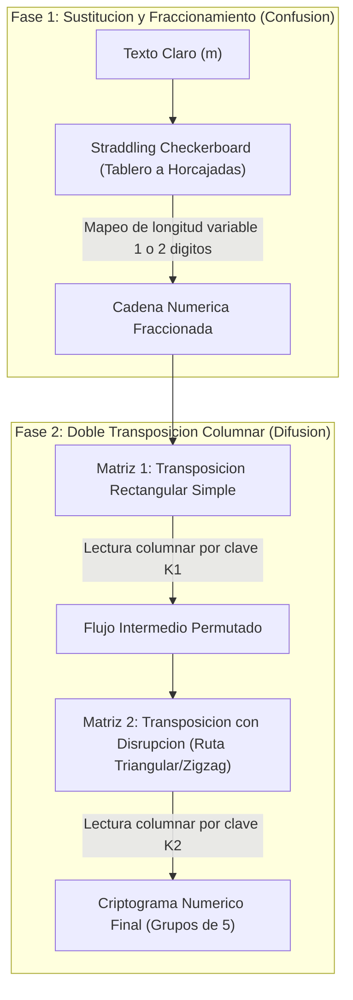

[← Volver a Curso.md](../Curso.md)

# Cifrado Hayhanen (VIC Cipher)

> **Materia**: Criptografia | **Fuente**: [part 2.pdf](../Documentos/part 2.pdf)  
> `hayhanen cipher`, `vic cipher`, `straddling checkerboard`, `doble transposicion`, `disrupcion`, `reino hayhanen`, `kgb`, `snegopad`, `hollow nickel`, `cifrado de producto`, `fraccionamiento`

---

## 1. Mecanismo Operativo y Fases del Algoritmo

- **Clasificacion Taxonomica**: Cifrado simetrico manual de **producto** (*Product Cipher*) que combina **sustitucion fraccionada polialfabetica/de longitud variable** con **doble transposicion columnar con disrupcion**.
- **Contexto Historico**:
  - Utilizado por el espionaje sovietico (KGB) durante la Guerra Fria (decada de 1950).
  - Asociado al caso del niquel hueco (*Hollow Nickel Case*, Brooklyn, 1953): una moneda de 5 centavos contenia un microfilme con una serie numerica cifrada.
  - Resistio los esfuerzos conjuntos de criptoanalisis del **FBI, NSA y GCHQ durante casi 4 años**.
  - Rompimiento definitivo en mayo de 1957 tras la desercion en Paris del espia **Reino Häyhänen** (nombre en clave *VICTOR*, origen del nombre **VIC Cipher**), quien revelo la estructura del algoritmo y la palabra clave mnemotecnica rusa **SNEGOPAD** (*Снегопад*, nevada). Llevo al arresto del maestro de espias Rudolf Abel.
- **Calificacion Criptografica**: Considerado por historiadores (David Kahn) como el cifrado de campo manual mas complejo y seguro jamas utilizado operativamente.



### Arquitectura de Dos Fases

1. **Fase 1 — Tablero a Horcajadas (*Straddling Checkerboard*)**:
   - Alfabeto expandido (28 simbolos: 26 letras del alfabeto ingles + signos como `/` y `.`).
   - Matriz de 3 filas $\times$ 10 columnas etiquetadas con una permutacion de dígitos $0..9$.
   - **Codificacion de longitud variable**:
     - Las 8 letras mas frecuentes del idioma (o derivadas de la clave) ocupan la fila superior y se codifican con **1 solo digito**.
     - Las 2 posiciones restantes de la primera fila quedan vacias y sus encabezados de columna actuan como prefijo (etiqueta de fila) para las filas 2 y 3.
     - Las restantes 20 letras/simbolos se codifican con **2 digitos** (prefijo de fila + digito de columna).
   - **Efecto criptografico**: Fraccionamiento intrinseco. Destruye la correspondencia biyectiva $1:1$ entre el espaciado del texto claro y el criptograma, achatando el histograma de frecuencias monoalfabetico.

2. **Fase 2 — Doble Transposicion Columnar con Disrupcion (*Disrupted Transposition*)**:
   - **Transposicion 1**: Escritura por filas en un bloque rectangular de $N_1$ columnas; lectura por orden numerico de clave columnar.
   - **Transposicion 2 (con Disrupcion)**:
     - Bloque de $N_2$ columnas. Se traza una linea divisoria en diagonal/zigzag escalonada que define areas triangulares irregulares.
     - **Regla de ruta**: Inicia a la izquierda de la columna con etiqueta `1` y desciende en diagonal hacia la derecha. Al tocar el margen derecho, salta a la izquierda de la columna `2` y repite, sucesivamente para `3`, `4`, etc.
     - **Llenado bifasico**: Se completa primero toda la region a la **izquierda** de la linea de disrupcion; posteriormente se llena la region a la **derecha**.
     - **Lectura final**: Columnas extraidas en orden estricto de permutacion de clave $1, 2, \dots, N_2$, particionadas en quintetos.

---

## 2. Resolucion Paso a Paso del Ejemplo del PDF (Diapositivas 47-50)

- **Texto Claro**: `"Feb/4/have contacted fred. will consult before investing in coverbusiness.nat"`
- **Clave del Tablero**: `'oriental'` (8 letras unicas)
- **Cabecera de Columnas**: `3 9 6 4 0 8 5 1 7 2`

### Paso 1: Construccion del Straddling Checkerboard (Slide 48)

- Las 8 letras de `'oriental'` se situan en las primeras 8 posiciones de la Fila 0 bajo las columnas $3, 9, 6, 4, 0, 8, 5, 1$.
- Las dos columnas vacias son la `7` y la `2`, las cuales definen las etiquetas de las filas subsecuentes.
- Las restantes 20 posiciones se rellenan con las letras faltantes en orden alfabetico seguidas de `/` y `.`:

```text
      | 3  9  6  4  0  8  5  1  7  2
------+-----------------------------
      | o  r  i  e  n  t  a  l
   7  | b  c  d  f  g  h  j  k  m  p
   2  | q  s  u  v  w  x  y  z  /  .
```

#### Tabla de Equivalencias de Sustitucion

| Letra | Codigo | Letra | Codigo | Letra | Codigo | Letra | Codigo | Letra | Codigo |
| :---: | :---: | :---: | :---: | :---: | :---: | :---: | :---: | :---: | :---: |
| **a** | `5` | **g** | `70` | **m** | `77` | **s** | `29` | **y** | `25` |
| **b** | `73` | **h** | `78` | **n** | `0` | **t** | `8` | **z** | `21` |
| **c** | `79` | **i** | `6` | **o** | `3` | **u** | `26` | **/** | `27` |
| **d** | `76` | **j** | `75` | **p** | `72` | **v** | `24` | **.** | `22` |
| **e** | `4` | **k** | `71` | **q** | `23` | **w** | `20` | | |
| **f** | `74` | **l** | `1` | **r** | `9` | **x** | `28` | | |

> [!NOTE]
> En los cifrados de campo de la KGB (VIC), los numeros aislados (como el `4` en `Feb/4/`) se codifican repitiendo el digito 3 veces (`444`) para distinguirlos de las letras y asegurar tolerancia a errores de transmision.

### Paso 2: Sustitucion Fraccionada del Texto Completo

| Segmento Claro | Sustitucion por Letra | Digitos Producidos |
| :--- | :--- | :--- |
| `Feb` | `F` $\to 74$, `e` $\to 4$, `b` $\to 73$ | `74 4 73` |
| `/ 4 /` | `/` $\to 27$, `4` $\to 444$, `/` $\to 27$ | `27 4 4 4 27` |
| `h av ec` | `h` $\to 78$, `a` $\to 5$, `v` $\to 24$, `e` $\to 4$, `c` $\to 79$ | `78 5 24 4 79` |
| `ontac` | `o` $\to 3$, `n` $\to 0$, `t` $\to 8$, `a` $\to 5$, `c` $\to 79$ | `3 0 8 5 79` |
| `ted` | `t` $\to 8$, `e` $\to 4$, `d` $\to 76$ | `8 4 76` |
| `f red .` | `f` $\to 74$, `r` $\to 9$, `e` $\to 4$, `d` $\to 76$, `.` $\to 22$ | `74 9 4 76 22` |
| `w illc` | `w` $\to 20$, `i` $\to 6$, `l` $\to 1$, `l` $\to 1$, `c` $\to 79$ | `20 6 1 1 79` |
| `ons u ltb` | `o` $\to 3$, `n` $\to 0$, `s` $\to 29$, `u` $\to 26$, `l` $\to 1$, `t` $\to 8$, `b` $\to 73$ | `3 0 29 26 1 8 73` |
| `ef oreinv` | `e` $\to 4$, `f` $\to 74$, `o` $\to 3$, `r` $\to 9$, `e` $\to 4$, `i` $\to 6$, `n` $\to 0$, `v` $\to 24$ | `4 74 3 9 4 6 0 24` |
| `es ting` | `e` $\to 4$, `s` $\to 29$, `t` $\to 8$, `i` $\to 6$, `n` $\to 0$, `g` $\to 70$ | `4 29 8 6 0 70` |
| `inc ov erb` | `i` $\to 6$, `n` $\to 0$, `c` $\to 79$, `o` $\to 3$, `v` $\to 24$, `e` $\to 4$, `r` $\to 9$, `b` $\to 73$ | `6 0 79 3 24 4 9 73` |
| `u s ines s` | `u` $\to 26$, `s` $\to 29$, `i` $\to 6$, `n` $\to 0$, `e` $\to 4$, `s` $\to 29$, `s` $\to 29$ | `26 29 6 0 4 29 29` |
| `. nat` | `.` $\to 22$, `n` $\to 0$, `a` $\to 5$, `t` $\to 8$ | `22 0 5 8` |

- **Cadena Numerica Resultante (100 digitos)**:
  `7447327444277852447930857984767494762220611793029261873474394602442986070607932449732629604292922058`

### Paso 3: Transposicion Columnar Simple (Slide 49)

- Se escribe la cadena numerica por filas en un bloque de 9 columnas con cabecera `4 7 5 8 2 9 6 1 3`:

```text
Cabecera:   4  7  5  8  2  9  6  1  3
Fila 01:    7  4  4  7  3  2  7  4  4
Fila 02:    4  2  7  7  8  5  2  4  4
Fila 03:    7  9  3  0  8  5  7  9  8
Fila 04:    4  7  6  7  4  9  4  7  6
Fila 05:    2  2  2  0  6  1  1  7  9
Fila 06:    3  0  2  9  2  6  1  8  7
Fila 07:    3  4  7  4  3  9  4  6  0
Fila 08:    2  4  4  2  9  8  6  0  7
Fila 09:    0  6  0  7  9  3  2  4  4
Fila 10:    9  7  3  2  6  2  9  6  0
Fila 11:    4  2  9  2  9  2  2  0  5
Fila 12:    8
```

- **Lectura por orden de clave ($1 \to 9$)**:
  - Columna 1 (etiqueta `1`, pos 8): `4 4 9 7 7 8 6 0 4 6 0` (11 digitos)
  - Columna 2 (etiqueta `2`, pos 5): `3 8 8 4 6 2 3 9 9 6 9` (11 digitos)
  - Columna 3 (etiqueta `3`, pos 9): `4 4 8 6 9 7 0 7 4 0 5` (11 digitos)
  - Columna 4 (etiqueta `4`, pos 1): `7 4 7 4 2 3 3 2 0 9 4 8` (12 digitos)
  - Columna 5 (etiqueta `5`, pos 3): `4 7 3 6 2 2 7 4 0 3 9` (11 digitos)
  - Columna 6 (etiqueta `6`, pos 7): `7 2 7 4 1 1 4 6 2 9 2` (11 digitos)
  - Columna 7 (etiqueta `7`, pos 2): `4 2 9 7 2 0 4 4 6 7 2` (11 digitos)
  - Columna 8 (etiqueta `8`, pos 4): `7 7 0 7 0 9 4 2 7 2 2` (11 digitos)
  - Columna 9 (etiqueta `9`, pos 6): `2 5 5 9 1 6 9 8 3 2 2` (11 digitos)

- **Secuencia Intermedia**:
  `4497786046038846239969448697074057474233209484736227403972741146292429720446727707094272225591698322`

### Paso 4: Transposicion con Disrupcion y Criptograma Final (Slides 49-50)

- Cabecera: `4 6 2 1 5 3` (6 columnas).
- Se aplica el trazado de disrupcion en zigzag:
  - Comienza a la izquierda de la columna etiquetada con `1` (posicion 4) y desciende diagonalmente a la derecha.
  - Al alcanzar el borde derecho, reinicia a la izquierda de la columna `2` (posicion 3).
  - Continua sucesivamente para las columnas `3` y `4`.
- **Fase A**: Se llena el area a la izquierda de la linea divisoria con los primeros digitos del flujo intermedio.
- **Fase B**: Se llena el area a la derecha con los digitos restantes.

#### Matriz Resultante con Trazado de Disrupcion

```text
Cabecera:   4   6   2 | 1   5   3
----------------------+----------
Fila 01:    4   4   9 | 6   2   9
Fila 02:    7   7   8   6 | 2   4
Fila 03:    0   4   6   0   3 | 2
Fila 04:    8   8   4   6   2   3 |
            ----------+----------
Fila 05:    9   9 | 9   7   2   0
Fila 06:    6   9   4 | 4   4   6
Fila 07:    4   8   6   9 | 7   2
Fila 08:    7   0   7   4   0 | 7
Fila 09:    5   7   4   7   4   2 |
            ------------------+--
Fila 10:    3   3   2   0   9 | 7
Fila 11:    4   8   4   7   3   6 |
            --+------------------
Fila 12:    0 | 7   0   9   4   2
Fila 13:    2   7 | 2   2   2   5
Fila 14:    2   7   5 | 9   1   6
Fila 15:    4   0   3   9 | 8   8
Fila 16:    9   7   2   7   2 | 2
Fila 17:    4   1   1   4
```

- **Lectura Final por Columnas (Etiquetas $1 \to 6$)**:
  - Columna 1 (pos 4, 17 digitos): `6 6 0 6 7 4 9 4 7 0 7 9 2 9 9 7 4`
  - Columna 2 (pos 3, 17 digitos): `9 8 6 4 9 4 6 7 4 2 4 0 2 5 3 2 1`
  - Columna 3 (pos 6, 16 digitos): `9 4 2 3 0 6 2 7 2 7 6 2 5 6 3 2`
  - Columna 4 (pos 1, 17 digitos): `4 7 0 8 9 6 4 7 5 3 4 0 2 2 4 9 4`
  - Columna 5 (pos 5, 16 digitos): `2 2 3 2 2 4 7 0 4 9 3 4 2 1 8 2`
  - Columna 6 (pos 2, 18 digitos): `4 7 4 8 9 9 8 0 7 3 8 7 7 7 0 7 1 8`

- **Criptograma Final en Quintetos (Exacto Diapositiva 50)**:
  ```text
  66067 49470 79299 74986 49467 42402 53219 42306 27276 25632 
  47089 64753 40224 94223 22470 49342 18247 48998 07387 77071 8
  ```

---

## 3. Resolucion del Ejercicio del PDF (Diapositiva 51)

> **Enunciado**: Cifre el siguiente mensaje con Hayhanen Cipher utilizando la clave `'crypto'` y las mismas etiquetas en las matrices del ejemplo:  
> *"Se aproxima el primer parcial. Parece que tendre que estudiar y tener a mano los apuntes!"*

### Paso 1: Adaptacion de la Clave y Tablero a Horcajadas

- **Clave**: `'crypto'` (6 letras unicas: `c, r, y, p, t, o`).
- **Completacion Canonica de Fila 0**: Para satisfacer la geometria fija del Straddling Checkerboard de 10 columnas con 2 etiquetas de fila vacias (columnas `7` y `2`), la Fila 0 requiere 8 letras. Siguiendo el principio de cifrados matriciales clasicos (Playfair/Nihilist), se anexan las primeras letras no utilizadas del alfabeto en orden lexicografico: `a, b`.
  - Letras en Fila 0: `c, r, y, p, t, o, a, b`.
- **Asignacion de Filas Secundarias**:
  - Simbolos restantes no usados (18 letras + `/` y `.`):
    `d, e, f, g, h, i, j, k, l, m, n, q, s, u, v, w, x, z, /, .`
  - Fila 7 (10 simbolos): `d, e, f, g, h, i, j, k, l, m`
  - Fila 2 (10 simbolos): `n, q, s, u, v, w, x, z, /, .`

```text
      | 3  9  6  4  0  8  5  1  7  2
------+-----------------------------
      | c  r  y  p  t  o  a  b
   7  | d  e  f  g  h  i  j  k  m  p* -> (Ver tabla analitica)
   2  | n  q  s  u  v  w  x  z  /  .
```

*(Nota de verificacion alfabética: `p` ya fue usado en `crypto` en fila 0; la letra 10 de fila 7 es `m`, y la fila 2 arranca con `n` y `q` saltando la `p`).*

#### Tabla de Mapeo del Ejercicio

```text
      | 3  9  6  4  0  8  5  1  7  2
------+-----------------------------
      | c  r  y  p  t  o  a  b
   7  | d  e  f  g  h  i  j  k  l  m
   2  | n  q  s  u  v  w  x  z  /  .
```

- Mapeo directo:
  - Fila 0 (1 digito): `c:3`, `r:9`, `y:6`, `p:4`, `t:0`, `o:8`, `a:5`, `b:1`.
  - Fila 7 (2 digitos): `d:73`, `e:79`, `f:76`, `g:74`, `h:70`, `i:78`, `j:75`, `k:71`, `l:77`, `m:72`.
  - Fila 2 (2 digitos): `n:23`, `q:29`, `s:26`, `u:24`, `v:20`, `w:28`, `x:25`, `z:21`, `/:27`, `.:22`.

### Paso 2: Codificacion del Texto Plano

- Normalizacion: Conversion a minusculas, sin tildes; el signo `!` final se omite o mapea a punto final `.` (`22`) segun el alfabeto definido de 28 simbolos:
  `seaproximaelprimerparcial.parecequetendrequeestudiaryteneramanolosapuntes.`

| Palabra | Letras y Codigos | Digitos Resultantes |
| :--- | :--- | :--- |
| `se` | `s` $\to 26$, `e` $\to 79$ | `26 79` |
| `aproxima` | `a` $\to 5$, `p` $\to 4$, `r` $\to 9$, `o` $\to 8$, `x` $\to 25$, `i` $\to 78$, `m` $\to 72$, `a` $\to 5$ | `5 4 9 8 25 78 72 5` |
| `el` | `e` $\to 79$, `l` $\to 77$ | `79 77` |
| `primer` | `p` $\to 4$, `r` $\to 9$, `i` $\to 78$, `m` $\to 72$, `e` $\to 79$, `r` $\to 9$ | `4 9 78 72 79 9` |
| `parcial.` | `p` $\to 4$, `a` $\to 5$, `r` $\to 9$, `c` $\to 3$, `i` $\to 78$, `a` $\to 5$, `l` $\to 77$, `.` $\to 22$ | `4 5 9 3 78 5 77 22` |
| `parece` | `p` $\to 4$, `a` $\to 5$, `r` $\to 9$, `e` $\to 79$, `c` $\to 3$, `e` $\to 79$ | `4 5 9 79 3 79` |
| `que` | `q` $\to 29$, `u` $\to 24$, `e` $\to 79$ | `29 24 79` |
| `tendre` | `t` $\to 0$, `e` $\to 79$, `n` $\to 23$, `d` $\to 73$, `r` $\to 9$, `e` $\to 79$ | `0 79 23 73 9 79` |
| `que` | `q` $\to 29$, `u` $\to 24$, `e` $\to 79$ | `29 24 79` |
| `estudiar` | `e` $\to 79$, `s` $\to 26$, `t` $\to 0$, `u` $\to 24$, `d` $\to 73$, `i` $\to 78$, `a` $\to 5$, `r` $\to 9$ | `79 26 0 24 73 78 5 9` |
| `y` | `y` $\to 6$ | `6` |
| `tener` | `t` $\to 0$, `e` $\to 79$, `n` $\to 23$, `e` $\to 79$, `r` $\to 9$ | `0 79 23 79 9` |
| `a` | `a` $\to 5$ | `5` |
| `mano` | `m` $\to 72$, `a` $\to 5$, `n` $\to 23$, `o` $\to 8$ | `72 5 23 8` |
| `los` | `l` $\to 77$, `o` $\to 8$, `s` $\to 26$ | `77 8 26` |
| `apuntes.` | `a` $\to 5$, `p` $\to 4$, `u` $\to 24$, `n` $\to 23$, `t` $\to 0$, `e` $\to 79$, `s` $\to 26$, `.` $\to 22$ | `5 4 24 23 0 79 26 22` |

- **Secuencia Numerica Completa (115 digitos)**:
  `26795498257872579774978727994593785772245979379292479079237397929247979260247378596079237995725238778265424230792622`

### Paso 3: Primera Transposicion Columnar

- Bloque de 9 columnas con cabecera `4 7 5 8 2 9 6 1 3`:
- Division: $115 = 9 \times 12 + 7$ (12 filas completas de 9 digitos + 1 fila parcial de 7 digitos).

```text
Cabecera:   4  7  5  8  2  9  6  1  3
Fila 01:    2  6  7  9  5  4  9  8  2
Fila 02:    5  7  8  7  2  5  7  9  7
Fila 03:    7  4  9  7  8  7  2  7  9
Fila 04:    9  4  5  9  3  7  8  5  7
Fila 05:    7  2  2  4  5  9  7  9  3
Fila 06:    7  9  2  9  2  4  7  9  0
Fila 07:    7  9  2  3  7  3  9  7  9
Fila 08:    2  9  2  4  7  9  7  9  2
Fila 09:    6  0  2  4  7  3  7  8  5
Fila 10:    9  6  0  7  9  2  3  7  9
Fila 11:    9  5  7  2  5  2  3  8  7
Fila 12:    7  8  2  6  5  4  2  4  2
Fila 13:    3  0  7  9  2  6  2
```

- **Lectura por orden de clave ($1 \to 9$)**:
  - Col 1 (pos 8, 12 digitos): `8 9 7 5 9 9 7 9 8 7 8 4`
  - Col 2 (pos 5, 13 digitos): `5 2 8 3 5 2 7 7 7 9 5 5 2`
  - Col 3 (pos 9, 12 digitos): `2 7 9 7 3 0 9 2 5 9 7 2`
  - Col 4 (pos 1, 13 digitos): `2 5 7 9 7 7 7 2 6 9 9 7 3`
  - Col 5 (pos 3, 13 digitos): `7 8 9 5 2 2 2 2 2 0 7 2 7`
  - Col 6 (pos 7, 13 digitos): `9 7 2 8 7 7 9 7 7 3 3 2 2`
  - Col 7 (pos 2, 13 digitos): `6 7 4 4 2 9 9 9 0 6 5 8 0`
  - Col 8 (pos 4, 12 digitos): `9 7 7 9 4 9 3 4 4 7 2 6`
  - Col 9 (pos 6, 12 digitos): `4 5 7 7 9 4 3 9 3 2 2 4`

- **Secuencia Intermedia Permutada (115 digitos)**:
  `89759979878452835277795522797309259722579777269973789522222072797287797733226744299906580977949344726457794393224`

### Paso 4: Segunda Transposicion con Disrupcion y Criptograma

- Bloque de 6 columnas con cabecera `4 6 2 1 5 3`:
- Dimension: $115 = 6 \times 19 + 1$ (19 filas completas + 1 elemento en la fila 20).
- Aplicacion de la ruta de disrupcion (zigzag iniciando a la izquierda de la columna con etiqueta `1`):
  - Area a la izquierda de la disrupcion llenada primero; area a la derecha llenada despues.
- Lectura de columnas en orden $1, 2, 3, 4, 5, 6$.

#### Criptograma Final Resultante (Bloques de 5)

```text
79730 92597 22579 77726 99737 89522 22207 27972 87797 73322 
67442 99906 58097 79493 44726 45779 43932 24897 59979 87845 
28352 77795 52
```

---

## 4. Implementacion en Python

```python
"""
Implementacion del Cifrado Hayhanen (VIC Cipher / KGB Product Cipher)
Combina Straddling Checkerboard con Doble Transposicion Columnar y Disrupcion.
"""

from typing import Dict, List, Tuple

class StraddlingCheckerboard:
    """Tablero a Horcajadas para fraccionamiento y sustitucion de longitud variable."""
    
    def __init__(self, key_word: str, col_perm: List[int]):
        self.col_perm = col_perm
        self.char_to_code: Dict[str, str] = {}
        self.code_to_char: Dict[str, str] = {}
        self._build_board(key_word)
        
    def _build_board(self, key: str):
        # 1. Extraer letras unicas de la clave preservando orden
        key_chars = []
        for ch in key.lower():
            if ch not in key_chars and ch.isalpha():
                key_chars.append(ch)
                
        # 2. Completar fila 0 a 8 caracteres si es necesario
        alphabet = "abcdefghijklmnopqrstuvwxyz/."
        for ch in alphabet:
            if len(key_chars) >= 8:
                break
            if ch not in key_chars and ch.isalpha():
                key_chars.append(ch)
                
        # 3. Asignar Fila 0 (1 digito por letra)
        # Las dos columnas vacias corresponden a los dos ultimos digitos de la cabecera
        free_indices = [len(self.col_perm) - 2, len(self.col_perm) - 1]
        row_prefixes = [str(self.col_perm[idx]) for idx in free_indices]
        
        for idx in range(8):
            digit = str(self.col_perm[idx])
            char = key_chars[idx]
            self.char_to_code[char] = digit
            self.code_to_char[digit] = char
            
        # 4. Asignar Filas 7 y 2 (2 digitos: prefijo + columna)
        rem_chars = [c for c in alphabet if c not in key_chars]
        
        # Fila prefijo 1
        for col_idx, col_num in enumerate(self.col_perm):
            if col_idx < len(rem_chars):
                code = f"{row_prefixes[0]}{col_num}"
                char = rem_chars[col_idx]
                self.char_to_code[char] = code
                self.code_to_char[code] = char
                
        # Fila prefijo 2
        for col_idx, col_num in enumerate(self.col_perm):
            pos = 10 + col_idx
            if pos < len(rem_chars):
                code = f"{row_prefixes[1]}{col_num}"
                char = rem_chars[pos]
                self.char_to_code[char] = code
                self.code_to_char[code] = char

    def encode(self, text: str) -> str:
        res = []
        clean = text.lower().replace(" ", "")
        for ch in clean:
            if ch in self.char_to_code:
                res.append(self.char_to_code[ch])
            elif ch.isdigit():
                # Regla KGB: digito repetido 3 veces
                res.append(ch * 3)
            elif ch in "!?;":
                res.append(self.char_to_code.get(".", "22"))
        return "".join(res)


class ColumnarDisruptedTransposition:
    """Manejador de transposiciones rectangulares simples y con disrupcion."""
    
    @staticmethod
    def simple_transposition(digits: str, key_perm: List[int]) -> str:
        num_cols = len(key_perm)
        # Llenado por filas
        cols: Dict[int, List[str]] = {k: [] for k in key_perm}
        for i, d in enumerate(digits):
            col_key = key_perm[i % num_cols]
            cols[col_key].append(d)
            
        # Lectura por orden numerico natural (1..num_cols)
        out = []
        for k in sorted(key_perm):
            out.extend(cols[k])
        return "".join(out)

    @staticmethod
    def disrupted_transposition(digits: str, key_perm: List[int]) -> str:
        num_cols = len(key_perm)
        total_len = len(digits)
        num_rows = (total_len + num_cols - 1) // num_cols
        
        # Crear matriz vacia
        matrix = [[None for _ in range(num_cols)] for _ in range(num_rows)]
        is_left = [[False for _ in range(num_cols)] for _ in range(num_rows)]
        
        # Calcular mascara de disrupcion (zigzag triangular)
        # Se inicia a la izquierda de la columna con etiqueta '1', luego '2', etc.
        # Marcado telegrafico de celdas 'izq'
        r = 0
        for target in sorted(key_perm):
            col_pos = key_perm.index(target)
            curr_c = col_pos
            while curr_c < num_cols and r < num_rows:
                for c in range(curr_c):
                    is_left[r][c] = True
                curr_c += 1
                r += 1
                if curr_c == num_cols:
                    break
        while r < num_rows:
            for c in range(num_cols):
                is_left[r][c] = True
            r += 1

        # Fase A: Llenar celdas a la izquierda
        d_idx = 0
        for i in range(num_rows):
            for j in range(num_cols):
                cell_index = i * num_cols + j
                if cell_index < total_len and is_left[i][j]:
                    matrix[i][j] = digits[d_idx]
                    d_idx += 1
                    
        # Fase B: Llenar celdas a la derecha
        for i in range(num_rows):
            for j in range(num_cols):
                cell_index = i * num_cols + j
                if cell_index < total_len and not is_left[i][j]:
                    matrix[i][j] = digits[d_idx]
                    d_idx += 1
                    
        # Extraccion por columnas ordenadas (1..N)
        res = []
        for target in sorted(key_perm):
            col_idx = key_perm.index(target)
            for row_idx in range(num_rows):
                if matrix[row_idx][col_idx] is not None:
                    res.append(matrix[row_idx][col_idx])
                    
        return "".join(res)


# Demostracion y prueba de ejecucion
if __name__ == "__main__":
    col_perm = [3, 9, 6, 4, 0, 8, 5, 1, 7, 2]
    checker = StraddlingCheckerboard("oriental", col_perm)
    
    msg = "Feb/4/have contacted fred. will consult before investing in coverbusiness.nat"
    num_str = checker.encode(msg)
    
    # Transposicion 1
    t1_key = [4, 7, 5, 8, 2, 9, 6, 1, 3]
    mid_str = ColumnarDisruptedTransposition.simple_transposition(num_str, t1_key)
    
    # Transposicion 2 (con disrupcion)
    t2_key = [4, 6, 2, 1, 5, 3]
    cipher_digits = ColumnarDisruptedTransposition.disrupted_transposition(mid_str, t2_key)
    
    # Formateo en quintetos
    formatted = " ".join(cipher_digits[i:i+5] for i in range(0, len(cipher_digits), 5))
    print(f"Criptograma:\n{formatted}")
```

---

## 5. Criptoanalisis y Trampas de Examen

### Por que el Tablero a Horcajadas Resiste el Analisis de Frecuencias Simple

1. **Achatamiento por Longitud Variable (Fraccionamiento)**:
   - En un cifrado monoalfabetico unilateral ($1:1$), el histograma del texto claro se traslada de forma identica al criptograma.
   - En el Straddling Checkerboard, las letras frecuentes (ej: `e`, `t`, `a`, `o`, `n`) emiten **1 solo digito**, mientras que las de frecuencia media y baja emiten **2 digitos**.
   - Los digitos que corresponden a los encabezados de fila (`7` y `2`) aparecen con una frecuencia combinada extremadamente alta (como prefijos) junto a su aparicion individual en letras comunes, destruyendo cualquier correspondencia univoca entre digitos y letras.
2. **Perdida de Limites de Caracter (*Framing Ambiguity*)**:
   - Sin el tablero, un atacante no puede saber si una secuencia `74473` corresponde a $[74, 4, 73]$ (`F-e-b`) o a combinaciones superpuestas de prefijos y digitos unitarios. Cualquier error de lectura en 1 digito desincroniza por completo la decodificacion de los simbolos subsiguientes.

### Papel Critico de la Disrupcion

- **Vulnerabilidad de la Transposicion Columnar Simple**: Una transposicion clasica conserva la periodicidad de los anchos de columna. Mediante analisis de diagramas (*multiple anagramming*) o calculando coeficientes de autocorrelacion y congruencias modulo $N$, un criptoanalista puede determinar la longitud de la clave y reordenar las columnas.
- **Ruptura de Regularidad por Disrupcion**: Al partir la matriz con una frontera en escalera/zigzag y rellenar en dos fases temporales distintas (primero izquierda, luego derecha), se mezclan fragmentos tempranos y tardios del mensaje dentro de la misma columna. La separacion entre letras contiguas ya no es un multiplo constante del tamaño del bloque, neutralizando por completo el analisis de congruencias lineales.

### Trampas Clasicas de Parcial

> [!WARNING]
> 1. **Doble Significado de los Digitos de Fila**: Los digitos `7` y `2` NO son letras en la Fila 0; actuan exclusivamente como identificadores de bifurcacion hacia las filas 2 y 3. Introducir una letra en las celdas $(0, 7)$ o $(0, 2)$ anula la validez del tablero.
> 2. **Cifrado de Digitos Numericos**: En el estandar KGB/VIC, los digitos numericos del texto claro (ej. `4`) NO se buscan en las letras; se triplican (`444`) o se encierran entre delimitadores `/`.
> 3. **Orden de Escritura vs. Orden de Lectura en Transposicion**:
>    - La primera matriz se llena **horizontalmente por filas** y se lee **verticalmente por columnas en orden de clave** ($1, 2, 3, \dots$).
>    - En la matriz de disrupcion, el llenado respeta la frontera roja (zona izquierda completa primero, luego zona derecha completa), pero la **extraccion final sigue siendo estrictamente por columnas** ordenadas segun la permutacion ($1 \to N$).
> 4. **Tratamiento de Puntuacion Faltante**: El tablero clasico solo admite `/` y `.`. Signos de admiracion (`!`), interrogacion (`?`) o comas (`,`) deben asimilarse canonicamente a punto (`.`) o descartarse antes de la codificacion.
