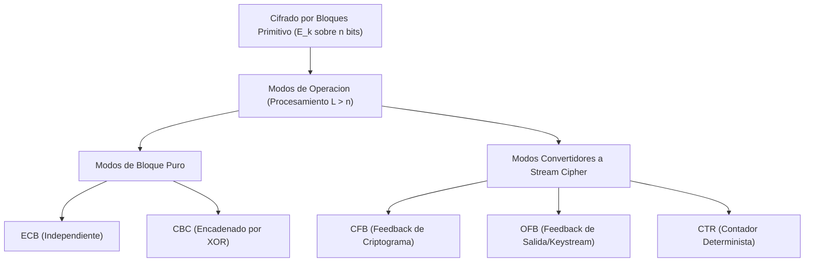
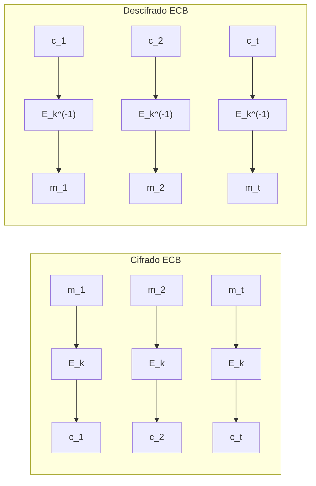
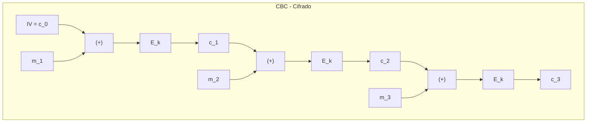
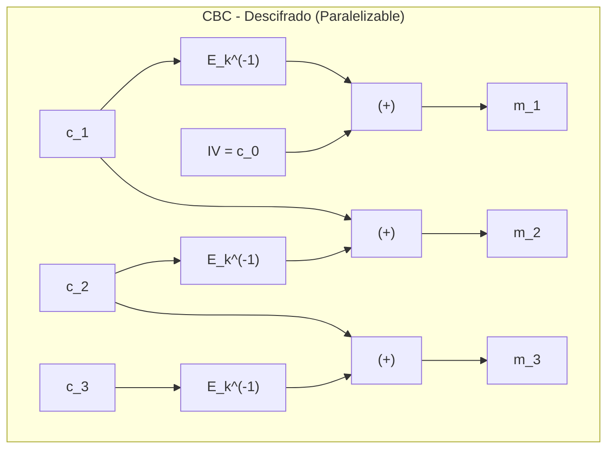
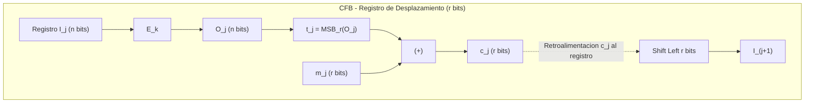
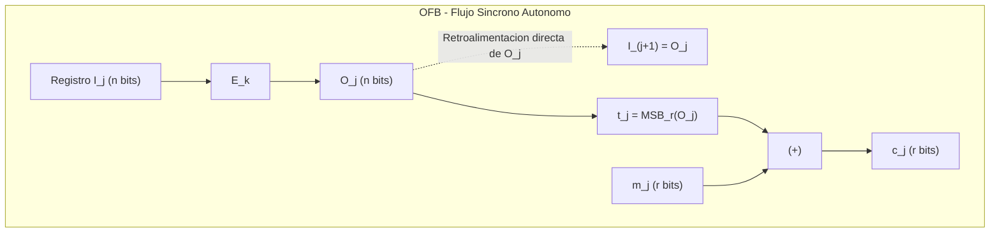
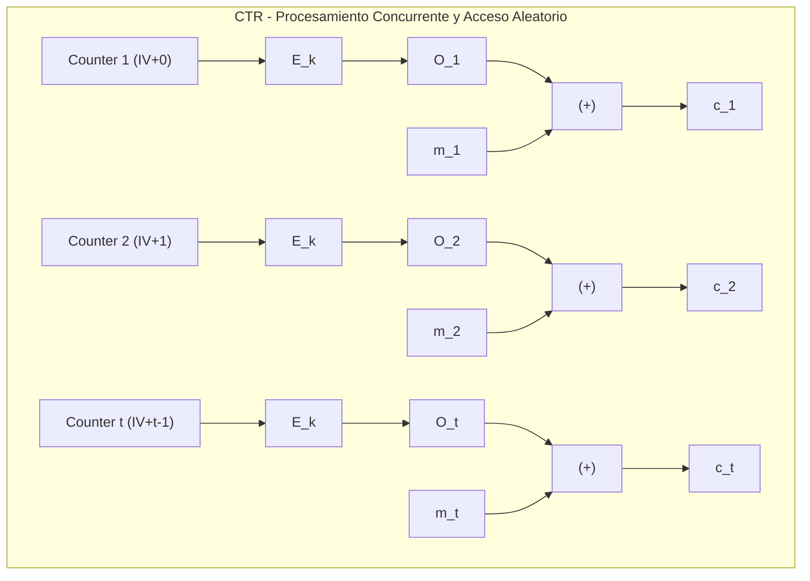

[← Volver a Curso.md](../Curso.md)

# Modos de Operacion de Cifrados por Bloque (ECB, CBC, CFB, OFB, CTR)

> **Materia**: Criptografia | **Fuente**: [part 2.pdf](../Documentos/part 2.pdf)  
> `modos de operacion`, `ecb`, `cbc`, `cfb`, `ofb`, `ctr`, `vector de inicializacion`, `iv`, `propagacion de error`, `tux ecb`, `stream cipher`, `padding`, `registro de desplazamiento`, `electronic codebook`, `cipher block chaining`, `cipher feedback`, `output feedback`, `counter mode`, `two-time pad`

---

## 1. Notacion y Principio Fundamental

- **Necesidad operativa**: Un cifrado por bloques procesa trozos fijos de $n$ bits (ej. $n=64$ en DES, $n=128$ en AES). Para procesar mensajes de longitud arbitraria $L > n$, se requieren **modos de operacion** que definan el particionado, encadenamiento y transformacion del flujo de datos.
- **Notacion formal del curso (Slide 53)**:
  - $E_k$: Funcion de cifrado biyectiva que opera sobre bloques de $n$ bits usando la clave $k$.
  - $E_k^{-1}$: Funcion inversa de descifrado con clave $k$.
  - $m = m_1, m_2, \dots, m_t$: Mensaje en texto plano descompuesto en $t$ bloques.
  - $k$: Clave secreta simetrica compartida.
  - $IV$: Vector de Inicializacion (*Initialization Vector*), bloque aleatorio no secreto de $n$ bits para eliminar determinismo.
  - $\gg$: Operacion de desplazamiento binario a la derecha (*Shift to the right*).
  - $(\rightarrow)$: Proceso de cifrado (*Encryption*).
  - $(\leftarrow)$: Proceso de descifrado (*Decryption*).
  - $\oplus$ o $\otimes$: Operacion logica XOR (suma modulo 2 bit a bit en $\mathbb{F}_2$).



### Tabla Comparativa Maestra de Propiedades (Slides 55, 59, 64, 67, 69)

| Modo | Tipo de Cifrado | Texto Plano Identico Cifra Igual | Dependencias de Encadenamiento | Propagacion de Error en $c_j$ | Recuperacion de Error (Auto-sincronia) | Throughput ($E_k$ por bloque) | Operacion Interna en Descifrado | Requiere Padding |
| :--- | :--- | :---: | :---: | :--- | :---: | :---: | :---: | :---: |
| **ECB** | Bloque | **SI (Vulnerable)** | NO | Solo bloque $m_j$ | NO | $1$ | $E_k^{-1}$ | SI |
| **CBC** | Bloque | **NO** | SI ($c_{j-1}$) | Corrompe $m_j$ y 1 bit en $m_{j+1}$ | SI ($m_{j+2}$ en adelante OK) | $1$ | $E_k^{-1}$ | SI |
| **CFB** | Flujo ($r \le n$) | **NO** | SI ($c_{j-1}$) | Corrompe $m_j$ y desincroniza $\lceil n/r \rceil$ rondas | SI (tras purgar $c$ del registro) | $\lceil n/r \rceil$ | **$E_k$ (¡solo cifrado!)** | NO |
| **OFB** | Flujo sincrono | **NO** | NO (en clave) | Estrictamente 1 bit en $m_j$ | SI (inmediato) | $\lceil n/r \rceil$ | **$E_k$ (¡solo cifrado!)** | NO |
| **CTR** | Flujo contador | **NO** | NO | Estrictamente 1 bit en $m_j$ | SI (inmediato, acceso aleatorio) | $1$ | **$E_k$ (¡solo cifrado!)** | NO |

---

## 2. Modo ECB (Electronic Codebook)

### Definicion y Pseudocodigo (Slide 54)
- Opera como un libro de codigos directo: cada bloque de texto plano $m_j$ de $n$ bits se transforma independientemente en un bloque de texto cifrado $c_j$.
- **Pseudocodigo**:
  - **Entrada**: $m, k \quad \{m = m_1, m_2, \dots, m_t, \ |m_i| = n\}$
  - **Cifrado $(\rightarrow)$**: $c_j \leftarrow E_k(m_j) \quad \forall j \in \{1 \dots t\}$
  - **Descifrado $(\leftarrow)$**: $m_j \leftarrow E_k^{-1}(c_j) \quad \forall j \in \{1 \dots t\}$



### Vulnerabilidad Estructural: La Fuga del Pinguino Tux (Slide 62)
- Si $m_i = m_j \implies c_i = c_j$ bajo la misma clave $k$.
- **Efecto visual**: En imagenes de mapa de bits (bitmap de Tux) o protocolos con cabeceras repetitivas, el criptograma preserva la correlacion espacial y de frecuencias del texto claro. No ofrece **seguridad semantica** ni indistinguibilidad frente a texto claro elegido (CPA).

### Resolucion del Ejemplo del PDF (Slide 56)
- **Parametros**: Alfabeto $\mathcal{A} = \{0, 1\}$, bloque de tamano $n = 4$.
- **Permutacion de cifrado**:
  $$\pi = \begin{pmatrix} 1 & 2 & 3 & 4 \\ 2 & 3 & 4 & 1 \end{pmatrix}$$
  *Regla de evaluacion del PDF*: $c[i] = m[\pi(i)]$, es decir, la salida toma el bit de la posicion $\pi(i)$:
  $$c = (m[2], m[3], m[4], m[1])$$
- **Mensaje**: $m = 101100010100101$ (15 bits $\implies$ padding con un `0` final para completar 16 bits).
  - $m_1 = 1011$
  - $m_2 = 0001$
  - $m_3 = 0100$
  - $m_4 = 1010$
- **Cifrado bloque a bloque**:
  - $c_1 = E_\pi(1011) = (m_1[2], m_1[3], m_1[4], m_1[1]) = (0, 1, 1, 1) = \mathbf{0111}$
  - $c_2 = E_\pi(0001) = (m_2[2], m_2[3], m_2[4], m_2[1]) = (0, 0, 1, 0) = \mathbf{0010}$
  - $c_3 = E_\pi(0100) = (m_3[2], m_3[3], m_3[4], m_3[1]) = (1, 0, 0, 0) = \mathbf{1000}$
  - $c_4 = E_\pi(1010) = (m_4[2], m_4[3], m_4[4], m_4[1]) = (0, 1, 0, 1) = \mathbf{0101}$
- **Criptograma final**:
  $$c = 0111\ 0010\ 1000\ 0101$$

### Resolucion del Ejercicio del PDF (Slide 57)
- **Parametros**: $n = 4$, mensaje con padding: $m_1 = 1011, m_2 = 0001, m_3 = 0100, m_4 = 1010$.
- **Permutacion de cifrado**:
  $$\pi = \begin{pmatrix} 1 & 2 & 3 & 4 \\ 3 & 4 & 2 & 1 \end{pmatrix}$$
- **Mapeo por destino**: El bit en posicion $i$ se traslada a la posicion $\pi(i)$:
  - Posicion 1 va a posicion 3: $c[3] = m[1]$
  - Posicion 2 va a posicion 4: $c[4] = m[2]$
  - Posicion 3 va a posicion 2: $c[2] = m[3]$
  - Posicion 4 va a posicion 1: $c[1] = m[4]$
  - Vector de salida ordenado $(c[1], c[2], c[3], c[4]) = (m[4], m[3], m[1], m[2])$
- **Calculo detallado**:
  - **Bloque 1** ($m_1 = 1011$ con $m[1]=1, m[2]=0, m[3]=1, m[4]=1$):
    $$c_1 = (m[4], m[3], m[1], m[2]) = (1, 1, 1, 0) = \mathbf{1110}$$
  - **Bloque 2** ($m_2 = 0001$ con $m[1]=0, m[2]=0, m[3]=0, m[4]=1$):
    $$c_2 = (m[4], m[3], m[1], m[2]) = (1, 0, 0, 0) = \mathbf{1000}$$
  - **Bloque 3** ($m_3 = 0100$ con $m[1]=0, m[2]=1, m[3]=0, m[4]=0$):
    $$c_3 = (m[4], m[3], m[1], m[2]) = (0, 0, 0, 1) = \mathbf{0001}$$
  - **Bloque 4** ($m_4 = 1010$ con $m[1]=1, m[2]=0, m[3]=1, m[4]=0$):
    $$c_4 = (m[4], m[3], m[1], m[2]) = (0, 1, 1, 0) = \mathbf{0110}$$
- **Criptograma final**:
  $$c = 1110\ 1000\ 0001\ 0110$$

---

## 3. Modo CBC (Cipher-Block Chaining)

### Definicion y Pseudocodigo (Slide 58)
- Encadena cada bloque de texto plano mediante XOR con el bloque de texto cifrado previo antes de someterlo al cifrado por bloques. Rompe el determinismo de patrones identicos.
- **Pseudocodigo**:
  - **Entrada**: $m, k, IV \quad \{m = m_1, m_2, \dots, m_t, \ |m_i| = |IV| = n\}$
  - **Cifrado $(\rightarrow)$**:
    $$c_0 \leftarrow IV$$
    $$c_j \leftarrow E_k(c_{j-1} \oplus m_j) \quad \forall j \in \{1 \dots t\}$$
  - **Descifrado $(\leftarrow)$**:
    $$c_0 \leftarrow IV$$
    $$m_j \leftarrow c_{j-1} \oplus E_k^{-1}(c_j) \quad \forall j \in \{1 \dots t\}$$





### Resolucion Paso a Paso del Ejemplo del PDF (Slides 60 y 61)
- **Parametros**: $\pi = (2, 3, 4, 1)$, $IV = 1010$, bloques $m_1 = 1011, m_2 = 0001, m_3 = 0100, m_4 = 1010$.

#### Cifrado (Slide 60)
1. $C_0 = IV = 1010$.
2. **Ronda 1**:
   $$C_0 \oplus m_1 = 1010 \oplus 1011 = 0001$$
   $$C_1 = E_\pi(0001) = \mathbf{0010}$$
3. **Ronda 2**:
   $$C_1 \oplus m_2 = 0010 \oplus 0001 = 0011$$
   $$C_2 = E_\pi(0011) = \mathbf{0110}$$
4. **Ronda 3**:
   $$C_2 \oplus m_3 = 0110 \oplus 0100 = 0010$$
   $$C_3 = E_\pi(0010) = \mathbf{0100}$$
5. **Ronda 4**:
   $$C_3 \oplus m_4 = 0100 \oplus 1010 = 1110$$
   $$C_4 = E_\pi(1110) = \mathbf{1101}$$
- **Criptograma**: $c = 0010\ 0110\ 0100\ 1101$.

#### Descifrado Inverso (Slide 61)
- Funcion inversa $E_\pi^{-1}$: Rotacion circular a la derecha:
  $$E_\pi^{-1}(y_1, y_2, y_3, y_4) = (y_4, y_1, y_2, y_3)$$
1. **Recuperacion de $m_1$**:
   $$E_\pi^{-1}(C_1) = E_\pi^{-1}(0010) = 0001$$
   $$m_1 = C_0 \oplus 0001 = 1010 \oplus 0001 = \mathbf{1011}$$
2. **Recuperacion de $m_2$**:
   $$E_\pi^{-1}(C_2) = E_\pi^{-1}(0110) = 0011$$
   $$m_2 = C_1 \oplus 0011 = 0010 \oplus 0011 = \mathbf{0001}$$
3. **Recuperacion de $m_3$**:
   $$E_\pi^{-1}(C_3) = E_\pi^{-1}(0100) = 0010$$
   $$m_3 = C_2 \oplus 0010 = 0110 \oplus 0010 = \mathbf{0100}$$
4. **Recuperacion de $m_4$**:
   $$E_\pi^{-1}(C_4) = E_\pi^{-1}(1101) = 1110$$
   $$m_4 = C_3 \oplus 1110 = 0100 \oplus 1110 = \mathbf{1010}$$
- **Texto plano recuperado**: $m = 1011000101001010$ (coincidencia exacta).

---

## 4. Modo CFB (Cipher Feedback)

### Principio Operativo y Pseudocodigo (Slide 63)
- Convierte el cifrado por bloques en un **cifrado de flujo auto-sincronizado** que procesa unidades de $r$ bits ($r \le n$, tipicamente $r=8$ para un byte a la vez en sesiones interactivas SSH/Telnet).
- Utiliza un registro de desplazamiento de $n$ bits alimentado con el criptograma previo.
- **Formulas y Pseudocodigo**:
  - **Entrada**: $m, k, IV \quad \{m = m_1, m_2, \dots, m_u, \ |m_i| = r < n, \ |IV| = n\}$
  - **Cifrado $(\rightarrow)$**:
    $$I_1 \leftarrow IV$$
    $$\text{Para } j = 1 \dots u: \begin{cases} O_j \leftarrow E_k(I_j) \\ t_j \leftarrow O_j \gg (n-r) & \text{(los } r \text{ bits mas significativos)} \\ c_j \leftarrow m_j \oplus t_j \\ I_{j+1} \leftarrow (2^r \times I_j + c_j) \bmod 2^n & \text{(shift left } r \text{ bits y concatenar } c_j\text{)} \end{cases}$$
  - **Descifrado $(\leftarrow)$**:
    $$I_1 \leftarrow IV$$
    $$\text{Para } j = 1 \dots u: \begin{cases} O_j \leftarrow E_k(I_j) & \text{\bf (¡Usa } E_k \text{ directo, NO } E_k^{-1}\text{!)} \\ t_j \leftarrow O_j \gg (n-r) \\ m_j \leftarrow c_j \oplus t_j \\ I_{j+1} \leftarrow (2^r \times I_j + c_j) \bmod 2^n \end{cases}$$



### Resolucion del Ejemplo del PDF (Slide 65)
- **Parametros**: $n = 4$, $r = 3$, $\pi = (2, 3, 4, 1)$, $IV = 1010$.
  - Desplazamiento para extraer $r=3$ bits: $n - r = 4 - 3 = 1$ bit $\implies t_j = O_j \gg 1$ (los 3 primeros bits de $O_j$).
  - Bloques de entrada: $m_1 = 101, m_2 = 100, m_3 = 010, m_4 = 100, m_5 = 101$.

#### Tabla de Estados y Ejecucion Completa ($j=1 \dots 5$)

| $j$ | $I_j$ | $O_j = E_\pi(I_j)$ | $t_j = \text{MSB}_3(O_j)$ | $m_j$ | $c_j = m_j \oplus t_j$ | $I_{j+1} = (\text{LSB}_1(I_j) \parallel c_j)$ |
| :---: | :---: | :---: | :---: | :---: | :---: | :---: |
| **1** | `1010` | $E_\pi(1010) = \mathbf{0101}$ | `010` | `101` | $101 \oplus 010 = \mathbf{111}$ | $(0 \parallel 111) = \mathbf{0111}$ |
| **2** | `0111` | $E_\pi(0111) = \mathbf{1110}$ | `111` | `100` | $100 \oplus 111 = \mathbf{011}$ | $(1 \parallel 011) = \mathbf{1011}$ |
| **3** | `1011` | $E_\pi(1011) = \mathbf{0111}$ | `011` | `010` | $010 \oplus 011 = \mathbf{001}$ | $(1 \parallel 001) = \mathbf{1001}$ |
| **4** | `1001` | $E_\pi(1001) = \mathbf{0011}$ | `001` | `100` | $100 \oplus 001 = \mathbf{101}$ | $(1 \parallel 101) = \mathbf{1101}$ |
| **5** | `1101` | $E_\pi(1101) = \mathbf{1011}$ | `101` | `101` | $101 \oplus 101 = \mathbf{000}$ | $(1 \parallel 000) = \mathbf{1000}$ |

- **Criptograma final**:
  $$c = 111011001101000$$

---

## 5. Modo OFB (Output Feedback)

### Principio Operativo y Pseudocodigo (Slide 66)
- **Cifrador de flujo sincrono**: La secuencia pseudoaleatoria de cifrado (*keystream*) se genera de manera completamente independiente del texto plano y del texto cifrado.
- La retroalimentacion ocurre directamente desde la salida del cifrador por bloques al registro de entrada ($I_{j+1} \leftarrow O_j$).
- **Pseudocodigo**:
  - **Entrada**: $m, k, IV \quad \{m = m_1, m_2, \dots, m_u, \ |m_i| = r < n, \ |IV| = n\}$
  - **Cifrado $(\rightarrow)$**:
    $$I_1 \leftarrow IV$$
    $$\text{Para } j = 1 \dots u: \begin{cases} O_j \leftarrow E_k(I_j) \\ t_j \leftarrow O_j \gg (n-r) \\ c_j \leftarrow m_j \oplus t_j \\ I_{j+1} \leftarrow O_j \end{cases}$$
  - **Descifrado $(\leftarrow)$**:
    $$I_1 \leftarrow IV$$
    $$\text{Para } j = 1 \dots u: \begin{cases} O_j \leftarrow E_k(I_j) & \text{\bf (¡Usa } E_k \text{ directo!)} \\ t_j \leftarrow O_j \gg (n-r) \\ m_j \leftarrow c_j \oplus t_j \\ I_{j+1} \leftarrow O_j \end{cases}$$



### Resolucion del Ejemplo del PDF (Slide 68)
- **Parametros**: $n = 4, r = 3, \pi = (2, 3, 4, 1), IV = 1010$.
  - Bloques de entrada: $m_1 = 101, m_2 = 100, m_3 = 010, m_4 = 100, m_5 = 101$.
  - Relacion de retroalimentacion: $I_{j+1} = O_j$.

#### Tabla de Estados y Ejecucion Completa ($j=1 \dots 5$)

| $j$ | $I_j$ | $O_j = E_\pi(I_j)$ | $t_j = \text{MSB}_3(O_j)$ | $m_j$ | $c_j = m_j \oplus t_j$ | $I_{j+1} = O_j$ |
| :---: | :---: | :---: | :---: | :---: | :---: | :---: |
| **1** | `1010` | $E_\pi(1010) = \mathbf{0101}$ | `010` | `101` | $101 \oplus 010 = \mathbf{111}$ | `0101` |
| **2** | `0101` | $E_\pi(0101) = \mathbf{1010}$ | `101` | `100` | $100 \oplus 101 = \mathbf{001}$ | `1010` |
| **3** | `1010` | $E_\pi(1010) = \mathbf{0101}$ | `010` | `010` | $010 \oplus 010 = \mathbf{000}$ | `0101` |
| **4** | `0101` | $E_\pi(0101) = \mathbf{1010}$ | `101` | `100` | $100 \oplus 101 = \mathbf{001}$ | `1010` |
| **5** | `1010` | $E_\pi(1010) = \mathbf{0101}$ | `010` | `101` | $101 \oplus 010 = \mathbf{111}$ | `0101` |

- **Criptograma final**:
  $$c = 111001000001111$$

---

## 6. Modo CTR (Counter Mode)

### Principio Operativo y Pseudocodigo (Slide 69)
- Genera un flujo de claves cifrando valores sucesivos de un contador monotonico indexado.
- **Estructura del contador**: $I_j = \text{Nonce} \parallel \text{Contador}_j$, donde el $\text{Nonce}$ (*number used once*) es un valor unico por sesion/mensaje.
- **Pseudocodigo**:
  - **Entrada**: $m, k, IV = \text{Nonce} \quad \{m = m_1, m_2, \dots, m_t, \ |m_i| = n, \ |IV| = n\}$
  - **Cifrado $(\rightarrow)$**:
    $$I_1 \leftarrow IV$$
    $$\text{Para } j = 1 \dots t: \begin{cases} O_j \leftarrow E_k(I_j) \\ c_j \leftarrow m_j \oplus O_j \\ I_{j+1} \leftarrow I_j + 1 \end{cases}$$
  - **Descifrado $(\leftarrow)$**:
    $$I_1 \leftarrow IV$$
    $$\text{Para } j = 1 \dots t: \begin{cases} O_j \leftarrow E_k(I_j) & \text{\bf (¡Identico al cifrado!)} \\ m_j \leftarrow c_j \oplus O_j \\ I_{j+1} \leftarrow I_j + 1 \end{cases}$$



### Ventajas Criticas de Ingenieria
1. **Paralelizacion total**: Tanto el cifrado como el descifrado admiten computacion masivamente paralela en multiples nucleos de CPU o shaders de GPU (a diferencia de CBC y CFB en cifrado, que son estrictamente secuenciales).
2. **Acceso aleatorio (*Random Access*)**: Cualquier bloque $m_j$ puede ser descifrado de manera aislada sin calcular los bloques anteriores:
   $$m_j = c_j \oplus E_k(IV + (j-1))$$
3. **Pre-computacion de keystream**: Los bloques $O_j = E_k(I_j)$ pueden calcularse antes de recibir el mensaje. El cifrado en tiempo real se reduce a una sola operacion XOR.
4. **Simetria de hardware**: No requiere implementar el circuito de $E_k^{-1}$. Todo el criptosistema opera utilizando exclusivamente la primitiva de cifrado directo $E_k$.
5. **Cero padding**: El ultimo bloque de tamano parcial se cifra haciendo XOR con los primeros bits correspondientes de $O_t$, sin inflar la longitud del mensaje.

---

## 7. Implementacion Comparativa en Python

Script en Python que ejecuta la permutacion de 4 bits $\pi=(2,3,4,1)$ sobre los 5 modos de operacion, reproduciendo con exactitud los ejemplos del PDF:

```python
"""
Laboratorio de Modos de Operacion: ECB, CBC, CFB, OFB, CTR.
Basado en las diapositivas 52-70 de Criptografia (part 2.pdf).
Permutacion pi = (2, 3, 4, 1): output = (input[1], input[2], input[3], input[0])
"""

def E_pi(b: str) -> str:
    """Cifrador primitivo por bloques de 4 bits: pi = (2, 3, 4, 1)."""
    assert len(b) == 4
    return b[1] + b[2] + b[3] + b[0]

def E_pi_inv(b: str) -> str:
    """Descifrador inverso por bloques de 4 bits: pi^-1 = (4, 1, 2, 3)."""
    assert len(b) == 4
    return b[3] + b[0] + b[1] + b[2]

def xor_bits(a: str, b: str) -> str:
    """XOR bit a bit entre cadenas de bits de igual longitud."""
    return "".join(str(int(x) ^ int(y)) for x, y in zip(a, b))

# --- 1. MODO ECB (Slide 56) ---
def ecb_mode(blocks: list[str]) -> list[str]:
    return [E_pi(m) for m in blocks]

# --- 2. MODO CBC (Slides 60-61) ---
def cbc_encrypt(blocks: list[str], iv: str) -> list[str]:
    c_prev = iv
    cipher_blocks = []
    for m in blocks:
        c_curr = E_pi(xor_bits(c_prev, m))
        cipher_blocks.append(c_curr)
        c_prev = c_curr
    return cipher_blocks

def cbc_decrypt(cipher_blocks: list[str], iv: str) -> list[str]:
    c_prev = iv
    plain_blocks = []
    for c in cipher_blocks:
        m = xor_bits(c_prev, E_pi_inv(c))
        plain_blocks.append(m)
        c_prev = c
    return plain_blocks

# --- 3. MODO CFB (r=3, n=4) (Slide 65) ---
def cfb_encrypt(r_blocks: list[str], iv: str, r: int = 3, n: int = 4) -> list[str]:
    I = iv
    c_blocks = []
    for m in r_blocks:
        O = E_pi(I)
        t = O[:r]  # Desplazamiento O >> (n-r) = MSB_r
        c = xor_bits(m, t)
        c_blocks.append(c)
        I = I[r:] + c  # Shift left r bits + append c
    return c_blocks

# --- 4. MODO OFB (r=3, n=4) (Slide 68) ---
def ofb_encrypt(r_blocks: list[str], iv: str, r: int = 3) -> list[str]:
    I = iv
    c_blocks = []
    for m in r_blocks:
        O = E_pi(I)
        t = O[:r]
        c = xor_bits(m, t)
        c_blocks.append(c)
        I = O  # Retroalimentacion directa del bloque de salida
    return c_blocks

# --- 5. MODO CTR (n=4) (Slide 69) ---
def ctr_encrypt(blocks: list[str], nonce: int) -> list[str]:
    c_blocks = []
    for j, m in enumerate(blocks):
        counter_val = (nonce + j) % 16
        counter_bin = format(counter_val, '04b')
        O = E_pi(counter_bin)
        c = xor_bits(m, O)
        c_blocks.append(c)
    return c_blocks

if __name__ == "__main__":
    # Verificacion ECB (Slide 56)
    m_ecb = ["1011", "0001", "0100", "1010"]
    c_ecb = ecb_mode(m_ecb)
    print("ECB:", "".join(c_ecb))  # 0111001010000101

    # Verificacion CBC (Slides 60-61)
    iv_cbc = "1010"
    c_cbc = cbc_encrypt(m_ecb, iv_cbc)
    print("CBC Encrypt:", "".join(c_cbc))  # 0010011001001101
    m_cbc_rec = cbc_decrypt(c_cbc, iv_cbc)
    print("CBC Decrypt:", "".join(m_cbc_rec))  # 1011000101001010

    # Verificacion CFB (Slide 65)
    m_stream = ["101", "100", "010", "100", "101"]
    c_cfb = cfb_encrypt(m_stream, iv="1010", r=3, n=4)
    print("CFB:", "".join(c_cfb))  # 111011001101000

    # Verificacion OFB (Slide 68)
    c_ofb = ofb_encrypt(m_stream, iv="1010", r=3)
    print("OFB:", "".join(c_ofb))  # 111001000001111

    # Demostracion CTR
    c_ctr = ctr_encrypt(m_ecb, nonce=10)
    m_ctr_rec = ctr_encrypt(c_ctr, nonce=10)  # Descifrado usa la MISMA funcion
    print("CTR Decrypt == Plain:", m_ctr_rec == m_ecb)
```

---

## 8. Trampas de Examen y Criterios de Seleccion

> [!CAUTION]
> **Reutilizacion de Nonce/IV en CTR y OFB (Catastrofe Criptografica)**:
> Si un vector de inicializacion o nonce se reutiliza bajo la misma clave $k$ en CTR u OFB:
> $$c_A = m_A \oplus K, \quad c_B = m_B \oplus K \implies c_A \oplus c_B = m_A \oplus m_B$$
> El adversario elimina por completo el cifrador y reduce la seguridad al **ataque Two-Time Pad**, permitiendo recuperar ambos textos planos mediante tecnicas de frecuencia y cancelacion de espacios.

> [!WARNING]
> **Ausencia Total de Autenticacion e Integridad (Maleabilidad)**:
> Ninguno de estos 5 modos basicos protege contra la alteracion maliciosa del mensaje:
> - En CTR y OFB, modificar el bit $i$ de $c_j$ voltea de forma determinista y predecible el bit $i$ de $m_j$ (*bit-flipping attack*).
> - En CBC, modificar $c_{j-1}$ permite inyectar cambios arbitrarios en $m_j$ a costa de corromper $m_{j-1}$ (*CBC padding oracle attack* / *POODLE*).
> - **Regla practica**: En sistemas de produccion nunca se debe usar un modo de cifrado puro sin autenticacion; se requiere **AEAD** (como AES-GCM o ChaCha20-Poly1305) o el esquema **Encrypt-then-MAC** (CBC + HMAC-SHA256).

### Matriz de Impacto ante Ruido en el Canal (Pregunta Tipica de Parcial)

| Modo | Si se corrompe 1 bit en $c_j$ durante la transmision: |
| :--- | :--- |
| **ECB** | Solo el bloque $m_j$ se descifra corrupto de manera aleatoria. Ningun otro bloque se altera. |
| **CBC** | **Efecto dual**: El bloque $m_j$ se destruye completamente (efecto avalancha dentro de $E_k^{-1}$). En el bloque subsiguiente $m_{j+1}$, se corrompe **exactamente el mismo bit** que sufrio el error en $c_j$. Los bloques $m_{j+2}$ en adelante se recuperan a la perfeccion (**auto-recuperacion**). |
| **CFB** | El bloque actual $m_j$ tiene 1 bit corrupto. Luego, el criptograma corrupto ingresa al registro de desplazamiento $I$, corrompiendo por completo los siguientes $\lceil n/r \rceil$ bloques descifrados hasta que el dato danado sale del registro. |
| **OFB** | Corrupcion estricta 1 a 1: unicamente el bit alterado en $c_j$ se invierte en $m_j$. No hay propagacion hacia adelante ni hacia atras. |
| **CTR** | Corrupcion estricta 1 a 1: unicamente el bit alterado en $c_j$ se invierte en $m_j$. Los demas bloques no sufren impacto. |

### Criterio de Eleccion segun el Requisito del Sistema
- **Almacenamiento en Disco / Bases de Datos**: Modo **CTR** o **XTS** (permite lectura/escritura aleatoria sin descifrar sectores enteros).
- **Flujos Continuos / Sensores IoT con Recursos Limitados**: Modo **CTR** (ahorra silicio al no requerir modulo de descifrado $E_k^{-1}$) o **OFB** (sin propagacion de error).
- **Comunicaciones Legadas / Certificaciones Antiguas**: Modo **CBC** con IV criptograficamente aleatorio y esquema de autenticacion HMAC obligatorio.
- **Prohibicion Absoluta**: **ECB** esta terminantemente prohibido para cualquier dato que exceda la longitud de un unico bloque primitivo.
