[← Volver a Curso.md](../Curso.md)

# AES: Estructura Global y Representacion del Estado

> **Materia**: Criptografia | **Fuente**: [part 4.pdf](../Documentos/part 4.pdf)  
> `aes`, `rijndael`, `fips 197`, `cifrado por bloques`, `state array`, `matriz de estado 4x4`, `orden column-major`, `nb`, `nk`, `nr`, `rondas aes`, `aes-128`, `aes-192`, `aes-256`, `etapas de cifrado`, `etapas de descifrado`, `whitening`, `ronda inicial`, `ronda final`

---

## 1. Parametros y Dimensiones Operativas

- **Definicion**: Advanced Encryption Standard (Rijndael, Daemen y Rijmen, 1997). Cifrado simetrico por bloques estandarizado por el NIST en 2001 (FIPS 197).
- **Tamano de bloque ($Nb$)**: Invariablemente **128 bits** ($4$ palabras de 32 bits = 16 bytes).
- **Relacion de rondas ($Nr$)**: Funcion lineal directa del tamano de clave ($Nk$):
  $$Nr = Nk + 6$$

| Variante | Tamano de Bloque ($Nb$) | Tamano de Clave ($Nk$) | Clave en Bits | Numero de Rondas ($Nr$) | Subclaves de Ronda Requeridas |
| :--- | :---: | :---: | :---: | :---: | :---: |
| **AES-128** | 4 palabras (16 bytes) | 4 palabras (16 bytes) | 128 bits | **10 rondas** | 11 subclaves (44 words) |
| **AES-192** | 4 palabras (16 bytes) | 6 palabras (24 bytes) | 192 bits | **12 rondas** | 13 subclaves (52 words) |
| **AES-256** | 4 palabras (16 bytes) | 8 palabras (32 bytes) | 256 bits | **14 rondas** | 15 subclaves (60 words) |

- **Unidad minima de procesamiento (Word)**: 1 palabra = 32 bits = 4 bytes.

---

## 2. Representacion del Dato: Matriz de Estado (State Array)

- **Estructura**: Arreglo bidimensional de $4 \times 4$ bytes (16 bytes = 128 bits).
- **Regla estricta de orden**: **Column-major order** (los bytes del mensaje se colocan rellenando secuencialmente cada columna de arriba hacia abajo):
  $$\text{in} = [b_0, b_1, b_2, \dots, b_{15}] \implies \begin{pmatrix} b_0 & b_4 & b_8 & b_{12} \\ b_1 & b_5 & b_9 & b_{13} \\ b_2 & b_6 & b_{10} & b_{14} \\ b_3 & b_7 & b_{11} & b_{15} \end{pmatrix}$$

### Ejemplo Practico de Carga (Slide 5)
- **Texto plano**: `"AES es muy facil"` (16 bytes).
- **Conversion ASCII a Hexadecimal**:
  - `A` $\to 65 \to \mathbf{41}$, `E` $\to 69 \to \mathbf{45}$, `S` $\to 83 \to \mathbf{53}$, ` ` $\to 32 \to \mathbf{20}$
  - `e` $\to 101 \to \mathbf{65}$, `s` $\to 115 \to \mathbf{73}$, ` ` $\to 32 \to \mathbf{20}$, `m` $\to 109 \to \mathbf{6d}$
  - `u` $\to 117 \to \mathbf{75}$, `y` $\to 121 \to \mathbf{79}$, ` ` $\to 32 \to \mathbf{20}$, `f` $\to 102 \to \mathbf{66}$
  - `a` $\to 97 \to \mathbf{61}$, `c` $\to 99 \to \mathbf{63}$, `i` $\to 105 \to \mathbf{69}$, `l` $\to 108 \to \mathbf{6c}$
- **Carga en State Array y Key Array**:
  $$\text{State Inicial} = \begin{pmatrix} 41 & 65 & 75 & 61 \\ 45 & 73 & 79 & 63 \\ 53 & 20 & 20 & 69 \\ 20 & 6d & 66 & 6c \end{pmatrix}, \quad K_0 = \begin{pmatrix} 2b & 28 & ab & 09 \\ 7e & ae & f7 & cf \\ 15 & d2 & 15 & 4f \\ 16 & a6 & 88 & 3c \end{pmatrix}$$

---

## 3. Fases Operativas: Cifrado vs Descifrado

```mermaid
flowchart TD
    subgraph Encryption["Cifrado AES (Encryption)"]
        m["Texto Plano (128 bits)"] --> E_Init["Ronda Inicial: AddRoundKey (K_0)"]
        E_Init --> E_Rounds["Rondas 1 a Nr-1:<br/>1. SubBytes (SB)<br/>2. ShiftRows (SR)<br/>3. MixColumns (MC)<br/>4. AddRoundKey (K_r)"]
        E_Rounds --> E_Final["Ronda Final (Nr):<br/>1. SubBytes (SB)<br/>2. ShiftRows (SR)<br/>3. AddRoundKey (K_Nr)"]
        E_Final --> c["Texto Cifrado (128 bits)"]
    end

    subgraph Decryption["Descifrado AES (Decryption)"]
        cd["Texto Cifrado (128 bits)"] --> D_Init["Ronda Inicial:<br/>1. AddRoundKey (K_Nr)<br/>2. InvSubBytes (SB^-1)<br/>3. InvShiftRows (SR^-1)"]
        D_Init --> D_Rounds["Rondas 1 a Nr-1:<br/>1. AddRoundKey (K_r)<br/>2. InvMixColumns (MC^-1)<br/>3. InvSubBytes (SB^-1)<br/>4. InvShiftRows (SR^-1)"]
        D_Rounds --> D_Final["Ronda Final (Nr):<br/>AddRoundKey (K_0)"]
        D_Final --> md["Texto Plano Recuperado"]
    end
```

### Tabla Comparativa de Etapas de Cifrado y Descifrado

| Etapa | Operaciones en Cifrado (Encryption) | Operaciones en Descifrado (Decryption) | Subclave Empleada |
| :--- | :--- | :--- | :---: |
| **Ronda Inicial** | $\text{AddRoundKey}$ | $\text{AddRoundKey} \to \text{InvSubBytes} \to \text{InvShiftRows}$ | $K_0$ en Cifrado / $K_{Nr}$ en Descifrado |
| **Rondas Intermedias ($1 \dots Nr-1$)** | $\text{SubBytes} \to \text{ShiftRows} \to \text{MixColumns} \to \text{AddRoundKey}$ | $\text{AddRoundKey} \to \text{InvMixColumns} \to \text{InvSubBytes} \to \text{InvShiftRows}$ | $K_r$ ($r = 1 \dots Nr-1$ / orden inverso en descifrado) |
| **Ronda Final ($Nr$)** | $\text{SubBytes} \to \text{ShiftRows} \to \text{AddRoundKey}$ *(¡Sin MixColumns!)* | $\text{AddRoundKey}$ | $K_{Nr}$ en Cifrado / $K_0$ en Descifrado |

---

## 4. Traza Completa del Ejemplo Integrado (Slides 25-31)

- **Texto plano ($m$)**: `41 45 53 20 65 73 20 6d 75 79 20 66 61 63 69 6c`
- **Clave ($k$)**: `2b 7e 15 16 28 ae d2 a6 ab f7 15 88 09 cf 4f 3c`
- **Texto cifrado resultante ($c$)**:
  $$c = \text{e4 48 e5 74 a3 74 d9 0c c3 3c 22 af 9b 8e ab 7f}$$

### Evolucion del Estado por Ronda en Cifrado (AES-128)

| Ronda | $\text{ARK}$ (Entrada Ronda) | $\text{SubBytes}$ | $\text{ShiftRows}$ | $\text{MixColumns}$ | Subclave Aplicada |
| :---: | :---: | :---: | :---: | :---: | :---: |
| **0** | `41 45 53 20 ...` | — | — | — | $K_0 = \text{2b 7e 15 16 ...}$ |
| **1** | `6a 3b 46 36 ...` | `02 e2 5a 05 ...` | `02 c1 96 53 ...` | `99 69 01 f7 ...` | $K_1 = \text{a0 fa fe 17 ...}$ |
| **2** | `39 93 ff e0 ...` | `12 dc 16 e1 ...` | `12 38 b7 a1 ...` | `07 57 8c cb ...` | $K_2 = \text{f2 c2 95 f2 ...}$ |
| **3** | `f5 95 19 39 ...` | `e6 2a d4 12 ...` | `e6 6a 74 27 ...` | `3a 89 0d 61 ...` | $K_3 = \text{3d 80 47 7d ...}$ |
| **4** | `07 09 4a 1c ...` | `c5 01 d6 9c ...` | `c5 12 e7 a9 ...` | `e9 7a e2 e8 ...` | $K_4 = \text{ef 44 a5 41 ...}$ |
| **5** | `06 3e 47 a9 ...` | `6f b2 a0 d3 ...` | `6f 15 cf 6c ...` | `42 63 4b b3 ...` | $K_5 = \text{d4 d1 c6 f8 ...}$ |
| **6** | `96 b2 8d 4b ...` | `90 37 5d b3 ...` | `90 09 35 66 ...` | `73 bb 59 5b ...` | $K_6 = \text{6d 88 a3 7a ...}$ |
| **7** | `1e 33 fa 21 ...` | `72 c3 2d fd ...` | `72 05 25 66 ...` | `a8 71 97 7a ...` | $K_7 = \text{4e 54 f7 0e ...}$ |
| **8** | `e6 25 60 74 ...` | `8e 3f d0 92 ...` | `8e e2 24 37 ...` | `29 0a 7d 21 ...` | $K_8 = \text{ea d2 73 21 ...}$ |
| **9** | `c3 d8 0e 00 ...` | `2e 61 ab 63 ...` | `2e be 36 37 ...` | `84 24 a5 94 ...` | $K_9 = \text{ac 77 66 f3 ...}$ |
| **10** | `28 53 c3 67 ...` | `34 ed 2e 85 ...` | `34 5c 1c dc ...` | *(Omitido)* | $K_{10} = \text{d0 14 f9 a8 ...}$ |
| **Salida**| $\mathbf{e4\ 48\ e5\ 74\ a3\ 74\ d9\ 0c\ c3\ 3c\ 22\ af\ 9b\ 8e\ ab\ 7f}$ | — | — | — | — |

---

## 5. Casos Trampa y Puntos Criticos de Examen

- **¿Por que la ronda final no incluye MixColumns?**:
  - Para hacer que la arquitectura de cifrado y descifrado sea estructuralmente simetrica. Si la ronda final ejecutara MixColumns, el descifrado necesitaria una operacion adicional antes de la primera subclave.
- **Diferencia con Redes de Feistel (DES)**:
  - AES es una **red de Sustitucion-Permutacion (SPN)**; procesa los 128 bits simultaneamente en cada ronda, no divide en mitades izquierda/derecha.
  - Todas las operaciones en AES deben ser estrictamente **reversibles (biyectivas)**, a diferencia de Feistel donde la funcion $F$ puede ser no invertible.
- **Cantidad de subclaves**:
  - AES-128 realiza 10 rondas pero requiere **11 subclaves de 128 bits** ($K_0$ para el whitening inicial + $K_1 \dots K_{10}$ para las rondas). Total: 44 palabras de 32 bits.
