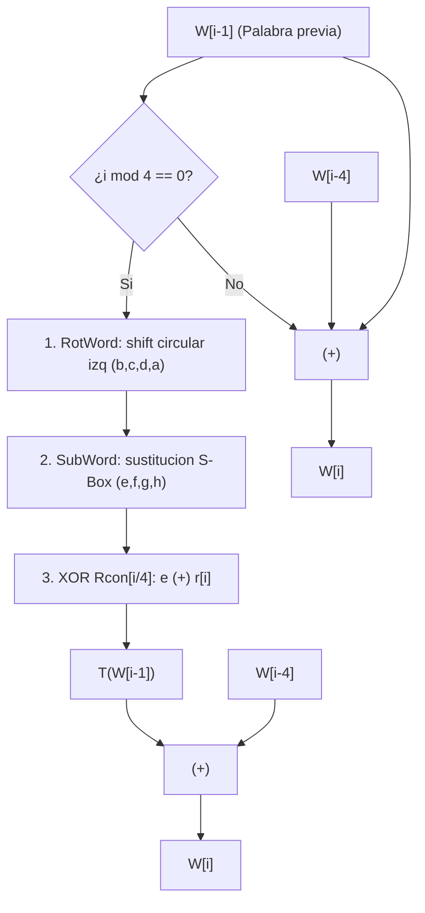

[← Volver a Curso.md](../Curso.md)

# AES: Generador y Expansion de Claves (Key Expansion)

> **Materia**: Criptografia | **Fuente**: [part 4.pdf](../Documentos/part 4.pdf)  
> `key expansion`, `key generator`, `rotword`, `subword`, `rcon`, `constante de ronda`, `subclaves`, `w[i]`, `aes-128`, `gf(2^8)`, `s-box`, `recursividad de claves`, `whitening key`

---

## 1. Proposito Operativo y Dimensionamiento

- **Objetivo**: Derivar $Nr + 1$ subclaves de 128 bits a partir de la clave maestra $k$ de 128 bits ($Nk = 4$ palabras).
- **Dimension de salida**: Arreglo lineal de **44 palabras de 32 bits**: $W[0], W[1], \dots, W[43]$.
- **Mapeo de subclaves de ronda**:
  - Subclave inicial (Ronda 0): $[W[0], W[1], W[2], W[3]]$
  - Subclave de Ronda $r \in \{1 \dots 10\}$:
    $$K_r = [W[4r], W[4r+1], W[4r+2], W[4r+3]]$$

---

## 2. Algoritmo de Expansion Recursiva

Para $i \in [0 \dots 3]$, $W[i]$ son directamente las 4 columnas de la clave maestra $k$.  
Para $i \in [4 \dots 43]$, cada palabra se calcula mediante:

$$W[i] = \begin{cases} W[i - 4] \oplus T(W[i - 1]) & \text{si } i \equiv 0 \pmod 4 \\ W[i - 4] \oplus W[i - 1] & \text{si } i \not\equiv 0 \pmod 4 \end{cases}$$

---

## 3. Primitivas de la Transformacion $T(W[i-1])$

Sea la columna $W[i - 1] = [a, b, c, d]^T$:

1. **RotWord (Rotacion Circular de Bytes)**:
   - Desplaza los bytes un lugar a la izquierda de forma circular:
     $$\text{RotWord}([a, b, c, d]^T) = [b, c, d, a]^T$$
2. **SubWord (Sustitucion No Lineal)**:
   - Aplica la S-Box de AES de manera independiente a cada uno de los 4 bytes:
     $$\text{SubWord}([b, c, d, a]^T) = [\text{SBox}(b), \text{SBox}(c), \text{SBox}(d), \text{SBox}(a)]^T = [e, f, g, h]^T$$
3. **Suma de la Constante de Ronda ($Rcon$)**:
   - Se realiza XOR entre el byte mas significativo $e$ y la constante de ronda $r[i]$ en $GF(2^8)$:
     $$T(W[i - 1]) = [e \oplus r[i], f, g, h]^T = [e, f, g, h]^T \oplus Rcon[i/4]$$
   - Donde $Rcon[j]$ es una palabra de 32 bits con ceros en los tres bytes de menor peso:
     $$Rcon[j] = [r[j], 00_{16}, 00_{16}, 00_{16}]^T$$

### Tabla de Constantes de Ronda $Rcon$ en $GF(2^8)$ (Slides 9 y 10)

| Ronda $j = i/4$ | $1$ | $2$ | $3$ | $4$ | $5$ | $6$ | $7$ | $8$ | $9$ | $10$ |
| :--- | :---: | :---: | :---: | :---: | :---: | :---: | :---: | :---: | :---: | :---: |
| **$r[j]$ (hex)** | `01` | `02` | `04` | `08` | `10` | `20` | `40` | `80` | `1b` | `36` |
| **$Rcon[j]$ (palabra)**| `01000000` | `02000000` | `04000000` | `08000000` | `10000000` | `20000000` | `40000000` | `80000000` | `1b000000` | `36000000` |

> [!NOTE]
> En $GF(2^8)$, $r[9] = 80_{16} \times 02_{16} = 100_{16} \oplus 11b_{16} = \mathbf{1b_{16}}$.  
> Luego, $r[10] = 1b_{16} \times 02_{16} = \mathbf{36_{16}}$.

---

## 4. Calculo Practico Paso a Paso (Ejemplo Slides 10-12)

- **Clave maestra**: $k = \text{2b 7e 15 16 28 ae d2 a6 ab f7 15 88 09 cf 4f 3c}$
- **Palabras base ($i = 0 \dots 3$)**:
  $$W[0] = \text{2b7e1516}, \quad W[1] = \text{28aed2a6}, \quad W[2] = \text{abf71588}, \quad W[3] = \text{09cf4f3c}$$

### Calculo de la Subclave 1 ($i = 4 \dots 7$)
1. **Calcular $W[4]$ ($i=4 \equiv 0 \pmod 4$)**:
   - $W[3] = \text{09cf4f3c}$
   - $\text{RotWord}(W[3]) = \text{cf4f3c09}$
   - $\text{SubWord}(\text{cf4f3c09})$:
     - $\text{SBox}[\text{cf}] = \mathbf{8a}$
     - $\text{SBox}[\text{4f}] = \mathbf{84}$
     - $\text{SBox}[\text{3c}] = \mathbf{eb}$
     - $\text{SBox}[\text{09}] = \mathbf{01}$
     - Resultado: $\text{8a84eb01}$
   - Aplicar $Rcon[1] = \text{01000000}$:
     $$T(W[3]) = \text{8a84eb01} \oplus \text{01000000} = \mathbf{8b84eb01}$$
   - XOR con $W[0]$:
     $$W[4] = W[0] \oplus T(W[3]) = \text{2b7e1516} \oplus \text{8b84eb01} = \mathbf{a0fafe17}$$
2. **Calcular $W[5]$ ($i=5 \not\equiv 0 \pmod 4$)**:
   $$W[5] = W[1] \oplus W[4] = \text{28aed2a6} \oplus \text{a0fafe17} = \mathbf{88542cb1}$$
3. **Calcular $W[6]$ ($i=6 \not\equiv 0 \pmod 4$)**:
   $$W[6] = W[2] \oplus W[5] = \text{abf71588} \oplus \text{88542cb1} = \mathbf{23a33939}$$
4. **Calcular $W[7]$ ($i=7 \not\equiv 0 \pmod 4$)**:
   $$W[7] = W[3] \oplus W[6] = \text{09cf4f3c} \oplus \text{23a33939} = \mathbf{2a6c7605}$$

- **Subclave 1 Resultante**:
  $$K_1 = [W[4], W[5], W[6], W[7]] = \begin{pmatrix} \text{a0} & \text{88} & \text{23} & \text{2a} \\ \text{fa} & \text{54} & \text{a3} & \text{6c} \\ \text{fe} & \text{2c} & \text{39} & \text{76} \\ \text{17} & \text{b1} & \text{39} & \text{05} \end{pmatrix}$$

---

## 5. Tabla Maestra de Todas las Subclaves de Ronda (Slide 25)

| Ronda | Subclave Generada (Columnas $W[4r \dots 4r+3]$) |
| :---: | :---: |
| **0 ($K_0$)** | $\begin{pmatrix} \text{2b} & \text{28} & \text{ab} & \text{09} \\ \text{7e} & \text{ae} & \text{f7} & \text{cf} \\ \text{15} & \text{d2} & \text{15} & \text{4f} \\ \text{16} & \text{a6} & \text{88} & \text{3c} \end{pmatrix}$ |
| **1 ($K_1$)** | $\begin{pmatrix} \text{a0} & \text{88} & \text{23} & \text{2a} \\ \text{fa} & \text{54} & \text{a3} & \text{6c} \\ \text{fe} & \text{2c} & \text{39} & \text{76} \\ \text{17} & \text{b1} & \text{39} & \text{05} \end{pmatrix}$ |
| **2 ($K_2$)** | $\begin{pmatrix} \text{f2} & \text{7a} & \text{59} & \text{73} \\ \text{c2} & \text{96} & \text{35} & \text{59} \\ \text{95} & \text{b9} & \text{80} & \text{f6} \\ \text{f2} & \text{43} & \text{7a} & \text{7f} \end{pmatrix}$ |
| **3 ($K_3$)** | $\begin{pmatrix} \text{3d} & \text{47} & \text{1e} & \text{6d} \\ \text{80} & \text{16} & \text{23} & \text{7a} \\ \text{47} & \text{fe} & \text{7e} & \text{88} \\ \text{7d} & \text{3e} & \text{44} & \text{3b} \end{pmatrix}$ |
| **4 ($K_4$)** | $\begin{pmatrix} \text{ef} & \text{a8} & \text{b6} & \text{db} \\ \text{44} & \text{52} & \text{71} & \text{0b} \\ \text{a5} & \text{5b} & \text{25} & \text{ad} \\ \text{41} & \text{7f} & \text{3b} & \text{00} \end{pmatrix}$ |
| **5 ($K_5$)** | $\begin{pmatrix} \text{d4} & \text{7c} & \text{ca} & \text{11} \\ \text{d1} & \text{83} & \text{f2} & \text{f9} \\ \text{c6} & \text{9d} & \text{b8} & \text{15} \\ \text{f8} & \text{87} & \text{bc} & \text{bc} \end{pmatrix}$ |
| **6 ($K_6$)** | $\begin{pmatrix} \text{6d} & \text{11} & \text{db} & \text{ca} \\ \text{88} & \text{0b} & \text{f9} & \text{00} \\ \text{a3} & \text{3e} & \text{86} & \text{93} \\ \text{7a} & \text{fd} & \text{41} & \text{fd} \end{pmatrix}$ |
| **7 ($K_7$)** | $\begin{pmatrix} \text{4e} & \text{5f} & \text{84} & \text{4e} \\ \text{54} & \text{5f} & \text{a6} & \text{a6} \\ \text{f7} & \text{c9} & \text{4f} & \text{dc} \\ \text{0e} & \text{f3} & \text{b2} & \text{4f} \end{pmatrix}$ |
| **8 ($K_8$)** | $\begin{pmatrix} \text{ea} & \text{b5} & \text{31} & \text{7f} \\ \text{d2} & \text{8d} & \text{2b} & \text{8d} \\ \text{73} & \text{ba} & \text{f5} & \text{29} \\ \text{21} & \text{d2} & \text{60} & \text{2f} \end{pmatrix}$ |
| **9 ($K_9$)** | $\begin{pmatrix} \text{ac} & \text{19} & \text{28} & \text{57} \\ \text{77} & \text{fa} & \text{d1} & \text{5c} \\ \text{66} & \text{dc} & \text{29} & \text{00} \\ \text{f3} & \text{21} & \text{41} & \text{6e} \end{pmatrix}$ |
| **10 ($K_{10}$)** | $\begin{pmatrix} \text{d0} & \text{c9} & \text{e1} & \text{b6} \\ \text{14} & \text{ee} & \text{3f} & \text{63} \\ \text{f9} & \text{25} & \text{0c} & \text{0c} \\ \text{a8} & \text{89} & \text{c8} & \text{a6} \end{pmatrix}$ |

---

## 6. Casos Trampa y Puntos Criticos de Examen

- **Direccion de RotWord**: La rotacion es **hacia la izquierda**: el primer byte pasa al final (`[a, b, c, d] -> [b, c, d, a]`). Un error comun es desplazar a la derecha.
- **Rcon solo afecta al byte superior**: $Rcon$ tiene ceros en los 3 bytes inferiores. Solo se altera el byte resultante de $\text{SBox}(b) \oplus r[i]$; los otros tres bytes $[f, g, h]$ pasan inalterados tras SubWord.
- **Dependencia lineal simple para $i \not\equiv 0 \pmod 4$**:
  - Para las columnas 1, 2 y 3 de cada ronda, el calculo es un simple XOR binario directo sin tablas: $W[i] = W[i-4] \oplus W[i-1]$.
