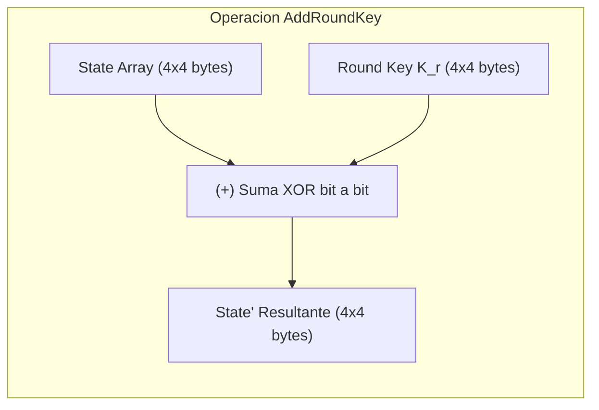

[← Volver a Curso.md](../Curso.md)

# AES: Transformacion AddRoundKey (ARK)

> **Materia**: Criptografia | **Fuente**: [part 4.pdf](../Documentos/part 4.pdf)  
> `addroundkey`, `ark`, `xor`, `key whitening`, `subclave`, `involutivo`, `autoinverso`, `state array`, `dependencia de clave`, `suma en gf(2)`

---

## 1. Definicion y Principio Operativo

- **Mecanica**: Realiza una suma logica **XOR bit a bit ($\oplus$)** entre cada byte de la matriz de estado ($S$) y el byte correspondiente de la subclave de ronda ($K_r$):
  $$S'_{i,j} = S_{i,j} \oplus K_{i,j} \quad \forall i, j \in \{0, 1, 2, 3\}$$
- **Proposito criptografico**:
  - **Inyeccion de clave (*Key Dependence*)**: Es la **unica transformacion** en todo el algoritmo AES que introduce la clave secreta en el flujo de datos. Sin ARK, el cifrado seria una funcion fija sin secreto.
  - **Blanqueamiento inicial (*Key Whitening*)**: Aplicado en la Ronda 0 sobre el texto plano crudo. Evita que un atacante conozca los valores exactos que ingresan a la primera ronda de sustitucion no lineal (SubBytes).

---

## 2. Propiedad de Autoinversion (Involucion)

- **Simetria algebraica**: La operacion XOR es su propia inversa:
  $$(A \oplus B) \oplus B = A$$
- **Consecuencia de ingenieria**:
  $$\text{AddRoundKey}^{-1} \equiv \text{AddRoundKey}$$
  - No requiere logica ni circuitos dedicados de descifrado. Tanto el emisor como el receptor ejecutan exactamente la misma operacion aplicando la subclave correspondiente.

---

## 3. Calculo Practico Paso a Paso (Ejemplo Slide 13)

### Datos de Entrada
- **State Array ($S$)**:
  $$S = \begin{pmatrix} 41 & 65 & 75 & 61 \\ 45 & 73 & 79 & 63 \\ 53 & 20 & 20 & 69 \\ 20 & 6d & 66 & 6c \end{pmatrix}$$
- **Subclave Inicial ($K_0$)**:
  $$K_0 = \begin{pmatrix} 2b & 28 & ab & 09 \\ 7e & ae & f7 & cf \\ 15 & d2 & 15 & 4f \\ 16 & a6 & 88 & 3c \end{pmatrix}$$

### Desglose Binario del Byte $(0,0)$ (Slide 13)
- $S_{0,0} = 41_{16} = \mathbf{0100\ 0001_2}$
- $K_{0,0} = 2b_{16} = \mathbf{0010\ 1011_2}$
- Suma XOR bit a bit:
  $$\begin{array}{r@{\quad}l}
    & 0100\ 0001 \\
  \oplus & 0010\ 1011 \\
  \hline
  = & 0110\ 1010_2 = \mathbf{6a_{16}}
  \end{array}$$

### Estado Resultante Completo ($S' = S \oplus K_0$)
$$\begin{pmatrix} 41 \oplus 2b & 65 \oplus 28 & 75 \oplus ab & 61 \oplus 09 \\ 45 \oplus 7e & 73 \oplus ae & 79 \oplus f7 & 63 \oplus cf \\ 53 \oplus 15 & 20 \oplus d2 & 20 \oplus 15 & 69 \oplus 4f \\ 20 \oplus 16 & 6d \oplus a6 & 66 \oplus 88 & 6c \oplus 3c \end{pmatrix} = \begin{pmatrix} \mathbf{6a} & \mathbf{4d} & \mathbf{de} & \mathbf{68} \\ \mathbf{3b} & \mathbf{dd} & \mathbf{8e} & \mathbf{ac} \\ \mathbf{46} & \mathbf{f2} & \mathbf{35} & \mathbf{26} \\ \mathbf{36} & \mathbf{cb} & \mathbf{ee} & \mathbf{50} \end{pmatrix}$$

---

## 4. Eficiencia de Implementacion en Software y Hardware

- **A nivel de procesador escalar**: 16 operaciones XOR de 8 bits o 4 operaciones XOR de 32 bits (una por cada palabra columna):
  $$C_j = S_{*,j} \oplus W[4r + j]$$
- **A nivel de instrucciones vectoriales SIMD (x86 SSE/AVX / ARM NEON)**:
  - Una unica instruccion `PXOR` (128 bits en 1 ciclo de reloj).
  - En hardware x86 con soporte AES-NI: instruccion nativa `AESENC` / `AESENCLAST`.

---

## 5. Casos Trampa y Puntos Criticos de Examen

- **Alineacion de indices**: El XOR se realiza estrictamente entre elementos con **identica posicion de fila y columna** ($S_{i,j} \oplus K_{i,j}$). No hay transposicion ni desplazamiento en esta fase.
- **Diferencia entre suma aritmetica y suma en $GF(2)$**: La operacion es suma modulo 2 sin acarreo (XOR). Jamas sumar los valores en decimal con acarreo convencional.
- **Ubicacion en el algoritmo**: Se aplica en **todas las etapas**:
  1. Antes de iniciar las rondas (Ronda 0 - Whitening).
  2. Al final de cada una de las rondas intermedias ($1 \dots Nr-1$).
  3. Al cierre de la ronda final ($Nr$).
