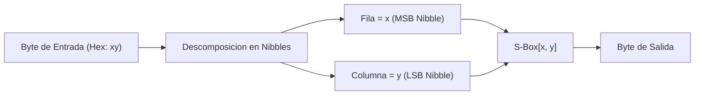

[← Volver a Curso.md](../Curso.md)

# AES: Transformacion SubBytes e InvSubBytes (SB)

> **Materia**: Criptografia | **Fuente**: [part 4.pdf](../Documentos/part 4.pdf)  
> `subbytes`, `invsubbytes`, `s-box`, `invsbox`, `caja s`, `confusion`, `no linealidad`, `sustitucion de bytes`, `nibble`, `gf(2^8)`, `inversion multiplicativa`, `transformacion afin`

---

## 1. Definicion y Mecanica Operativa

- **Definicion**: Sustitucion no lineal byte a byte del estado mediante una tabla de correspondencia biyectiva fija de 256 elementos (**S-Box** en cifrado, **InvSBox** en descifrado):
  $$S'_{i,j} = \text{SBox}(S_{i,j}) \quad \forall i,j \in \{0, 1, 2, 3\}$$
- **Proposito criptografico**:
  - Aportar **confusion** y **alta no linealidad** al criptosistema.
  - Es el **unico componente no lineal** de todo el cifrador AES. Protege contra criptoanalisis diferencial y criptoanalisis lineal.

---

## 2. Regla Practica de Consulta de la S-Box

Para cualquier byte de entrada en formato hexadecimal de dos digitos $B = \mathbf{xy}$:
1. El primer digito hexadecimal ($\mathbf{x} \in \{0 \dots \text{f}\}$, nibble mas significativo) selecciona la **fila**.
2. El segundo digito hexadecimal ($\mathbf{y} \in \{0 \dots \text{f}\}$, nibble menos significativo) selecciona la **columna**.
3. El valor en la interseccion $\text{SBox}[\mathbf{x}, \mathbf{y}]$ es el byte sustituto.

### Ejemplo Practico de Consulta (Slide 14)
- **Byte a sustituir**: $6a_{16}$
  - Fila: $6$
  - Columna: $a$
  - En la tabla S-Box: fila $6$, columna $a \implies \mathbf{02_{16}}$

---

## 3. Ejemplo Practico de la Matriz de Estado (Slide 14)

$$\text{State Entrada} = \begin{pmatrix} 6a & 4d & de & 68 \\ 3b & dd & 8e & ac \\ 46 & f2 & 35 & 26 \\ 36 & cb & ee & 50 \end{pmatrix} \xrightarrow{\text{SubBytes}} \text{State' Salida} = \begin{pmatrix} \mathbf{02} & \mathbf{e3} & \mathbf{1d} & \mathbf{45} \\ \mathbf{e2} & \mathbf{c1} & \mathbf{19} & \mathbf{91} \\ \mathbf{5a} & \mathbf{89} & \mathbf{96} & \mathbf{f7} \\ \mathbf{05} & \mathbf{1f} & \mathbf{28} & \mathbf{53} \end{pmatrix}$$

### Trazabilidad de Bytes Clave
- Fila 0: $\text{SBox}[6,a] = \mathbf{02}$, $\text{SBox}[4,d] = \mathbf{e3}$, $\text{SBox}[d,e] = \mathbf{1d}$, $\text{SBox}[6,8] = \mathbf{45}$
- Fila 1: $\text{SBox}[3,b] = \mathbf{e2}$, $\text{SBox}[d,d] = \mathbf{c1}$, $\text{SBox}[8,e] = \mathbf{19}$, $\text{SBox}[a,c] = \mathbf{91}$
- Fila 2: $\text{SBox}[4,6] = \mathbf{5a}$, $\text{SBox}[f,2] = \mathbf{89}$, $\text{SBox}[3,5] = \mathbf{96}$, $\text{SBox}[2,6] = \mathbf{f7}$
- Fila 3: $\text{SBox}[3,6] = \mathbf{05}$, $\text{SBox}[c,b] = \mathbf{1f}$, $\text{SBox}[e,e] = \mathbf{28}$, $\text{SBox}[5,0] = \mathbf{53}$

---

## 4. Tabla S-Box de Cifrado (Slide 15)

| | 0 | 1 | 2 | 3 | 4 | 5 | 6 | 7 | 8 | 9 | a | b | c | d | e | f |
| :---: | :---: | :---: | :---: | :---: | :---: | :---: | :---: | :---: | :---: | :---: | :---: | :---: | :---: | :---: | :---: | :---: |
| **0** | 63 | 7c | 77 | 7b | f2 | 6b | 6f | c5 | 30 | 01 | 67 | 2b | fe | d7 | ab | 76 |
| **1** | ca | 82 | c9 | 7d | fa | 59 | 47 | f0 | ad | d4 | a2 | af | 9c | a4 | 72 | c0 |
| **2** | b7 | fd | 93 | 26 | 36 | 3f | f7 | cc | 34 | a5 | e5 | f1 | 71 | d8 | 31 | 15 |
| **3** | 04 | c7 | 23 | c3 | 18 | 96 | 05 | 9a | 07 | 12 | 80 | e2 | eb | 27 | b2 | 75 |
| **4** | 09 | 83 | 2c | 1a | 1b | 6e | 5a | a0 | 52 | 3b | d6 | b3 | 29 | e3 | 2f | 84 |
| **5** | 53 | d1 | 00 | ed | 20 | fc | b1 | 5b | 6a | cb | be | 39 | 4a | 4c | 58 | cf |
| **6** | d0 | ef | aa | fb | 43 | 4d | 33 | 85 | 45 | f9 | 02 | 7f | 50 | 3c | 9f | a8 |
| **7** | 51 | a3 | 40 | 8f | 92 | 9d | 38 | f5 | bc | b6 | da | 21 | 10 | ff | f3 | d2 |
| **8** | cd | 0c | 13 | ec | 5f | 97 | 44 | 17 | c4 | a7 | 7e | 3d | 64 | 5d | 19 | 73 |
| **9** | 60 | 81 | 4f | dc | 22 | 2a | 90 | 88 | 46 | ee | b8 | 14 | de | 5e | 0b | db |
| **a** | e0 | 32 | 3a | 0a | 49 | 06 | 24 | 5c | c2 | d3 | ac | 62 | 91 | 95 | e4 | 79 |
| **b** | e7 | c8 | 37 | 6d | 8d | d5 | 4e | a9 | 6c | 56 | f4 | ea | 65 | 7a | ae | 08 |
| **c** | ba | 78 | 25 | 2e | 1c | a6 | b4 | c6 | e8 | dd | 74 | 1f | 4b | bd | 8b | 8a |
| **d** | 70 | 3e | b5 | 66 | 48 | 03 | f6 | 0e | 61 | 35 | 57 | b9 | 86 | c1 | 1d | 9e |
| **e** | e1 | f8 | 98 | 11 | 69 | d9 | 8e | 94 | 9b | 1e | 87 | e9 | ce | 55 | 28 | df |
| **f** | 8c | a1 | 89 | 0d | bf | e6 | 42 | 68 | 41 | 99 | 2d | 0f | b0 | 54 | bb | 16 |

---

## 5. Operacion Inversa: InvSubBytes y Tabla InvSBox (Slides 22 y 23)

- **Mecanica**: Realiza la transformacion inversa en descifrado sustituyendo cada byte $C = \mathbf{xy}$ mediante la tabla **InvSBox**:
  $$S_{i,j} = \text{InvSBox}(S'_{i,j})$$
- **Verificacion de reversion**:
  - $\text{SBox}[6, a] = 02 \iff \text{InvSBox}[0, 2] = \mathbf{6a}$
  - $\text{SBox}[4, d] = e3 \iff \text{InvSBox}[e, 3] = \mathbf{4d}$

### Tabla InvSBox de Descifrado (Slide 23)

| | 0 | 1 | 2 | 3 | 4 | 5 | 6 | 7 | 8 | 9 | a | b | c | d | e | f |
| :---: | :---: | :---: | :---: | :---: | :---: | :---: | :---: | :---: | :---: | :---: | :---: | :---: | :---: | :---: | :---: | :---: |
| **0** | 52 | 09 | 6a | d5 | 30 | 36 | a5 | 38 | bf | 40 | a3 | 9e | 81 | f3 | d7 | fb |
| **1** | 7c | e3 | 39 | 82 | 9b | 2f | ff | 87 | 34 | 8e | 43 | 44 | c4 | de | e9 | cb |
| **2** | 54 | 7b | 94 | 32 | a6 | c2 | 23 | 3d | ee | 4c | 95 | 0b | 42 | fa | c3 | 4e |
| **3** | 08 | 2e | a1 | 66 | 28 | d9 | 24 | b2 | 76 | 5b | a2 | 49 | 6d | 8b | d1 | 25 |
| **4** | 72 | f8 | f6 | 64 | 86 | 68 | 98 | 16 | d4 | a4 | 5c | cc | 5d | 65 | b6 | 92 |
| **5** | 6c | 70 | 48 | 50 | fd | ed | b9 | da | 5e | 15 | 46 | 57 | a7 | 8d | 9d | 84 |
| **6** | 90 | d8 | ab | 00 | 8c | bc | d3 | 0a | f7 | e4 | 58 | 05 | b8 | b3 | 45 | 06 |
| **7** | d0 | 2c | 1e | 8f | ca | 3f | 0f | 02 | c1 | af | bd | 03 | 01 | 13 | 8a | 6b |
| **8** | 3a | 91 | 11 | 41 | 4f | 67 | dc | ea | 97 | f2 | cf | ce | f0 | b4 | e6 | 73 |
| **9** | 96 | ac | 74 | 22 | e7 | ad | 35 | 85 | e2 | f9 | 37 | e8 | 1c | 75 | df | 6e |
| **a** | 47 | f1 | 1a | 71 | 1d | 29 | c5 | 89 | 6f | b7 | 62 | 0e | aa | 18 | be | 1b |
| **b** | fc | 56 | 3e | 4b | c6 | d2 | 79 | 20 | 9a | db | c0 | fe | 78 | cd | 5a | f4 |
| **c** | 1f | dd | a8 | 33 | 88 | 07 | c7 | 31 | b1 | 12 | 10 | 59 | 27 | 80 | ec | 5f |
| **d** | 60 | 51 | 7f | a9 | 19 | b5 | 4a | 0d | 2d | e5 | 7a | 9f | 93 | c9 | 9c | ef |
| **e** | a0 | e0 | 3b | 4d | ae | 2a | f5 | b0 | c8 | eb | bb | 3c | 83 | 53 | 99 | 61 |
| **f** | 17 | 2b | 04 | 7e | ba | 77 | d6 | 26 | e1 | 69 | 14 | 63 | 55 | 21 | 0c | 7d |

---

## 6. Casos Trampa y Puntos Criticos de Examen

- **Orden de los nibbles**: Primer nibble = **Fila**; Segundo nibble = **Columna**. Invertir este orden (columna, fila) es el error mas tipico en parciales y genera valores completamente erroneos.
- **Byte nulo ($00_{16}$)**: La entrada $00_{16}$ **no** mapea a $00_{16}$. En la S-Box, $\text{SBox}[0,0] = \mathbf{63_{16}}$. Esto elimina puntos fijos ($S(x) \ne x$) y puntos antifijos ($S(x) \ne \bar{x}$).
- **Naturaleza no lineal**: Es la unica etapa no lineal de AES. Si se eliminara SubBytes, AES se convertiria en una transformacion totalmente afin y lineal, rompible instantaneamente mediante eliminacion gaussiana.
