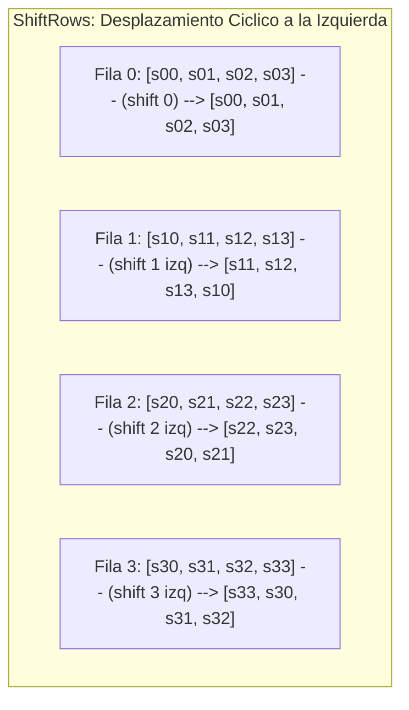

[← Volver a Curso.md](../Curso.md)

# AES: Transformacion ShiftRows e InvShiftRows (SR)

> **Materia**: Criptografia | **Fuente**: [part 4.pdf](../Documentos/part 4.pdf)  
> `shiftrows`, `invshiftrows`, `sr`, `desplazamiento ciclico`, `difusion horizontal`, `permutacion de bytes`, `state array`, `rotacion a la izquierda`, `rotacion a la derecha`, `inter-column mixing`

---

## 1. Definicion y Mecanica Operativa

- **Definicion**: Permutacion lineal que desplaza ciclicamente hacia la izquierda los bytes de cada fila de la matriz de estado.
- **Regla estricta por fila**:
  - **Fila 0**: No se desplaza (**0 posiciones**).
  - **Fila 1**: Se desplaza ciclicamente **1 posicion a la izquierda** ($\ll 1$).
  - **Fila 2**: Se desplaza ciclicamente **2 posiciones a la izquierda** ($\ll 2$).
  - **Fila 3**: Se desplaza ciclicamente **3 posiciones a la izquierda** ($\ll 3$).
- **Formula matematica (Cifrado)**:
  $$S'_{r, c} = S_{r, (c + r) \bmod 4} \quad \forall r, c \in \{0, 1, 2, 3\}$$
- **Proposito criptografico**:
  - Proporcionar **difusion horizontal inter-columnas**.
  - Evita que las 4 columnas del estado se procesen como 4 bloques independientes de 32 bits. Al combinarse con MixColumns, garantiza que tras apenas 2 rondas, cada byte del texto cifrado dependa de todos los bytes del texto plano (**efecto avalancha total**).

---

## 2. Calculo Practico Paso a Paso (Ejemplo Slide 16)

### Matriz de Entrada
$$\text{State Entrada} = \begin{pmatrix} 02 & e3 & 1d & 45 \\ e2 & c1 & 19 & 91 \\ 5a & 89 & 96 & f7 \\ 05 & 1f & 28 & 53 \end{pmatrix}$$

### Desplazamiento Fila por Fila
1. **Fila 0 (shift 0)**:
   $$[02, e3, 1d, 45] \longrightarrow \mathbf{[02, e3, 1d, 45]}$$
2. **Fila 1 (shift 1 a la izquierda)**:
   $$[e2, c1, 19, 91] \longrightarrow \mathbf{[c1, 19, 91, e2]}$$
   *(El byte $e2$ rota circularmente hacia la ultima posicion).*
3. **Fila 2 (shift 2 a la izquierda)**:
   $$[5a, 89, 96, f7] \longrightarrow \mathbf{[96, f7, 5a, 89]}$$
   *(Los bytes $5a, 89$ rotan hacia las posiciones finales).*
4. **Fila 3 (shift 3 a la izquierda)**:
   $$[05, 1f, 28, 53] \longrightarrow \mathbf{[53, 05, 1f, 28]}$$
   *(Equivalente a desplazar 1 posicion a la derecha).*

### Matriz de Salida Resultante
$$\text{State' Salida} = \begin{pmatrix} \mathbf{02} & \mathbf{e3} & \mathbf{1d} & \mathbf{45} \\ \mathbf{c1} & \mathbf{19} & \mathbf{91} & \mathbf{e2} \\ \mathbf{96} & \mathbf{f7} & \mathbf{5a} & \mathbf{89} \\ \mathbf{53} & \mathbf{05} & \mathbf{1f} & \mathbf{28} \end{pmatrix}$$

---

## 3. Operacion Inversa: InvShiftRows (Slide 22)

- **Mecanica**: Realiza el desplazamiento ciclico en sentido inverso (**hacia la derecha**):
  - **Fila 0**: No se desplaza (**0 posiciones**).
  - **Fila 1**: Se desplaza ciclicamente **1 posicion a la derecha** ($\gg 1$).
  - **Fila 2**: Se desplaza ciclicamente **2 posiciones a la derecha** ($\gg 2$).
  - **Fila 3**: Se desplaza ciclicamente **3 posiciones a la derecha** ($\gg 3$).
- **Formula matematica (Descifrado)**:
  $$S_{r, c} = S'_{r, (c - r) \bmod 4} \quad \forall r, c \in \{0, 1, 2, 3\}$$

### Verificacion Inversa Inmediata
Tomando la salida obtenida:
$$\begin{pmatrix} 02 & e3 & 1d & 45 \\ c1 & 19 & 91 & e2 \\ 96 & f7 & 5a & 89 \\ 53 & 05 & 1f & 28 \end{pmatrix} \xrightarrow{\text{InvShiftRows}} \begin{pmatrix} \mathbf{02} & \mathbf{e3} & \mathbf{1d} & \mathbf{45} \\ \mathbf{e2} & \mathbf{c1} & \mathbf{19} & \mathbf{91} \\ \mathbf{5a} & \mathbf{89} & \mathbf{96} & \mathbf{f7} \\ \mathbf{05} & \mathbf{1f} & \mathbf{28} & \mathbf{53} \end{pmatrix}$$

---

## 4. Casos Trampa y Puntos Criticos de Examen

- **Direccion del desplazamiento**:
  - En **Cifrado**: estrictamente hacia la **izquierda** ($\ll$).
  - En **Descifrado**: estrictamente hacia la **derecha** ($\gg$).
- **La Fila 0 NUNCA se desplaza**: Se mantiene intacta en su orden original ($0$ posiciones).
- **Desplazamiento horizontal vs procesamiento vertical**: ShiftRows opera horizontalmente por filas; las demas operaciones matriciales de AES (MixColumns, AddRoundKey, orden de lectura) operan primordialmente por columnas.
