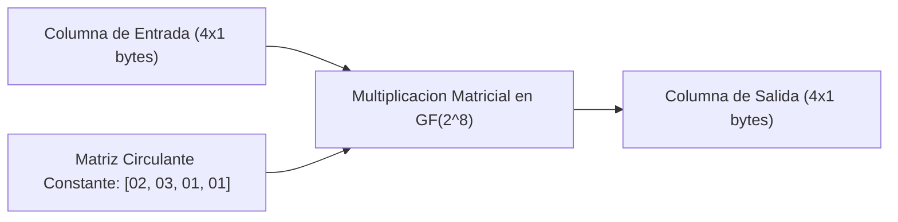

[← Volver a Curso.md](../Curso.md)

# AES: Transformacion MixColumns e InvMixColumns (MC)

> **Materia**: Criptografia | **Fuente**: [part 4.pdf](../Documentos/part 4.pdf)  
> `mixcolumns`, `invmixcolumns`, `mc`, `galois field`, `gf(2^8)`, `e-table`, `l-table`, `multiplicacion modular`, `difusion vertical`, `matriz mds`, `polinomio irreducible`, `operacion lineal`

---

## 1. Definicion y Formulacion Matricial

- **Definicion**: Transformacion lineal que opera sobre cada columna de la matriz de estado de manera independiente. Modela cada columna como un polinomio de grado 3 sobre el cuerpo de Galois $GF(2^8)$ y lo multiplica modulo $x^4 + 1$ con un polinomio constante prefijado:
  $$c(x) = 03x^3 + 01x^2 + 01x + 02$$
- **Representacion matricial en $GF(2^8)$ (Slide 17)**:
  $$\begin{pmatrix} S'_{0,c} \\ S'_{1,c} \\ S'_{2,c} \\ S'_{3,c} \end{pmatrix} = \begin{pmatrix} 02 & 03 & 01 & 01 \\ 01 & 02 & 03 & 01 \\ 01 & 01 & 02 & 03 \\ 03 & 01 & 01 & 02 \end{pmatrix} \begin{pmatrix} S_{0,c} \\ S_{1,c} \\ S_{2,c} \\ S_{3,c} \end{pmatrix} \quad \forall c \in \{0, 1, 2, 3\}$$
- **Proposito criptografico**:
  - Proporcionar **difusion vertical intra-columna** con propiedad de separabilidad maxima (**Matriz MDS**). Cada byte de salida depende de los 4 bytes de entrada de la columna.

---

## 2. Multiplicacion Practica en Galois Field $GF(2^8)$ con Tablas E y L (Slide 18)

Toda multiplicacion en $GF(2^8)$ con polinomio irreducible $m(x) = x^8 + x^4 + x^3 + x + 1$ ($11b_{16}$) se reduce a una suma aritmetica elemental usando las tablas **L-Table** (logaritmos base 3) y **E-Table** (exponenciales base 3):

### Algoritmo Operativo de Multiplicacion $A \times B$
1. Si $A = 00_{16}$ o $B = 00_{16} \implies A \times B = \mathbf{00_{16}}$ (no tienen logaritmo).
2. Consultar el logaritmo de ambos factores en la **L-Table**:
   $$\alpha = \text{L-Table}[A], \quad \beta = \text{L-Table}[B]$$
3. Sumar ambos valores en decimal modulo 255:
   $$\text{exp}_{\text{dec}} = (\alpha_{\text{dec}} + \beta_{\text{dec}}) \bmod 255$$
4. Convertir $\text{exp}_{\text{dec}}$ a hexadecimal ($\text{exp}_{\text{hex}}$) y buscar en la **E-Table**:
   $$\text{Resultado} = \text{E-Table}[\text{exp}_{\text{hex}}]$$

### Resolucion del Ejemplo del PDF (Slide 18)
Multiplicar $6a_{16} \times 97_{16}$ en $GF(2^8)$:
1. $\text{L-Table}[6, a] = 28_{16} \implies 40_{10}$.
2. $\text{L-Table}[9, 7] = f5_{16} \implies 245_{10}$.
3. Suma en decimal modulo 255:
   $$40 + 245 = 285 \implies 285 \bmod 255 = 30_{10}$$
4. Conversion a hexadecimal: $30_{10} = 1e_{16}$.
5. Busqueda en tabla exponencial:
   $$\text{E-Table}[1, e] = \mathbf{66_{16}}$$
- **Resultado final**: $6a_{16} \times 97_{16} = \mathbf{66_{16}}$.

---

## 3. Resolucion Paso a Paso del Producto Vectorial (Slide 19)

Calculo de la primera columna ($c=0$):
$$\begin{pmatrix} S'_{0,0} \\ S'_{1,0} \\ S'_{2,0} \\ S'_{3,0} \end{pmatrix} = \begin{pmatrix} 02 & 03 & 01 & 01 \\ 01 & 02 & 03 & 01 \\ 01 & 01 & 02 & 03 \\ 03 & 01 & 01 & 02 \end{pmatrix} \begin{pmatrix} 02 \\ c1 \\ 96 \\ 53 \end{pmatrix}$$

### 1. Elemento $S'_{0,0}$ (Fila 0)
$$S'_{0,0} = (02 \cdot 02) \oplus (03 \cdot c1) \oplus (01 \cdot 96) \oplus (01 \cdot 53)$$
- $02 \cdot 02 = \mathbf{04}$
- $03 \cdot c1$: $L[03]=01_{16}(1), L[c1]=c8_{16}(200) \implies 1+200=201=c9_{16} \implies E[c9] = \mathbf{58}$
- $01 \cdot 96 = \mathbf{96}$ (elemento neutro)
- $01 \cdot 53 = \mathbf{53}$ (elemento neutro)
- Suma XOR:
  $$04 \oplus 58 \oplus 96 \oplus 53 = \mathbf{99_{16}}$$

### 2. Elemento $S'_{1,0}$ (Fila 1)
$$S'_{1,0} = (01 \cdot 02) \oplus (02 \cdot c1) \oplus (03 \cdot 96) \oplus (01 \cdot 53)$$
- $01 \cdot 02 = \mathbf{02}$
- $02 \cdot c1$: $L[02]=19_{16}(25), L[c1]=c8_{16}(200) \implies 25+200=225=e1_{16} \implies E[e1] = \mathbf{99}$
- $03 \cdot 96$: $L[03]=01_{16}(1), L[96]=ce_{16}(206) \implies 1+206=207=cf_{16} \implies E[cf] = \mathbf{a1}$
- $01 \cdot 53 = \mathbf{53}$
- Suma XOR:
  $$02 \oplus 99 \oplus a1 \oplus 53 = \mathbf{69_{16}}$$

### 3. Elemento $S'_{2,0}$ (Fila 2)
$$S'_{2,0} = (01 \cdot 02) \oplus (01 \cdot c1) \oplus (02 \cdot 96) \oplus (03 \cdot 53)$$
- $01 \cdot 02 = \mathbf{02}$
- $01 \cdot c1 = \mathbf{c1}$
- $02 \cdot 96$: $L[02]=19_{16}(25), L[96]=ce_{16}(206) \implies 25+206=231=e7_{16} \implies E[e7] = \mathbf{37}$
- $03 \cdot 53$: $L[03]=01_{16}(1), L[53]=bd_{16}(189) \implies 1+189=190=be_{16} \implies E[be] = \mathbf{f5}$
- Suma XOR:
  $$02 \oplus c1 \oplus 37 \oplus f5 = \mathbf{01_{16}}$$

### 4. Elemento $S'_{3,0}$ (Fila 3)
$$S'_{3,0} = (03 \cdot 02) \oplus (01 \cdot c1) \oplus (01 \cdot 96) \oplus (02 \cdot 53)$$
- $03 \cdot 02 = \mathbf{06}$
- $01 \cdot c1 = \mathbf{c1}$
- $01 \cdot 96 = \mathbf{96}$
- $02 \cdot 53$: $L[02]=19_{16}(25), L[53]=bd_{16}(189) \implies 25+189=214=d6_{16} \implies E[d6] = \mathbf{a6}$
- Suma XOR:
  $$06 \oplus c1 \oplus 96 \oplus a6 = \mathbf{f7_{16}}$$

- **Vector columna resultante**:
  $$\begin{pmatrix} S'_{0,0} \\ S'_{1,0} \\ S'_{2,0} \\ S'_{3,0} \end{pmatrix} = \begin{pmatrix} \mathbf{99} \\ \mathbf{69} \\ \mathbf{01} \\ \mathbf{f7} \end{pmatrix}$$

### Matriz de Estado Completa de Salida (Slide 17)
$$\text{State Entrada} = \begin{pmatrix} 02 & e3 & 1d & 45 \\ c1 & 19 & 91 & e2 \\ 96 & f7 & 5a & 89 \\ 53 & 05 & 1f & 28 \end{pmatrix} \xrightarrow{\text{MixColumns}} \begin{pmatrix} \mathbf{99} & \mathbf{04} & \mathbf{d7} & \mathbf{16} \\ \mathbf{69} & \mathbf{d6} & \mathbf{d5} & \mathbf{32} \\ \mathbf{01} & \mathbf{00} & \mathbf{19} & \mathbf{d6} \\ \mathbf{f7} & \mathbf{da} & \mathbf{d2} & \mathbf{f4} \end{pmatrix}$$

---

## 4. Operacion Inversa: InvMixColumns (Slide 22)

- **Mecanica**: Dado que la matriz circulante de MixColumns es invertible en $GF(2^8)$, el descifrado multiplica cada columna por la **matriz inversa**:
  $$\begin{pmatrix} S_{0,c} \\ S_{1,c} \\ S_{2,c} \\ S_{3,c} \end{pmatrix} = \begin{pmatrix} \mathbf{0e} & \mathbf{0b} & \mathbf{0d} & \mathbf{09} \\ \mathbf{09} & \mathbf{0e} & \mathbf{0b} & \mathbf{0d} \\ \mathbf{0d} & \mathbf{09} & \mathbf{0e} & \mathbf{0b} \\ \mathbf{0b} & \mathbf{0d} & \mathbf{09} & \mathbf{0e} \end{pmatrix} \begin{pmatrix} S'_{0,c} \\ S'_{1,c} \\ S'_{2,c} \\ S'_{3,c} \end{pmatrix}$$
- Los coeficientes $\{0e, 0b, 0d, 09\}$ representan las constantes polinomiales inversas modulo $x^4 + 1$.

---

## 5. Tabla E (Exponencial en $GF(2^8)$) (Slide 20)

| | 0 | 1 | 2 | 3 | 4 | 5 | 6 | 7 | 8 | 9 | a | b | c | d | e | f |
| :---: | :---: | :---: | :---: | :---: | :---: | :---: | :---: | :---: | :---: | :---: | :---: | :---: | :---: | :---: | :---: | :---: |
| **0** | 01 | 03 | 05 | 0f | 11 | 33 | 55 | ff | 1a | 2e | 72 | 96 | a1 | f8 | 13 | 35 |
| **1** | 5f | e1 | 38 | 48 | d8 | 73 | 95 | a4 | f7 | 02 | 06 | 0a | 1e | 22 | 66 | aa |
| **2** | e5 | 34 | 5c | e4 | 37 | 59 | eb | 26 | 6a | be | d9 | 70 | 90 | ab | e6 | 31 |
| **3** | 53 | f5 | 04 | 0c | 14 | 3c | 44 | cc | 4f | d1 | 68 | b8 | d3 | 6e | b2 | cd |
| **4** | 4c | d4 | 67 | a9 | e0 | 3b | 4d | d7 | 62 | a6 | f1 | 08 | 18 | 28 | 78 | 88 |
| **5** | 83 | 9e | b9 | d0 | 6b | bd | dc | 7f | 81 | 98 | b3 | ce | 49 | db | 76 | 9a |
| **6** | b5 | c4 | 57 | f9 | 10 | 30 | 50 | f0 | 0b | 1d | 27 | 69 | bb | d6 | 61 | a3 |
| **7** | fe | 19 | 2b | 7d | 87 | 92 | ad | ec | 2f | 71 | 93 | ae | e9 | 20 | 60 | a0 |
| **8** | fb | 16 | 3a | 4e | d2 | 6d | b7 | c2 | 5d | e7 | 32 | 56 | fa | 15 | 3f | 41 |
| **9** | c3 | 5e | e2 | 3d | 47 | c9 | 40 | c0 | 5b | ed | 2c | 74 | 9c | bf | da | 75 |
| **a** | 9f | ba | d5 | 64 | ac | ef | 2a | 7e | 82 | 9d | bc | df | 7a | 8e | 89 | 80 |
| **b** | 9b | b6 | c1 | 58 | e8 | 23 | 65 | af | ea | 25 | 6f | b1 | c8 | 43 | c5 | 54 |
| **c** | fc | 1f | 21 | 63 | a5 | f4 | 07 | 09 | 1b | 2d | 77 | 99 | b0 | cb | 46 | ca |
| **d** | 45 | cf | 4a | de | 79 | 8b | 86 | 91 | a8 | e3 | 3e | 42 | c6 | 51 | f3 | 0e |
| **e** | 12 | 36 | 5a | ee | 29 | 7b | 8d | 8c | 8f | 8a | 85 | 94 | a7 | f2 | 0d | 17 |
| **f** | 39 | 4b | dd | 7c | 84 | 97 | a2 | fd | 1c | 24 | 6c | b4 | c7 | 52 | f6 | 01 |

---

## 6. Tabla L (Logaritmo en $GF(2^8)$) (Slide 21)

| | 0 | 1 | 2 | 3 | 4 | 5 | 6 | 7 | 8 | 9 | a | b | c | d | e | f |
| :---: | :---: | :---: | :---: | :---: | :---: | :---: | :---: | :---: | :---: | :---: | :---: | :---: | :---: | :---: | :---: | :---: |
| **0** | 00 | 00 | 19 | 01 | 32 | 02 | 1a | c6 | 4b | c7 | 1b | 68 | 33 | ee | df | 03 |
| **1** | 64 | 04 | e0 | 0e | 34 | 8d | 81 | ef | 4c | 71 | 08 | c8 | f8 | 69 | 1c | c1 |
| **2** | 7d | c2 | 1d | b5 | f9 | b9 | 27 | 6a | 4d | e4 | a6 | 72 | 9a | c9 | 09 | 78 |
| **3** | 65 | 2f | 8a | 05 | 21 | 0f | e1 | 24 | 12 | f0 | 82 | 45 | 35 | 93 | da | 8e |
| **4** | 96 | 8f | db | bd | 36 | d0 | ce | 94 | 13 | 5c | d2 | f1 | 40 | 46 | 83 | 38 |
| **5** | 66 | dd | fd | 30 | bf | 06 | 8b | 62 | b3 | 25 | e2 | 98 | 22 | 88 | 91 | 10 |
| **6** | 7e | 6e | 48 | c3 | a3 | b6 | 1e | 42 | 3a | 6b | 28 | 54 | fa | 85 | 3d | ba |
| **7** | 2b | 79 | 0a | 15 | 9b | 9f | 5e | ca | 4e | d4 | ac | e5 | f3 | 73 | a7 | 57 |
| **8** | af | 58 | a8 | 50 | f4 | ea | d6 | 74 | 4f | ae | e9 | d5 | e7 | e6 | ad | e8 |
| **9** | 2c | d7 | 75 | 7a | eb | 16 | 0b | f5 | 59 | cb | 5f | b0 | 9c | a9 | 51 | a0 |
| **a** | 7f | 0c | f6 | 6f | 17 | c4 | 49 | ec | d8 | 43 | 1f | 2d | a4 | 76 | 7b | b7 |
| **b** | cc | bb | 3e | 5a | fb | 60 | b1 | 86 | 3b | 52 | a1 | 6c | aa | 55 | 29 | 9d |
| **c** | 97 | b2 | 87 | 90 | 61 | be | dc | fc | bc | 95 | cf | cd | 37 | 3f | 5b | d1 |
| **d** | 53 | 39 | 84 | 3c | 41 | a2 | 6d | 47 | 14 | 2a | 9e | 5d | 56 | f2 | d3 | ab |
| **e** | 44 | 11 | 92 | d9 | 23 | 20 | 2e | 89 | b4 | 7c | b8 | 26 | 77 | 99 | e3 | a5 |
| **f** | 67 | 4a | ed | de | c5 | 31 | fe | 18 | 0d | 63 | 8c | 80 | c0 | f7 | 70 | 07 |

---

## 7. Casos Trampa y Puntos Criticos de Examen

- **Modulo en la suma de logaritmos**: Es estrictamente **modulo 255** (tamano del grupo multiplicativo $\mathbb{F}_{2^8}^* = 2^8 - 1 = 255$), **NO** modulo 256.
- **Suma de terminos**: La suma entre terminos resultantes del producto matricial es **XOR ($\oplus$)**, jamas suma con acarreo.
- **Multiplicacion por $01_{16}$**: No requiere lookup de tablas; es la identidad ($01 \cdot X = X$).
- **Omitida en la Ronda Final**: La transformacion MixColumns **NO se ejecuta en la ronda 10** (Ronda Final) de AES-128. Omitirla es crucial para preservar la compatibilidad simetrica con el algoritmo inverso.
