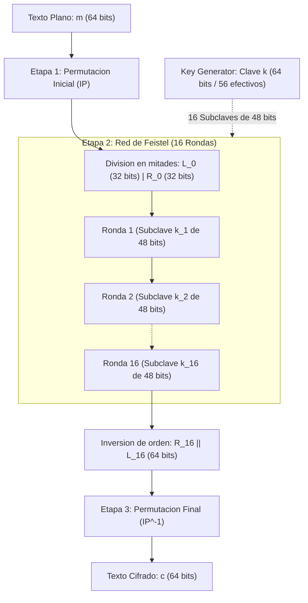
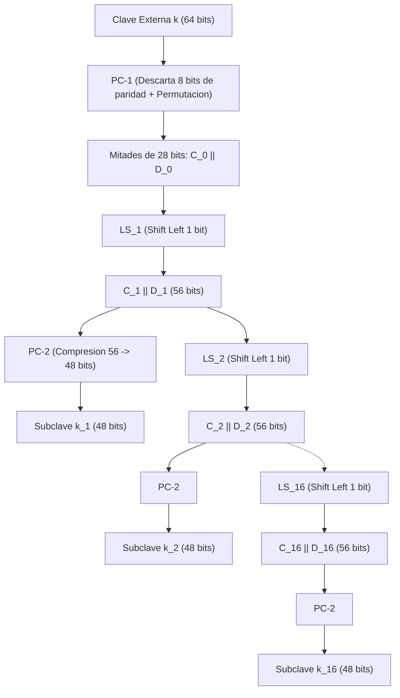
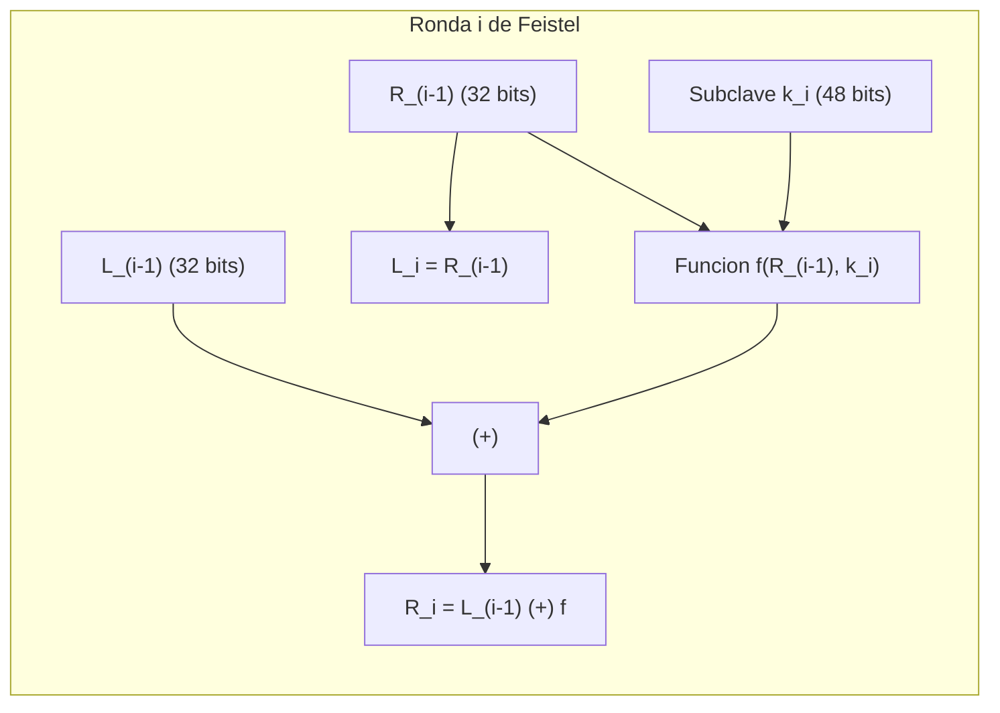
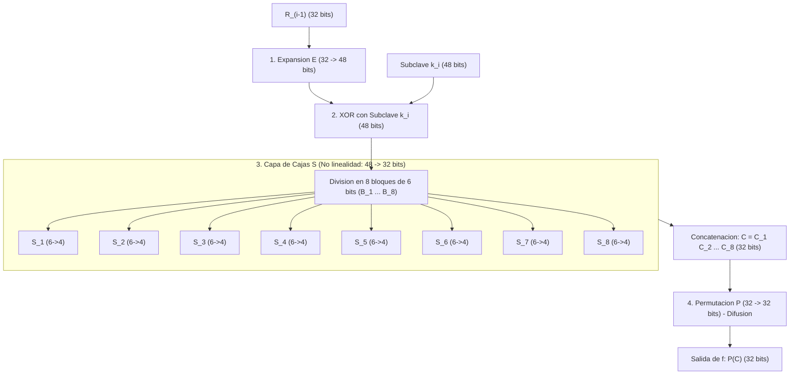
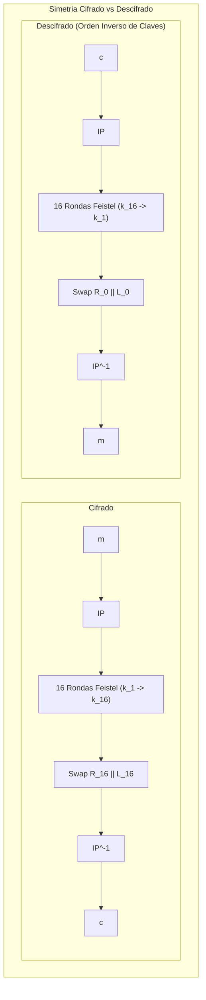

[← Volver a Curso.md](../Curso.md)

# Cifrado DES (Data Encryption Standard)

> **Materia**: Criptografia | **Fuente**: [part 3.pdf](../Documentos/part 3.pdf)  
> `data encryption standard`, `des`, `cifrado por bloques`, `red de feistel`, `64 bits`, `clave de 56 bits`, `bits de paridad`, `key schedule`, `pc-1`, `pc-2`, `desplazamiento circular`, `ls`, `permutacion inicial`, `ip`, `ip inversa`, `fp`, `funcion f`, `expansion e`, `cajas s`, `s-box`, `permutacion p`, `confusion`, `difusion`, `eff deep crack`, `inversion de mitades`, `padding ceros`

---

## 1. Parametros y Arquitectura Global de DES

Cifrado simetrico por bloques desarrollado por **IBM** y adoptado como estandar federal en EE. UU. (FIPS PUB 46, patente US 3,962,539).

- **Tamaño de bloque**: $n = 64\text{ bits}$ ($M, C \in \{0, 1\}^{64}$). Si el texto claro no alcanza los 64 bits, se aplica **padding con ceros** hasta completar el bloque.
- **Tamaño de clave externa**: $64\text{ bits}$, organizada en 8 bytes.
- **Tamaño de clave efectiva**: **$56\text{ bits}$**. Los bits en posiciones multiplos de 8 ($8, 16, 24, 32, 40, 48, 56, 64$) son **bits de paridad impar** para deteccion de errores (cada byte debe contener un numero impar de unos); son **ignorados** durante el computo criptografico.
- **Espacio de claves**: $2^{56} = 72.057.594.037.927.936 \approx 7.2 \times 10^{16}$ claves posibles.
- **Estructura basica**: Cifrador de Feistel iterado en **16 rondas** balanceadas precedido por una permutacion inicial ($IP$) y sucedido por una permutacion final ($IP^{-1}$).
- **Seguridad historica**: Considerado irrompible en los años 70. En 1998, la **EFF** (*Electronic Frontier Foundation*) construyo la maquina **DES Deep Crack**, que quebro DES por fuerza bruta en un promedio de **4.5 dias**. Actualmente esta obsoleto y fue sustituido formalmente por **AES**.

---

## 2. Procedimiento Paso a Paso: Generador de Subclaves (Key Schedule)

El algoritmo genera **16 subclaves** de $48\text{ bits}$ ($k_1, k_2, \dots, k_{16}$) a partir de la clave original $k$ de 64 bits.

### Componentes de Permutacion del Key Schedule
> [!NOTE]
> - **PC-1 (*Permuted Choice 1*)**: Permutacion fija de 56 posiciones. Descarta los bits de paridad $8, 16, 24, 32, 40, 48, 56, 64$ y reordena los 56 bits restantes en dos bloques independientes de 28 bits ($C_0$ y $D_0$).
> - **PC-2 (*Permuted Choice 2*)**: Permutacion por compresion fija de 48 posiciones. Selecciona y permuta 48 de los 56 bits concatenados $(C_i D_i)$ para producir la subclave $k_i$.

### Procedimiento Algoritmico
1. **Reduccion Inicial con PC-1**:
   $$k_0 = PC\text{-}1(k) = C_0 D_0$$
   - $C_0$: Primeros $28\text{ bits}$ de $PC\text{-}1(k)$.
   - $D_0$: Ultimos $28\text{ bits}$ de $PC\text{-}1(k)$.
2. **Generacion Iterativa de Subclaves (Rondas $i = 1 \dots 16$)**:
   - En cada ronda $i$, se aplica un **desplazamiento circular a la izquierda** (*Left Shift*, $LS_i$) de forma independiente a cada mitad:
     $$C_i = LS_i(C_{i-1})$$
     $$D_i = LS_i(D_{i-1})$$
   - **Regla del desplazamiento $LS_i$**:
     - **1 bit**: para las rondas $i \in \{1, 2, 9, 16\}$.
     - **2 bits**: para las 12 rondas restantes ($i \in \{3, 4, 5, 6, 7, 8, 10, 11, 12, 13, 14, 15\}$).
   - **Compresion y reordenamiento con PC-2**:
     $$k_i = PC\text{-}2(C_i D_i) \quad (|k_i| = 48\text{ bits})$$

### Tabla de Desplazamientos del Key Schedule

| Ronda $i$ | Desplazamiento $LS_i$ | Desplazamiento Acumulado ($C_i, D_i$) |
| :---: | :---: | :---: |
| **1** | **1 bit** | 1 bit |
| **2** | **1 bit** | 2 bits |
| **3** | 2 bits | 4 bits |
| **4** | 2 bits | 6 bits |
| **5** | 2 bits | 8 bits |
| **6** | 2 bits | 10 bits |
| **7** | 2 bits | 12 bits |
| **8** | 2 bits | 14 bits |
| **9** | **1 bit** | 15 bits |
| **10** | 2 bits | 17 bits |
| **11** | 2 bits | 19 bits |
| **12** | 2 bits | 21 bits |
| **13** | 2 bits | 23 bits |
| **14** | 2 bits | 25 bits |
| **15** | 2 bits | 27 bits |
| **16** | **1 bit** | **28 bits (ciclo completo $\implies C_{16} = C_0, D_{16} = D_0$)** |

---

## 3. Procedimiento Paso a Paso: Algoritmo de Cifrado DES

El cifrado transforma un bloque $m$ de $64\text{ bits}$ en un bloque $c$ de $64\text{ bits}$ atravesando 3 etapas (18 pasos en total).

### Etapa 1: Permutacion Inicial (IP)
- Si el bloque $m$ tiene menos de 64 bits, se completa con **ceros** a la derecha (*zero padding*).
- Se aplica la permutacion inicial fija **IP** (matriz fija de 64 bits):
  $$m_0 = IP(m) = L_0 R_0$$
- Se particiona $m_0$ en dos mitades de 32 bits:
  - $L_0$: bits $1 \dots 32$.
  - $R_0$: bits $33 \dots 64$.

---

### Etapa 2: Red de Feistel (16 Rondas)
Para cada ronda $i$ desde $1$ hasta $16$, se computa la transformacion de Feistel:
$$L_i = R_{i-1}$$
$$R_i = L_{i-1} \oplus f(R_{i-1}, k_i)$$

#### Procedimiento Interno de la Funcion $f(R_{i-1}, k_i)$
La funcion interna $f$ mapea $(\{0, 1\}^{32} \times \{0, 1\}^{48}) \to \{0, 1\}^{32}$ mediante 4 subpasos:

1. **Subpaso 1 — Expansion ($E$)**:
   - $R_{i-1}$ ($32\text{ bits}$) se divide conceptualmente en 8 grupos de 4 bits.
   - La funcion fija de expansion **$E$** duplica los bits extremos de cada grupo (16 bits aparecen dos veces), expandiendo el bloque de **32 a 48 bits**: $E(R_{i-1})$.
2. **Subpaso 2 — XOR con la Subclave**:
   - Se realiza la suma modulo 2 bit a bit:
     $$A = E(R_{i-1}) \oplus k_i \quad (48\text{ bits})$$
   - El resultado se subdivide en 8 bloques contiguos de 6 bits:
     $$A = B_1 B_2 B_3 B_4 B_5 B_6 B_7 B_8, \quad \text{donde } |B_j| = 6\text{ bits}$$
3. **Subpaso 3 — Sustitucion No Lineal mediante Cajas S ($S_1 \dots S_8$)**:
   - Existen **8 S-Boxes fijas** independientes ($S_1, S_2, \dots, S_8$). Cada una esta definida por una **matriz fija de $4 \times 16$** con valores enteros entre $0$ y $15$ ($4\text{ bits}$).
   - **Mecanismo de indexacion para cada bloque $B_j = b_1 b_2 b_3 b_4 b_5 b_6$**:
     - **Fila $r \in \{0, 1, 2, 3\}$**: Dada por los 2 bits extremos $b_1 b_6$ en binario:
       $$r = (b_1 b_6)_2$$
     - **Columna $c \in \{0 \dots 15\}$**: Dada por los 4 bits centrales $b_2 b_3 b_4 b_5$ en binario:
       $$c = (b_2 b_3 b_4 b_5)_2$$
     - **Valor de salida $C_j$**:
       $$C_j = S_j(r, c) \quad (\text{entero } 0..15 \implies 4\text{ bits binarios})$$
   - **Concatenacion de salidas**:
     $$C = C_1 C_2 C_3 C_4 C_5 C_6 C_7 C_8 \quad (8 \times 4 = 32\text{ bits})$$
4. **Subpaso 4 — Permutacion de Difusion ($P$)**:
   - El bloque $C$ de 32 bits atraviesa la permutacion fija **$P$** (P-Box de 32 bits que redistribuye las posiciones de los bits para asegurar difusion):
     $$f(R_{i-1}, k_i) = P(C) = P\Big(S\big(E(R_{i-1}) \oplus k_i\big)\Big)$$

---

### Etapa 3: Permutacion Final ($IP^{-1}$)
1. **Inversion de orden de mitades (*Swap*)**:
   - Al finalizar la ronda 16 se obtienen $L_{16}$ y $R_{16}$.
   - Se invierte su orden concatenando el bloque derecho primero:
     $$\text{Bloque intermedio} = R_{16} L_{16}$$
2. **Aplicacion de la Permutacion Inversa ($IP^{-1}$)**:
   - Se aplica la permutacion fija **$IP^{-1}$** (la inversa biyectiva exacta de $IP$, tal que $IP^{-1} \circ IP = I$):
     $$c = IP^{-1}(R_{16} L_{16}) \quad (|c| = 64\text{ bits})$$
   - $c$ es el texto cifrado final.

---

## 4. Procedimiento Paso a Paso: Algoritmo de Descifrado DES

El descifrado aprovecha la simetria de la **Red de Feistel**:

### Regla Fundamental
- El descifrado se ejecuta con **el mismo algoritmo, las mismas cajas y el mismo circuito que el cifrado**.
- **La funcion $f$ no necesita ser invertible** porque el termino $f(R_{i-1}, k_i)$ se cancela algebraicamente por la propiedad involutiva del XOR:
  $$(L_{i-1} \oplus f) \oplus f = L_{i-1}$$
- **Unica diferencia**: Las 16 subclaves de $48\text{ bits}$ se aplican en **orden estrictamente inverso**:
  $$\text{Ronda 1 usa } k_{16}, \quad \text{Ronda 2 usa } k_{15}, \quad \dots, \quad \text{Ronda 16 usa } k_1$$

### Procedimiento Algoritmico de Descifrado
1. Tomar el criptograma $c$ de 64 bits y aplicar $IP(c) = R_{16} L_{16}$.
2. Para cada ronda $j = 1 \dots 16$, usar la subclave $k_{17-j}$:
   $$L'_j = R'_{j-1}$$
   $$R'_j = L'_{j-1} \oplus f(R'_{j-1}, k_{17-j})$$
3. Al terminar la ronda 16 se obtiene $R_0 L_0$.
4. Se invierten las mitades a $L_0 R_0$ y se aplica $IP^{-1}(L_0 R_0) = m$.
5. Se recupera de forma exacta el texto plano original $m$.

---

## 5. Traza Completa del Ejemplo Numerico Oficial (Slides 21–28)

### Parametros Iniciales
- **Texto claro**: $m = \text{0123456789ABCDEF}_{16}$ (64 bits).
- **Clave**: $k = \text{133457799BBCDFF1}_{16}$ (64 bits con paridad).

---

### Parte 1: Generacion de Subclaves (Key Schedule)

1. **Conversion de la clave $k$ a binario** (8 grupos de 8 bits; el 8º bit de cada byte es paridad):
   $$k = 0001001\mathbf{1}\ 0011010\mathbf{0}\ 0101011\mathbf{1}\ 0111100\mathbf{1}\ 1001101\mathbf{1}\ 1011110\mathbf{0}\ 1101111\mathbf{1}\ 1111000\mathbf{1}$$
2. **Aplicacion de PC-1** (elimina paridad y divide en $C_0$ y $D_0$ de 28 bits cada uno):
   $$C_0 = 1111000\ 0110011\ 0010101\ 0101111$$
   $$D_0 = 0101010\ 1011001\ 1001111\ 0001111$$
3. **Ronda 1 de Claves ($LS_1 = 1\text{ bit}$)**:
   - Desplazar $C_0$ a la izquierda 1 posicion:
     $$C_1 = 1110000\ 1100110\ 0101010\ 1011111$$
   - Desplazar $D_0$ a la izquierda 1 posicion:
     $$D_1 = 1010101\ 0110011\ 0011110\ 0011110$$
4. **Calculo de la primera subclave $k_1 = PC\text{-}2(C_1 D_1)$** (48 bits en 8 grupos de 6 bits):
   $$k_1 = 000110\ 110000\ 001011\ 101111\ 111111\ 000111\ 000001\ 110010$$

---

### Parte 2: Cifrado del Bloque de Datos (Ronda 1)

1. **Conversion de $m$ a binario (64 bits)**:
   $$m = 00000001\ 00100011\ 01000101\ 01100111\ 10001001\ 10101011\ 11001101\ 11101111$$
2. **Aplicacion de la Permutacion Inicial $m_0 = IP(m) = L_0 R_0$**:
   - $L_0 = 1100\ 1100\ 0000\ 0000\ 1100\ 1100\ 1111\ 1111$ (32 bits)
   - $R_0 = 1111\ 0000\ 1010\ 1010\ 1111\ 0000\ 1010\ 1010$ (32 bits)
3. **Calculo de la Ronda 1**:
   - $L_1 = R_0 = 1111\ 0000\ 1010\ 1010\ 1111\ 0000\ 1010\ 1010$
   - **Evaluacion de $f(R_0, k_1)$**:
     - *Expansion $E(R_0)$ de 32 a 48 bits*:
       $$E(R_0) = 011110\ 100001\ 010101\ 010101\ 011110\ 100001\ 010101\ 010101$$
     - *XOR con $k_1$ ($E(R_0) \oplus k_1 = B_1 \dots B_8$)*:
       $$E(R_0) \oplus k_1 = 011000\ 010001\ 011110\ 111010\ 100001\ 100110\ 010100\ 100111$$
     - *Sustitucion en Cajas S*:
       - Para $B_1 = 011000_2$: Fila $r = (00)_2 = 0$, Columna $c = (1100)_2 = 12 \implies S_1(0, 12) = 5_{10} = \mathbf{0101}_2$.
       - Aplicando las cajas $S_1 \dots S_8$ a los 8 bloques:
         $$S(B) = 0101\ 1100\ 1000\ 0010\ 1011\ 0101\ 1001\ 0111 \quad (32\text{ bits})$$
     - *Permutacion $P$*:
       $$f(R_0, k_1) = P(S(B)) = 0010\ 0011\ 0100\ 1010\ 1010\ 1001\ 1011\ 1011$$
   - **Calculo de $R_1 = L_0 \oplus f(R_0, k_1)$**:
     $$R_1 = 11001100000000001100110011111111 \oplus 00100011010010101010100110111011$$
     $$R_1 = \mathbf{1110\ 1111\ 0100\ 1010\ 0110\ 0101\ 0100\ 0100}$$

---

### Parte 3: Estado Final tras las 16 Rondas e Inversion $IP^{-1}$

Tras iterar las 16 rondas completas de Feistel, el estado en la ronda 16 es:
- $L_{16} = 01000011010000100011001000110100$
- $R_{16} = 00001010010011001101100110010101$

1. **Inversion de mitades**:
   $$\text{Entrada a } IP^{-1} = R_{16} L_{16} = 00001010010011001101100110010101\ 01000011010000100011001000110100$$
2. **Aplicacion de la Permutacion Final $c = IP^{-1}(R_{16} L_{16})$**:
   $$c = 10000101\ 11101000\ 00010011\ 01010100\ 00001111\ 00001010\ 10110100\ 00000101_2$$
3. **Conversion a Hexadecimal**:
   $$\mathbf{c = 85E813540F0AB405}_{16}$$

---

## 6. Puntos Criticos de Examen y Preguntas Frecuentes

> [!CAUTION]
> **El Intercambio Final $R_{16} L_{16}$ es Obligatorio**:
> En la Etapa 3, la permutacion $IP^{-1}$ se aplica sobre **$R_{16} L_{16}$** y NO sobre $L_{16} R_{16}$. Si no se invierten las mitades, el algoritmo de descifrado requeriria una logica diferente a la de cifrado, rompiendo la simetria de hardware de Feistel.

> [!WARNING]
> **No Confundir Clave Externa (64 bits) con Clave Efectiva (56 bits)**:
> La clave suministrada a DES consta de 64 bits, pero 8 de ellos son bits de paridad fija (posiciones $8, 16, 24, \dots, 64$). Por tanto, la resistencia real contra ataques de fuerza bruta es de $2^{56}$, no de $2^{64}$.

### Preguntas Tipicas de Parcial

1. **¿Por que la funcion interna $f$ no necesita ser invertible?**
   - Porque la red de Feistel recupera $L_{i-1}$ sumando nuevamente por XOR el mismo valor: $R_i \oplus f(R_{i-1}, k_i) = L_{i-1} \oplus f \oplus f = L_{i-1}$. La biyectividad global del cifrado esta garantizada por la estructura de Feistel, independientemente de que $f$ sea no inyectiva.
2. **¿Que componente de DES aporta la Confusion y cual la Difusion?**
   - **Confusion**: Aportada exclusivamente por las **8 Cajas S** ($S_1 \dots S_8$), que son las **unicas operaciones no lineales** de todo el algoritmo.
   - **Difusion**: Aportada de forma combinada por la funcion de **Expansion $E$** y la **Permutacion $P$**, que dispersan las dependencias de bits a lo largo del bloque.
3. **¿Cual es el rol criptografico de $IP$ e $IP^{-1}$?**
   - **Ninguno en cuanto a seguridad**: Son permutaciones fijas sin clave. Su inclusion en el estandar original de 1977 obedecio unicamente a facilitar el enrutamiento de buses de 8 bits en los chips de hardware de la epoca. No aportan resistencia contra criptoanalisis lineal o diferencial.
4. **¿Cual es la suma total de desplazamientos en el Key Schedule?**
   - Exactamente **28 posiciones** ($4 \times 1\text{ bit} + 12 \times 2\text{ bits} = 28$). Dado que $C_i$ y $D_i$ tienen exactamente 28 bits, tras la ronda 16 los registros regresan a su estado original ($C_{16} = C_0$ y $D_{16} = D_0$).

