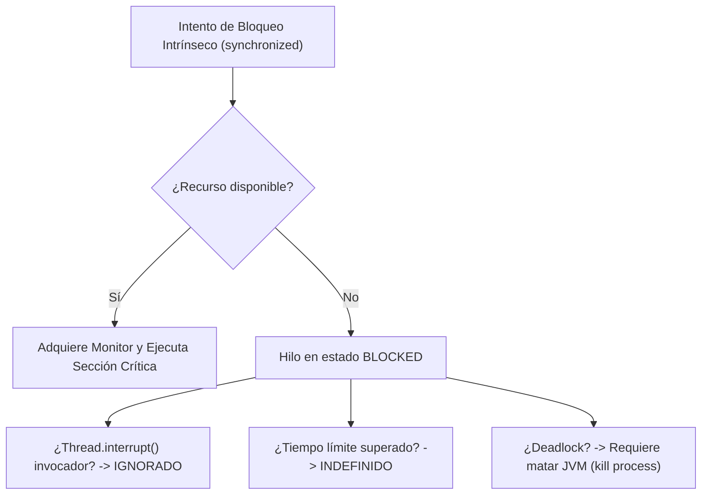
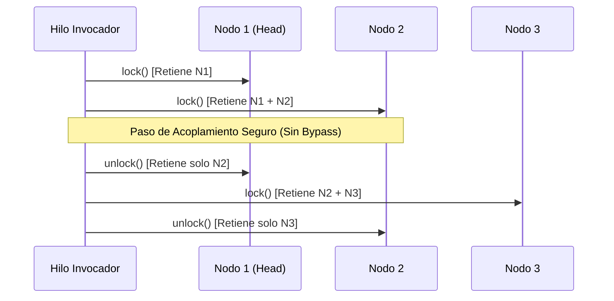

[← Volver a Curso.md](../Curso.md)

# 05. Hilos y Cerrojos — Día 2: Más Allá de los Cerrojos Intrínsecos

> **Materia**: Paralela y Distribuida | **Fuente**: [05.SieteModelosConcurrenciaCapitulo2Dia2_2026.pdf](../Documentos/05.SieteModelosConcurrenciaCapitulo2Dia2_2026.pdf)  
> **Terminos Core**: `reentrantlock`, `lockinterruptibly`, `trylock`, `timeouts`, `livelock`, `hand-over-hand locking`, `lock coupling`, `condition variables`, `await`, `signal`, `atomicinteger`, `cas`, `spurious wakeup`, `fairness`, `reentrantreadwritelock`, `atomicintegerfieldupdater`

---

## 1. Limitaciones Fundamentales de los Bloqueos Intrínsecos (`synchronized`)

- **Incapacidad de Interrupción**: Un hilo bloqueado esperando adquirir un monitor intrínseco **no responde a `Thread.interrupt()`**; no existe vía de escape de un deadlock sin forzar la terminación del proceso (`kill JVM`).
- **Ausencia de Tiempos de Espera (*Timeouts*)**: Imposible abortar un intento de adquisición tras una cota temporal; el hilo aguarda indefinidamente.
- **Estructura Léxica Estricta**: La adquisición y liberación se hayan acopladas al bloque de código (`synchronized (obj) { ... }`). Imposible adquirir un cerrojo en un método y liberarlo en otro, o entrelazar adquisiciones y liberaciones de múltiples recursos.
- **Canal de Notificación Único**: Todo objeto Java dispone de una sola cola de espera implícita (`wait()`, `notify()`, `notifyAll()`); genera despertares innecesarios de hilos con condiciones disjuntas (*thundering herd*).



---

## 2. Bloqueos Explícitos: `ReentrantLock`

Paquete base: `java.util.concurrent.locks.ReentrantLock` (introducido en Java 5, JSR-166 por Doug Lea).

### Idioma Obligatorio de Uso (`try ... finally`)
```java
Lock lock = new ReentrantLock();
lock.lock(); // Siempre FUERA del try para evitar desbloqueos espurios si lock() falla
try {
    // Sección crítica: acceso a recursos compartidos mutables
} finally {
    lock.unlock(); // Garantiza liberación incondicional ante retornos y excepciones
}
```

### Tabla Comparativa: Modos de Adquisición en `ReentrantLock`

| Método | Bloqueante | Responde a Interrupción | Soporta Timeout | Caso de Uso Principal |
|---|:---:|:---:|:---:|---|
| `lock()` | Sí | No | No | Reemplazo directo equivalente a `synchronized`. |
| `lockInterruptibly()` | Sí | **Sí** (`InterruptedException`) | No | Recuperación controlada ante deadlocks o cancelación de tareas cooperativas. |
| `tryLock()` | No | No | No | Sondear disponibilidad; retrocede inmediatamente si está ocupado. |
| `tryLock(long timeout, TimeUnit unit)` | Condicional | **Sí** (`InterruptedException`) | **Sí** | Evasión de bloqueos perpetuos con políticas de reintento. |

---

## 3. Bloqueo Interrumpible y Tiempos de Espera

### Recuperación de Deadlocks (`lockInterruptibly`)
- Al suscitarse una contención circular entre hilos, invocar `t.interrupt()` desde un hilo supervisor hace que `lockInterruptibly()` aborte la espera arrojando `InterruptedException`.
- Permite liberar recursos retenidos y reiniciar tareas sin degradar la disponibilidad del proceso completo.

### Evasión de Deadlocks con `tryLock()` y el Fenómeno de Livelock
```java
// Cena de los Filósofos con Timeout (DiningPhilosophersTimeout.java)
leftChopstick.lock();
try {
    if (rightChopstick.tryLock(1000, TimeUnit.MILLISECONDS)) {
        try {
            // Comer: ambos recursos adquiridos exitosamente
        } finally {
            rightChopstick.unlock();
        }
    } else {
        // No se obtuvo el segundo palillo en 1000 ms: ceder y volver a pensar
    }
} finally {
    leftChopstick.unlock(); // Evita retención perpetua del primer recurso
}
```

- **Riesgo de Livelock (Bloqueo Activo)**:
  - Definición: Estado donde dos o más hilos cambian continuamente su estado en respuesta a las acciones de los otros sin progresar en su cómputo real.
  - Causa: Si todos los filósofos toman el palillo izquierdo simultáneamente y todos sufren timeout al mismo tiempo, todos liberan el palillo izquierdo a la vez y reintentan en sincronía cíclica.
  - Mitigación: Introducir un tiempo de espera con variación aleatoria (*randomized backoff / jitter*) para romper la resonancia temporal entre hilos.
  - Regla arquitectónica: Los timeouts son un mecanismo de **recuperación**, no un sustituto de la **prevención** (el orden global de adquisición sigue siendo la estrategia óptima).

---

## 4. Bloqueo Mano a Mano (*Hand-over-Hand Locking*)

Conocido alternativamente como **Lock Coupling**, **Chain Locking**, **Latch Coupling** o **Crabbing**.

- **Problema del Grano Grueso**: Proteger una lista enlazada completa con un único cerrojo global serializa todas las inserciones, búsquedas y eliminaciones.
- **Mecanismo de Grano Fino**: Cada nodo de la estructura almacena su propio cerrojo (`ReentrantLock`).
- **Invariante de Travesía**:
  1. Adquirir cerrojo del nodo actual $N_i$.
  2. Adquirir cerrojo del nodo siguiente $N_{i+1}$.
  3. Liberar cerrojo del nodo anterior $N_i$.
- **Garantías Formales**:
  - **Sin Bypass**: Ningún hilo concurrente puede adelantarse o alterar los punteros entre $N_i$ y $N_{i+1}$ mientras ambos estén bloqueados.
  - **Paralelismo Excedente**: Múltiples hilos pueden recorrer o insertar en diferentes secciones de la lista en simultáneo.
  - **Retención Máxima**: Cada hilo retiene a lo sumo **dos cerrojos simultáneos** en inserción, y **un cerrojo** en lectura/conteo.



### Código Clave: `ConcurrentSortedList.java`
```java
public void insert(int value) {
    Node current = head;
    current.lock.lock(); // Bloquea cabeza
    Node next = current.next;
    try {
        while (true) {
            next.lock.lock(); // Bloquea siguiente antes de evaluar
            try {
                if (next == tail || next.value >= value) {
                    Node node = new Node(value, current, next);
                    next.prev = node;
                    current.next = node;
                    return; // Retorno protegido por bloques finally
                }
            } finally {
                current.lock.unlock(); // Avanza la ventana de bloqueo
            }
            current = next;
            next = current.next;
        }
    } finally {
        next.lock.unlock();
    }
}
```

> [!NOTE]
> **¿Por qué `size()` recorriendo hacia atrás no provoca Deadlock con `insert()` avanzando hacia adelante?**  
> `insert()` bloquea de `head` $\rightarrow$ `tail` adquiriendo 2 cerrojos simultáneos. `size()` recorre de `tail` $\rightarrow$ `head`, pero adquiere y libera **un único cerrojo por paso**. Al retener a lo sumo 1 cerrojo a la vez, se anula la condición de Coffman de **Retención y Espera (*Hold and Wait*)**, impidiendo la formación de un ciclo de bloqueo.

---

## 5. Variables de Condición (`java.util.concurrent.locks.Condition`)

Instanciadas exclusivamente desde una instancia de cerrojo explícito: `Condition cond = lock.newCondition();`.

### Patrón de Espera Canónico (Bucle Obligatorio)
```java
lock.lock();
try {
    while (!estadoValidoParaProceder) {
        cond.await(); // Libera cerrojo atómicamente y suspende hilo; lo readquiere al despertar
    }
    // Manipular estado compartido bajo condición garantizada
} finally {
    lock.unlock();
}
```

### Operaciones Fundamentales
- `await()`: Libera atómicamente el lock asociado y añade el hilo a la cola de espera de la condición. Al ser señalizado, compite por readquirir el lock antes de retornar.
- `signal()`: Despierta a un único hilo de la cola de la variable de condición.
- `signalAll()`: Despierta a la totalidad de hilos suspendidos en esa variable de condición.

### ¿Por qué `while` y NUNCA `if`?
1. **Despertares Espurios (*Spurious Wakeups*)**: Interrupciones del kernel del sistema operativo pueden liberar a un hilo de `await()` aun cuando no se haya emitido `signal()`.
2. **Condiciones Cambiantes (Robo de Condición)**: Entre el instante de notificación de un hilo y el momento en que readquiere el cerrojo, un tercer hilo puede intervenir y consumir el recurso.
3. **Señales Masivas (`signalAll`)**: Cuando se emite un broadcast, todos despiertan pero solo el primero en tomar el lock halla la condición verdadera; los restantes deben reingresar a suspensión.

### Cena de los Filósofos con Variables de Condición (`DiningPhilosophersCondition`)
- **Arquitectura**: Un único cerrojo global para la mesa (`ReentrantLock table`) y una variable de condición individual por filósofo (`Condition condition = table.newCondition()`).
- **Estado de decisión**: Booleano local `eating`. Condición para comer: `!(left.eating || right.eating)`.
- **Protocolo de Comer**:
  ```java
  table.lock();
  try {
      while (left.eating || right.eating) {
          condition.await();
      }
      eating = true;
  } finally {
      table.unlock();
  }
  ```
- **Protocolo de Pensar (Liberación Selectiva)**:
  ```java
  table.lock();
  try {
      eating = false;
      left.condition.signal();  // Notificación punto a punto a vecinos
      right.condition.signal();
  } finally {
      table.unlock();
  }
  ```
- **Eficiencia**: Maximiza el paralelismo; cualquier filósofo cuyos vecinos no estén comiendo adquiere el permiso de inmediato, sin inanición por contención cruzada de palillos individuales.

---

## 6. Variables Atómicas y Operaciones Lock-Free

Paquete: `java.util.concurrent.atomic` (`AtomicInteger`, `AtomicLong`, `AtomicBoolean`, `AtomicReference<V>`).

### Comparación de Mecanismos de Sincronización

| Característica | `synchronized` | `volatile` | `AtomicInteger` |
|---|:---:|:---:|:---:|
| **Visibilidad de Memoria** | Sí (al entrar/salir del monitor) | Sí (barreras de lectura/escritura) | Sí (semántica volatile interna) |
| **Atomicidad en `++count`** | Sí (exclusión mutua) | **No** (lectura-modificación-escritura rota) | **Sí** (hardware CAS atómico) |
| **Mecanismo Subyacente** | Suspensión de hilo en SO | Invalida cachés L1/L2 | Instrucción CPU `CMPXCHG` |
| **Vulnerable a Deadlock** | Sí | No | **No (Estructuralmente inmune)** |
| **Sobrecosto Temporal** | Alto bajo contención | Mínimo | Muy bajo (sin cambios de contexto) |

### Comparar y Reemplazar (*Compare-And-Swap* - CAS)
- Primitiva atómica soportada directamente por el hardware del procesador:  
  $$\text{CAS}(V, E, N)$$
  Donde $V$ es la posición de memoria, $E$ el valor esperado y $N$ el nuevo valor.
- Si $V == E$, la CPU actualiza $V \leftarrow N$ de forma atómica y retorna `true`; de lo contrario, no altera la memoria y retorna `false`.
- Bucle optimista de actualización:
  ```java
  int valorActual, valorNuevo;
  do {
      valorActual = atomic.get();
      valorNuevo = transformar(valorActual);
  } while (!atomic.compareAndSet(valorActual, valorNuevo));
  ```

---

## 7. Preguntas de Examen, Autoestudio y Casos Trampa

| Pregunta / Caso Crítico | Fundamento Técnico |
|---|---|
| **¿Qué es el parámetro de equidad (`fairness`) en `ReentrantLock`?** | `new ReentrantLock(true)` garantiza asignación en orden FIFO estricto; evita la inanición (*starvation*). El cerrojo no justo (`false`, por defecto) permite colarse (*barging*), ofreciendo mayor rendimiento global al evitar el sobrecosto de suspender/despertar hilos. |
| **¿Cuándo utilizar `ReentrantReadWriteLock`?** | En estructuras con alta preponderancia de lecturas y muy baja frecuencia de escrituras (*read-heavy*). Permite múltiples lectores simultáneos (`readLock()`), pero restringe la escritura a acceso exclusivo (`writeLock()`). |
| **¿Qué diferencia existe entre `AtomicInteger` y `AtomicIntegerFieldUpdater`?** | `AtomicInteger` es un objeto independiente en el Heap (sobrecosto de 16-24 bytes por instancia). `AtomicIntegerFieldUpdater` actualiza atómicamente un campo primitivo `volatile int` existente mediante reflexión estática, reduciendo drásticamente la huella de memoria en estructuras masivas (árboles, listas con millones de nodos). |
| **¿Qué ocurre si se usa `if` en vez de `while` con variables de condición?** | Si ocurre un despertar espurio o un hilo competidor consume el recurso antes de que el hilo despertado readquiera el lock, el código procederá asumiendo una precondición falsa, corrompiendo la memoria o el estado de la aplicación. |
| **¿Por qué `signalAll()` con cerrojos intrínsecos es ineficiente?** | Despierta indiscriminadamente a todos los hilos en la cola única del objeto, provocando contención violenta (*thundering herd problem*); con `Condition` se asocian múltiples variables de condición a un mismo cerrojo para señalizar solo al subgrupo interesado. |

