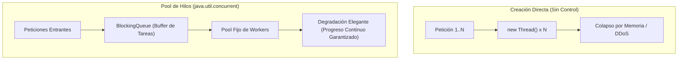

[← Volver a Curso.md](../Curso.md)

# 05. Hilos y Cerrojos — Día 3: Sobre los Hombros de Gigantes (`java.util.concurrent`)

> **Materia**: Paralela y Distribuida | **Fuente**: [05.SieteModelosConcurrenciaCapitulo2Dia3_2026.pdf](../Documentos/05.SieteModelosConcurrenciaCapitulo2Dia3_2026.pdf)  
> **Terminos Core**: `executorservice`, `threadpool`, `cpu-bound vs io-bound`, `copyonwritearraylist`, `cow en so`, `productor-consumidor`, `arrayblockingqueue`, `poison pill`, `concurrenthashmap`, `lock striping`, `putifabsent`, `replace`, `contencion de cerrojos`, `batching local`, `ley de amdahl`, `countdownlatch`, `cyclicbarrier`, `forkjoinpool`, `work-stealing`

---

## 1. De la Creación Manual de Hilos a Pools de Hilos (`ExecutorService`)

### Riesgos de la Creación Directa de Hilos (`new Thread(...)`)
- **Sobrecosto de Creación**: Asignar un hilo implica reservar pila nativa en SO (~1 MB por hilo), estructuras en el kernel y llamadas al sistema; no es gratuito.
- **Agotamiento de Recursos (*Thread Exhaustion*)**: Un hilo por conexión entrante (`EchoServer.java`) provoca una explosión de hilos si las solicitudes superan la velocidad de atención, congelando o tumbando la JVM (`OutOfMemoryError: unable to create new native thread`).
- **Vector de Ataque DDoS**: Clientes maliciosos abren conexiones masivas sin enviar datos para colapsar la memoria y el planificador del servidor.



### Arquitectura de `ExecutorService`
Desacopla la **definición del trabajo** (`Runnable`/`Callable`) del **mecanismo de ejecución** (hilos, colas, políticas de saturación):

```java
int threadPoolSize = Runtime.getRuntime().availableProcessors() * 2;
ExecutorService executor = Executors.newFixedThreadPool(threadPoolSize);

while (true) {
    Socket socket = server.accept();
    executor.execute(new ConnectionHandler(socket)); // Encola si todos los hilos están ocupados
}
```

- **Garantía de Progreso**: Si la tasa de solicitudes supera la capacidad, las tareas aguardan en cola sin multiplicar hilos. El servidor no atiende todo al instante, pero **continúa procesando sin colapsar** (*graceful degradation*).

### Reglas de Dimensionamiento de Pools (Joe Asks: *How Large Should My Thread Pool Be?*)

| Tipo de Carga | Criterio de Dimensionamiento | Justificación Técnica |
|---|:---:|---|
| **Cómputo Intensivo (*CPU-Bound*)** | $N_{\text{threads}} \approx N_{\text{cores}}$ (o $N_{\text{cores}} + 1$) | Minimizar sobrecosto de conmutación de contexto (*context switching*) y mantener tuberías de cómputo saturadas. |
| **E/S Intensiva (*IO-Bound*)** | $N_{\text{threads}} \gg N_{\text{cores}}$ | Los hilos pasan la mayor parte del tiempo bloqueados esperando disco, red o base de datos; se requieren hilos adicionales para aprovechar la CPU ociosa. |

- **Fórmula de Brian Goetz**:
  $$N_{\text{threads}} = N_{\text{CPU}} \times U_{\text{CPU}} \times \left(1 + \frac{W}{C}\right)$$
  Donde $N_{\text{CPU}}$ es el conteo de núcleos, $U_{\text{CPU}}$ la utilización deseada ($0 \le U_{\text{CPU}} \le 1$), y $\frac{W}{C}$ el ratio entre tiempo de espera (*wait time*) y tiempo de cómputo (*compute time*).
- **Regla Práctica**: Contrastar siempre con pruebas de carga realistas y cronometraje en hardware destino.

---

## 2. Colecciones Copy-On-Write (`CopyOnWriteArrayList`)

### Inversión de la Estrategia de Copia Defensiva
- **Enfoque Día 1 (`Downloader.java`)**: Copia defensiva en cada lectura/iteración (`listeners.clone()`) bajo bloqueo intrínseco para evitar invocar métodos alienígenas mientras se retiene el cerrojo.
- **Enfoque `CopyOnWriteArrayList`**: Da la vuelta a la estrategia. Las lecturas/iteraciones son **100% libres de cerrojos** y operan sobre un snapshot inmutable. La copia completa del arreglo interno se realiza **únicamente al modificar** (`add`, `remove`, `set`).

```java
private CopyOnWriteArrayList<ProgressListner> listeners;

public void addListener(ProgressListener listener) {
    listeners.add(listener); // Copia el arreglo interno atómicamente
}

private void updateProgress(int n) {
    for (ProgressListener listener : listeners) { // Iterador sobre snapshot: sin locks, sin CME
        listener.onProgress(n);
    }
}
```

### Propiedades Operativas
- **Inmunidad a `ConcurrentModificationException`**: Los iteradores leen la copia estática existente en el instante de su creación; modificaciones posteriores crean un nuevo arreglo sin afectar iteradores activos.
- **Perfil de Rendimiento Óptimo**: Colecciones con ratio lectura/escritura muy alto (*read-mostly / write-rarely*), como listas de listeners, observadores o tablas de enrutamiento estáticas.
- **Sobrecosto Crítico**: Si las modificaciones son frecuentes o la colección contiene gran volumen de elementos, la clonación de memoria degrada drásticamente el rendimiento y satura el Garbage Collector.

### Paralelismo con Sistemas Operativos: COW en Memoria Virtual
- **Llamada al sistema `fork()`**: Los procesos padre e hijo comparten inicialmente las mismas páginas físicas de memoria marcadas como de solo lectura.
- **Duplicación por Demanda**: Solo cuando cualquiera de los dos procesos ejecuta una instrucción de escritura sobre una página compartida, la MMU genera una trampa (*page fault*) y el SO copia físicamente dicha página.
- **Beneficio**: Creación casi instantánea de procesos y consumo óptimo de memoria RAM.

---

## 3. Patrón Productor-Consumidor y Colas Bloqueantes

### Desacoplamiento y Control de Flujo
- **Productor (*Producer*)**: Lee fuentes de datos externas o genera trabajo y lo deposita en un buffer intermediario.
- **Consumidor (*Consumer*)**: Extrae elementos del buffer y ejecuta el procesamiento costoso de forma asíncrona.

```mermaid
graph LR
    Parser["Productor (Parser XML)"] -->|put() bloqueante| Q[("ArrayBlockingQueue<Page>\n(Capacidad = 100)")]
    Q -->|take() bloqueante| C1["Consumidor 1 (Counter)"]
    Q -->|take() bloqueante| C2["Consumidor 2 (Counter)"]
    Q -->|take() bloqueante| CN["Consumidor N (Counter)"]
```

### Buffer Acotado (*Bounded*) vs. No Acotado (*Unbounded*)

| Propiedad | Buffer No Acotado (`ConcurrentLinkedQueue`) | Buffer Acotado (`ArrayBlockingQueue`) |
|---|---|---|
| **Límite de Capacidad** | Ninguno (crece hasta agotar memoria Heap) | Fijo y explícito (ej. capacidad $100$) |
| **Mecanismo de Sincronización** | No bloqueante (*lock-free / CAS*) | Bloqueante (`put()` y `take()` con variables de condición) |
| **Comportamiento ante Desbalance** | Si el productor es más veloz, acumula millones de ítems $\rightarrow$ `OutOfMemoryError` | Si el buffer se llena, `put()` **bloquea al productor**; si se vacía, `take()` **bloquea al consumidor** |
| **Aplicación en Concurrencia** | Tareas efímeras y balanceadas | **Control de contrapresión (*backpressure*) obligatorio** para fuentes masivas (ej. dump Wikipedia 40 GiB) |

### Protocolo de Terminación: Píldora Venenosa (*Poison Pill*)
- **Concepto**: Objeto centinela especial colocado en la cola por el productor para señalar el fin inequívoco del flujo de datos (análogo al carácter nulo `\0` en cadenas C).
- **Detección y Ruptura**:
  ```java
  while (true) {
      Page page = queue.take(); // Bloquea si la cola está vacía
      if (page.isPoisonPill()) {
          break; // Fin del trabajo del consumidor
      }
      countWords(page);
  }
  ```
- **Regla Multihilo para $M$ Consumidores**: El productor **debe encolar exactamente $M$ Poison Pills**. Cada consumidor extrae una píldora y finaliza; si se inserta una sola, un único consumidor terminará y los $M-1$ restantes quedarán suspendidos indefinidamente en `queue.take()`.
- **¿Por qué la Poison Pill es superior a una bandera booleana (`volatile boolean done`)?**:
  1. **Preserva el orden FIFO**: Garantiza que el consumidor procese todos los elementos generados antes de salir.
  2. **Evita Deadlock por Cola Vacía**: Si el consumidor ya está bloqueado en `take()` antes de activarse la bandera, jamás despertará para evaluarla a menos que reciba un elemento que lo desbloquee.

---

## 4. Estudio de Caso: Conteo de Palabras en Wikipedia

Problema base: Procesar un volcado XML de Wikipedia de ~40 GiB (prueba sobre las primeras 100,000 páginas) para identificar frecuencias de términos.

### Progresión Arquitectural y Rendimiento

| Versión | Arquitectura | Mecanismo de Sincronización | Tiempo (100k pág.) | Speedup ($S$) | Diagnóstico Técnico |
|---|---|---|:---:|:---:|---|
| **V1. Secuencial** | Monohilo | Ninguno (`HashMap` estándar) | $105\text{ s}$ | $1.00\times$ | Base: Parseo $10\text{ s}$, Conteo $95\text{ s}$. |
| **V2. Prod-Cons (1P / 1C)** | 1 Parser, 1 Counter | `ArrayBlockingQueue(100)` + Poison Pill | $95\text{ s}$ | $1.04\times$ | Concurrencia acotada por el paso más lento: $\max(10, 95) = 95\text{ s}$. El conteo es el cuello de botella. |
| **V3. Prod-Cons Multiconsumidor** | 1 Parser, 2 Counters | `synchronized` / `ReentrantLock` protegiendo `HashMap` | $212\text{ s}$ | **$0.49\times$** | **Colapso por contención violenta**: Hilos gastan más tiempo disputando el cerrojo global que computando. |
| **V4. `ConcurrentHashMap`** | 1 Parser, 4 Counters | `ConcurrentHashMap` con `putIfAbsent()` y `replace()` | $63\text{ s}$ | $1.67\times$ | Lock striping alivia bloqueos entre buckets, pero palabras frecuentes ("the", "of") concentran contención en las mismas entradas. |
| **V5. Batching Local + Merge** | 1 Parser, 6 Counters | `HashMap` local por hilo + `mergeCounts()` concurrente al final | **$33\text{ s}$** | **$3.14\times$** | **Aislamiento de estado mutable**: Cero contención durante el conteo masivo; sincronización diferida al cierre. |

```mermaid
graph LR
    subgraph V3_Contencion ["V3: Contención Violenta (Desastre)"]
        C1_3["Counter 1"] -->|Pelea por cerrojo único| LockMap["HashMap con Lock Global"]
        C2_3["Counter 2"] -->|Pelea por cerrojo único| LockMap
    end
    subgraph V5_Batching ["V5: Batching Local (Óptimo)"]
        C1_5["Counter 1"] --> L1["localCounts (Privado)"]
        C2_5["Counter 2"] --> L2["localCounts (Privado)"]
        L1 -.->|Al terminar: mergeCounts()| GlobalMap[("ConcurrentHashMap Global")]
        L2 -.->|Al terminar: mergeCounts()| GlobalMap
    end
```

### Análisis de la Curva Universal de Rendimiento Paralelo
- **Comportamiento Inicial (1 a 4 Hilos)**: Crecimiento cuasi-lineal del speedup al asignar trabajo a núcleos físicos libres.
- **Zona de Rendimiento Máximo (5 a 6 Hilos)**: Aprovechamiento de Hyper-Threading (dos hilos de hardware por núcleo físico, `availableProcessors() == 8`).
- **Punto de Inflexión y Degradación ($> 6$ Hilos)**: La sobrecarga de conmutación de contexto, contención de buses de memoria y saturación de colas del SO supera el paralelismo disponible; el tiempo total vuelve a subir.

---

## 5. Mecánica Interna de `ConcurrentHashMap`

### Bloqueo de Bandas (*Lock Striping*)
- **Estructura Interna (Java 5–7)**: En lugar de sincronizar toda la tabla con un monitor global, divide el mapa en un arreglo de segmentos independientes (por defecto $16$ bandas).
- **Acceso Concurrente**:
  - Operaciones de **lectura** (`get`): Generalmente libres de cerrojos gracias a campos `volatile`.
  - Operaciones de **escritura** (`put`, `remove`): Bloquean **únicamente el segmento correspondiente** al hash de la clave.
  - Dos escrituras sobre claves que caen en segmentos disjuntos se ejecutan en **paralelo real sin contención**.
- **Evolución en Java 8+**: Reemplazó los segmentos explícitos por operaciones CAS sin bloqueo en las cabezas de bucket y cerrojos sincronizados granulares a nivel de nodo individual (árboles rojo-negro en caso de colisiones).

### Primitivas Atómicas Read-Modify-Write
Permiten actualizar valores sin cerrojos externos explícitos:

```java
// Idioma canónico de actualización atómica con bucle de reintento optimista
while (true) {
    Integer currentCount = counts.get(word);
    if (currentCount == null) {
        if (counts.putIfAbsent(word, 1) == null)
            break; // Clave no existía y fue agregada exitosamente
    } else if (counts.replace(word, currentCount, currentCount + 1)) {
        break; // Clave existía con currentCount y fue reemplazada atómicamente
    }
    // Reintentar si otro hilo modificó el valor entre la lectura y la operación atómica
}
```

- **`putIfAbsent(K key, V val)`**: Asocia la clave al valor solo si no está presente; retorna `null` si tuvo éxito o el valor actual si ya existía.
- **`replace(K key, V oldVal, V newVal)`**: Emula directamente la instrucción CPU `CMPXCHG` (CAS); solo actualiza y retorna `true` si el valor actual coincide exactamente con `oldVal`.

---

## 6. Balance Integral del Modelo Hilos y Cerrojos

Paul Butcher concluye la evaluación del modelo con un balance de ingeniería:

### Fortalezas
1. **Universalidad**: Aplicable a prácticamente cualquier problema concurrente; presente como estándar en todos los lenguajes imperativos.
2. **Cercanía al Hardware**: Máxima eficiencia computacional teórica al mapear directamente sobre hilos y primitivas del sistema operativo y CPU.
3. **Ecosistema Maduro**: Bibliotecas de grado industrial (`java.util.concurrent`) resuelven estructuras de datos complejas sin requerir implementación manual.

### Debilidades
1. **Ausencia de Soporte de Paralelismo Directo**: El modelo está diseñado para concurrencia (atender múltiples eventos); forzarlo para paralelismo de datos requiere arquitecturas manuales complejas (fork-join, batching).
2. **No Determinismo Crítico**: Los entrelazamientos temporales conducen a carreras de datos, deadlocks y corrupciones difíciles de reproducir o testear.
3. **Restricción a Memoria Compartida**: Inoperable de forma nativa en sistemas distribuidos, clústeres o arquitecturas de memoria no compartida.
4. **Mantenimiento Frágil**: Exige rigor extremo; un solo acceso no sincronizado o una llamada alienígena con lock retenido compromete la estabilidad del sistema completo.

### Las 5 Reglas Definitivas del Modelo
1. Sincronizar **todo** acceso a memoria mutable compartida.
2. Sincronizar tanto lecturas como escrituras.
3. Adquirir múltiples cerrojos en un **orden global estricto**.
4. Jamás invocar métodos alienígenas reteniendo cerrojos.
5. **Preferir siempre las utilidades de `java.util.concurrent`** frente al diseño manual de primitivas.

---

## 7. Catálogo Completo de Programas del Capítulo 2

| # | Programa | Día | Estado | Propósito y Concepto Clave |
|:---:|---|:---:|:---:|---|
| 1 | `HelloWorld` | 1 | Ok | Creación elemental de hilos (`Thread.start`, `join`, `yield`). |
| 2 | `Counting` | 1 | Ok | Carrera de datos en `++count` sin sincronización. |
| 3 | `CountingBetter` | 1 | Ok | Fallo de visibilidad por sincronizar solo la escritura. |
| 4 | `CountingFixed` | 1 | Ok | Exclusión mutua y visibilidad con `synchronized` en lectura y escritura. |
| 5 | `Puzzle` | 1 | Ok | Reordenamiento de instrucciones en JMM (`answerReady` vs `answer = 0`). |
| 6 | `HttpDownload` | 1 | Ok | Descarga bloqueante sin gestión asíncrona. |
| 7 | `HttpDownloadBetter` | 1 | No | Intento de paralelismo con llamada alienígena insegura. |
| 8 | `HttpDownloadFixed` | 1 | Ok | Copia defensiva de listeners para aislar llamadas alienígenas. |
| 9 | `DiningPhilosophers` | 1 | Ok | Deadlock clásico por retención y espera circular simétrica. |
| 10 | `DiningPhilosophersFixed` | 1 | Ok | Prevención de deadlock mediante orden global de cerrojos por ID. |
| 11 | `Interruptible` | 2 | Ok | Escape de deadlock mediante `lockInterruptibly()`. |
| 12 | `Uninterruptible` | 2 | Ok | Deadlock perpetuo con `synchronized`; inmune a `Thread.interrupt()`. |
| 13 | `DiningPhilosophersTimeout` | 2 | Ok | Evasión de deadlock con `tryLock(timeout)` y riesgo de livelock. |
| 14 | `DiningPhilosophersCondition` | 2 | Ok | Sincronización fina con `Condition` (`await`, `signal`) sobre mesa compartida. |
| 15 | `LinkedList` (`ConcurrentSortedList`) | 2 | Ok | Bloqueo mano a mano (*hand-over-hand locking / coupling*). |
| 16 | `EchoServer` | 3 | No | Antipatrón: creación ilimitada de hilos (`new Thread` por conexión). |
| 17 | `EchoServerBetter` | 3 | No | Uso de `ExecutorService` con pool de hilos acotado. |
| 18 | `WordCount` | 3 | No | Versión secuencial de conteo de palabras (base comparativa 105 s). |
| 19 | `WordCountProducerConsumer` | 3 | No | Separación 1 productor / 1 consumidor con `ArrayBlockingQueue`. |
| 20 | `WordCountSynchronizedHashMap` | 3 | No | Múltiples consumidores con contención crítica sobre cerrojo global (212 s). |
| 21 | `WordCountConcurrentHashMap` | 3 | No | Múltiples consumidores sobre `ConcurrentHashMap` con `putIfAbsent`/`replace` (63 s). |
| 22 | `WordCountBatchConcurrentHashMap` | 3 | No | Máximo rendimiento con mapas locales por hilo y merge final concurrente (33 s). |

---

## 8. Preguntas de Examen, Autoestudio y Casos Trampa

| Pregunta / Caso Crítico | Fundamento Técnico |
|---|---|
| **¿En qué se diferencia un `ForkJoinPool` de un `ThreadPoolExecutor` estándar?** | `ThreadPoolExecutor` usa una cola central compartida para tareas independientes y homogéneas. `ForkJoinPool` implementa **robo de trabajo (*work-stealing*)** donde cada hilo posee su propia cola de doble extremo (`Deque`), optimizado para tareas recursivas de grano fino (*divide-and-conquer*) que generan subtareas hijas. |
| **¿Cómo opera el mecanismo de *Work-Stealing*?** | Cada hilo extrae tareas de la **cabeza (LIFO)** de su propio Deque (alta localidad de caché). Cuando un hilo queda ocioso, **roba tareas del fondo (FIFO)** del Deque de otro hilo ocupado, balanceando la carga con mínima contención de locks. |
| **¿Diferencia entre `CountDownLatch` y `CyclicBarrier`?** | `CountDownLatch` es un cerrojo de **un solo uso**: un conjunto de hilos espera hasta que el contador llegue a $0$ mediante `countDown()`. `CyclicBarrier` es **reutilizable (cíclica)**: sincroniza a $N$ hilos que deben converger en un punto de encuentro (*rendezvous*) antes de continuar juntos la siguiente fase. |
| **Cálculo de la Ley de Amdahl para WordCount: ¿Puede alcanzar $32\times$ con 32 núcleos?** | **No**. Con $10\text{ s}$ de parseo secuencial sobre $105\text{ s}$ totales, la fracción secuencial ineludible es $f = \frac{10}{105} \approx 0.0952$ ($9.52\%$). La aceleración máxima teórica con infinitos núcleos es $S_{\max} = \frac{1}{f} \approx 10.5\times$. Con 32 núcleos: $$S(32) = \frac{1}{0.0952 + \frac{1 - 0.0952}{32}} \approx 8.1\times$$ |
| **¿Por qué la Poison Pill es obligatoria frente a una bandera booleana (`isDone`)?** | Si los consumidores están bloqueados esperando en `queue.take()`, una bandera `volatile boolean isDone = true` nunca será leída porque los hilos no despiertan; la Poison Pill viaja a través de la cola y los desbloquea ordenadamente. |

