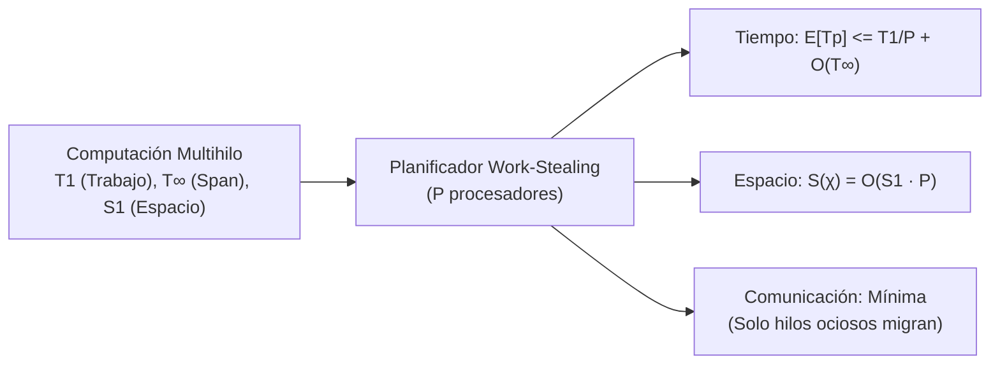
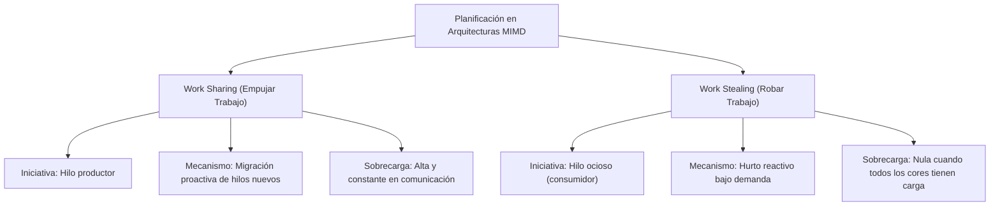
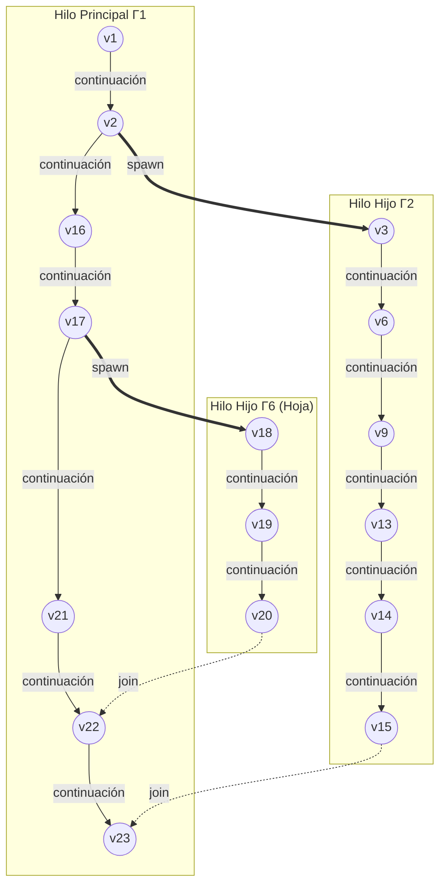
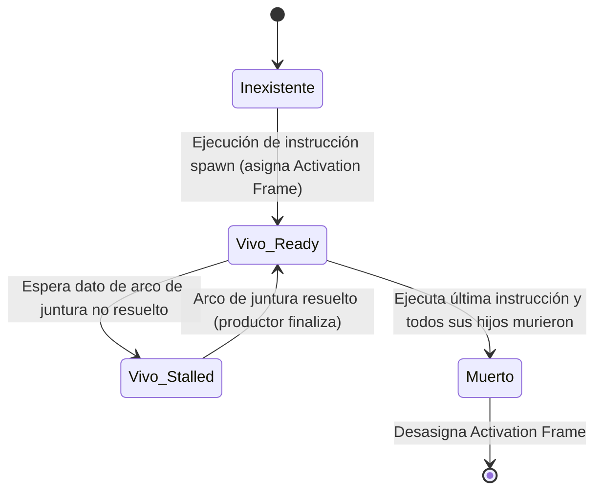
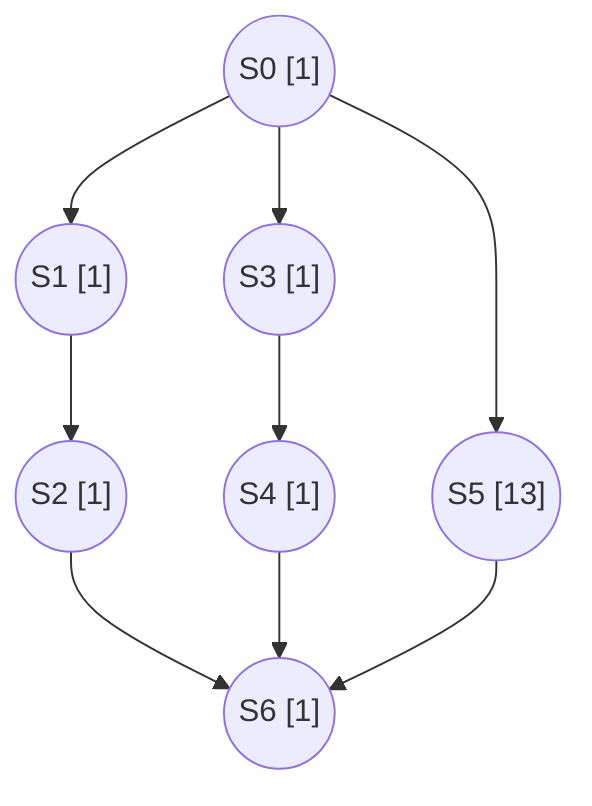

[← Volver a Curso.md](../Curso.md)

# 06. Algoritmo de Work-Stealing (Parte 1 de 5): Fundamentos, Modelo Multihilo y Análisis de Espacio

> **Materia**: Paralela y Distribuida | **Fuente**: [06.Work-Stealing_2026_Parte1_de_5.pdf](../Documentos/06.Work-Stealing_2026_Parte1_de_5.pdf)  
> **Terminos Core**: `work stealing`, `work sharing`, `blumofe-leiserson`, `cormen clrs`, `mimd`, `activation frame`, `stack depth`, `expansion lineal del espacio`, `dag computacional`, `spawn tree`, `arcos de continuacion`, `arcos de creacion`, `arcos de juntura`, `hilos vivos`, `hilos postergados`, `hilos ready`, `complejidad asintotica`, `cota de tiempo esperado`, `cota de espacio`, `greedy scheduling`, `online algorithm`, `busy leaves`

---

## 1. Marco Teórico y Teorema Fundamental de Blumofe & Leiserson (1999)

- **Referencia Fundacional**: Robert D. Blumofe y Charles E. Leiserson (1999), *"Scheduling Multithreaded Computations by Work Stealing"*, Journal of the ACM (JACM), 46(5):720–748.
- **Problema Abordado**: Planificación distribuida eficiente de computaciones multihilo dinámicas con dependencias complejas y tiempos de ejecución impredecibles.
- **Cota Superior de Tiempo de Ejecución Esperado (CLRS - Cormen et al.)**:
  Para cualquier computación con trabajo total $T_1$ y tramo crítico $T_\infty$, un planificador aleatorizado de *work-stealing* sobre $P$ procesadores alcanza:
  $$E[T_P] \le \frac{T_1}{P} + O(T_\infty)$$
- **Tres Garantías Óptimas en el Peor Caso Demostradas en el Paper**:
  1. **Tiempo Esperado Óptimo**: Escala linealmente con $P$ mientras $P \ll \frac{T_1}{T_\infty}$ (alta holgura / *slackness*).
  2. **Espacio de Memoria Acotado**: Exhibe **expansión lineal del espacio** $S(\chi) = O(S_1 \cdot P)$.
  3. **Sobrecarga de Comunicación Mínima**: Tráfico asintóticamente inferior al paradigma de *work sharing*.

---

## 2. Evolución de los Mecanismos de Concurrencia con Hilos en Java

| Generación | Mecanismo | Año / Versión | Scheduler | Work-Stealing | Características Operativas | Deficiencias / Limitaciones |
|:---|:---|:---:|:---:|:---:|:---|:---|
| **1** | `synchronized` | 1996 (Java 1.0) | No | No | Sintaxis nativa en lenguaje. Monitores de objeto, exclusión mutua automática al entrar/salir del bloque. | Inflexible. Sin timeouts naturales, sin soporte para cancelación o interrupción limpia. |
| **2** | `ReentrantLock` | 2004 (Java 5) | No | No | Bloqueo explícito con `lock()` / `unlock()`, `tryLock()`, timeouts y variables de condición (`Condition`). | Verboso. Si se omite `unlock()` en bloque `finally`, se genera interbloqueo (*deadlock*). |
| **3** | `ExecutorService` | 2004 (Java 5) | Simple (FIFO / Prioridad) | No | Desacopla la definición de la tarea (`Runnable`, `Callable`) de los hilos de ejecución en pool. | Depende de hilos pesados del S.O. Mal dimensionamiento del pool colapsa recursos. |
| **4** | `ForkJoin` | 2011 (Java 7) | Avanzado | **Sí** | Divide y vencerás recursivo (`RecursiveAction`, `RecursiveTask`). Balanceo automático mediante colas de doble extremo (*Deques*). Base de streams paralelos. | Complejidad algorítmica. Ineficiente para tareas con alto I/O bloqueante prolongado. |
| **5** | `Virtual Threads` | 2023 (Java 21 LTS) | Avanzado | **Sí (Indirecto)** | Proyecto Loom. Hilos ultraligeros administrados por la JVM para operaciones masivas I/O-bound. Paradigma "un hilo por tarea". | Requiere sincronización. Operaciones nativas o bloques `synchronized` legacy pueden anclar (*pin*) el hilo al carrier. |

### Transición de Paradigmas en Java
- **Java 1.0 – Java 5**: Concurrencia orientada a la **protección de memoria compartida** manipulando hilos del SO manualmente.
- **Java 5 – Java 7**: Transición hacia la **gestión programable de tareas concurrentes** y paralelismo estructurado para CPU.
- **Java 21**: Paso de optimizar "pocos hilos costosos" a sostener "millones de hilos baratos" en el espacio de usuario.

### Equivalencias Interlenguaje de Concurrencia
| Java | Erlang (Modelo de Actores) | Go (Modelo CSP) | Python (Hilos / Multiproceso) |
|:---|:---|:---|:---|
| `synchronized` | No aplicable (memoria aislada por actor) | `sync.Mutex` | `threading.Lock` |
| `ReentrantLock` | No típico | `sync.RWMutex` / canales con buffer | `threading.RLock` |
| `ExecutorService` | Procesos ligeros + Mailbox + Supervisores | Goroutines + Pools de trabajadores | `concurrent.futures.Executor` |
| `ForkJoin` | Paralelismo de procesos (sin equivalencia directa) | Goroutines + scheduler con work-stealing interno | `multiprocessing.Pool` / `ProcessPoolExecutor` |
| `Virtual Threads` | Procesos nativos de Erlang (BEAM) | Goroutines | `asyncio` (similar en espíritu asíncrono, distinto en semántica) |

---

## 3. Paradigmas de Planificación en Arquitecturas MIMD

- **MIMD (*Multiple Instruction, Multiple Data*)**: Arquitectura donde múltiples procesadores independientes ejecutan flujos de instrucciones distintos sobre conjuntos de datos distintos de manera asíncrona.
- **Tres Objetivos Fundamentales de Todo Planificador Paralelo**:
  1. **Maximizar la Utilización**: Mantener todos los procesadores ocupados con cómputo útil.
  2. **Acotar el Espacio de Memoria**: Mantener el uso de memoria en cotas lineales respecto a la ejecución serial.
  3. **Minimizar la Comunicación**: Reducir el intercambio de mensajes y sincronización entre núcleos/nodos.

### Tabla Comparativa: Work Sharing vs. Work Stealing

| Dimensión | Work Sharing (Reparto de Trabajo) | Work Stealing (Robo de Trabajo) |
|:---|:---|:---|
| **Punto de Iniciativa** | El procesador ocupado que genera una subtarea (*Push*). | El procesador ocioso que no tiene trabajo (*Pull*). |
| **Rol de Supervisión** | Requiere supervisor central o árbitro que redistribuya tareas. | Descentralizado; cada procesador opera de forma autónoma. |
| **Frecuencia de Migración** | Continua: cada `spawn` intenta migrar a otros núcleos. | Mínima: solo migra cuando un procesador agota su propia cola. |
| **Costo en Comunicación** | **Elevado**: satura el bus/red incluso con todos los núcleos ocupados. | **Bajo y amortizado**: si todos están ocupados, el costo de comunicación es $0$. |
| **Localidad de Caché** | Pobre: las subtareas recién creadas se mueven antes de ser tocadas. | Óptima: el hilo creador procesa sus tareas locales en orden LIFO. |

---

## 4. Modelo Formal de Computación Multihilo

Una computación multihilo se formaliza como un **Grafo Acíclico Dirigido (DAG)** de instrucciones elementales de tiempo unitario:

- **Instrucción / Vértice ($v \in V$)**: Operación atómica de cómputo que toma exactamente $1$ unidad de tiempo.
- **Hilo ($\Gamma_i$)**: Secuencia ordenada linealmente de instrucciones ejecutadas secuencialmente.
- **Árbol de Generación (*Spawn Tree*)**: Árbol compuesto exclusivamente por hilos como nodos y arcos de creación como aristas.
  - **Raíz ($\Gamma_1$)**: Hilo inicial principal de la computación.
  - **Hojas**: Hilos que no generan descendencia (`spawn`).

### Tipos de Arcos en la Computación Multihilo

1. **Arcos de Continuación**:
   - Conectan la instrucción $v_j$ con $v_{j+1}$ dentro del **mismo hilo** $\Gamma_i$.
   - Representan avance secuencial en la ejecución.
2. **Arcos de Creación / Generación (*Spawn Edges*)**:
   - Conectan la instrucción creadora en el padre con la **primera instrucción del hilo hijo**.
   - Asignan un *activation frame* en memoria al hilo hijo.
   - Un procesador **no puede ejecutar** al hijo antes de que el padre complete la instrucción de spawn.
3. **Arcos de Juntura / Unión (*Join Edges*)**:
   - Conectan la última instrucción productora de datos con la instrucción consumidora en otro hilo (relación Productor-Consumidor).
   - Se ilustran como líneas curvas o trazos discontinuos.

### Supuestos Formales del Modelo
- **Grado de Entrada Acotado**: Cada instrucción posee como máximo un número constante de arcos incidentes ($O(1)$).
- **No-Bloqueo Inmediato Post-Spawn**: La instrucción inmediatamente posterior a un spawn en el hilo padre **nunca recibe un arco de juntura entrante**. Garantiza que el padre permanece en estado `ready` al menos $1$ instrucción más.
- **Grafo Acíclico (DAG)**: Si el grafo contiene ciclos de dependencia, la computación es inviable (interbloqueo estructural).

---

## 5. Ciclo de Vida del Hilo y Reglas del Padre

- **Hilo Vivo (*Alive*)**: Intervalo desde que se ejecuta la instrucción que lo engendra y se le asigna su *activation frame*, hasta que finaliza su última instrucción y se desasigna dicho frame.
- **Hilo Listo (*Ready*)**: Hilo vivo cuyas dependencias entrantes en el DAG han sido completamente satisfechas.
- **Hilo Postergado (*Stalled*)**: Hilo vivo cuya siguiente instrucción requiere datos de un arco de unión aún no completado.
- **Invariante de Persistencia del Hilo Padre**:
  > Un hilo padre **permanece vivo** hasta que **todos sus hilos hijos hayan muerto**.
  - El padre no desasigna su *activation frame* hasta que todos los frames de sus hijos hayan sido desasignados.
  - No existe memoria global fuera de los *activation frames* (toda asignación se modela dentro de los frames de los hilos activos).

---

## 6. Modelo de Memoria: Activation Frames, Pila y Expansión Lineal

- **Activation Frame**: Segmento de memoria reservado para las variables locales, parámetros y cómputo intermedio de un hilo vivo.
- **Profundidad de Pila (*Stack Depth*) de un Hilo**:
  Suma de los tamaños de los *activation frames* de todos sus ancestros directos en el árbol de generación, incluyéndose a sí mismo:
  $$\text{Stack Depth}(\Gamma_k) = \sum_{u \in \text{Ancestros}(\Gamma_k) \cup \{\Gamma_k\}} \text{size}(\text{frame}(u))$$
- **Profundidad de Pila de la Computación**:
  Máxima profundidad de pila entre todos los hilos que componen el cómputo:
  $$\text{Stack Depth}(C) = \max_{\Gamma_k \in C} \text{Stack Depth}(\Gamma_k)$$
- **Espacio de Memoria Multiprocesador $S(\chi)$**:
  El espacio ocupado bajo una planificación $\chi$ con $P$ procesadores en un instante $t$ es la suma de los frames de todos los hilos vivos concurrentes en $t$. El consumo global es el máximo sobre todo $t$:
  $$S(\chi) = \max_t \sum_{\Gamma \in \text{Alive}(t)} \text{size}(\text{frame}(\Gamma))$$
- **Espacio Serial $S_1$**:
  Espacio máximo requerido en ejecución serial ($P=1$, orden DFS convencional).
- **Expansión Lineal del Espacio (Condición Óptima)**:
  $$S(\chi) = O(S_1 \cdot P)$$
  > Una planificación exhibe **expansión lineal del espacio** si su memoria con $P$ procesadores no excede un múltiplo constante de $P$ veces el espacio serial $S_1$. Blumofe y Leiserson demostraron que el algoritmo de *work-stealing* aleatorizado garantiza esta cota óptima.

---

## 7. Planificación para $P$ Procesadores: Sensibilidad al Orden de Despacho

La asignación de instrucciones en estado `ready` a procesadores libres determina directamente la eficiencia y el tiempo total $T_P$.

### Caso de Estudio: Grafo $G'$ con $P=2$ Procesadores
- Estructura: Nodo raíz $S_0$ ($1\text{ paso}$), bifurca a ramas $\{S_1 \to S_2\}$, $\{S_3 \to S_4\}$ y a la tarea pesada $S_5$ ($13\text{ pasos}$). Confluyen en $S_6$ ($1\text{ paso}$).

### Comparación de Órdenes de Despacho ($P=2$)

| Paso de Tiempo | Scheduling 1 (Ingenuo / Serializado) | Scheduling 2 (Priorizando Tarea Larga $S_5$) |
|:---:|:---|:---|
| **$t_1$** | $P_0: S_0[1]$ \| $P_1: \text{Ocioso}$ | $P_0: S_0[1]$ \| $P_1: \text{Ocioso}$ |
| **$t_2$** | $P_0: S_1[1]$ \| $P_1: S_3[1]$ | $P_0: S_5[1/13]$ \| $P_1: S_1[1]$ |
| **$t_3$** | $P_0: S_2[1]$ \| $P_1: S_4[1]$ | $P_0: S_5[2/13]$ \| $P_1: S_2[1]$ |
| **$t_4$** | $P_0: S_5[1/13]$ \| $P_1: \text{Ocioso}$ | $P_0: S_5[3/13]$ \| $P_1: S_3[1]$ |
| **$t_5 \dots t_{15}$** | $P_0: S_5[2 \dots 12/13]$ \| $P_1: \text{Ocioso}$ | $P_0: S_5[4 \dots 13/13]$ \| $P_1: S_4[1] \to \text{Ocioso [9 pasos]}$ |
| **$t_{16}$** | $P_0: S_5[13/13]$ \| $P_1: \text{Ocioso}$ | $P_0: S_6[1]$ \| $P_1: \text{Ocioso}$ |
| **$t_{17}$** | $P_0: S_6[1]$ \| $P_1: \text{Ocioso}$ | *(Finalizado)* |
| **Tiempo Total** | **$T_2 = 17$ pasos** | **$T_2 = 15$ pasos (Ahorro de $2$ unidades)** |

- **Conclusión Práctica**: Despachar tareas pesadas en paralelo tan pronto se habilitan maximiza el solapamiento de cómputo en núcleos secundarios y reduce el tiempo ocioso global.

---

## 8. Repaso de Complejidad Asintótica y su Rol en Cómputo Paralelo

### ¿Por qué el Modelo Work-Span ($T_1, T_\infty$) es Insuficiente?
- Solo computa el tiempo ideal de CPU sin fricción.
- **Omite por completo**:
  1. Sobrecargas de comunicación física y contención de bus/red.
  2. Límites y requerimientos de consumo de memoria de los *activation frames*.
  3. Contención en cerrojos y sincronización de colas de tareas.
- La **complejidad asintótica** revela los límites matemáticos fundamentales cuando el tamaño de entrada $N \to \infty$.

### Notaciones Asintóticas Formales
| Notación | Descripción | Definición Formal |
|:---:|:---|:---|
| $f(n) = O(g(n))$ | Cota Superior ($\le$) | $\exists c > 0, n_0 > 0 \ni f(n) \le c \cdot g(n), \quad \forall n > n_0$ |
| $f(n) = \Omega(g(n))$ | Cota Inferior ($\ge$) | $\exists c > 0, n_0 > 0 \ni f(n) \ge c \cdot g(n), \quad \forall n > n_0$ |
| $f(n) = \Theta(g(n))$ | Cota Ajustada ($=$) | $\exists c_1, c_2 > 0, n_0 > 0 \ni c_1 g(n) \le f(n) \le c_2 g(n), \quad \forall n > n_0$ |
| $f(n) = o(g(n))$ | Cota Superior Estricta ($<$) | $\forall c > 0, \exists n_0 > 0 \ni f(n) < c \cdot g(n), \quad \forall n > n_0$ |
| $f(n) = \omega(g(n))$ | Cota Inferior Estricta ($>$) | $\forall c > 0, \exists n_0 > 0 \ni f(n) > c \cdot g(n), \quad \forall n > n_0$ |

### Abuso Notacional del Signo "$=$"
En análisis de algoritmos, el símbolo "$=$" denota **pertenencia o inclusión**, no igualdad aritmética:
- $T(N) = O(f(N)) \implies T(N) \in O(f(N))$.
- $O(f(N)) = O(h(N)) \implies O(f(N)) \subseteq O(h(N))$.
- Cadena: $T(N) = O(N^2) = O(N^3) \implies T(N) \in O(N^2) \subseteq O(N^3)$.

### ¿Por qué los Algoritmos Paralelos Exigen Notación $\Theta$?
Al calcular el **Speedup** $S_P$:
$$S_P = \frac{T_1}{T_P}$$
- Para demostrar que un algoritmo paralelo logra un speedup mínimo (ej. $S_P = \Omega(\sqrt{P})$), se requiere:
  - Una **cota inferior** ($\Omega$) para el numerador (tiempo serial $T_1$).
  - Una **cota superior** ($O$) para el denominador (tiempo paralelo $T_P$).
- Debido a que un valor grande en $T_P$ deprime el speedup y un valor grande en $T_1$ lo eleva artificialmente, operar bajo **$\Theta$ (cota ajustada)** garantiza límites rigurosos sin distorsión.

---

## 9. Principio de Algoritmos Online y Propiedad de Hojas Ocupadas (*Busy-Leaves*)

### Algoritmo Online
- **Definición**: Un planificador es **online** si antes del paso discreto $t$, ha computado y ejecutado los pasos hasta $t-1$, y toma sus decisiones usando **exclusivamente esa información histórica**.
- No requiere conocimiento profético del futuro: desconoce la estructura de ramas del DAG aún no exploradas o tiempos de cómputo de tareas no finalizadas.

### Reglas Operativas de Hojas Ocupadas (*Busy-Leaves Property*)
Define la política con la que los procesadores gestionan hilos locales en el árbol de generación para garantizar espacio $O(S_1 \cdot P)$:

1. **Spawns (Creaciones)**:
   - Si el hilo activo $a$ genera a $b$, el procesador coloca a $a$ en su cola/pool y ejecuta inmediatamente $b$ en el siguiente paso de tiempo.
2. **Stalls (Postergaciones)**:
   - Si el hilo activo $a$ se posterga (espera de datos por un arco de unión), el procesador devuelve $a$ al pool y queda en estado ocioso en el siguiente paso para intentar robar trabajo.
3. **Dies (Finalizaciones)**:
   - Si el hilo hijo $b$ muere, el procesador revisa si el padre $a$ tiene algún otro hijo vivo.
   - Si no quedan hermanos vivos y ningún otro procesador está ejecutando $a$, retoma inmediatamente a $a$.
   - En cualquier otro caso, el procesador queda en estado ocioso en el siguiente paso de tiempo.

> **Sobrecarga de Planificación (*Overhead*)**: Tiempo de CPU y mensajes consumidos exclusivamente en bifurcación, inserción en colas, robos y sincronización de dependencias (trabajo de gestión adicional no productivo).

---

## 10. Casos Trampa y Puntos Críticos de Parcial

- **Cota Óptima de Memoria**: La condición $S(\chi) = O(S_1 \cdot P)$ es óptima porque con $P$ procesadores ejecutando ramas concurrentes independientes en el peor caso, la memoria crece a lo sumo $P$ veces la profundidad de pila de una sola rama ($S_1$). Un planificador descuidado (ej. BFS ingenuo) puede requerir espacio exponencial.
- **Work Sharing vs. Work Stealing en Exámenes**:
  - *Trampa común*: Afirmar que *work sharing* es mejor porque "mantiene a todos informados".
  - *Corrección*: *Work sharing* inunda la red con migraciones continuas de tareas que quizás nadie necesita. *Work stealing* mantiene comunicación en **cero absoluto** mientras todos los cores tengan trabajo local.
- **Fallecimiento del Hilo Padre**:
  - Un hilo padre **nunca muere antes que sus hijos** en este modelo formal. Si un hijo intenta acceder a variables del marco de activación de su padre, este debe seguir existiendo.
- **Interdicción de Arcos de Unión Inmediatos Post-Spawn**:
  - Si un hilo pudiera recibir un arco de unión inmediatamente después de hacer spawn, el procesador podría quedar bloqueado en la instrucción siguiente, violando la continuidad de despacho y complicando la demostración de cotas de espacio.
- **Virtual Threads y Work-Stealing**:
  - Los Virtual Threads de Java 21 no reemplazan al ForkJoinPool; **lo utilizan internamente** como scheduler predeterminado para montar y desmontar hilos virtuales sobre los *carrier threads* del sistema operativo.

