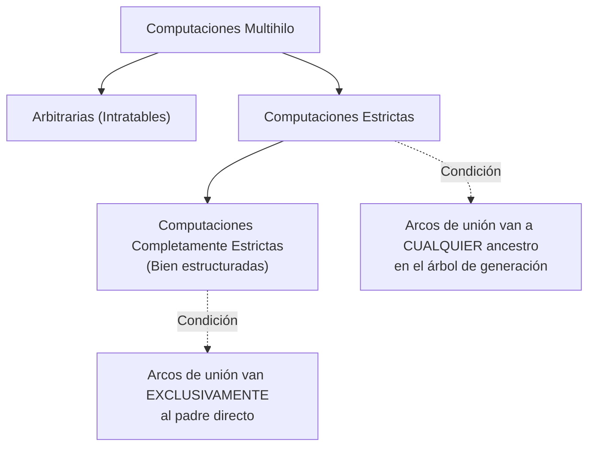
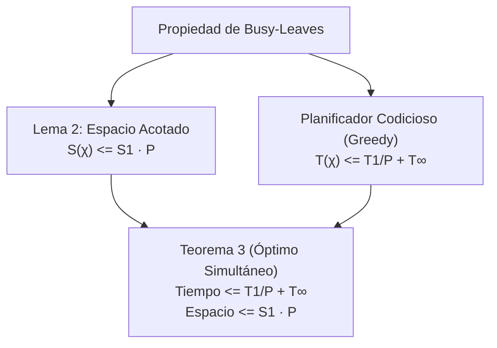

[← Volver a Curso.md](../Curso.md)

# 06. Algoritmo de Work-Stealing (Parte 2 de 5): Computaciones Estrictas, Planificación Greedy y Algoritmo de Hojas Ocupadas

> **Materia**: Paralela y Distribuida | **Fuente**: [06.Work-Stealing_2026_Parte2_de_5.pdf](../Documentos/06.Work-Stealing_2026_Parte2_de_5.pdf)  
> **Términos Core**: `programa vs computacion multihilo`, `determinismo`, `computacion estricta`, `computacion completamente estricta`, `work`, `span`, `trayecto critico`, `planificador codicioso`, `greedy scheduler`, `teorema 1 de greedy`, `speedup lineal`, `propiedad de hojas ocupadas`, `busy leaves`, `algoritmo online`, `pool global centralizado`, `reglas de transicion`, `spawns stalls dies`, `lema 2 cota de espacio`, `teorema 3 tiempo y espacio`, `induccion de hojas ocupadas`, `cuello de botella centralizado`

---

## 1. Programa Multihilo vs. Computación Multihilo

- **Diferencia Fundamental**:
  - **Programa Multihilo**: Código fuente estático. Sobre una misma entrada (*input*), los entrelazados de planificación del S.O. pueden producir distintos órdenes de ejecución y grafos resultantes.
  - **Computación Multihilo**: Grafo Acíclico Dirigido (DAG) concreto generado durante una ejecución.
- **Determinismo**:
  - **No determinístico**: Un programa que sobre una misma entrada puede generar más de una computación multihilo distinta.
  - **Determinístico**: Genera **exactamente la misma computación multihilo** (mismo DAG de dependencias) para una entrada dada, sin importar cómo sea planificada por los procesadores.
- **Enfoque Metodológico de Blumofe & Leiserson**:
  - Se analizan **computaciones multihilo**, no programas.
  - No importa el mecanismo sintáctico con el que se generaron las tareas; las propiedades estructurales, de tiempo y de espacio se estudian **a posteriori** sobre el DAG.

---

## 2. Taxonomía de Computaciones: Estrictas y Completamente Estrictas

La planificación eficiente de grafos con dependencias arbitrarias es computacionalmente inviable ($NP$-hard). Por ello se restringen los patrones de sincronización:

### Tabla Comparativa de Modelos Estrictos

| Propiedad | Computación Estricta | Computación Completamente Estricta |
|:---|:---|:---|
| **Destino de Arcos de Unión (*Join*)** | A cualquier **ancestro** en el árbol de generación. | Exclusivamente al **hilo padre directo**. |
| **Aislamiento de Subárboles** | El único arco entrante a un subárbol desde el exterior es el **arco de creación (*spawn*) hacia su raíz**. | Igual aislamiento, pero la sincronización de retorno es puramente local (hijo $\to$ padre). |
| **Semántica del Término "Estricto"** | Un hilo no puede ser invocado hasta que **todos sus argumentos estén completamente disponibles**, aunque dichos argumentos pueden calcularse en paralelo. | Satisface la condición estricta y además posee estructura jerárquica estricta tipo divide y vencerás (*fork-join* canónico). |
| **Equivalencia Semántica DFS** | Cualquier cómputo ejecutable en orden primero en profundidad (*Depth-First*) sobre $1$ procesador puede transformarse en estricto o completamente estricto ajustando dependencias (puede alterar paralelismo, pero **preserva la semántica**). | Representa la estructura de la gran mayoría de frameworks paralelos modernos (ej. `ForkJoinPool` en Java, Cilk). |

---

## 3. Métricas Fundamentales y Límites Teóricos de Planificación

Sea una computación ejecutada sobre $P$ procesadores con una planificación $\chi$:

- **Tiempo de Ejecución $T(\chi)$**: Tiempo para completar el grafo bajo el scheduler $\chi$.
- **Tiempo Mínimo $T_P$**: $T_P = \min_\chi T(\chi)$ (el óptimo absoluto sobre todas las planificaciones posibles para $P$ procesadores).
- **Trabajo (*Work*) $T_1$**: Número total de instrucciones del cómputo. Equivale al tiempo en $1$ procesador (cada instrucción toma $1$ unidad de tiempo).
- **Tramo Crítico (*Span*) $T_\infty$**: Longitud del trayecto dirigido más largo dentro del DAG. Tiempo mínimo insuperable aun con infinitos procesadores ($P = \infty$).

### Cotas Inferiores Universales
$$T_P \ge \frac{T_1}{P} \quad \text{y} \quad T_P \ge T_\infty$$
- Razón de $T_P \ge T_1/P$: $P$ procesadores ejecutan a lo sumo $P$ instrucciones por unidad de tiempo.
- Razón de $T_P \ge T_\infty$: Las dependencias a lo largo de la ruta crítica deben ejecutarse forzosamente de forma serial.

### Cota Superior Óptima Universal
$$T(\chi) \le \frac{T_1}{P} + T_\infty$$
- Esta suma de ambos límites inferiores es **universalmente óptima** (a lo sumo un factor 2 del óptimo absoluto $T_P$).

---

## 4. Planificadores Codiciosos (*Greedy Schedulers*) y Speedup Lineal

- **Definición de Planificador Codicioso (*Greedy Schedule*)**:
  En cada paso discreto de tiempo $t$:
  - Si hay $\ge P$ instrucciones en estado `ready`, **se ejecutan exactamente $P$ instrucciones**.
  - Si hay $< P$ instrucciones en estado `ready`, **se ejecutan absolutamente todas las instrucciones disponibles**.
  - En ningún paso se permite que un procesador permanezca ocioso si existe al menos una tarea lista sin asignar.

### Teorema 1 (Cota de Planificación Codiciosa)
Para cualquier computación multihilo con Work $T_1$ y Span $T_\infty$, y para cualquier número $P$ de procesadores, toda planificación codiciosa $\chi$ garantiza:
$$T(\chi) \le \frac{T_1}{P} + T_\infty = \frac{\text{Work}}{P} + \text{Span}$$

### Condición Formal para Speedup Lineal
- **Objetivo**: Lograr que el tiempo escale inversamente con los núcleos: $T(\chi) = O(T_1 / P)$ (formalmente $T(\chi) \in O(T_1 / P)$).
- **Condición de Paralelismo**: Ocurre si y solo si la holgura de paralelismo satisface:
  $$\frac{T_1}{T_\infty} = \Omega(P) \quad \left[\frac{T_1}{T_\infty} \in \Omega(P)\right]$$
- Si el paralelismo inherente $T_1/T_\infty$ supera con margen asintótico al número de procesadores $P$, el término $T_1/P$ domina sobre $T_\infty$, obteniendo aceleración lineal casi perfecta.

---

## 5. Fundamentos del Algoritmo de Hojas Ocupadas (*Busy-Leaves*)

El **Algoritmo de Hojas Ocupadas** es un planificador paralelo formal que opera como modelo base para demostrar la existencia de planificaciones óptimas en tiempo y espacio simultáneamente.

- **Naturaleza "Online"**:
  - Antes del paso discreto $t$, ha calculado y ejecutado los primeros $t-1$ pasos.
  - Para calcular el paso $t$, utiliza **únicamente la información histórica hasta $t-1$**.
  - **Cero omnisciencia**: Desconoce instrucciones futuras o subárboles no expandidos.
- **Abstracción del Pool Global**:
  - Mantiene todos los hilos vivos en un **único pool común** accesible por todos los $P$ procesadores.
  - Los procesadores insertan hilos al bifurcar y extraen hilos en estado `ready`.
  - **Supuesto de análisis**: Se asume acceso atómico sin fricción ni costo de contención para estudiar exclusivamente la calidad matemática del planificador.

---

## 6. Reglas de Transición de Estado de los Hilos (*Busy-Leaves Rules*)

Un procesador asignado a un hilo $\Gamma_a$ ejecuta instrucciones de forma continua paso a paso hasta que ocurre uno de **tres eventos determinantes**:

```mermaid
stateDiagram-v2
    [*] --> Ejecutando: Procesador p toma hilo listo
    
    Ejecutando --> Evento_Spawn: 1. Ejecuta instrucción spawn
    Ejecutando --> Evento_Stall: 2. Dependencia no resuelta
    Ejecutando --> Evento_Die: 3. Última instrucción finalizada
    
    Evento_Spawn --> Ejecutando_Hijo: Retorna padre al pool; p toma hijo Γb inmediatamente
    Evento_Stall --> Procesador_Ocioso: Retorna Γa al pool; p queda ocioso para robar del pool
    Evento_Die --> Revisa_Padre: Verifica si padre Γb tiene más hijos vivos
    
    Revisa_Padre --> Ejecuta_Padre: Padre libre y sin más hijos vivos -> p toma al padre
    Revisa_Padre --> Procesador_Ocioso: Padre ocupado o con otros hijos -> p queda ocioso
```

### Detalle Operativo de las Tres Reglas

1. **Regla 1: Spawns (Creación)**:
   - Si el hilo activo $\Gamma_a$ engendra un hijo $\Gamma_b$:
   - El procesador $p$ concluye el paso **devolviendo el padre $\Gamma_a$ al pool global**.
   - En el paso siguiente, el procesador $p$ **inicia inmediatamente la ejecución del hijo $\Gamma_b$**.
   - *Efecto*: $\Gamma_a$ deja de ser hoja; $\Gamma_b$ pasa a ser la nueva hoja y queda inmediatamente ocupada por $p$.

2. **Regla 2: Stalls (Postergaciones / Bloqueo)**:
   - Si el hilo activo $\Gamma_a$ se suspende esperando un dato de un arco de unión:
   - El procesador concluye el paso **devolviendo $\Gamma_a$ al pool global**.
   - El procesador inicia el siguiente paso en estado **ocioso** (intentando retirar otro hilo listo del pool).
   - *Invariante crítica*: En computaciones estrictas, **un hilo hoja NUNCA puede suspenderse**; solo se suspende un ancestro esperando a un descendiente.

3. **Regla 3: Dies (Finalizaciones)**:
   - Si el hilo activo $\Gamma_a$ muere:
   - El procesador examina el estado del hilo padre $\Gamma_b$:
     - **Caso a (Padre liberado)**: Si el padre $\Gamma_b$ **no tiene ningún otro hijo vivo** y ningún otro procesador lo está ejecutando, el procesador extrae a $\Gamma_b$ del pool y **comienza a trabajar en él en el siguiente paso**.
     - **Caso b (Padre retenido)**: Si el padre $\Gamma_b$ aún tiene otros hijos vivos o ya está siendo ejecutado por otro procesador, el procesador actual **inicia el siguiente paso ocioso**.

---

## 7. Síntesis del Caso de Estudio

El comportamiento dinámico del algoritmo se valida en el artículo mediante un grafo modelo:
- **Estructura del Grafo**: $6$ hilos ($\Gamma_1 \dots \Gamma_6$) con $23$ instrucciones totales ($T_1 = 23$) y un tramo crítico de $10$ pasos ($T_\infty = 10$).
- **Configuración de Prueba**: $P = 2$ procesadores sobre un pool centralizado.
- **Resultado Operativo**:
  - Tiempo total de ejecución: $T_2 = 14$ pasos discretos.
  - Cumple rigurosamente la cota codiciosa: $T_2 \le \lceil 23/2 \rceil + 10 = 12 + 10 = 22$.
  - Mantiene en todo instante las hojas del subárbol activo asociadas a procesadores en cómputo útil, evitando la dispersión de frames en memoria.

---

## 8. Propiedad y Teoremas Fundamentales de Hojas Ocupadas

### Definición Formal de la Propiedad de Hojas Ocupadas (*Busy-Leaves*)
> **Subárbol de Generación en el paso $t$**: Porción del árbol de generación compuesta **exclusivamente por los hilos vivos en el instante $t$**.  
> **Propiedad**: En cada paso $t$ de la ejecución, **cada hilo hoja del subárbol de generación tiene un procesador trabajando activamente sobre él**.
- Como solo existen $P$ procesadores físicos, el subárbol de generación no puede tener en ningún momento más de $P$ hojas vivas.

### Lema 2 (Cota de Espacio de Hojas Ocupadas)
Para cualquier computación multihilo con tamaño de pila serial $S_1$, toda planificación $\chi$ que preserve la propiedad de hojas ocupadas utiliza un espacio acotado por:
$$S(\chi) \le S_1 \cdot P$$

- **Demostración**:
  1. La propiedad de hojas ocupadas garantiza que en cualquier paso $t$, el subárbol de generación posee a lo sumo $P$ hojas (cada hoja requiere un procesador, y hay $P$ procesadores).
  2. En una computación estricta, la memoria ocupada por una hoja y todos sus ancestros directos hasta la raíz no excede la profundidad de pila serial $S_1$.
  3. Al sumar la memoria de las a lo sumo $P$ ramas concurrentes activas:
     $$\text{Espacio total}(t) \le \sum_{\text{hojas } h} \text{Ancestros}(h) \le S_1 \cdot P$$

### Teorema 3 (Existencia de Planificación Óptima en Tiempo y Espacio)
Para cualquier número $P$ de procesadores y cualquier computación multihilo estricta con trabajo $T_1$, span $T_\infty$ y tamaño de pila $S_1$, el algoritmo de hojas ocupadas computa una planificación $\chi$ que satisface simultáneamente:
$$T(\chi) \le \frac{T_1}{P} + T_\infty \quad \text{y} \quad S(\chi) \le S_1 \cdot P$$

### Demostración Inductiva del Teorema 3
1. **Cota de Tiempo**: Se deriva directamente del **Teorema 1**, ya que el algoritmo de hojas ocupadas es codicioso (nunca deja procesadores ociosos si existen hilos listos en el pool).
2. **Cota de Espacio**: Se deriva del **Lema 2** demostrando por inducción matemática sobre el número de pasos $t$ que las tres reglas preservan la propiedad de hojas ocupadas:
   - **Caso Base ($t = 1$)**: El subárbol consta únicamente del hilo raíz $\Gamma_1$. Es la única hoja y un procesador está asignado a él. Propiedad preservada.
   - **Paso Inductivo ($t \to t+1$)**:
     - *Regla 1 (Spawn)*: $\Gamma_a$ engendra a $\Gamma_b$. $\Gamma_a$ se convierte en nodo interno (deja de ser hoja); $\Gamma_b$ pasa a ser la nueva hoja. Como el procesador pasa a ejecutar $\Gamma_b$, la nueva hoja permanece ocupada.
     - *Regla 2 (Stall)*: Si $\Gamma_a$ se posterga, **$\Gamma_a$ no puede ser una hoja** (en computaciones estrictas solo se espera a descendientes, por lo que $\Gamma_a$ tiene hijos en el subárbol). Ninguna hoja queda desatendida.
     - *Regla 3 (Die)*: Si $\Gamma_a$ muere, su padre $\Gamma_b$ se convierte en hoja si no le restan otros hijos vivos. Si ningún procesador lo atiende, el procesador liberado toma a $\Gamma_b$, garantizando que la nueva hoja quede ocupada.

---

## 9. Cuello de Botella y Límite de Escalabilidad

A pesar de su elegancia teórica, el algoritmo de hojas ocupadas **no es escalable en sistemas multiprocesador de mediana o gran escala**:

- **Falla Estructural: Pool Global Centralizado**:
  - Todos los $P$ procesadores deben acceder atómicamente al mismo contenedor centralizado para depositar y retirar hilos.
  - La contención en el bus de memoria, líneas de caché compartidas y cerrojos del pool destruye el rendimiento a medida que $P$ se incrementa.
- **Transición Necesaria**:
  - El algoritmo de hojas ocupadas demuestra matemáticamente que **es posible** lograr tiempo $O(T_1/P + T_\infty)$ y espacio $O(S_1 \cdot P)$.
  - Para hacerlo práctico en hardware distribuido/multinúcleo, se requiere descentralizar la estructura: cada procesador mantiene su propio **Deque local**, reemplazando el pool global por el algoritmo de **Work-Stealing Aleatorizado** (*Randomized Work-Stealing*).

---

## 10. Casos Trampa y Preguntas de Examen

- **¿Por qué un hilo hoja nunca puede sufrir un *stall* en computaciones estrictas?**:
  - En un cómputo estricto, todo arco de unión incidente a un hilo proviene exclusivamente de sus descendientes. Si un hilo es una hoja, no tiene descendientes vivos; por ende, no tiene dependencias pendientes y jamás puede suspenderse.
- **Definición Rigurosa de Algoritmo Online**:
  - Un algoritmo es *online* si en el paso $t$ toma decisiones basadas **estrictamente en los pasos $1 \dots t-1$ ya ejecutados**, sin consultar la estructura futura del DAG ni predecir duraciones de hilos no creados.
- **Condición para Speedup Lineal en Greedy Schedulers**:
  - No basta con tener muchos núcleos; se requiere que el paralelismo intrínseco sea asintóticamente superior a los procesadores: $\frac{T_1}{T_\infty} = \Omega(P)$. Si el span es muy largo, el speedup colapsa.
- **Lema 2 y el Factor $S_1 \cdot P$**:
  - *Trampa de examen*: Creer que con $P$ procesadores la memoria puede multiplicarse por el número total de hilos vivos $N$.
  - *Respuesta correcta*: Gracias a la propiedad de hojas ocupadas, solo hay a lo sumo $P$ hojas simultáneas; cada camino raíz-hoja ocupa a lo sumo $S_1$, garantizando un límite estricto de $S_1 \cdot P$.
- **Rol del Pool Centralizado**:
  - El pool global del algoritmo de hojas ocupadas es un **artificio de diseño teórico** para demostrar las cotas asintóticas; en implementaciones reales de *work-stealing* se descarta por problemas insolubles de contención.

