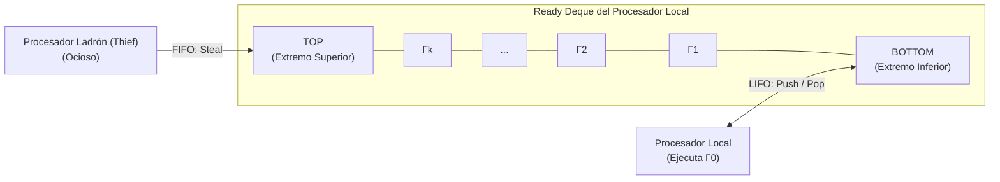
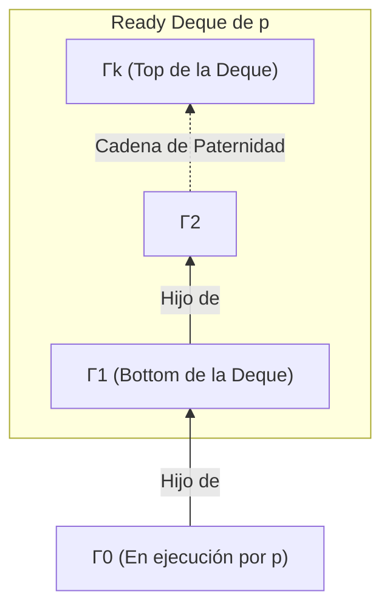
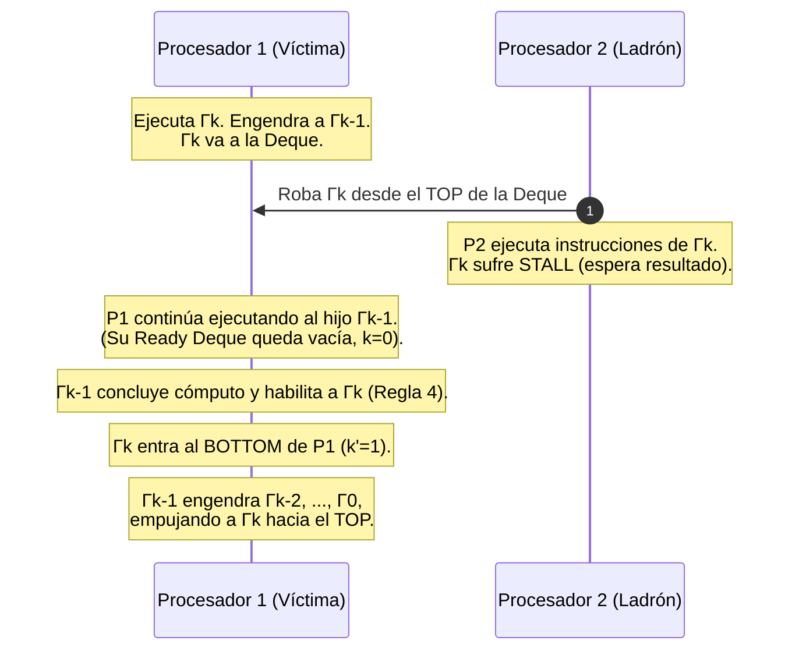
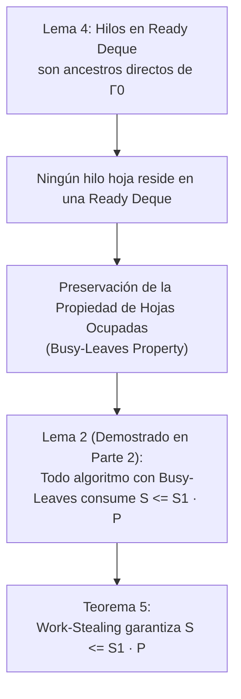

[← Volver a Curso.md](../Curso.md)

# 06. Algoritmo de Work-Stealing (Parte 3 de 5): Algoritmo Aleatorizado Distribuido, Lema Estructural 4 y Cota de Espacio (Teorema 5)

> **Materia**: Paralela y Distribuida | **Fuente**: [06.Work-Stealing_2026_Parte3_de_5.pdf](../Documentos/06.Work-Stealing_2026_Parte3_de_5.pdf)  
> **Términos Core**: `work stealing aleatorizado`, `ready deque`, `bottom`, `top`, `lifo vs fifo`, `thief`, `victim`, `reglas de ejecucion`, `spawn`, `stall`, `die`, `enable`, `computacion completamente estricta`, `lema 4`, `propiedad de ser hilo padre`, `hilo padre no procesado`, `deque edges`, `teorema 5 cota de espacio`, `preservacion de hojas ocupadas`, `expansion lineal del espacio`

---

## 1. De Pool Centralizado a Colas Dobles Distribuidas (`Ready Deques`)

Para superar el cuello de botella por contención del pool global centralizado analizado en el algoritmo de *Busy-Leaves*, el algoritmo de **Work-Stealing Aleatorizado** distribuye la gestión de tareas listas entre los $P$ procesadores.

- **Estructura Distribuida**: Cada procesador mantiene localmente una cola doblemente terminada denominada **Ready Deque** (*Double-Ended Queue*).
- **Extremos de la Deque**:
  - **Bottom (Parte Inferior)**: Extremo privado de trabajo para el procesador local.
  - **Top (Parte Superior)**: Extremo público expuesto a otros procesadores para migración por robo.

### Tabla Comparativa de Acceso: Bottom vs. Top

| Dimensión | Extremo Inferior (**Bottom**) | Extremo Superior (**Top**) |
|:---|:---|:---|
| **Agente Operador** | **Procesador local** propietario de la deque. | Procesador externo ocioso en rol de **ladrón (*thief*)**. |
| **Comportamiento** | **Pila (LIFO - *Last-In, First-Out*)**. | **Cola (FIFO - *First-In, First-Out*)**. |
| **Operaciones** | Inserción (`push`) al crear/habilitar y retiro (`pop`) al desocuparse. | Extracción exclusiva (`steal` / `pop_front`). |
| **Justificación de Diseño** | Maximiza la **localidad espacial y temporal de caché** ($L1/L2$); retoma tareas recientes con datos aún calientes en memoria. | Roba la **tarea más antigua** en el subárbol (cercana a la raíz), la cual contiene el subárbol con **mayor cantidad de trabajo restante**, amortizando el costo del robo. |
| **Contención de Cerrojos** | Mínima: el procesador local opera en un extremo distinto al de los ladrones. | Ocasional: solo cuando múltiples ladrones atacan concurrentemente a la misma víctima o la deque tiene $\le 1$ elemento. |

### Complejidad Algorítmica de la Deque
- **Lista doblemente enlazada o búfer circular**: Inserción y extracción en ambos extremos en tiempo constante **$O(1)$**.
- Acceso arbitrario o búsqueda interna: $O(n)$ (no requerido en el protocolo de ejecución).

---

## 2. Ciclo de Ejecución y las Cuatro Reglas Operativas

Un procesador $p$ retira un hilo listo $\Gamma_0$ del extremo **bottom** de su *ready deque* y ejecuta secuencialmente sus instrucciones hasta que ocurre uno de **cuatro eventos**:

```mermaid
stateDiagram-v2
    [*] --> Ejecutando: Procesador p toma Γ0 del Bottom
    
    Ejecutando --> R1_Spawn: 1. Instrucción spawn (crea hijo)
    Ejecutando --> R2_Stall: 2. Instrucción bloqueante (stall)
    Ejecutando --> R3_Die: 3. Última instrucción finalizada (die)
    Ejecutando --> R4_Enable: 4. Satisface dependencia de hilo postergado (enable)

    R1_Spawn --> Ejecutando: Push Γ0 al Bottom; p ejecuta al hijo Γb inmediatamente
    R2_Stall --> Evaluacion_Deque: Revisa Ready Deque local
    R3_Die --> Evaluacion_Deque: Aplica misma lógica que Regla 2 (Stall)
    R4_Enable --> Inserta_Padre: Push padre habilitado al Bottom de la deque local

    state Evaluacion_Deque {
        [*] --> Hay_Hilos: ¿Deque local con hilos?
        Hay_Hilos --> Pop_Bottom: Si -> Pop del Bottom y continúa cómputo
        Hay_Hilos --> Inicia_Robo: No (vacía) -> Pasa a modo Ladrón (Thief)
    }

    Inicia_Robo --> Roba_Top: Selecciona víctima al azar y roba del Top
    Roba_Top --> Ejecutando: Éxito en robo -> Ejecuta tarea robada
    Roba_Top --> Inicia_Robo: Víctima vacía -> Reintenta con otra víctima aleatoria
```

### Detalle de las Cuatro Reglas de Ejecución

1. **Regla 1: Spawn (Creación de Subtarea)**:
   - Si $\Gamma_0$ ejecuta un `spawn` creando al hilo hijo $\Gamma_b$:
   - El padre $\Gamma_0$ se coloca (`push`) en el **bottom** de la *ready deque* local.
   - El procesador $p$ pasa a **ejecutar de inmediato al hilo hijo $\Gamma_b$** en el siguiente paso.
   - *Invariante*: Se profundiza en profundidad (DFS) ejecutando de inmediato la nueva hoja del subárbol.

2. **Regla 2: Stall (Postergación / Bloqueo)**:
   - Si $\Gamma_0$ se suspende esperando un dato de un arco de unión no resuelto:
   - El procesador $p$ inspecciona su *ready deque*:
     - **Si NO está vacía**: Extrae (`pop`) el hilo situado en el **bottom** y comienza a procesarlo inmediatamente.
     - **Si ESTÁ vacía**: Pasa al rol de **ladrón (*thief*)** e inicia *work-stealing*:
       - Elige un procesador **víctima (*victim*)** de forma aleatoria y uniforme entre los $P-1$ restantes.
       - Si la *ready deque* de la víctima tiene hilos, roba el hilo del **top** y lo ejecuta.
       - Si la *ready deque* de la víctima está vacía, selecciona al azar otra víctima y repite el intento.

3. **Regla 3: Die (Finalización de Hilo)**:
   - Si $\Gamma_0$ completa su última instrucción y concluye:
   - El procesador procede **exactamente según la Regla 2 (Stall)**:
     - Si su deque local tiene trabajo, extrae del **bottom**.
     - Si su deque local está vacía, pasa al rol de ladrón y roba del **top** de una víctima aleatoria.

4. **Regla 4: Enable (Habilitación de Hilo Postergado)**:
   - Si la instrucción de $\Gamma_0$ resuelve la última dependencia de un hilo postergado $\Gamma_b$:
   - El hilo recién habilitado $\Gamma_b$ se coloca en el **bottom** de la *ready deque* del procesador que ejecutaba $\Gamma_0$.

### Prioridad en Eventos Simultáneos
Un hilo puede generar dos eventos en un mismo paso de ejecución. El orden de despacho estricto es:
- **Enable + Stall**: Se ejecuta **primero la Regla 4 (Enable)** y luego **la Regla 2 (Stall)**.
- **Enable + Die**: Se ejecuta **primero la Regla 4 (Enable)** y luego **la Regla 3 (Die)**.
- *Propósito*: Garantiza que el hilo habilitado quede registrado en la deque antes de que el procesador quede desocupado o pase a robar, impidiendo que hilos habilitados queden huérfanos.

### Inicialización Global del Sistema
- Al inicio ($t=0$), todas las $P$ *ready deques* están completamente **vacías**.
- El hilo raíz de la computación multihilo se coloca en la *ready deque* de un único procesador.
- Los restantes $P-1$ procesadores inician inmediatamente en modo de **robo (*work-stealing*)**, enviando solicitudes aleatorias.

---

## 3. Lema 4: Lema Estructural Fundamental

El **Lema 4** es la piedra angular estructural de Blumofe y Leiserson para ligar la disciplina de las colas dobles con las propiedades topológicas del árbol de generación.

### Enunciado Formal del Lema 4
En la ejecución de cualquier computación multihilo **completamente estricta** mediante el algoritmo de Work-Stealing:
- Sea un procesador $p$ en un instante en el que está ejecutando un hilo $\Gamma_0$.
- Sean $\Gamma_1, \Gamma_2, \dots, \Gamma_k$ los $k$ hilos alojados en su *ready deque*, ordenados de **Bottom** ($\Gamma_1$) a **Top** ($\Gamma_k$).
- Si $k > 0$, entonces se satisfacen rigurosamente **dos propiedades**:
  1. **Propiedad 1 ("Ser el Hilo Padre")**:  
     Para todo $i = 1, 2, \dots, k$, el hilo $\Gamma_i$ es el **padre directo** del hilo $\Gamma_{i-1}$.  
     *(Cadena genealógica: $\Gamma_1$ es padre de $\Gamma_0$; $\Gamma_2$ es padre de $\Gamma_1$; $\dots$; $\Gamma_k$ es padre de $\Gamma_{k-1}$)*.
  2. **Propiedad 2 ("Hilo Padre no Procesado")**:  
     Si $k > 1$, para todo $i = 1, 2, \dots, k-1$, el hilo $\Gamma_i$ **no ha sido procesado** desde que generó (`spawn`) al hijo $\Gamma_{i-1}$.

---

## 4. Demostración Inductiva del Lema 4

La prueba se formula por **inducción sobre los pasos discretos de tiempo $t$**:

- **Caso Base**: Al inicio, el hilo raíz está en la deque de un procesador y las demás están vacías. No hay hilos siendo ejecutados con $k > 0$ en colas locales. Se cumple trivialmente.
- **Hipótesis Inductiva**: Antes del paso actual, el procesador $p$ ejecuta $\Gamma_0$ con $k$ hilos en deque, y se satisfacen las Propiedades 1 y 2 (o $k=0$).
- **Paso Inductivo ($t \to t+1$) según la regla ejecutada**:

### 1. Regla 1 (Spawn)
- $\Gamma_0$ engendra a $\Gamma_{hijo}$.
- El procesador hace `push` de $\Gamma_0$ al **bottom** de su deque; el hijo pasa a ser el nuevo hilo activo: $\Gamma'_0 = \Gamma_{hijo}$.
- Nueva configuración: $\Gamma'_1 = \Gamma_0$, $\Gamma'_j = \Gamma_{j-1}$ para $j = 2, \dots, k' = k+1$.
- **Propiedad 1**:
  - $\Gamma'_1$ (antiguo $\Gamma_0$) es el padre directo de $\Gamma'_0$ (por definición del spawn).
  - Para $j \ge 2$, $\Gamma'_j = \Gamma_{j-1}$ es padre de $\Gamma'_{j-1} = \Gamma_{j-2}$ por hipótesis inductiva previa. Se preserva.
- **Propiedad 2**:
  - Para $j = 1$: $\Gamma'_1$ (antiguo $\Gamma_0$) **no ha sido procesado** tras crear a $\Gamma'_0$ porque el `spawn` acaba de suceder en este paso exacto.
  - Para $j \ge 2$: si $k' > 2$, $\Gamma'_j$ no había sido procesado previamente según la hipótesis previa. Se preserva.

### 2. Regla 2 (Stall) y Regla 3 (Die)
- Si $k = 0$: La deque estaba vacía. El procesador pasa a robar. Cuando roba un hilo, lo ejecuta de inmediato como único elemento activo ($k' = 0$). Propiedad satisfecha trivialmente.
- Si $k > 0$: El procesador extrae (`pop`) del **bottom** a $\Gamma_1$.
  - Nuevo hilo activo: $\Gamma'_0 = \Gamma_1$.
  - Resto de la deque: $\Gamma'_j = \Gamma_{j+1}$ para $j = 1, \dots, k' = k-1$.
- **Propiedad 1**:
  - Para $j = 1$: $\Gamma'_1 = \Gamma_2$, que es el padre de $\Gamma_1 = \Gamma'_0$.
  - Para $j > 1$: $\Gamma'_j = \Gamma_{j+1}$ es padre de $\Gamma'_{j-1} = \Gamma_j$. Se preserva.
- **Propiedad 2**:
  - Si $k' > 1$: para $j = 1, \dots, k'-1$, $\Gamma'_j = \Gamma_{j+1}$ no ha sido procesado desde que creó a $\Gamma'_{j-1} = \Gamma_j$ (heredado directamente de la hipótesis previa donde el rango $i \in [2, k-1]$ no fue tocado). Se preserva.

### 3. Regla 4 (Enable)
- En una computación **completamente estricta**, los arcos de unión van **únicamente al padre directo**. Por ende, $\Gamma_0$ solo puede habilitar a su padre.
- **Condición Estructural Ineludible**: ¡$k$ debe ser igual a cero ($k = 0$)!
  - *Demostración por contradicción*: Si $k > 0$, por la Propiedad 1 el padre de $\Gamma_0$ sería $\Gamma_1$, ubicado en el **bottom** de su propia *ready deque*. Pero todos los hilos dentro de la *ready deque* están en estado `ready` (listos), lo cual contradice que el padre estuviera postergado (*stalled*).
  - Por lo tanto, si un hilo activo habilita a su padre, **su ready deque está forzosamente vacía ($k=0$)**.
- Al habilitar al padre: este se inserta en el **bottom**:
  - $\Gamma'_0 = \Gamma_0$ (continúa ejecutando).
  - $\Gamma'_1 = \text{padre recién habilitado}$.
  - $k' = 1$.
- **Propiedad 1**: $\Gamma'_1$ es el padre de $\Gamma'_0$.
- **Propiedad 2**: Requiere $k' > 1$; como $k' = 1$, no impone restricciones. Se preserva.

### 4. Robo por Otro Procesador (Work-Stealing)
- Un ladrón roba del **top** el hilo $\Gamma_k$.
- En el procesador víctima $p$, la deque se reduce a $k' = k-1$.
- Los hilos restantes $\Gamma_1 \dots \Gamma_{k-1}$ conservan intactas sus posiciones relativas y estados.
- Si $k' > 0$, las Propiedades 1 y 2 continúan cumpliéndose sin alteración.
- *Otras instrucciones*: Instrucciones internas de avance secuencial no alteran la deque. $\blacksquare$

---

## 5. El Caso Especial de $\Gamma_k$: ¿Por qué la Propiedad 2 lo Excluye?

La Propiedad 2 rige para $i = 1, 2, \dots, k-1$, omitiendo expresamente a $\Gamma_k$ (el hilo en el **top**).

### Escenario de Ejecución de $\Gamma_k$ Posterior a la Creación de $\Gamma_{k-1}$
¿Cómo es posible que $\Gamma_k$ haya sido ejecutado tras engendrar a $\Gamma_{k-1}$?

- **Explicación**:
  1. $\Gamma_k$ fue robado previamente por otro procesador $p_2$ desde el *top*.
  2. En $p_2$, $\Gamma_k$ **ejecutó instrucciones** hasta que se suspendió (*stall*).
  3. Su hijo $\Gamma_{k-1}$ (ejecutado por $p_1$) resolvió la dependencia y habilitó a $\Gamma_k$ mediante la **Regla 4**.
  4. Como la deque de $p_1$ estaba vacía ($k=0$), $\Gamma_k$ reingresó en el `bottom` de $p_1$.
  5. Posteriormente, $\Gamma_{k-1}$ continuó y engendró a $\Gamma_{k-2}, \dots, \Gamma_0$, desplazando a $\Gamma_k$ hacia el `top`.
  6. Por tanto, $\Gamma_k$ **sí fue ejecutado** después de haber creado a $\Gamma_{k-1}$. La exclusión en la Propiedad 2 es rigurosamente exacta.

---

## 6. Teorema 5: Cota de Expansión Lineal del Espacio en Work-Stealing

El **Teorema 5** formaliza que el algoritmo descentralizado de colas dobles retiene la cota óptima de memoria de *Busy-Leaves* sin requerir sincronización global.

### Enunciado del Teorema 5
Para cualquier computación multihilo **completamente estricta** con profundidad de pila serial $S_1$, el algoritmo de Work-Stealing ejecutado sobre un computador con $P$ procesadores utiliza un espacio de memoria acotado por:
$$S \le S_1 \cdot P$$

### Demostración Rigurosa
1. **Estado de las Hojas**: En cada paso de tiempo $t$, cualquier hilo hoja del subárbol de generación vivo está necesariamente en estado `ready`. Por tanto, forzosamente debe:
   - Estar siendo procesado por algún procesador, O
   - Estar contenido dentro de la *ready deque* de algún procesador.
2. **Exclusión de Hojas en las Deques (Lema 4)**:
   - Por el Lema 4, si un procesador ejecuta $\Gamma_0$, todos los hilos $\Gamma_1, \dots, \Gamma_k$ en su deque son **ancestros directos de $\Gamma_0$**.
   - Al ser ancestros de $\Gamma_0$, tienen descendientes vivos en el cómputo; por ende, **ninguno de ellos es una hoja**.
   - En consecuencia, **ningún hilo en ninguna ready deque puede ser una hoja**.
3. **Garantía de Hojas Ocupadas**:
   - Si ninguna hoja está en una deque, **todas las hojas vivas están forzosamente siendo ejecutadas por los procesadores**.
   - Por tanto, el algoritmo de Work-Stealing **garantiza la Propiedad de Hojas Ocupadas (*Busy-Leaves*)** en cada paso.
4. **Aplicación del Lema 2**:
   - Por el Lema 2 (Parte 2), toda computación que garantice *Busy-Leaves* en cómputos estrictos consume a lo sumo $S_1 \cdot P$.
   - Conclusión: $S \le S_1 \cdot P$. $\blacksquare$

---

## 7. Preguntas de Examen y Trampas Frecuentes

- **¿Por qué la Regla 4 (Enable) solo puede dispararse si la Ready Deque local está vacía ($k=0$)?**:
  - En cómputos completamente estrictos, solo se habilita al **padre directo**. Si la deque tuviera hilos ($k > 0$), el padre ya estaría en el `bottom` de la deque en estado `ready`, imposibilitando que estuviera postergado (*stalled*). Por tanto, la habilitación de un padre solo ocurre con la deque local vacía.
- **¿Por qué un procesador local saca tareas del Bottom (LIFO) y un ladrón roba del Top (FIFO)?**:
  - El procesador local busca **localidad temporal de caché** reutilizando los marcos de memoria más jóvenes (DFS). El ladrón busca **granularidad gruesa**: la tarea más vieja en el `top` encabeza el subárbol más grande de cómputo no resuelto, evitando robos continuos futuros.
- **¿Qué garantiza el Lema 4 respecto a las hojas del subárbol de generación?**:
  - Garantiza que **ninguna hoja viva puede estar almacenada pasivamente en una deque**. Todas las tareas en las deques son padres/ancestros del hilo en ejecución.
- **¿Por qué el Teorema 5 exige computaciones "completamente estrictas" y no solo "estrictas"?**:
  - Porque en computaciones estrictas generales los arcos de unión pueden apuntar a cualquier ancestro, no únicamente al padre directo, lo cual rompería la condición de que el hilo habilitado por la Regla 4 sea estrictamente el padre inmediato que encaja en la posición contigua de la deque.
- **¿Qué sucede si un hilo en el mismo paso habilita a otro y a su vez se posterga?**:
  - Debe ejecutarse **primero la Regla 4 (Enable)** y luego **la Regla 2 (Stall)**. De invertir el orden, el procesador quedaría desocupado antes de devolver al hilo padre habilitado a la deque, vulnerando la consistencia del planificador.

