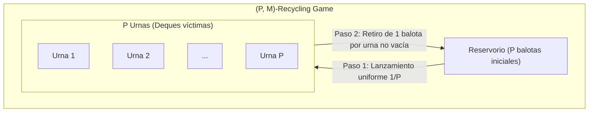
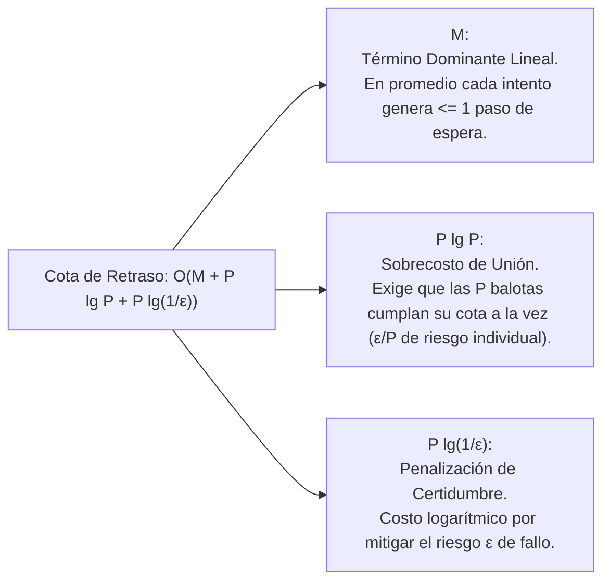
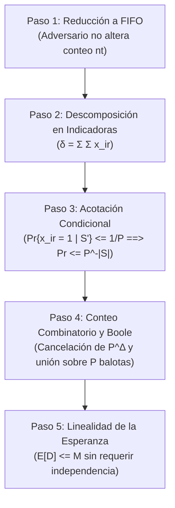
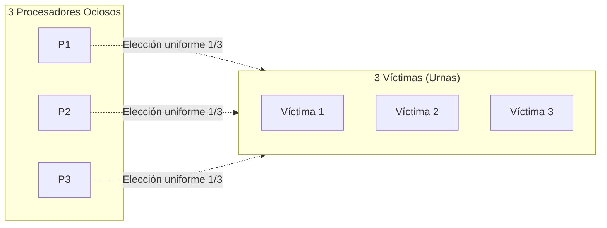

[← Volver a Curso.md](../Curso.md)

# 06. Algoritmo de Work-Stealing (Parte 4 de 5): Acceso Atómico, Juego de Reciclaje (P, M) y Retraso por Contención (Lema 6)

> **Materia**: Paralela y Distribuida | **Fuente**: [06.Work-Stealing_2026_Parte4_de_5.pdf](../Documentos/06.Work-Stealing_2026_Parte4_de_5.pdf)  
> **Términos Core**: `acceso atomico`, `mensaje atomico`, `juego de reciclaje`, `recycling game`, `balls and bins`, `balotas y urnas`, `adversario`, `cola fifo`, `retraso total`, `total delay`, `cubeta wait`, `lema 6`, `cota con alta probabilidad`, `cota en esperanza`, `linealidad de la esperanza`, `desigualdad de boole`, `greg plaxton`, `descomposicion en indicadoras`, `formula de stirling`

---

## 1. Fundamentos del Modelo de Acceso Atómico (*Atomic-Access Model*)

Para analizar formalmente el impacto de la contención cuando múltiples procesadores intentan robar simultáneamente de una misma *ready deque*, Blumofe y Leiserson fundamentan su análisis en el **modelo atómico de paso de mensajes** (*atomic message-passing model*, Liu, Aiello y Bhatt, 1993).

- **Supuesto de Arquitectura**: Computador paralelo asincrónico con $P$ procesadores interconectados, con memoria compartida o memoria distribuida.
- **Mensaje Atómico**: Unidad mínima e indivisible de comunicación en el modelo:
  - No se fragmenta en subcomponentes.
  - Llega completo o no llega en el paso en curso.
  - El modelo abstrae la longitud en bytes; solo computa la ocurrencia del evento de envío/recepción.
  - Cada procesador puede procesar **a lo sumo un mensaje por paso de tiempo**.
  - *Aclaración conceptual*: "Atómico" no alude a física atómica, sino a la indivisibilidad computacional de la operación.

### Comparativa de Modelos de Contención en Robo Concurrente

| Característica | Modelo de Karp y Zhang [1993] | Modelo Atómico de Blumofe y Leiserson [1999] |
|:---|:---|:---|
| **Resolución de Colisiones** | Si varias solicitudes convergen en una misma *deque* en el mismo paso, **una es aceptada y las demás son rechazadas/negadas**. | Las solicitudes concurrentes **NO se descartan**; se encolan secuencialmente. |
| **Control de Servicio** | Resolución probabilística simétrica sin memoria de encolamiento. | Gestionado por un **adversario** (*adversary*) bajo análisis de peor caso (*online algorithms*). |
| **Grado de Libertad del Adversario** | No aplica (modelo reactivo determinista/aleatorio). | El adversario decide el orden de atención de la cola para cada *deque*. |
| **Restricción Obligatoria del Adversario** | No aplica. | Si una *deque* tiene al menos una solicitud pendiente, el adversario **no puede dejar desierta la atención** (debe servir exactamente una). |

---

## 2. El Juego Combinatorio de Reciclaje: $(P, M)$-Recycling Game

Para acotar matemáticamente el retraso acumulado por contención sin importar qué procesadores roben ni cómo se distribuyan sus solicitudes en el tiempo, se introduce el **juego de reciclaje de balotas y urnas** (*Balls and Bins Recycling Game*).

### Definición y Parámetros del Juego
- **$P$**: Número de balotas en juego = Número de urnas disponibles.
- **$M$**: Número total acumulado de lanzamientos de balotas permitidos al adversario.
- **Reservorio (*Reservoir*)**: Contenedor común donde residen inicialmente las $P$ balotas, separadas de las urnas.

### Dinámica Operativa de Cada Paso de Juego
En cada paso discreto, el adversario ejecuta obligatoriamente en secuencia:
1. **Fase de Lanzamiento**:
   - Selecciona un subconjunto de balotas presentes en el reservorio (posiblemente todas, algunas o ninguna).
   - Para cada balota seleccionada: la retira del reservorio, elige una de las $P$ urnas de manera uniforme e independiente al azar (probabilidad $1/P$) y lanza la balota a la urna elegida.
2. **Fase de Servicio**:
   - Inspecciona cada una de las $P$ urnas.
   - En cada urna que posea $\ge 1$ balota, el adversario extrae una balota (a su libre elección) y la retorna al reservorio.
- **Terminación**: El juego concluye cuando se completan los $M$ lanzamientos y todas las balotas han regresado al reservorio.

### Mapeo Isomórfico: Work-Stealing $\longleftrightarrow$ $(P, M)$-Recycling Game

| Elemento en $(P, M)$-Recycling Game | Componente Físico en Work-Stealing | Significado Operativo |
|:---|:---|:---|
| **Balota $r$ ($1 \le r \le P$)** | Procesador $p_r$ (potencial ladrón / *thief*). | Entidad que genera intentos de robo. |
| **Urna $k$ ($1 \le k \le P$)** | *Ready Deque* del procesador víctima $p_k$. | Destino aleatorio de una solicitud de robo. |
| **Balota en el Reservorio** | Procesador ocupado en cómputo local. | El procesador **no está esperando** respuesta de robo. |
| **Balota dentro de una Urna** | Solicitud de robo pendiente en cola. | Solicitud enviada a la víctima aún no atendida. |
| **Retorno de Balota al Reservorio** | Atención completada del robo. | El ladrón recibe respuesta (tarea robada o confirmación de deque vacía) y retorna a cómputo. |
| **A lo sumo 1 balota por procesador** | Invariante de sincronización del *thief*. | Un procesador solo genera una nueva solicitud tras concluir la anterior. |

---

## 3. Retraso Total ($D$) y Conexión con la Cubeta `WAIT`

- **Estado al final del paso $t$**: Quedan $n_t$ balotas distribuidas en las urnas (solicitudes pendientes sin atender).
- **Definición de Retraso Total ($D$)**:
  $$D = \sum_{t=1}^{T} n_t$$
  - $T$: Número total de pasos transcurridos hasta vaciar las urnas.
  - $D$ totaliza los **pasos-procesador perdidos en espera**: cada balota que permanece en una urna al cierre de un paso computa $1$ ciclo de ocio.
- **Rol del Adversario**: Seleccionar qué balotas lanzar y cuáles retirar con el fin de maximizar $D$.
- **Conexión con el Tiempo de Ejecución (Parte 5)**: En el análisis de tiempo global, los pasos de trabajo de todos los procesadores se clasifican en cubetas contables; $D$ representa con exactitud la dimensión de la cubeta **`WAIT`**.

---

## 4. Lema 6: Cotas de Retraso por Contención

El **Lema 6** demuestra que, aun ante un adversario malicioso que controle la cola de atención, las colisiones aleatorias no crecen descontroladamente.

### Enunciado Formal del Lema 6
Para cualquier $\epsilon > 0$, con probabilidad al menos $1 - \epsilon$, el retraso total $D$ incurrido por $M$ solicitudes de robo generadas por $P$ procesadores en el modelo de acceso atómico cumple:
$$D = O\left(M + P \lg P + P \lg\left(\frac{1}{\epsilon}\right)\right)$$
Asimismo, el **retraso total esperado** satisface:
$$E[D] \le M$$

> **Resultado de Greg Plaxton (1994)**: Plaxton mejoró la cota de alta probabilidad a $O(M)$ para el régimen práctico donde $1/\epsilon$ está acotado por un polinomio en $M$ y $P$.

### Desglose e Intuición de los Términos de la Cota

- **Linealidad en $M$**: El término principal escala proporcional al volumen de robos; la contención promedio no degrada la eficiencia asintótica.
- **Factor $P \lg P$**: Nace de la distribución simultánea de riesgo: para que la probabilidad global de falla sobrepase $\epsilon$, a cada balota individual se le tolera a lo sumo $\epsilon/P$, absorbiendo $\lg P$ pasos adicionales por balota.
- **Amortiguación Logarítmica en $\epsilon$**: La probabilidad de fallo $\epsilon$ interviene solo como $\lg(1/\epsilon)$. Multiplicar por 10 la exigencia de certidumbre (ej. pasar de falla $10\%$ a $1\%$) únicamente suma $\approx 3.3$ pasos de espera por procesador ($3.3 \cdot P$).
- **Retraso Acumulado vs. Individual**: La cota $D$ suma el tiempo de espera de **todos los procesadores en conjunto** a lo largo de toda la computación, no el tiempo de un procesador aislado.

---

## 5. Análisis Numérico de Sensibilidad

Evaluación de la cota explícita obtenida en la demostración:
$$D \le 2e \cdot M + P\left(\lg P + \lg\left(\frac{1}{\epsilon}\right)\right)$$
Bajo un escenario con **$P = 8$ procesadores** ($\lg 8 = 3$) y **$M = 100$ solicitudes**:
- Término base dominante: $2e \cdot M \approx 2(2.71828)(100) \approx 543.66 \approx 544$.
- Retraso total promedio: $E[D] \le M = 100$.

| Métrica / Parámetro | Caso 1: Certeza Moderada | Caso 2: Alta Certeza | Caso 3: Extrema Certeza |
|:---|:---:|:---:|:---:|
| **Riesgo de Falla ($\epsilon$)** | $\epsilon = 0.1$ ($10\%$) | $\epsilon = 0.01$ ($1\%$) | $\epsilon = 0.0001$ ($0.01\%$) |
| **Garantía Probabilística ($1-\epsilon$)** | **$90\%$** | **$99\%$** | **$99.99\%$** |
| **Inverso del Riesgo ($1/\epsilon$)** | $10$ | $100$ | $10000$ |
| **Término Logarítmico $\lg(1/\epsilon)$** | $\lg 10 \approx 3.32$ | $\lg 100 \approx 6.64$ | $\lg 10000 \approx 13.29$ |
| **Evaluación $P(\lg P + \lg(1/\epsilon))$** | $8(3 + 3.32) \approx \mathbf{51}$ | $8(3 + 6.64) \approx \mathbf{77}$ | $8(3 + 13.29) \approx \mathbf{130}$ |
| **Cota Superior Explícita de Retraso ($D$)** | $544 + 51 = \mathbf{594}$ | $544 + 77 = \mathbf{621}$ | $544 + 130 = \mathbf{674}$ |
| **Incremento en Pasos de Espera** | — | $+27$ pasos ($+4.5\%$) | $+53$ pasos ($+8.5\%$) |

> **Conclusión Práctica**: Reducir el riesgo de fallo en un factor de $1.000\times$ (del $90\%$ al $99.99\%$) únicamente eleva la cota de retraso de $594$ a $674$ pasos acumulados ($\approx 13\%$). La contención aleatoria es altamente estable y predecible.

---

## 6. Demostración Rigurosa del Lema 6

La demostración se articula en cinco fases analíticas:

### Paso 1: Reducción del Adversario a Orden FIFO
- El retraso total $D = \sum_{t=1}^T n_t$ depende exclusivamente del número de balotas $n_t$ presentes en cada urna al término de cada paso.
- La identidad específica de la balota que el adversario decida retirar de una urna con $\ge 1$ elementos no modifica el número restante de balotas en dicha urna.
- Por ende, **puede asumirse sin pérdida de generalidad que cada urna procesa balotas bajo disciplina estricta FIFO** (*First-In, First-Out*): nuevas balotas ingresan al final de la cola y se retiran desde la cabeza.

### Paso 2: Descomposición en Variables Indicadoras
- Por simetría, se analiza el retraso $\delta = \delta_1$ de la balota $1$ a lo largo de sus $m$ lanzamientos ($m \le M$):
  $$D = \sum_{r=1}^P \delta_r, \quad \delta = \sum_{i=1}^m d_i$$
  - **Ciclo $i$-ésimo**: Secuencia de pasos desde que la balota $1$ es lanzada por $i$-ésima vez hasta que es extraída y devuelta al reservorio.
  - $d_i$: Retraso experimentado en el $i$-ésimo ciclo.
- **Definición de Retraso Directo**: El ciclo $i$ de la balota $1$ es retrasado por la balota $r$ ($r \ne 1$) si ambas coinciden en la misma urna $k$ y la balota $r$ es retirada antes o durante dicho ciclo.
- Bajo FIFO, una balota $r$ puede retrasar el ciclo $i$ **a lo sumo una única vez**. Se define la variable indicadora:
  $$x_{ir} = \begin{cases} 1 & \text{si el ciclo } i \text{ de la balota } 1 \text{ es retrasado por la balota } r \\ 0 & \text{en otro caso} \end{cases}$$
- El retraso total de la balota $1$ es la suma de $m(P-1)$ indicadoras binarias:
  $$\delta = \sum_{i=1}^m \sum_{r=2}^P x_{ir} \tag{Ecuación 2}$$

### Paso 3: Acotación de la Probabilidad Conjunta
Sea $S$ un conjunto arbitrario de parejas $(i, r)$ con tamaño $|S|$. Se demuestra que:
$$\Pr\left\{ \bigwedge_{(i,r)\in S} (x_{ir} = 1) \right\} \le P^{-|S|} \tag{Ecuación 3}$$
- Por regla de la cadena (denominada en el artículo "teorema de Bayes"), para $S' = S \setminus \{(i,r)\}$:
  $$\Pr\left\{ x_{ir} = 1 \;\middle|\; \bigwedge_{(i',r')\in S'} (x_{i'r'} = 1) \right\} \le \frac{1}{P} \tag{Ecuación 4}$$
- **Justificación de Independencia Condicional**:
  1. *Condicionar sobre ciclos $i' \ne i$*: Revela si otros lanzamientos sufrieron retraso, pero no aporta información sobre la urna destino elegida al azar en el lanzamiento $i$.
  2. *Condicionar sobre otras balotas $r'$ en el ciclo $i$*: $x_{ir'} = 1$ indica que la balota $1$ cayó donde estaba $r'$, pero no revela la posición de la balota $r$.
  3. No existe "colusión" oculta entre las variables indicadoras que permita inflar la probabilidad por encima de $1/P$.

### Paso 4: Cota Combinatoria de Stirling y Desigualdad de Boole
Para que el retraso $\delta$ alcance un umbral $\Delta$, al menos $\Delta$ variables indicadoras de las $m(P-1)$ disponibles deben tomar el valor $1$:
- Número de formas de elegir subconjuntos de tamaño $\Delta$:
  $$\binom{m(P-1)}{\Delta} \le \binom{mP}{\Delta} \le \left( \frac{emP}{\Delta} \right)^\Delta$$
  *(Derivado de Stirling: $k! \ge (k/e)^k$, con $n = mP$ y $k = \Delta$)*.
- Multiplicando por la probabilidad conjunta $P^{-\Delta}$ (Ecuación 3):
  $$\Pr\{\delta \ge \Delta\} \le \left( \frac{emP}{\Delta} \right)^\Delta P^{-\Delta} = \left( \frac{em}{\Delta} \right)^\Delta$$
  *(Los factores $P^\Delta$ y $P^{-\Delta}$ se anulan mutuamente).*

Para acotar esta probabilidad por $\frac{\epsilon}{P}$:
1. Si $\Delta \ge 2em \implies \frac{em}{\Delta} \le \frac{1}{2} \implies \left( \frac{em}{\Delta} \right)^\Delta \le 2^{-\Delta}$.
2. Si además $\Delta \ge \lg P + \lg(1/\epsilon) \implies 2^{-\Delta} \le 2^{-(\lg P + \lg(1/\epsilon))} = \frac{\epsilon}{P}$.
- En consecuencia, fijando $\Delta_r = \max\{2em_r, \; \lg P + \lg(1/\epsilon)\}$, se garantiza:
  $$\Pr\{\delta_r \ge \Delta_r\} \le \frac{\epsilon}{P}$$

- **Aplicación de la Desigualdad de Boole**:
  $$\Pr\left( \bigcup_{r=1}^P \{\delta_r \ge \Delta_r\} \right) \le \sum_{r=1}^P \Pr\{\delta_r \ge \Delta_r\} \le P \cdot \frac{\epsilon}{P} = \epsilon$$
- Con probabilidad al menos $1 - \epsilon$, ninguna balota supera su cota:
  $$D = \sum_{r=1}^P \delta_r \le \sum_{r=1}^P \max\left\{ 2em_r, \; \lg P + \lg\left(\frac{1}{\epsilon}\right) \right\} = \Theta\left( M + P \lg P + P \lg\left(\frac{1}{\epsilon}\right) \right)$$
  *(Dado que $\max\{a,b\} \le a+b \le 2\max\{a,b\}$ y $\sum_{r=1}^P m_r = M$).*

### Paso 5: Cota en Esperanza por Linealidad
- Por la Ecuación (4), cada variable indicadora cumple $E[x_{ir}] \le 1/P$.
- Por linealidad de la esperanza sobre las $(P-1)m_r$ indicadoras de la balota $r$:
  $$E[\delta_r] \le (P-1) m_r \cdot \frac{1}{P} = \left(\frac{P-1}{P}\right) m_r \le m_r$$
- Sumando sobre las $P$ balotas:
  $$E[D] = \sum_{r=1}^P E[\delta_r] \le \sum_{r=1}^P m_r = M \quad \blacksquare$$

---

## 7. Linealidad de la Esperanza: Teorema y Caso de Estudio

- **Propiedad Fundamental**: Para cualquier conjunto de variables aleatorias $X_1, \dots, X_n$:
  $$E\left[ \sum_{i=1}^n X_i \right] = \sum_{i=1}^n E[X_i]$$
- **Validez Universal**: La linealidad se cumple **estrictamente siempre**, sin importar si las variables son totalmente independientes, parcialmente correlacionadas o directamente idénticas ($Y=X \implies E[X+Y] = 2E[X]$).

### Caso de Estudio del Curso: 3 Procesadores Ociosos vs. 3 Víctimas
Tres procesadores ladrones ($P_1, P_2, P_3$) eligen al azar entre 3 víctimas posibles. Si a una víctima llega una solicitud, se atiende de inmediato; si llegan varias concurrentemente, una es servida y las restantes quedan esperando.

#### Enfoque A: Perspectiva de los Ladrones
Fijamos la atención en el procesador $P_1$:
- Probabilidad de que los otros dos elijan víctimas distintas a $P_1$:
  $$\left(\frac{2}{3}\right)^2 = \frac{4}{9} \implies \text{Espera } 0 \text{ pasos}.$$
- Probabilidad de que exactamente uno coincida con $P_1$:
  $$2 \cdot \left(\frac{1}{3}\right)\left(\frac{2}{3}\right) = \frac{4}{9} \implies \text{Espera con prob } \frac{1}{2} \text{ (desempate equitativo)}.$$
- Probabilidad de que ambos coincidan con $P_1$:
  $$\left(\frac{1}{3}\right)^2 = \frac{1}{9} \implies \text{Espera con prob } \frac{2}{3} \text{ (1 pasa, 2 esperan)}.$$
- Esperanza individual de espera para $P_1$:
  $$E[X_1] = \left(\frac{4}{9}\cdot 0\right) + \left(\frac{4}{9}\cdot \frac{1}{2}\right) + \left(\frac{1}{9}\cdot \frac{2}{3}\right) = 0 + \frac{2}{9} + \frac{2}{27} = \frac{8}{27}$$
- Por simetría y linealidad ($E[X] = E[X_1] + E[X_2] + E[X_3]$):
  $$E[X] = 3 \cdot \frac{8}{27} = \frac{8}{9} \approx 0.888 \text{ procesadores esperando}$$

#### Enfoque B: Perspectiva de las Víctimas (Verificación Dual)
- Cada víctima que recibe $\ge 1$ solicitud atiende exactamente a 1 procesador.
- Por balance de flujo: $\text{Procesadores esperando} = \text{Total solicitudes } (3) - \text{Víctimas con solicitudes}$.
- Sea $Y_j = 1$ si la víctima $j$ recibe al menos una solicitud:
  $$\Pr(Y_j = 0) = \left(\frac{2}{3}\right)^3 = \frac{8}{27} \implies E[Y_j] = 1 - \frac{8}{27} = \frac{19}{27}$$
- Número esperado de víctimas ocupadas:
  $$E[Y_1 + Y_2 + Y_3] = 3 \cdot \frac{19}{27} = \frac{19}{9}$$
- Total esperado de procesadores esperando:
  $$E[X] = 3 - \frac{19}{9} = \frac{8}{9} \quad \checkmark$$

> **Corolario**: Con $M=3$ solicitudes, el promedio de espera $8/9 \approx 0.888 \le 3$, confirmando experimentalmente que $E[D] \le M$ se sostiene incluso con colisiones directas y bajo cualquier criterio de despacho del adversario.

---

## 8. Puntos Críticos de Examen y Trampas Frecuentes

- **¿Por qué Blumofe-Leiserson usan un adversario en vez de rechazar solicitudes como Karp-Zhang?**:
  - Karp y Zhang asumen que las solicitudes rechazadas se descartan y deben reintentarse desde cero, lo cual modela peor los protocolos reales de redes con buffers y complica el análisis de peor caso. El modelo de encolamiento con adversario demuestra que el sistema es eficiente incluso si el orden de despacho en las colas favorece sistemáticamente el peor escenario.
- **¿Qué representa formalmente la variable $D$ en la computación multihilo global?**:
  - Representa el contenido acumulado de la cubeta **`WAIT`** en el análisis de tiempo de ejecución (Parte 5). Cuantifica el total de ciclos de procesador desperdiciados en contención de cerraduras o esperas de comunicación en las colas.
- **¿Por qué la linealidad de la esperanza aplica en el Paso 5 si las indicadoras $x_{ir}$ no son independientes?**:
  - Trampa clásica de examen. La linealidad de la esperanza **no exige independencia probabilística**. Se cumple idénticamente para variables dependientes o correlacionadas: $E[A+B] = E[A] + E[B]$ es una propiedad algebraica del operador integral/sumatorio.
- **¿Cómo desaparece la base $P^\Delta$ al acotar los subconjuntos con la fórmula de Stirling?**:
  - El número de subconjuntos de tamaño $\Delta$ está acotado por $\left(\frac{emP}{\Delta}\right)^\Delta = \left(\frac{em}{\Delta}\right)^\Delta \cdot P^\Delta$. Al multiplicarlo por la probabilidad conjunta $P^{-\Delta}$, los términos $P^\Delta$ y $P^{-\Delta}$ se cancelan algebraicamente ($P^\Delta \cdot P^{-\Delta} = 1$), desacoplando el término combinatorio de $P$.
- **¿Qué significa que un procesador tenga "a lo sumo una solicitud pendiente"?**:
  - Que un procesador ladrón que emite un intento de robo se suspende hasta que dicha solicitud es atendida y devuelta al reservorio. Nunca emite múltiples robos concurrentes en paralelo desde el mismo procesador.
- **¿Por qué una garantía de certeza mil veces más estricta solo sube la cota marginalmente?**:
  - Porque el riesgo $\epsilon$ figura dentro de un logaritmo: $\lg(1/\epsilon)$. Un factor multiplicativo de $1.000\times$ en certidumbre solo agrega $\lg(1000) \approx 9.96$ unidades multiplicadas por $P$, mientras que el término lineal $2e \cdot M$ permanece intacto.

