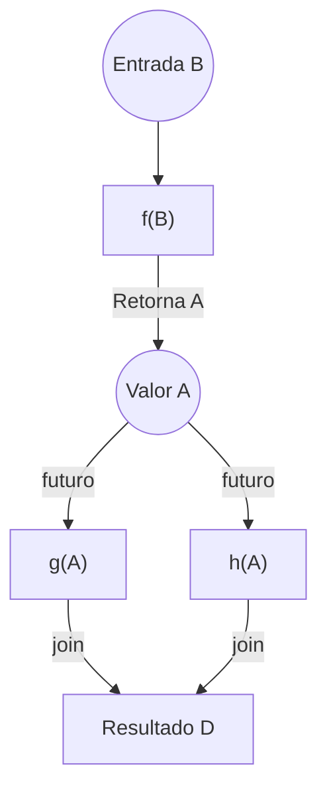
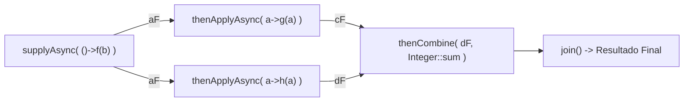
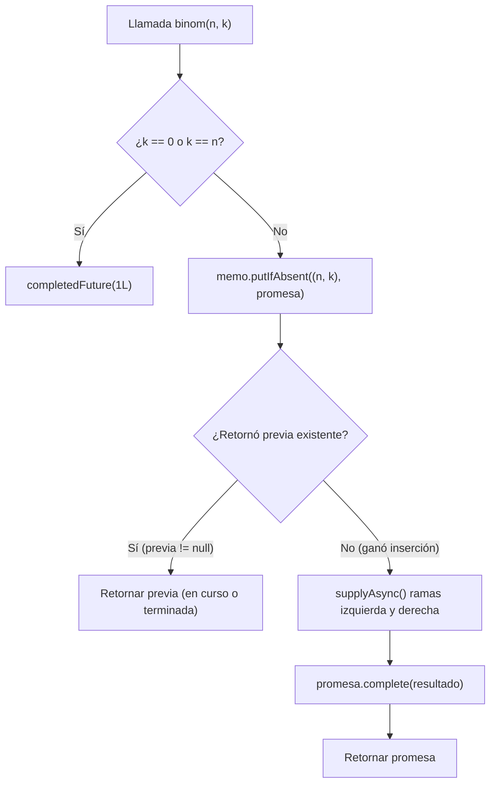

[← Volver a Curso.md](../Curso.md)

# 07. Paralelismo Funcional

> **Materia**: Paralela y Distribuida | **Fuente**: [07.Paralelismo_funcional_2026.pdf](../Documentos/07.Paralelismo_funcional_2026.pdf)  
> **Terminos Core**: `programacion funcional`, `funciones puras`, `efectos secundarios`, `transparencia referencial`, `calculo lambda`, `futuros y promesas`, `future task`, `blocking read`, `completablefuture`, `recursivetask vs recursiveaction`, `thread starvation`, `memoizacion`, `donald michie`, `binomio de newton`, `triangulo de pascal`, `putifabsent`, `java streams`, `analogia del rebano`, `gatherers`, `windowfixed`, `mapconcurrent`, `scan`, `windowsliding`, `fold`, `determinismo funcional`, `determinismo estructural`, `data race`, `drf`, `no-determinismo benigno`

---

## 1. Fundamentos de Programación Funcional y Pureza

- **Programación Funcional**: Paradigma declarativo basado en el uso de **funciones matemáticas** en contraste con la programación imperativa (basada en mutación de estado y variables compartidas).
  - Origen formal: **Cálculo Lambda** ($\lambda$-calculus, Alonzo Church, 1930) como modelo matemático de definición de funciones, aplicación y recursión.
  - Lenguajes puramente funcionales: Haskell, Scheme, Erlang, OCaml, Scala, F#.
  - Lenguajes multiparadigma modernos: Java (desde Java 8), Python, JavaScript, Rust.
- **Definición Matemática de Función**:
  - Correspondencia unívoca entre dos conjuntos: a cada elemento del dominio (variable independiente) le corresponde un **único** elemento del codominio (variable dependiente).
  - Regla: Dos entradas distintas pueden mapear al mismo valor ($f(x_1) = f(x_2) = y$); una misma entrada **nunca** puede producir dos salidas diferentes.
- **Funciones Puras (Expresiones Puras)**:
  - Carecen absolutamente de **efectos secundarios** (*side effects*): no modifican variables globales, no mutan estructuras en memoria compartida y no realizan operaciones de entrada/salida (I/O).
  - **Propiedades Fundamentales para Concurrencia**:
    1. **Eliminación de código muerto (*Dead Code Elimination*)**: Si el resultado de una expresión pura no se consume, puede descartarse sin alterar el comportamiento global.
    2. **Transparencia referencial**: Invocaciones repetidas con los mismos argumentos producen invariablemente el mismo resultado exacto.
    3. **Independencia causal**: Si no existe dependencia de datos entre dos expresiones puras ($A$ y $B$), el orden de ejecución es arbitrario e invertible, y pueden ejecutarse legítimamente **en paralelo**.
    4. **Libertad de optimización**: El compilador y el entorno de ejecución pueden reordenar, fusionar o paralelizar la evaluación sin riesgo de corromper el estado.
- **Axioma Central**: *La ausencia de estado compartido mutable erradica las condiciones de carrera.*

---

## 2. Modelo de Tareas Futuras (Futures & Promises)

### Principio de Derivación Paralela
Dada la descomposición funcional:
$$A = f(B)$$
$$C = g(A), \quad D = h(A)$$
- $C$ y $D$ dependen únicamente del valor de $A$.
- Una vez calculado $A$, el cómputo de $g(A)$ y $h(A)$ no presenta interferencia mutua: pueden despacharse en **paralelo**.



### Analogía del Pager en la Zona de Comidas (*Food Court*)
- **Pedido en mostrador**: Despacho de la tarea asíncrona.
- **Pager (Localizador luminoso)**: Entrega de un objeto **placeholder** / referente inmediato. No contiene la comida aún, pero enlaza al resultado prometido.
- **Cocina del restaurante**: Ejecución asíncrona en segundo plano (múltiples locales cocinando concurrentemente).
- **Activación del pager**: Cumplimiento de la promesa; el cliente recoge el pedido (**lectura del valor**).

### Definición Formal y Diferencia Conceptual
- **Future (Futuro)**: Vista de **sólo lectura** del resultado; manejador (*object handler / reference*) que permite consultar o esperar el valor retornado por la tarea en un tiempo posterior.
- **Promise (Promesa)**: Contenedor de **escritura única** (*single-assignment*) que el hilo productor completa una sola vez.
- **Historia**: Introducido por Baker y Hewitt (1977); incorporado a la computación paralela en **Multilisp** (Halstead, 1985) mediante la primitiva `(future E)`:
  1. Retorna de inmediato un *placeholder* para el resultado de la expresión $E$.
  2. Inicia la evaluación concurrente de $E$.

### Operaciones Clave sobre Futuros
1. **Asignación Única (*Single Assignment*)**:
   - $\text{futuro}\{ \langle \text{tarea} \rangle \}$: La referencia interna es inmutable una vez resuelta (semántica idéntica a `final` en Java).
2. **Lectura Bloqueante (*Blocking Read*)**:
   - Operación `A.get()`: Bloquea el hilo invocador si la tarea sigue en ejecución; retorna el valor si ya culminó o propaga la excepción si falló.
   - **Garantía causal**: Cualquier instrucción $S$ posterior a `A.get()` tiene la certidumbre matemática de que la tarea productora finalizó completamente antes de iniciar $S$.

> **Regla de Ejecución**: *Crear un futuro jamás bloquea el flujo del programa; únicamente la invocación de su lectura (`get()`) bloquea.*

### Grafo Computacional: `async`/`finish` vs. Futuros
- **Enfoque Clásico (`async` / `finish`)**: Los arcos de juntura (*join edges*) se encuentran atados rígidamente al límite del bloque de sincronización `finish`.
- **Enfoque con Futuros**: Los arcos de encuentro (*join*) son dinámicos y desacoplados: se materializan puntualmente **en cada invocación de `get()`**, permitiendo topologías de grafos dirigidos acíclicos (DAG) arbitrarias y de grano fino.

---

## 3. Implementaciones de Futuros en Java

### Fork/Join: `RecursiveAction` vs. `RecursiveTask<V>`
| Propiedad | `RecursiveAction` | `RecursiveTask<V>` |
|---|---|---|
| **Tipo de Tarea** | Tarea regular / Procedimiento puro | Tarea futura (*Future task*) |
| **Retorno de `compute()`** | `void` | Objeto de tipo parametrizado `V` |
| **Comportamiento de `join()`** | Bloquea hasta finalizar; retorna `void` | Bloquea hasta finalizar y **retorna el valor `V`** |
| **Propósito Canónico** | Modificaciones in-place sobre arreglos | Reducciones, búsquedas y cálculos evaluativos |

### `Future` (Java 5) vs. `CompletableFuture` (Java 8+)
| Criterio | `Future<V>` (Java 5) | `CompletableFuture<V>` (Java 8+) |
|---|---|---|
| **Consumo del Resultado** | Exclusivamente con `get()`, el cual **bloquea el hilo**. | **No bloqueante**: encadena continuaciones reactivas (`thenApplyAsync`, `thenCombine`). |
| **Completitud Manual** | No: solo el hilo ejecutor interno puede completarlo. | **Sí**: expone `.complete(valor)` comportándose como una **Promesa**. |
| **Manejo de Excepciones** | `get()` arroja `ExecutionException` chequeada. | En el pipeline funcional vía `.exceptionally()` o `.handle()`. |
| **Composición de Tareas** | Inexistente; requiere código imperativo bloqueante. | Monádica: `.thenCompose()` (aplanamiento) y `.thenCombine()` (confluencia). |

### El Riesgo del Bloqueo: Inanición por Agotamiento de Hilos (*Thread Starvation*)
- En un pool con tamaño finito (ej. `Executors.newFixedThreadPool(4)`):
  - Si cada subtarea ejecuta `aF.get()` internamente, retiene un hilo del pool en estado bloqueado.
  - Si el número de tareas dependientes supera la capacidad del pool, todos los hilos quedan bloqueados esperando tareas en cola que jamás recibirán un hilo ejecutor: **interbloqueo inducido por agotamiento de hilos**.
- **Solución con `CompletableFuture`**:
  - `thenApplyAsync()` registra la función en la cola de eventos y libera el hilo de inmediato. No retiene hilos en espera pasiva.



### Tabla de Equivalencia Semántica
| Notación Formal del Curso | Implementación en Java (`CompletableFuture`) |
|---|---|
| $A_{\text{futuro}} = \text{futuro}\{f(B)\}$ | `var aF = CompletableFuture.supplyAsync(() -> f(b));` |
| $C_{\text{futuro}} = \text{futuro}\{g(A.\text{get}())\}$ | `var cF = aF.thenApplyAsync(a -> g(a));` |
| $D_{\text{futuro}} = \text{futuro}\{h(A.\text{get}())\}$ | `var dF = aF.thenApplyAsync(a -> h(a));` |
| $\text{join del grafo } (C + D)$ | `int r = cF.thenCombine(dF, Integer::sum).join();` |
| $A.\text{get}()$ | `aF.join()` |

---

## 4. Memoización Concurrente con Futuros

- **Etimología**: Acuñado por Donald Michie en 1968, derivado del latín *memorandum* ("cosa que debe ser recordada"). **NO confundir con memorización**.
- **Definición**: Técnica de optimización que almacena en caché pares $(\text{entrada}, \text{resultado})$ de funciones computacionalmente costosas; ante entradas repetidas, retorna de inmediato el dato precalculado sin recomputar.

### Caso de Estudio: Coeficientes Binomiales (Triángulo de Pascal)
Fórmula recursiva del Binomio de Newton:
$$\binom{n}{k} = \binom{n-1}{k-1} + \binom{n-1}{k}, \quad \text{con } \binom{n}{0} = \binom{n}{n} = 1$$
- Cálculo de $\binom{30}{19} = 54.627.300$:
  - **Sin memoización**: $109.254.599$ llamadas recursivas redundantes ($O(2^n)$).
  - **Con memoización**: Únicamente **$209$ cálculos efectivos** en la tabla ($O(n \cdot k)$).

### Memoización Paralela: Caché de Futuros en vez de Valores
- **Problema de la memoización tradicional en paralelo**:
  - Si la tabla almacena solo resultados finales completados, dos o más hilos que soliciten simultáneamente $\binom{n}{k}$ encontrarán la casilla vacía y lanzarán cálculos duplicados idénticos en paralelo.
- **Patrón Óptimo con `CompletableFuture`**:
  - La tabla almacena **futuros / promesas** en lugar de valores resueltos:
    `Map<Par, CompletableFuture<Long>> memo = new ConcurrentHashMap<>();`
  - La tabla almacena tanto **trabajo terminado** como **trabajo en curso**.
  - Operación atómica clave: `putIfAbsent(clave, promesa)`.
    - Si la clave ya estaba presente: descarta la promesa propia y retorna el futuro existente (esperará su resolución vía `.join()` o encadenamiento).
    - Si la clave no existía: gana el derecho exclusivo de computar; despacha el cálculo asíncrono y al finalizar cumple la promesa mediante `.thenAccept(promesa::complete)`.



> **Condición Indispensable**: *La memoización solo es válida y determinista si la función es matemáticamente pura. Si contuviera efectos secundarios, eludir su ejecución violaría la semántica del programa.*

---

## 5. Streams de Java: Procesamiento Declarativo y Concurrente

### Analogía del Rebaño y la Esquila de Ovejas
| Componente de la Analogía | Elemento en Programación Java | Rol Funcional |
|---|---|---|
| **Rebaño de ovejas** | Colección de datos (`List<Oveja>`) | Estructura en memoria que almacena los objetos |
| **Acción de esquilar** | Función pura / Operación (`this::esquilar`) | Algoritmo que transforma o actúa sobre un elemento |
| **El Stream** | Abstracción de pipeline (`rebano.stream()`) | Secuencia de operaciones declarativas sobre los datos |
| **Esquilar en paralelo** | `rebano.parallelStream()` | Modalidad de ejecución que distribuye el trabajo entre núcleos |

- **Principio Esencial**: *Un Stream NO es el rebaño (no almacena datos) NI es la acción de esquilar (no es la función de negocio). Es la abstracción computacional intermedia que conecta la fuente con las transformaciones.*

### Comparativa Estructural: Colección vs. Stream
| Característica | Colección (`Collection<T>`) | Stream (`Stream<T>`) |
|---|---|---|
| **Almacenamiento** | Almacena datos físicamente en memoria | **No almacena datos**; consume una fuente externa |
| **Consumo / Reutilización** | Reutilizable indefinidamente | **De un solo uso** (*single-use*); queda consumido al cerrar |
| **Control de Recorrido** | Externo e imperativo (bucles `for` / iteradores) | **Interno y declarativo** (delegado a la librería) |
| **Paralelismo** | Requiere particionado manual y gestión de hilos | **Nativo y declarativo** vía `parallelStream()` |
| **Modificación de Fuente** | Permite mutación directa | **Prohibida**: no debe alterar la colección fuente durante el proceso |

### Modalidades de Fuentes de Streams
- Desde colección: `lista.stream()`
- Desde arreglos: `Arrays.stream(arreglo)`
- Desde literales discretos: `Stream.of(1, 2, 3, 4)`
- Desde generador infinito: `Stream.iterate(1, n -> n + 1)`
- Desde flujos de I/O: `Files.lines(Path.of("datos.txt"))`

### Ejecución Paralela: `parallelStream()`
- `rebano.parallelStream().forEach(this::esquilar);`
- **Mecanismo subyacente**: Utiliza el pool compartido de la JVM: **`ForkJoinPool.commonPool()`**.
- **Advertencias de Rendimiento**:
  1. No garantiza un hilo independiente por cada elemento del flujo.
  2. No garantiza que la ejecución paralela sea más veloz que la serial; para volúmenes pequeños o funciones de bajo costo, la sobrecarga (*overhead*) de bifurcación y sincronización degrada el rendimiento.

---

## 6. Evolución de Streams y Stream Gatherers (Java 24 - JEP 485)

### Cronología de la API Stream en Java
| Año | Versión de Java | Innovación Incorporada |
|---|---|---|
| **2014** | Java 8 | Introducción de `Stream`, `parallelStream`, `filter`, `map`, `reduce`, `forEach` |
| **2017** | Java 9 | `takeWhile`, `dropWhile`, `ofNullable`, API reactiva `Flow` |
| **2021** | Java 16 | `mapMulti()`, `.toList()` |
| **2024** | Java 22 / 23 | Stream Gatherers (Preview JEP 461 y 473) |
| **2025** | **Java 24** | **Versión Definitiva de Stream Gatherers (JEP 485)** |

### Los 5 Gatherers Estándar y su Comportamiento Concurrente
1. **`Gatherers.windowFixed(windowSize)`**:
   - Agrupa elementos en listas disjuntas de tamaño fijo (ej. bloques de 5 ovejas).
   - Divide la carga sin procesar en paralelo internamente.
2. **`Gatherers.mapConcurrent(maxConcurrency, function)`**:
   - Ejecuta la función de mapeo con un límite estricto de concurrencia simultánea ($k$ tareas concurrentes).
   - **Tecnología interna**: Implementado sobre **Hilos Virtuales (*Virtual Threads*)**.
   - **Garantía crítica**: **Preserva estrictamente el orden** de emisión original del stream.
   - *Diferencia clave*: `parallelStream()` paraleliza todas las etapas del pipeline indistintamente; `mapConcurrent()` restringe la concurrencia a una etapa puntual del pipeline sin desordenar la salida.
3. **`Gatherers.scan(() -> initial, accumulator)`**:
   - Computa acumulaciones prefijas intermedias (*running total*). Emite cada estado intermedio sucesivo.
4. **`Gatherers.windowSliding(windowSize)`**:
   - Ventanas deslizantes solapadas de tamaño $k$ con desplazamiento de 1 elemento. Esencial para análisis de series temporales.
5. **`Gatherers.fold(() -> initial, accumulator)`**:
   - Reducción terminal agregada que entrega un único valor resumido final.

> **Alerta Crítica de Parcial**:  
> *`fold()` y `scan()` se evalúan de forma **estrictamente secuencial**, incluso si se invocan dentro de un `parallelStream()`. Para obtener paralelismo en reducciones se debe recurrir a `reduce()` empleando operaciones matemáticamente **asociativas**.*

---

## 7. Determinismo, Data Races y Libertad de Carreras (DRF)

### Clasificación de Determinismo
- **Determinismo Funcional**: Para una misma entrada, el programa produce **siempre la misma salida**, con independencia del orden en que los núcleos ejecuten las instrucciones concurrentes.
- **Determinismo Estructural**: Para una misma entrada, el programa genera **siempre el mismo grafo computacional** (misma topología de nodos, arcos y dependencias).

### Conflictos de Memoria y Condición de Carrera de Datos (*Data Race*)
Dado un par de accesos a la misma posición de memoria ejecutados concurrentemente:
- **Lectura - Lectura ($R-R$)**: Operación segura y concurrente. No genera carreras.
- **Lectura - Escritura ($R-W$)**: Conflicto de carrera de datos.
- **Escritura - Escritura ($W-W$)**: Conflicto de carrera de datos (actualizaciones perdidas).

### Teorema de Libertad de Carreras de Datos (Data Race Freedom - DRF)
- **Definición DRF**: Un programa es libre de carreras de datos si ningún par de operaciones ejecutadas concurrentemente accede a la misma posición de memoria existiendo al menos una operación de escritura.
- **Teorema**:  
  $$\text{Programa con } \{ \text{async/finish}, \text{futuros} \} \land \mathbf{DRF} \implies \mathbf{Determinismo\ Funcional\ y\ Estructural}$$

### Demostración Práctica en el Rebaño: Carrera vs. DRF
```java
// CASO 1: CON CONDICION DE CARRERA (Violación de DRF)
int[] total = {0};
rebano.parallelStream().forEach(o -> total[0] += o.getKilosLana());
// Varios hilos leen y escriben sobre total[0] sin sincronización.
// Conflictos W-W y R-W: resultado errático, menor al esperado (pérdida de incrementos).

// CASO 2: LIBRE DE CARRERAS (Cumple DRF)
int total = rebano.parallelStream()
                  .mapToInt(Oveja::getKilosLana)
                  .sum();
// Cada hilo suma sus elementos de forma local y privada.
// La librería reduce y combina sumas parciales sin estado mutable compartido.
// Resultado determinista: exactamente 3.000.000 garantizado.
```

### No-Determinismo Benigno (*Benign Non-Determinism*)
- **Definición**: Escenario concurrente donde una misma entrada puede arrojar diferentes salidas válidas, pero **todas ellas satisfacen plenamente la especificación formal del problema**.
  - Ejemplo en Java:
    ```java
    Optional<Oveja> alguna = rebano.parallelStream()
                                   .filter(Oveja::necesitaEsquila)
                                   .findAny();
    ```
    Cualquier hilo puede entregar una oveja diferente según la latencia de despacho; todas son correctas porque todas requieren esquila.
- **Diferencia frente a Condición de Carrera**:
  - En el **no-determinismo benigno**, el conjunto de salidas admisibles está contemplado por diseño en la especificación.
  - En una **condición de carrera (*data race*)**, el programa viola la especificación y produce **corrupción silenciosa de datos o resultados matemáticamente incorrectos**.

---

## 8. Síntesis Matricial: Las 5 Dimensiones del Paralelismo Funcional

| Dimensión | Principio Operativo | Mecanismo de Sincronización | Garantía de Corrección |
|---|---|---|---|
| **Funciones Puras** | Ausencia de efectos colaterales; transparencia referencial | Inexistente (no hay contención de memoria) | Reordenamiento e inversión de orden válidos |
| **Tareas Futuras** | Retorno inmediato de placeholder; cómputo asíncrono | `get()` y `join()` como arcos de encuentro dinámicos | Semántica de asignación única (*single-assignment*) |
| **Memoización Concurrente** | Reutilización de resultados y registro de trabajo en curso | Inserción atómica en tabla (`putIfAbsent`) | Eliminación de cálculos duplicados concurrentes |
| **Java Streams** | Separación entre el qué (declarativo) y el cómo (ejecución) | Fork/Join Pool común o Hilos Virtuales en Gatherers | Inmutabilidad de la fuente de datos durante el flujo |
| **Garantía DRF** | Erradicación total de accesos concurrentes escritura/escritura | Reducciones puras y aislamiento de memoria | Determinismo funcional y estructural absoluto |

---

## 9. Puntos Críticos para Sustentación y Examen

- **¿Por qué la inmutabilidad es la clave de la escalabilidad paralela?**  
  Sin escrituras sobre variables compartidas, los accesos concurrentes se reducen a lecturas ($R-R$), eliminando la necesidad de cerrojos (`synchronized`, `ReentrantLock`), contención de caché y condiciones de carrera.
- **¿Por qué `Future.get()` causa interbloqueo y `CompletableFuture` no?**  
  `Future.get()` mantiene el hilo del pool bloqueado pasivamente. Si se llena el pool de tareas bloqueadas esperando a otras tareas encoladas, el sistema colapsa (*thread starvation deadlock*). `CompletableFuture` usa continuaciones asíncronas no bloqueantes que liberan el hilo inmediatamente hasta que el dato esté disponible.
- **¿Por qué `fold()` y `scan()` no se paralelizan en Stream Gatherers?**  
  Porque sus operadores dependen del acumulador del paso inmediatamente anterior en orden estricto de izquierda a derecha. Solo operaciones con propiedad asociativa (`reduce()`) permiten partición en árbol binario paralelo.
- **¿Qué diferencia conceptual separa a una Colección de un Stream?**  
  La colección es una estructura de almacenamiento físico de datos en memoria; el Stream es un pipeline efímero de transformaciones declarativas que se consume una única vez.
- **¿Qué garantiza el Teorema DRF?**  
  Que la ausencia de pares de acceso en paralelo con al menos una escritura sobre la misma memoria compartida garantiza que el programa paralelo se comportará de manera determinista (misma salida y mismo grafo computacional).

