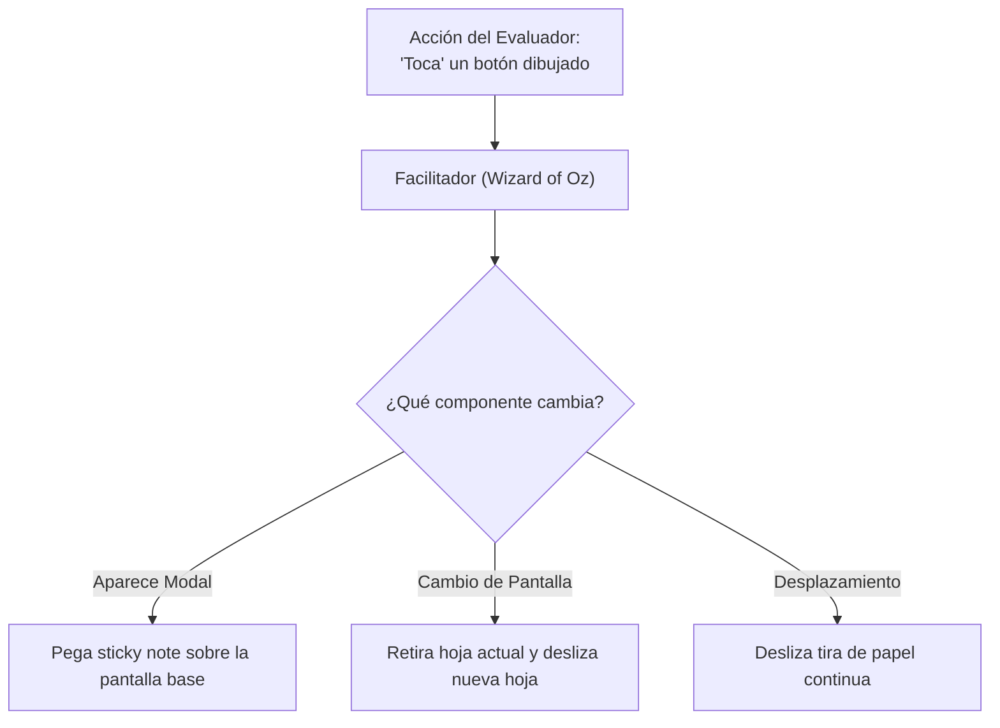
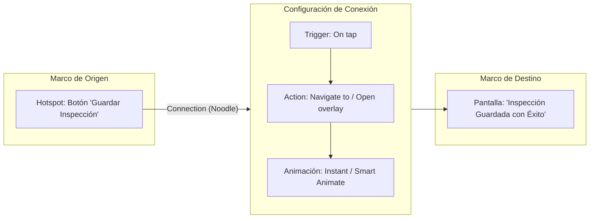
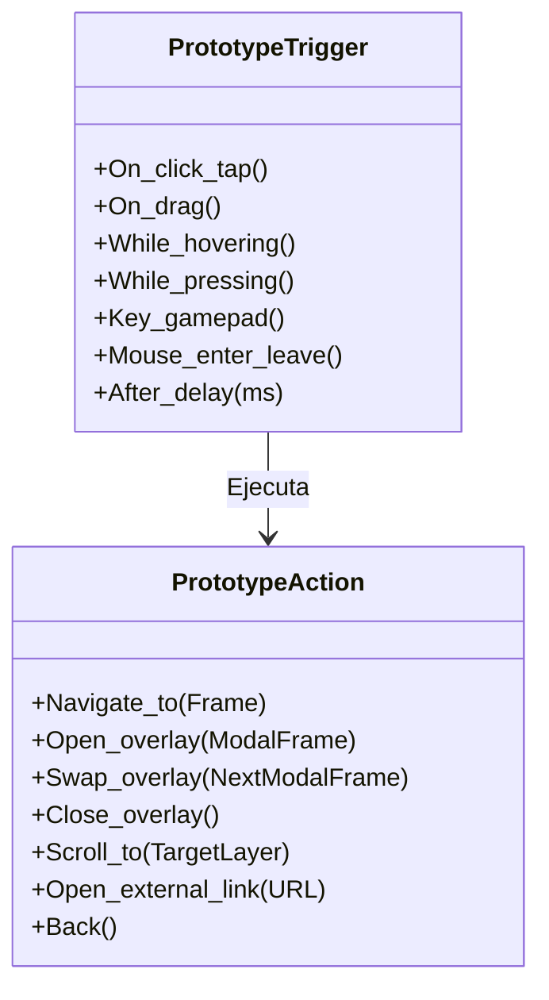
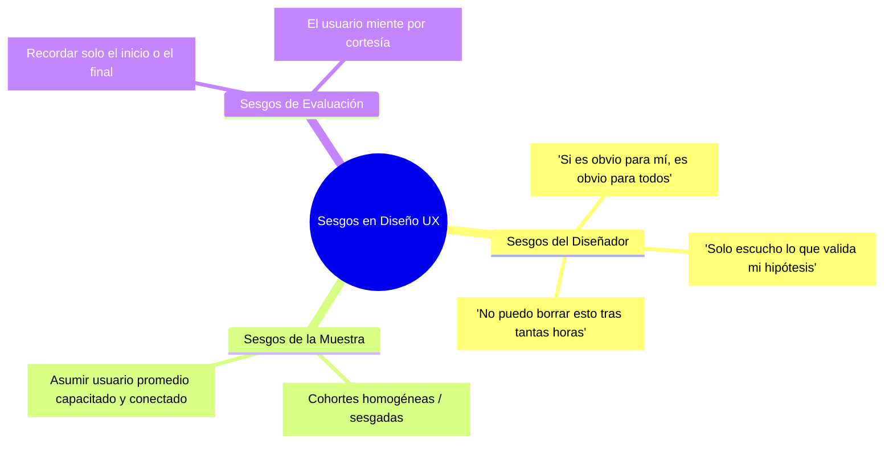
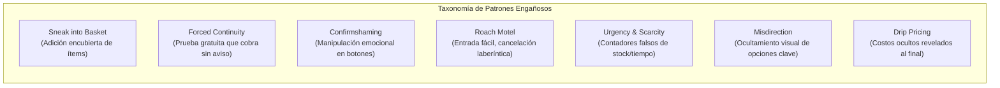
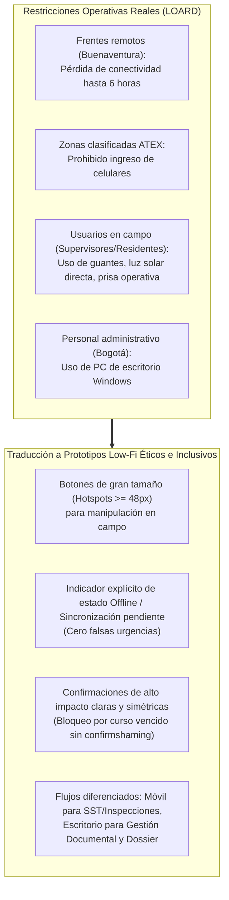

[← Volver a Curso.md](../Curso.md) | [Siguiente: 08b. Principios de Diseño Visual y Leyes de la Gestalt →](./08b_Principios_de_Diseno_Visual_y_Gestalt.md)

# 08a. Prototipado de Baja Fidelidad y Ética en el Diseño UX

> **Materia**: Sistemas de Información | **Docente**: PhD Jhon Alexander Garcia Camargo  
> **Semana**: Semana 8 | **Fuente**: [How to Design Low-Fidelity Prototypes (Google UX Design Certificate)](https://youtu.be/3F4mWr1cY-8?si=lK0tKjdSe8QqcTDt)  
> **Términos Core**: `Low-Fidelity Prototype`, `Paper Prototyping`, `Wireframe vs Prototype`, `Wizard of Oz`, `Figma Prototyping`, `Flow Starting Point`, `Hotspots`, `Connections`, `Triggers (On tap, On drag, After delay)`, `Actions (Navigate to, Open overlay, Scroll to)`, `Transitions (Instant, Dissolve, Smart Animate)`, `Implicit Bias`, `Confirmation Bias`, `False Consensus Effect`, `Recency Bias`, `Primacy Bias`, `Sample Bias`, `Social Desirability Bias`, `Deceptive Patterns (Dark Patterns)`, `Sneak into Basket`, `Forced Continuity`, `Confirmshaming`, `Roach Motel`, `Urgency & Scarcity`, `Misdirection`, `Drip Pricing`, `Symmetrical Friction`.

---

## 1. Fundamentos del Prototipado de Baja Fidelidad (Low-Fi)

### 1.1 Naturaleza y Propósito Operativo
- **Definición**: Representación temprana, esquemática y simplificada de un sistema interactivo orientada a verificar **funcionalidad, flujo de navegación y arquitectura de información** antes de invertir recursos en diseño visual o codificación.
- **Diferenciación Esencial**:
  - **Wireframe**: Artefacto puramente estático que delimita la disposición espacial, jerarquía de contenido y estructura de pantalla (el "esqueleto").
  - **Prototipo (Prototype)**: Artefacto dinámico o simulado que añade **conectividad e interactividad** entre pantallas; responde a entradas del usuario modelando flujos de tareas de inicio a fin (*end-to-end*).
  - **Axioma de Fidelidad**:
    $$\text{Costo de Modificación en Código} \gg \text{Costo en Figma Hi-Fi} \gg \text{Costo en Figma Low-Fi} \gg \text{Costo en Papel}$$

```mermaid
flowchart LR
    Idea["Requerimientos & User Stories"] --> WF["Wireframes Estáticos<br/>(Estructura y Jerarquía)"]
    WF --> LoFi["Prototipo Low-Fi<br/>(Flujo Interactivo Básico)"]
    LoFi --> Test1["Pruebas de Usabilidad Ronda 1<br/>(Validar modelo mental)"]
    Test1 -- "Iteración rápida" --> LoFi
    Test1 -- "Validado" --> VD["Diseño Visual y Mockups<br/>(08b: Gestalt & 08c: Mockups)"]
    VD --> HiFi["Prototipo Hi-Fi Interactivo<br/>(08f: Gestos & Movimiento)"]
    HiFi --> Dev["Implementación en Código"]
```

### 1.2 Principios Clave de Eficiencia
- **Aislamiento de Variables**: Uso estricto de escala de grises, formas primitivas y cajas de texto esquemáticas para impedir que los evaluadores desvíen su atención hacia colores, fuentes o imágenes en lugar de la lógica del proceso.
- **Desapego Emocional (*Low Attachment*)**: Un artefacto de rápida construcción minimiza la resistencia psicológica del equipo a descartar soluciones fallidas o pivotar ante retroalimentación adversa.
- **Prevención de la Trampa del Prototipo Costoso (*Expensive Prototype Trap*)**: Evitar construir interfaces hiperdetalladas que generen la ilusión de avance de desarrollo cuando aún persisten inconsistencias críticas en el flujo de negocio.

---

## 2. Prototipado en Papel (Paper Prototyping)

### 2.1 Metodología de Construcción Física
- **Materiales Operativos**: Papel cuadriculado/punteado (*dot grid*), marcadores oscuros, tarjetas índice (*index cards*), notas adhesivas (*sticky notes*) y plantilla física de silueta de dispositivo móvil/web.
- **Separación de Capas Análogas**:
  - **Lienzo Base (*Base Screen*)**: Marco rígido donde se dibuja el contenedor estático de la pantalla (barras fijas, encabezados estructurales).
  - **Componentes Dinámicos Móviles**: Dibujados sobre *sticky notes* recortadas para representar estados cambiantes sin redibujar la pantalla completa:
    - Menús desplegables (*dropdowns*).
    - Teclados virtuales.
    - Ventanas modales y cuadros de diálogo de alerta.
    - Fichas desplazables (*scrolling feeds*).

### 2.2 Técnica de Simulación "Mago de Oz" (*Wizard of Oz*)
- **Rol del Facilitador / Computadora Humana**: El evaluador asigna una tarea de negocio concreta al usuario (ej. *"Registra una inspección de seguridad en el frente Buenaventura"*). El usuario señala con su dedo dónde haría clic. El facilitador intercambia manualmente las hojas o superpone los *sticky notes* simulando la respuesta del sistema.
- **Ventajas Inmediatas**:
  - Costo monetario cero; tiempo de iteración en el orden de segundos.
  - Facilita el codiseño directo con usuarios no técnicos en sitio de trabajo.
- **Límites Técnicos**:
  - Imposibilidad de evaluar tiempos de respuesta o cargas pesadas de datos.
  - Dificultad para pruebas asíncronas no moderadas o remotas.

---

## 3. Prototipado Digital de Baja Fidelidad en Figma

### 3.1 Anatomía del Motor de Interacción en Figma
El prototipado interactivo en Figma se articula mediante una cuádrupla fundamental:
$$\text{Interacción} = (\text{Punto de Inicio / Hotspot}, \text{Trigger}, \text{Action}, \text{Destination})$$

| Componente Técnico | Descripción en Figma | Casos de Uso Habituales |
| :--- | :--- | :--- |
| **Flow Starting Point** | Marco (`Frame`) inicial donde arranca la ejecución del flujo interactivo. | Pantalla de inicio de sesión, tablero de mando principal (*dashboard*), formulario de captura. |
| **Hotspot** | Elemento vectorial o contenedor interactivo de origen que recibe el evento del usuario. | Botón, icono, tarjeta de lista, fila de tabla, área invisible de toque (*hitbox*). |
| **Connection ("Noodle")** | Flecha vectorial dirigida azul que enlaza el *Hotspot* con el marco o estado destino. | Vinculación explícita de rutas de navegación entre pantallas del sistema. |
| **Trigger (Disparador)** | Evento físico o temporal que activa la transición. | `On tap / On click`, `On drag`, `While hovering`, `While pressing`, `After delay`. |
| **Action (Acción)** | Mutación de estado que ejecuta el prototipo ante el disparo. | `Navigate to`, `Open overlay`, `Swap overlay`, `Close overlay`, `Scroll to`, `Back`. |
| **Destination** | Frame destino hacia el cual apunta la transición. | Pantalla completa de confirmación, contenedor emergente o posición dentro de la vista. |
| **Animation / Transition** | Curva temporal y efecto visual con el que se produce el cambio. | `Instant` (recomendado en Low-Fi), `Dissolve`, `Smart Animate`, `Slide in/out`. |

### 3.2 Tipos de Triggers y Acciones Críticas

- **`After delay`**: Disparador temporal sin intervención de clic. Indispensable para simular pantallas de carga (*spinners*), transiciones automáticas de estado o expiración de sesión por inactividad.
- **`Open overlay`**: Despliega un frame sobre el marco actual (centrado, manual o fijado a bordes), manteniendo visible el contexto de fondo con desenfoque o atenuación oscura (*dim background*).
- **`Swap overlay`**: Reemplaza el overlay actual por otro sin cerrar ni reiniciar el marco base (ideal para wizards de pasos o pestañas de modal).

---

## 4. Sesgos Cognitivos e Inclusión en Diseño UX (*Recognize Implicit Bias*)

### 4.1 Definición y Riesgo Operativo
- **Sesgo Implícito (*Implicit Bias*)**: Atajos heurísticos, prejuicios y suposiciones subconscientes que moldean las decisiones de diseño sin advertencia consciente.
- **Axioma Universal de UX**:
  $$\text{«Tú no eres el usuario»} \implies \text{Tus preferencias, velocidad técnica y modelo mental no son generalizables}$$

### 4.2 Taxonomía de Sesgos en Investigación y Prototipado

| Tipo de Sesgo | Definición Formal | Manifestación Típica en Diseño | Estrategia de Mitigación |
| :--- | :--- | :--- | :--- |
| **Confirmation Bias** *(Sesgo de Confirmación)* | Tendencia a buscar, registrar e interpretar información que corrobore las hipótesis preexistentes, descartando evidencia contraria. | Celebrar cuando un usuario entiende un menú ambiguo e ignorar a tres que fallaron justificando "error del usuario". | Redactar criterios de éxito objetivos antes de la prueba; triangular datos con observadores independientes. |
| **False Consensus Effect** *(Falso Consenso)* | Asumir que la mayoría de los usuarios comparten los mismos hábitos, habilidades tecnológicas o preferencias del diseñador. | Diseñar atajos de teclado complejos o navegación gestual oculta asumiendo que "todo el mundo sabe cómo funciona". | Validar con usuarios externos reales; recurrir a pruebas estandarizadas con métricas de tasa de error. |
| **Sample / Selection Bias** *(Sesgo de Muestreo)* | Reclutar participantes que no representan la diversidad real de la población objetivo. | Evaluar un sistema de registro de obra testeando exclusivamente con ingenieros jóvenes en oficinas centrales. | Reclutar usuarios de campo reales: supervisores en frentes aislados, operarios con baja alfabetización digital. |
| **Primacy & Recency Bias** | Otorgar mayor relevancia a la primera impresión (*primacy*) o a la última retroalimentación recibida (*recency*). | Modificar el prototipo de inmediato basándose únicamente en el comentario airado del último participante de la tarde. | Analizar las notas de evaluación de forma agregada una vez concluida la batería completa de pruebas. |
| **Implicit Demographic Bias** | Asumir un perfil de usuario hegemónico por omisión (ej. persona joven, sin discapacidad, con iPhone y Wi-Fi 5G continuo). | Diseñar interfaces dependientes de paletas de bajo contraste o exigir conectividad síncrona sin caché local. | Aplicar normas WCAG 2.1 AA/AAA; modelar escenarios degradados (modo offline, alto contraste, pantallas pequeñas). |
| **Social Desirability Bias** | Los participantes responden lo que creen que el diseñador desea escuchar por cortesía o complacencia. | El usuario dice: "La aplicación es muy clara", a pesar de haber tardado 5 minutos intentando encontrar el botón de salida. | Medir **comportamiento observable** (tiempo por tarea, clics errados) en lugar de opiniones subjetivas verbales. |
| **Sunk Cost Fallacy** *(Costo Hundido)* | Resistencia a desechar un flujo disfuncional debido a las horas invertidas en su diseño o maquetación. | Insistir en "educar al usuario" para justificar un wizard de 8 pasos mal concebido. | Mantener fidelidad ultrabaja en fases tempranas para minimizar el costo psicológico del descarte. |

---

## 5. Patrones Engañosos en UX (*Deceptive Patterns / Dark Patterns*)

### 5.1 Definición y Mecánica Extorsiva
- **Patrones Engañosos (*Deceptive Patterns*)**: Interfaces minuciosamente construidas para manipular, coaccionar o engañar al usuario para que ejecute acciones involuntarias que favorecen métricas financieras o de retención del negocio en detrimento del propio usuario.
- **Principio Rector Ético**:
  $$\text{Symmetrical Friction}: \text{La dificultad para cancelar o rechazar debe ser idéntica a la dificultad para contratar o aceptar}$$

### 5.2 Catálogo Crítico de Patrones Engañosos

1. **Sneak into Basket (Adición Encubierta al Carrito)**:
   - *Mecanismo*: Añadir productos adicionales, seguros o propinas premarcadas mediante casillas de verificación (*pre-checked checkboxes*) durante el checkout.
   - *Alternativa Ética*: Casillas desmarcadas por defecto; requerir consentimiento explícito e informado (*opt-in* voluntario).
2. **Forced Continuity (Continuidad Forzada)**:
   - *Mecanismo*: Exigir tarjeta de crédito para una prueba gratuita de 7 días y renovar automáticamente a suscripción anual sin aviso previo ni mecanismo directo de cancelación.
   - *Alternativa Ética*: Notificar 3 días antes del cobro mediante correo/alerta clara; permitir cancelación en un solo clic desde el perfil.
3. **Confirmshaming (Vergüenza por Confirmación)**:
   - *Mecanismo*: Redactar el botón de rechazo con lenguaje cargado de culpabilidad o humillación para forzar la aceptación (ej. *"No gracias, no me interesa cuidar mi salud ocupacional"* o *"Prefiero pagar más"*).
   - *Alternativa Ética*: Etiquetas neutrales, directas y simétricas (ej. *"Aceptar"* / *"Cancelar"*; *"Suscribirse"* / *"Omitir por ahora"*).
4. **Roach Motel (Trampa de Cucarachas / Asimetría de Fricción)**:
   - *Mecanismo*: Suscripción en línea instantánea en 2 clics; cancelación requiere llamar en horario restringido a una línea telefónica o enviar cartas físicas.
   - *Alternativa Ética*: Cancelación por la misma vía digital y con igual o menor número de pasos que la suscripción.
5. **Urgency & Artificial Scarcity (Urgencia y Escasez Falsa)**:
   - *Mecanismo*: Temporizadores regresivos ficticios (*"¡Esta oferta expira en 03:00 minutos!"*) o advertencias falsas de existencias (*"¡Solo queda 1 cupo!"*) para inducir compras impulsivas basadas en pánico (*FOMO*).
   - *Alternativa Ética*: Mostrar existencias y plazos solo si reflejan con exactitud los datos reales del inventario en tiempo real.
6. **Misdirection & Visual Interference (Desviación e Interferencia Visual)**:
   - *Mecanismo*: Utilizar contrastes casi invisibles (gris claro sobre blanco), fuentes diminutas o ubicar el botón destructivo en la posición tradicional del botón positivo para forzar el clic equivocado.
   - *Alternativa Ética*: Jerarquía visual basada en relevancia y seguridad para el usuario; colores de advertencia claros ante acciones irreversibles.
7. **Drip Pricing / Hidden Costs (Precios por Goteo y Costos Ocultos)**:
   - *Mecanismo*: Revelar tasas de servicio, cargos administrativos o sobrecostos de entrega únicamente en la pantalla final de pago tras haber invertido tiempo diligenciando formularios.
   - *Alternativa Ética*: Precio total desagregado visible desde el primer momento de la selección.

### 5.3 Riesgos Legales y Regulatorios
- **Marco Regulatorio Global**:
  - **Unión Europea (DSA & GDPR)**: Prohibición expresa de interfaces engañosas que distorsionen la autonomía del consumidor; multas de hasta el 6% de la facturación global anual.
  - **FTC (EE.UU. Federal Trade Commission)**: Acciones regulatorias severas y multas multimillonarias por esquemas de facturación recurrente con fricción asimétrica (*Restore Online Shoppers' Confidence Act - ROSCA*).

---

## 6. Puntos Críticos de Evaluación, Antipatrones y Conexión con el Proyecto

### 6.1 Antipatrones Graves en Prototipado y Pruebas UX
- **El Prototipo "Caja Negra" en Figma**:
  - *Error*: Crear conexiones unidireccionales que llevan al usuario a una pantalla sin botones para regresar, cancelar o reintentar.
  - *Regla*: Todo flujo debe ser reversible; todo frame modal debe incorporar botón de cierre (`Close overlay` o navegación atrás).
- **Sobrediseño Estético en Fase Temprana**:
  - *Error*: Dedicar horas a seleccionar tipografías o iconografía estilizada en prototipos de baja fidelidad.
  - *Consecuencia*: Distracción del evaluador y desperdicio de tiempo ante cambios estructurales inminentes.
- **Entrevista Inductiva (*Leading Questions*)**:
  - *Error*: Preguntar al evaluador: *"¿Verdad que este botón de registro es muy intuitivo?"*.
  - *Regla*: Utilizar consignas neutras centradas en tareas: *"Intenta registrar una inspección y cuéntame qué estás pensando en voz alta (*Think-Aloud Protocol*)"*.

### 6.2 Aplicación al Proyecto LOARD Construcciones (Sistemas de Información)

- **Inclusión y Contexto Físico en LOARD**:
  - Un prototipo para supervisores de obra no puede asumir pantallas táctiles de última generación ni conexión 5G constante.
  - Las alertas de vencimiento de certificaciones de SST (30 días y 15 días) deben ser puramente informativas y preventivas, sin recurrir a falsos patrones de urgencia que generen pánico injustificado.
- **Transparencia en el Avance de Obra**:
  - La medición de avance físico (cantidades ejecutadas vs presupuestadas) debe mostrar métricas objetivas; prohibido maquillar desviaciones de tiempo mediante gráficos truncados o escalas engañosas.

### 6.3 Checklist de Verificación de Calidad

- [ ] **Propósito de Baja Fidelidad**: ¿El prototipo se mantiene en escala de grises y enfocado estrictamente en flujos y arquitectura de información?
- [ ] **Consistencia en Figma**: ¿Cada marco posee su *Flow Starting Point* claramente definido y existen conexiones de retorno (`Back` o `Close`) en todos los estados?
- [ ] **Mitigación de Sesgos**: ¿El guion de prueba de usabilidad evita preguntas inductivas y considera usuarios con restricciones operativas reales?
- [ ] **Auditoría Ética**: ¿El diseño está completamente libre de *deceptive patterns* (sin casillas premarcadas, sin costos ocultos, sin confirmshaming)?
- [ ] **Simetría de Fricción**: ¿Es tan sencillo cancelar o editar un registro como lo es crearlo?

---

> **Navegación Semana 8**:  
> `Inicio Semana 8` | [← Volver a Curso.md](../Curso.md) | [Siguiente: 08b. Principios de Diseño Visual y Leyes de la Gestalt →](./08b_Principios_de_Diseno_Visual_y_Gestalt.md)

