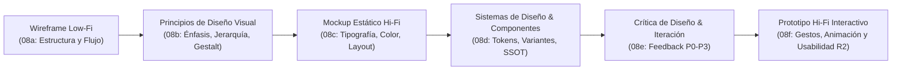
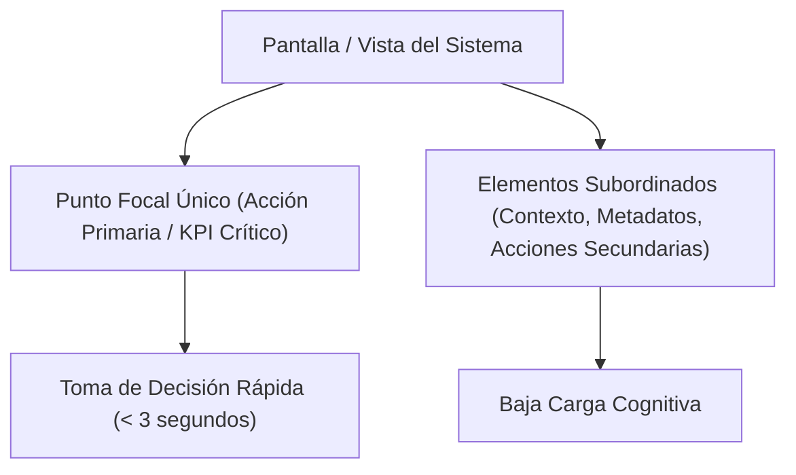
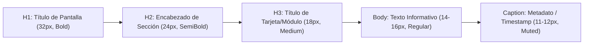
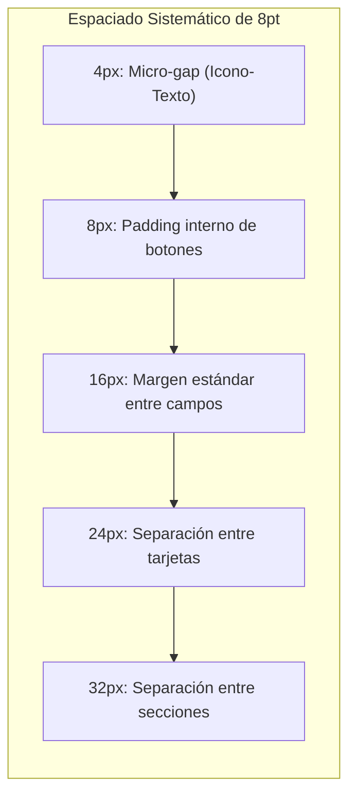
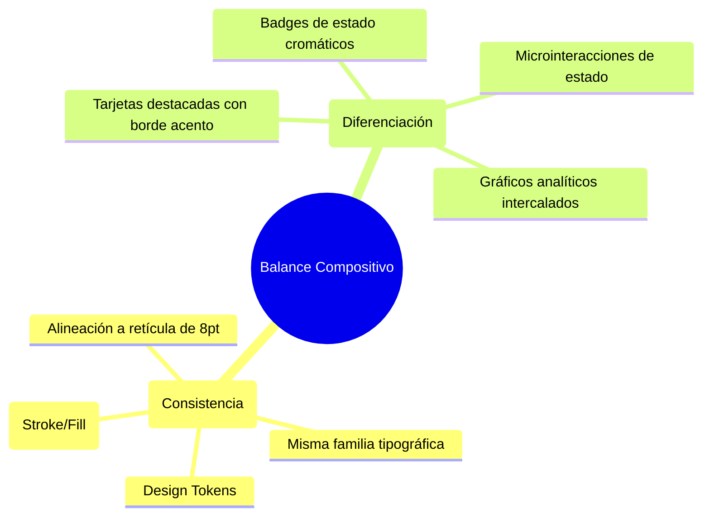
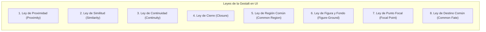
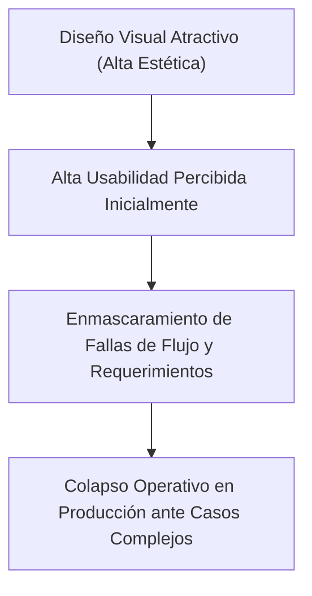
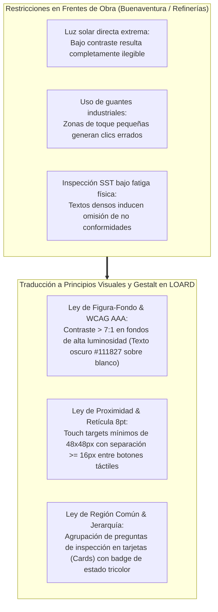

[← Anterior: 08a. Prototipado Low-Fi y Ética](./08a_Prototipado_Baja_Fidelidad_y_Etica_UX.md) | [Volver a Curso.md](../Curso.md) | [Siguiente: 08c. Diseño de Mockups: Tipografía, Color y Layouts →](./08c_Diseno_de_Mockups_Tipografia_Color_y_Layouts.md)

# 08b. Principios de Diseño Visual y Leyes de la Gestalt en UI/UX

> **Materia**: Sistemas de Información | **Docente**: PhD Jhon Alexander Garcia Camargo  
> **Semana**: Semana 8 | **Fuente**: [Understanding Visual Design Principles (Google UX Design Certificate)](https://youtu.be/yNDgFK2Jj1E?si=TGKHDmB-7buj8W-g)  
> **Términos Core**: `Visual Design Principles`, `Emphasis`, `Focal Point`, `Subordination`, `Visual Hierarchy`, `Typographic Scale`, `Reading Patterns (F-Pattern, Z-Pattern)`, `Scale and Proportion`, `Golden Ratio`, `Rule of Thirds`, `8pt Grid System`, `Unity and Variety`, `Visual Harmony`, `Design System`, `Design Tokens`, `Gestalt Principles`, `Law of Proximity`, `Law of Similarity`, `Law of Continuity`, `Law of Closure`, `Law of Common Region`, `Law of Figure-Ground`, `Law of Focal Point`, `Law of Common Fate`, `Aesthetic-Usability Effect`, `Squint Test`, `5-Second Test`, `WCAG 2.1 Contrast (4.5:1 / 3:1)`, `Visual Affordance`.

---

## 1. Fundamentos del Diseño Visual en UX y Modelo Perceptual

### 1.1 Naturaleza y Propósito Operativo
- **Definición**: Estructuración intencional y sistemática de componentes gráficos para comunicar significado, priorizar información, reducir la carga cognitiva y guiar la navegación del usuario sin fricción visual.
- **Relación en el Pipeline de Producto**:
  - **Wireframe (Baja Fidelidad)**: Define la arquitectura de información, contenidos y flujo esquemático.
  - **Diseño Visual / Mockup**: Aplica tipografía, color, espaciado, iconografía y principios compositivos sobre la estructura.
  - **Prototipo Interactivo (Alta Fidelidad)**: Incorpora microinteracciones, transiciones de estado y respuestas en tiempo real.
- **Axioma del Diseño Visual**:
  $$\text{Diseño Visual} \neq \text{Decoración Cosmética} \implies \text{Diseño Visual} = \text{Ingeniería de la Atención y Carga Cognitiva}$$

### 1.2 Procesamiento Visual Humano
- **Atributos Preatentivos (< 200 ms)**: Detección visual automática, inconsciente y paralela de cuatro dimensiones primitivas: color (tono/luminancia), forma (tamaño, orientación, curvatura), movimiento y posición espacial.
- **Procesamiento Atentivo (> 200 ms)**: Análisis cognitivo serial y consciente; lectura de texto, comparación de métricas y evaluación de alternativas.
- **Objetivo Técnico**: Explotar los atributos preatentivos para dirigir la atención hacia el punto focal antes de que el usuario inicie el esfuerzo de lectura voluntario.

---

## 2. Principio de Énfasis (*Emphasis*) y Punto Focal

### 2.1 Definición y Mecánica Operativa
- **Énfasis**: Técnica compositiva que crea un **Punto Focal (*Focal Point*)**, subordinando el resto de los componentes para que el ojo del usuario se pose prioritariamente en la acción o dato más crítico de la vista.
- **Ley de la Conservación del Énfasis**:
  $$\text{Si todo está enfatizado} \implies \text{Nada está enfatizado (Saturación y Ruido Visual)}$$

### 2.2 Técnicas para Generar Énfasis

| Técnica | Mecanismo Físico | Aplicación en UI |
| :--- | :--- | :--- |
| **Contraste de Color** | Choque de tono o saturación entre acento y neutros. | Botón Call-to-Action (CTA) primario con color corporativo sobre fondo neutro. |
| **Escala / Tamaño** | Dimensión significativamente superior al entorno. | Cifra numérica principal en tarjeta de KPI ($32\text{px}$ vs $14\text{px}$ de etiqueta). |
| **Espacio Negativo (*Whitespace*)** | Aislamiento espacial eliminando elementos circundantes. | Barra de búsqueda centrada con margen amplio en un panel de consulta. |
| **Ruptura de Forma** | Disrupción geométrica en una trama repetitiva. | Botón flotante de acción rápida (FAB circular) sobre cuadrícula de tarjetas rectangulares. |
| **Subordinación Activa** | Reducción de opacidad o contraste de lo secundario. | Enlaces secundarios en gris tenue (`#6B7280`) y botón de cancelar sin relleno (*ghost button*). |

---

## 3. Jerarquía Visual (*Visual Hierarchy*) y Patrones de Lectura

### 3.1 Definición y Escala Tipográfica Modular
- **Jerarquía Visual**: Organización secuencial de los elementos que establece su orden relativo de importancia y predetermina la ruta de escaneo visual del usuario.
- **Escala Modular Tipográfica**: Progresión geométrica de tamaños de fuente basada en un multiplicador constante ($r$):
  $$T_n = T_0 \cdot r^n \quad (\text{ej. Major Third: } r = 1.25)$$

### 3.2 Patrones de Escaneo Visual en Interfaces

```mermaid
flowchart TD
    subgraph F_Pattern["Patrón en F (Lectura Densa / Tabular)"]
        F1["Paso 1: Lectura horizontal superior completa"] --> F2["Paso 2: Salto vertical corto hacia abajo"]
        F2 --> F3["Paso 3: Segunda lectura horizontal más breve"]
        F3 --> F4["Paso 4: Escaneo vertical rápido sobre el margen izquierdo"]
    end

    subgraph Z_Pattern["Patrón en Z (Landing / Dashboards Visuales)"]
        Z1["Paso 1: Extremo superior izquierdo (Logo/Marca)"] --> Z2["Paso 2: Extremo superior derecho (Perfil/Notificaciones)"]
        Z2 --> Z3["Paso 3: Diagonal descendente al extremo inferior izquierdo"]
        Z3 --> Z4["Paso 4: Extremo inferior derecho (Punto de Conversión / CTA)"]
    end
```

- **Patrón en F (*F-Pattern*)**:
  - Aplicable a: Tablas de datos de obra, bitácoras de auditoría, listados de requisiciones y expedientes de calidad.
  - Regla: Ubicar las palabras clave, IDs de documento y estados críticos en los primeros 3 a 5 términos del margen izquierdo.
- **Patrón en Z (*Z-Pattern*)**:
  - Aplicable a: Pantallas de inicio de sesión, portales de bienvenida, tableros de resumen ejecutivo con métricas sintetizadas.
  - Regla: Posicionar el disparador de acción más valioso en el punto terminal inferior derecho.

---

## 4. Escala y Proporción (*Scale and Proportion*)

### 4.1 Definiciones Operativas
- **Escala (*Scale*)**: Dimensión relativa de un elemento individual comparado con otro elemento de referencia o con el marco contenedor (*frame*). Comunica jerarquía, distancia aparente y relevancia.
- **Proporción (*Proportion*)**: Relación matemática armónica y dimensional entre las partes que componen un elemento o entre los bloques de un diseño.

### 4.2 Sistemas de Proporción y Retículas Estandarizadas
- **Sistema de Cuadrícula de 8 Puntos (*8pt Grid System*)**:
  - Estandarización de dimensiones, márgenes y rellenos (*paddings*) en múltiplos estrictos de $8\text{px}$ (con submúltiplo de $4\text{px}$ para microespaciados):
    $$\text{Espaciados válidos} \in \{4, 8, 12, 16, 24, 32, 40, 48, 64, 80, 96\}\,\text{px}$$
  - Elimina la arbitrariedad en Figma y reduce fricción al traducir a CSS (`rem` múltiplos de 4 u 8).
- **Proporción Áurea ($\phi \approx 1.618$) y Regla de los Tercios**:
  - Reparto armónico entre área de trabajo principal ($A_1$) y barra lateral de navegación/filtros ($A_2$):
    $$\frac{A_1 + A_2}{A_1} \approx \frac{A_1}{A_2} \approx 1.618$$
  - Regla de los Tercios: División de la pantalla en una cuadrícula $3 \times 3$; los 4 puntos de cruce focalizan el interés perceptivo inmediato.

---

## 5. Principios de Unidad y Variedad (*Unity and Variety*)

### 5.1 Definiciones y Tensión Compositiva
- **Unidad (*Unity / Visual Harmony*)**: Coherencia global donde cada componente (botones, inputs, tipografía, cromática, sombras) parece pertenecer a un sistema único e integrado.
  - *Herramienta Núcleo*: **Design System** y **Design Tokens** (variables centralizadas para color, tipografía, elevación y espaciado).
- **Variedad (*Variety*)**: Inserción deliberada de contrastes y variantes visuales para evitar el aburrimiento perceptual, guiar la diferenciación y romper la monotonía sin fracturar la identidad del sistema.

### 5.2 Matriz de Balance entre Unidad y Variedad

| Estado Compositivo | Manifestación en la Interfaz | Consecuencia en el Usuario |
| :--- | :--- | :--- |
| **Unidad Excesiva (Cero Variedad)** | Todas las tarjetas, botones y bloques usan idéntico tamaño, gris neutro y peso tipográfico. | Monotonía; ceguera perceptual; incapacidad de detectar alertas o tareas prioritarias. |
| **Variedad Excesiva (Cero Unidad)** | Cada pantalla utiliza fuentes distintas, botones con radios disímiles y paletas multicolores. | Caos visual; desconfianza; aumento de carga cognitiva; pérdida del modelo mental. |
| **Equilibrio Óptimo (Golden Balance)** | Base unificada mediante *Design System* estricto + acentos cromáticos y dimensionales específicos para excepciones. | Navegación intuitiva y predecible; rápida identificación de anomalías y llamadas a la acción. |

---

## 6. Leyes de Percepción de la Gestalt aplicadas a UI/UX

El cerebro humano no procesa elementos aislados; organiza automáticamente los estímulos visuales en patrones estructurados según el axioma de la Gestalt:
$$\text{El Todo es cualitativamente diferente a la suma de sus partes individuales}$$

### 6.1 Catálogo Técnico de Leyes de la Gestalt

#### 1. Ley de Proximidad (*Proximity*)
- **Principio**: Elementos físicamente cercanos se perciben como una unidad o grupo funcional; elementos distantes se perciben como entidades independientes.
- **Regla Operativa en Formularios**:
  $$d(\text{Label}_A, \text{Input}_A) \ll d(\text{Input}_A, \text{Label}_B)$$
  La etiqueta debe estar significativamente más pegada a su campo asociado que al campo contiguo para evitar asociaciones erróneas.

#### 2. Ley de Similitud (*Similarity*)
- **Principio**: Elementos que comparten características visuales (color, forma, tamaño, tipografía u orientación) se interpretan como miembros de la misma categoría o portadores de la misma funcionalidad.
- **Aplicación en UI**:
  - Todos los botones interactivos primarios comparten la misma forma rectangular y color azul.
  - Todos los elementos informativos no clicables mantienen estilo neutro sin relieve.
  - La alteración involuntaria de estilo en un botón induce confusión sobre si ejecuta una acción distinta.

#### 3. Ley de Continuidad (*Continuity / Good Continuation*)
- **Principio**: La percepción humana tiende a prolongar trayectorias continuas (líneas rectas, curvas fluidas o alineaciones ordenadas) en lugar de realizar giros bruscos o procesar secuencias fragmentadas.
- **Aplicación en UI**:
  - Flujos lineales de progreso (*Steppers* de pasos: Paso 1 $\rightarrow$ Paso 2 $\rightarrow$ Paso 3).
  - Migas de pan (*Breadcrumbs*).
  - Alineación vertical estricta del margen izquierdo de datos en tablas y listas.

#### 4. Ley de Cierre (*Closure*)
- **Principio**: La mente completa visualmente contornos o figuras incompletas para percibir formas completas y reconocibles.
- **Aplicación en UI**:
  - **Tarjetas Cortadas (*Cut-off Cards*)**: Mostrar una tarjeta asomando solo al 30% en el borde derecho de la pantalla en un móvil; la mente percibe la existencia de más contenido y deduce de inmediato la necesidad de deslizar (*swipe affordance*).
  - **Iconografía Minimalista**: Trazos sugeridos que evocan herramientas, lupas o carpetas sin necesidad de dibujar cada detalle físico.

#### 5. Ley de Región Común (*Common Region*)
- **Principio**: Elementos encerrados dentro de un límite explícito común (borde continuo, fondo de color contrastante o sombra perimetral) se perciben como pertenecientes a un grupo unificado, incluso si sus elementos internos violan la proximidad o similitud.
- **Aplicación en UI**:
  - Contenedores de tarjeta (*Cards*), paneles modales, ventanas de diálogo y tablas con alternancia de fondo (*zebra striping*).
  - Sobrescribe la Ley de Proximidad: dos elementos distantes dentro de la misma caja se sienten más unidos que dos elementos cercanos pero divididos por un borde perimetral.

#### 6. Ley de Figura y Fondo (*Figure-Ground*)
- **Principio**: El sistema visual segrega automáticamente los elementos en una figura prominente (objeto en primer plano que concentra el foco) y un fondo subordinado (plano secundario contextual).
- **Aplicación en UI**:
  - Modales emergentes superpuestos sobre un fondo oscurecido y desenfocado (*Backdrop Dimming* / *Scrim* al 50-70% de opacidad).
  - Elevación mediante sombras difusas (*Elevation Z-index*): simula capas físicas superpuestas en el espacio 3D.

#### 7. Ley de Punto Focal (*Focal Point*)
- **Principio**: Cualquier elemento que rompa la monotonía visual mediante contraste drástico de forma, color o escala atraerá de inmediato la atención periférica del usuario.
- **Aplicación en UI**: El botón de "Aprobación de Obra" o "Descargar Dossier" resaltado en color saturado frente a una barra de herramientas en gris neutro.

#### 8. Ley de Destino Común (*Common Fate*)
- **Principio**: Elementos que se desplazan sincronizadamente en la misma dirección y a la misma velocidad se perciben como parte de un único conjunto funcional.
- **Aplicación en UI**:
  - Menús desplegables (*dropdowns*) cuyas opciones emergen en bloque con la misma animación y velocidad.
  - Acordeones colapsables donde el encabezado y el contenido se expanden con interpolación sincronizada.

---

## 7. Estrategias de Evaluación Visual, Efecto Estética-Usabilidad y Accesibilidad

### 7.1 El Efecto Estética-Usabilidad (*Aesthetic-Usability Effect*)
- **Definición Formal**: Fenómeno cognitivo (Kurosu & Kashimura, 1995; probado por Nielsen Norman Group) por el cual los usuarios perciben las interfaces estéticamente armónicas como más fáciles de usar, demostrando mayor tolerancia hacia fallas menores de usabilidad o fricciones operativas.
- **Riesgo en Ingeniería de Software**:
  $$\text{Interfaz Visualmente Atractiva} \not\implies \text{Arquitectura de Información o Lógica de Negocio Correcta}$$
  Una prueba de usabilidad no estructurada puede arrojar falsos positivos de satisfacción si el evaluador se deja seducir por el aspecto gráfico ignorando cuellos de botella en la captura de datos.

### 7.2 Métodos Rápidos de Validación Visual

| Método | Protocolo de Ejecución | Criterio de Éxito / Falla |
| :--- | :--- | :--- |
| **Prueba de Desenfoque (*Squint / Blur Test*)** | Aplicar un desenfoque gaussiano ($\sigma = 5\text{px}$) a la interfaz en Figma o entrecerrar los ojos. | Si los bloques de contenido (Región Común), la jerarquía de títulos y el punto focal se disuelven en una masa uniforme, la estructura visual es deficiente. |
| **Prueba de los 5 Segundos (*5-Second Test*)** | Exponer la pantalla al evaluador durante exactamente 5 segundos y retirarla. | El usuario debe identificar con precisión: 1) de qué sistema se trata, 2) el dato más importante y 3) qué acción primaria se debe realizar. |
| **Inspección de Contraste WCAG 2.1** | Medir la relación de contraste de luminancia ($L_1 + 0.05) / (L_2 + 0.05)$ mediante plugins o analizador. | - Texto normal: Contraste $\ge 4.5:1$ (Nivel AA) o $\ge 7:1$ (Nivel AAA). - Texto grande ($\ge 18\text{pt}$ o $14\text{pt}$ negrita) y componentes UI activos: $\ge 3:1$ (Nivel AA). |
| **Independencia Cromática** | Renderizar la interfaz en escala de grises estricta (*Grayscale Simulation*). | La información de estado (éxito, error, advertencia) debe seguir siendo comprensible gracias al uso concurrente de iconos y texto explícito. |

---

## 8. Puntos Críticos de Evaluación, Antipatrones y Conexión con el Proyecto

### 8.1 Antipatrones Críticos en Diseño Visual
- **Efecto "Árbol de Navidad"**:
  - *Defecto*: Utilizar múltiples colores vivos simultáneamente para categorías ordinarias.
  - *Corrección*: Restringir la paleta a 1 color primario de marca, 1 color secundario de soporte, tonos neutros (grises) y colores funcionales de estado (verde éxito, rojo error, amarillo advertencia, azul info).
- **Falsa Proximidad en Formularios**:
  - *Defecto*: Espaciar equitativamente todos los campos verticales ($16\text{px}$ entre label e input, y $16\text{px}$ entre input y el siguiente label).
  - *Corrección*: Agrupar rígidamente label e input a $4\text{px}$ u $8\text{px}$, y distanciar los bloques a $24\text{px}$ o $32\text{px}$.
- **Aplanamiento Tipográfico**:
  - *Defecto*: Emplear tamaños de fuente casi idénticos ($14\text{px}$ y $13\text{px}$) con variaciones insignificantes para títulos y datos.
  - *Corrección*: Aplicar contrastes evidentes de peso (`Bold` 700 vs `Regular` 400) y saltos de escala modular mínimos de $1.25\times$.
- **Botón Fantasma (*Ghost Button*) como Acción Primaria**:
  - *Defecto*: Colocar un botón con solo borde y fondo transparente para la tarea prioritaria de la pantalla.
  - *Corrección*: La acción primaria debe poseer relleno sólido y contraste dominante; los botones *ghost* se reservan para acciones secundarias o cancelaciones.

### 8.2 Aplicación al Proyecto LOARD Construcciones (Sistemas de Información)

- **Módulo de SST y Cursos Vencidos**:
  - *Principio de Énfasis y Punto Focal*: Si un operario tiene el curso de trabajo en alturas o espacios confinados vencido, la tarjeta de validación de ingreso debe mostrar un badge de alerta rojo en alto contraste con icono de bloqueo (`✕`), atrayendo la atención inmediata del supervisor antes de permitir el acceso.
  - *Independencia del Color*: Nunca usar solo un círculo rojo; acompañarlo de texto explicativo en negrita: **«CURSO VENCIDO (Bloqueo Preventivo)»**.
- **Visualización de Avance en el Tablero de Control de Proyectos**:
  - *Patrón en F*: En el resumen de avance de obra (Presupuestado vs. Ejecutado), colocar los nombres de los proyectos en el margen izquierdo, la barra de progreso lineal al centro (Ley de Continuidad) y el porcentaje numérico en escala destacada ($24\text{px}$ bold).
- **Gestión Documental del Dossier de Calidad**:
  - *Ley de Región Común*: Cada paquete de entrega de pruebas no destructivas (NDT) o certificados de calidad debe estar encapsulado en un contenedor de tarjeta independiente, con su estado de visado claramente distinguible mediante un borde lateral de $4\text{px}$ codificado por color.

---

## 9. Checklist de Verificación de Calidad

Antes de validar un mockup o diseño de interfaz:
- [ ] **Punto Focal Claro**: ¿Existe una única acción primaria o dato dominante que se identifique en los primeros 3 segundos?
- [ ] **Escala Jerárquica**: ¿Los títulos, subtítulos y textos de cuerpo presentan saltos tipográficos evidentes en tamaño y peso?
- [ ] **Consistencia de Retícula**: ¿Todos los paddings, márgenes y dimensiones siguen la cuadrícula de 8 puntos ($8\text{px}$ / $4\text{px}$)?
- [ ] **Verificación de la Gestalt**:
  - [ ] ¿Las etiquetas están más cerca de su campo respectivo que del siguiente bloque (Proximidad)?
  - [ ] ¿Los elementos con funciones idénticas conservan la misma apariencia (Similitud)?
  - [ ] ¿Los grupos de datos relacionados están encapsulados en contenedores o tarjetas visibles (Región Común)?
  - [ ] ¿Los modales o menús contextuales se separan con nitidez del fondo (Figura-Fondo)?
- [ ] **Prueba de Desenfoque (*Squint Test*)**: ¿La estructura general y los pesos siguen distinguiéndose al entrecerrar los ojos o aplicar desenfoque?
- [ ] **Accesibilidad de Contraste**: ¿El contraste entre texto y fondo cumple con el mínimo de $4.5:1$ de WCAG 2.1 AA?
- [ ] **Redundancia Visual**: ¿Los estados críticos (éxito, peligro, advertencia) utilizan iconos y texto además del color?

---

> **Navegación Semana 8**:  
> [← Anterior: 08a. Prototipado Low-Fi y Ética](./08a_Prototipado_Baja_Fidelidad_y_Etica_UX.md) | [Volver a Curso.md](../Curso.md) | [Siguiente: 08c. Diseño de Mockups: Tipografía, Color y Layouts →](./08c_Diseno_de_Mockups_Tipografia_Color_y_Layouts.md)

