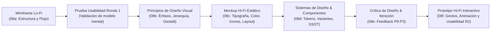
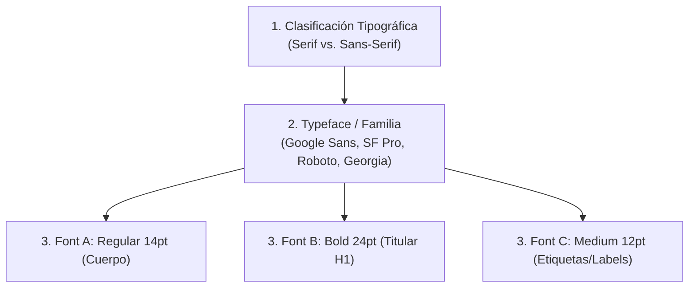
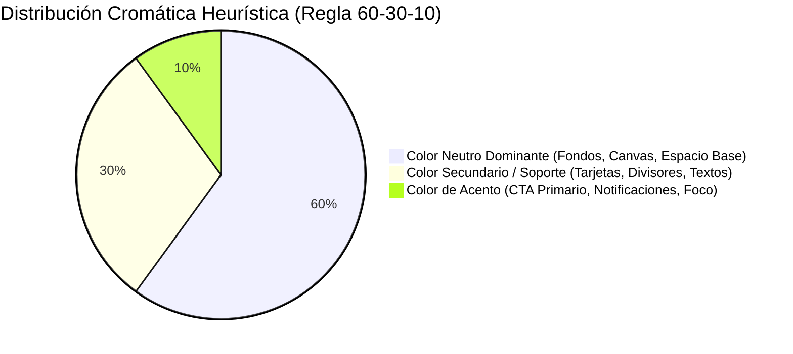
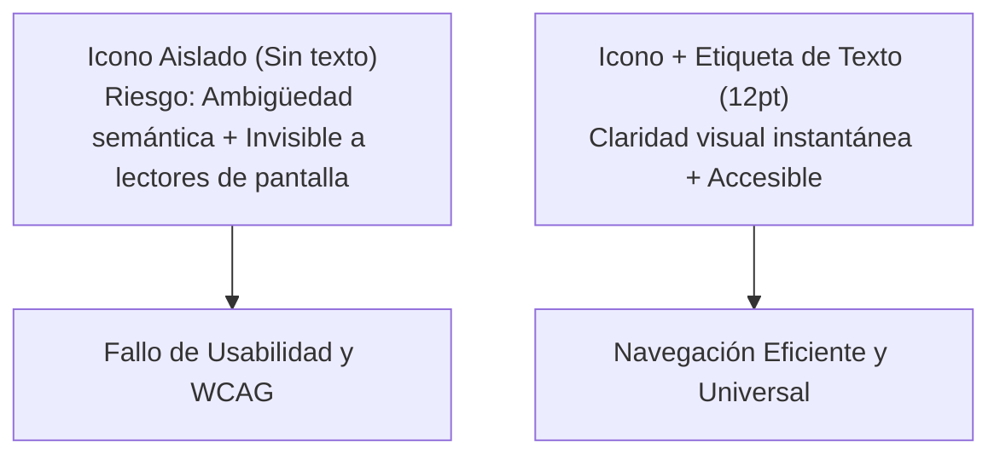
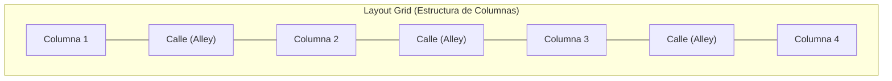
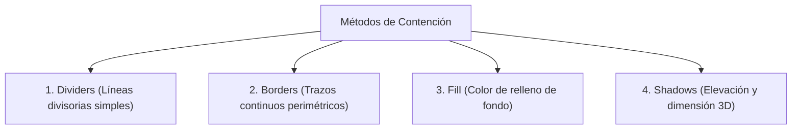
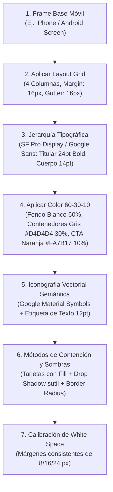

[← Anterior: 08b. Principios de Diseño Visual y Leyes de la Gestalt](./08b_Principios_de_Diseno_Visual_y_Gestalt.md) | [Volver a Curso.md](../Curso.md) | [Siguiente: 08d. Sistemas de Diseño y Sticker Sheets →](./08d_Sistemas_de_Diseno_y_Sticker_Sheets.md)

# 08c. Diseño de Mockups: Tipografía, Color, Iconografía y Layouts en UI/UX

> **Materia**: Sistemas de Información | **Docente**: PhD Jhon Alexander Garcia Camargo  
> **Semana**: Semana 8 | **Fuente**: [UX Mockups: Design, Layout, and Typography (Google UX Design Certificate)](https://youtu.be/_-dNJcc7uPo?si=88VoyMmALuMpuhco)  
> **Términos Core**: `Mockup`, `High-Fidelity Design`, `Visual Design Elements`, `Type Classification`, `Serif vs. Sans-Serif`, `Typeface`, `Font`, `Typographic Hierarchy`, `Legibility`, `Brand Guidelines`, `Google Sans`, `SF Pro Display`, `Color Theory in UX`, `60-30-10 Rule`, `Dominant Neutral (60%)`, `Secondary Complementary (30%)`, `Accent Focal (10%)`, `WCAG Contrast Standards`, `Environmental Color Drift`, `Iconography`, `Universal Icons`, `Cultural Bias in Icons`, `Icon Text Labels`, `Screen Reader Accessibility`, `Material Design Icons`, `Layout Architecture`, `Basic Grid`, `Layout Grid`, `Columns & Alleys (Gutters)`, `12-Column Desktop Grid`, `Containment Methods (Dividers, Borders, Fill, Shadows)`, `Elevation & Depth`, `White Space / Negative Space`, `Proximity Grouping`, `Touch Target Separation`.

---

## 1. Fundamentos de Mockups en el Pipeline de Producto

### 1.1 Naturaleza y Propósito Operativo del Mockup
- **Definición Formal**: Artefacto estático de **alta fidelidad (*High-Fidelity - Hi-Fi*)** que representa con precisión visual fidedigna el aspecto final del producto mediante elementos visuales de producción (fotos reales, paletas cromáticas, sombras, jerarquía tipográfica, iconografía estilizada y layouts estructurados).
- **Espectro de Fidelidad**:
  $$\text{Fidelidad} = \text{Grado de coincidencia visual, interactiva y de contenido respecto al producto final}$$
  - **Low-Fidelity (Lo-Fi)**: Baja complejidad y bajo refinamiento. Foco estricto en flujos de tareas, funcionalidad y arquitectura de información; minimiza costos de descarte.
  - **High-Fidelity (Hi-Fi)**: Alto refinamiento estético y formal. Emula la realidad visual del software para recopilar retroalimentación cualitativa y cuantitativa precisa de usuarios y *stakeholders*.
- **Transición Wireframe $\to$ Mockup**:
  - **Superación del Antipatrón *Paint-by-Number***: El mockup no consiste en "colorear sobre las cajas" del wireframe. Es la oportunidad de iterar y reubicar componentes (ej. imágenes, controles, textos) para optimizar el equilibrio visual y la jerarquía.
  - **Materialización de Contenido**: Sustitución sistemática de cajas grises (*placeholders*) y textos simulados (*Lorem Ipsum*) por palabras de interfaz finales (*UX Copy*), fotografía real e iconografía vectorial semántica.

---

## 2. Tríada de Elementos de Diseño Visual: Tipografía

### 2.1 Modelo Conceptual: Clasificación $\to$ Typeface $\to$ Font
Toda decisión tipográfica en UI responde a un proceso deductivo de tres niveles:

$$\text{Clasificación Tipográfica} \xrightarrow{\text{Selección de Familia}} \text{Typeface (Familia)} \xrightarrow{\text{Parámetros Específicos}} \text{Font (Fuente)}$$

- **1. Clasificación Tipográfica (*Type Classification*)**: Categoría estilística macro según los rasgos morfológicos de los caracteres.
- **2. Familia Tipográfica (*Typeface*)**: Identidad de diseño global de un conjunto de caracteres con características estilísticas compartidas (grosor de trazo, modulación, geometría). Se identifica por un nombre propio (ej. *Roboto*, *SF Pro*, *Google Sans*, *Times New Roman*).
- **3. Fuente (*Font*)**: Instanciación técnica específica de un *typeface* con tamaño, peso y estilo unificados:
  $$\text{Font} = \text{Typeface} + \text{Weight (Grosor)} + \text{Size (Puntos/Píxeles)} + \text{Style (Romana/Itálica)}$$
  - *Ejemplo*: `Roboto` es el typeface; `Roboto Bold 18pt` y `Roboto Light 12pt` son dos fuentes distintas.

### 2.2 Matriz Morfológica: Serif vs. Sans-Serif

| Parámetro Técnico | Tipografías Serif | Tipografías Sans-Serif |
| :--- | :--- | :--- |
| **Morfología** | Presentan remates, patines o serifas en los extremos de trazos y astas. | Trazos terminales limpios, uniformes y rectos; carecen de remates ornamentales. |
| **Evolución en Pantallas** | Históricamente evitadas en interfaces por baja resolución de monitores CRT/VGA (las serifas pixelaban). Modernamente digitalizadas y legibles gracias a pantallas de alta densidad (*Retina, OLED*). | Norma histórica en diseño web y móvil por su altísima nitidez y baja distorsión a resoluciones bajas. |
| **Connotación Semántica** | Elegancia, tradición, formalidad, rigor editorial, academicismo. | Modernidad, minimalismo, claridad tecnológica, eficiencia operativa. |
| **Ejemplos Canónicos** | *Times New Roman*, *Georgia*, *Cambria*, *Baskerville*. | *Roboto*, *Arial*, *Helvetica*, *Google Sans*, *SF Pro Display*. |

### 2.3 Importancia Operativa de la Tipografía en UX
1. **Jerarquía Tipográfica (*Typographic Hierarchy*)**:
   - Ordenación visual de textos mediante tamaño (*size*) y grosor (*weight*) para indicar prioridad cognitiva sin esfuerzo lector.
   - **Regla Básica de Interfaz**: Toda pantalla debe incorporar al menos dos niveles de escala:
     - *Nivel Titular (Header)*: Mayor tamaño ($24\text{–}32\text{ pt}$) y peso alto (*Bold/SemiBold*) para contexto inmediato.
     - *Nivel Cuerpo (Body)*: Menor tamaño ($14\text{–}16\text{ pt}$) y peso regular (*Regular/Book*) para lectura extendida.
2. **Legibilidad Universal (*Legibility*)**:
   - Comprensión inmediata de caracteres individuales para cualquier perfil de usuario, incluidos aquellos con agudeza visual reducida.
   - *Analogía de la Etiqueta Nutricional*: Texto negro denso sobre fondo blanco neutro en bloques críticos (ej. pantallas de cobro/checkout de e-commerce) para asegurar precisión total del usuario.
3. **Alineación con Guías de Marca (*Brand Guidelines*)**:
   - Consistencia con las normas de identidad corporativa investigadas y testeadas por la organización (ej. *Google Sans* en todo el ecosistema Google; *SF Pro* en Apple).

---

## 3. Tríada de Elementos de Diseño Visual: Teoría del Color

### 3.1 Funciones Operativas del Color en UX
- **Énfasis y Foco de Atención**: Dirigir la mirada hacia el objetivo clave de negocio (CTA, botones de acción primaria, enlaces de compra).
- **Identidad de Marca (*Branding*)**: Transmitir la personalidad y voz corporativa de forma instantánea mediante paletas normalizadas (ej. los 4 colores primarios de Google: azul, rojo, amarillo y verde).
- **Semiótica y Relatividad Cultural**: El color evoca emociones y respuestas psicofisiológicas (rojo = atención, urgencia, detención; azul = serenidad, confianza, calma), pero sus asociaciones simbólicas varían geográficamente; el diseño global requiere validación transcultural.

### 3.2 La Regla Proporcional 60-30-10
Fórmula de armonía cromática aplicada en interfaces para evitar el ruido visual y garantizar contraste focal:

$$\text{Paleta de Interfaz} = 60\% \, \text{Neutro Dominante} + 30\% \, \text{Secundario Estructural} + 10\% \, \text{Acento Focal}$$

- **60% - Color Neutro Dominante**:
  - Función: Base visual y fondo (*canvas*). Proporciona descanso visual y alta reflectancia.
  - Paleta típica: Blancos puros (`#FFFFFF`), blancos rotos o grises muy claros.
- **30% - Color Secundario de Soporte**:
  - Función: Estructuración de contenedores, tarjetas de contenido, barras de navegación y textos secundarios.
  - Paleta típica: Grises neutros (ej. `#D4D4D4`), tonalidades desaturadas de la marca.
- **10% - Color de Acento Focal**:
  - Función: Destacar la **acción primaria absoluta** que se desea que el usuario ejecute en la pantalla (Punto Focal).
  - Paleta típica: Tonalidades de alta saturación y contraste térmico (ej. naranja `#FA7B17`, azul vibrante, violeta).
  - *Regla de Uso*: Si el acento supera el 15-20% del área de pantalla, compite consigo mismo y se destruye el punto focal.

### 3.3 Accesibilidad Cromática y Deriva Ambiental (*Environmental Drift*)
- **Cumplimiento WCAG 2.1**: Todo texto y control accionable debe superar el umbral de contraste relativo contra su fondo circundante:
  - Texto estándar: Mínimo $4.5:1$ (Nivel AA).
  - Texto grande ($\ge 18\text{ pt}$ o $\ge 14\text{ pt}$ en negrita) y componentes UI: Mínimo $3.0:1$.
  - *Prohibición de Bajo Contraste*: Textos en tonos amarillos, verdes o grises claros sobre fondos verdes o pastel reducen la legibilidad a cero para usuarios con baja visión o daltonismo.
- **Deriva Ambiental y de Hardware**:
  - Los colores no se perciben de manera estática; mutan radicalmente según la tecnología del panel (OLED vs. LCD IPS) y la temperatura de color de la luz circundante (luz día fría $\approx 6500\text{ K}$ vs. luz tungsteno cálida $\approx 2700\text{ K}$).
  - *Caso Emblemático (El Vestido 2015)*: Fenómeno de constancia del color donde la misma prenda se interpretó como blanco/dorado o azul/negro según el sesgo de iluminación contextual inferido por el cerebro.
  - *Mandato de Diseño*: Probar obligatoriamente la UI en múltiples dispositivos físicos bajo condiciones extremas de luz ambiental (luz solar directa y oscuridad total).

---

## 4. Tríada de Elementos de Diseño Visual: Iconografía

### 4.1 Definición y Ventajas Técnicas
- **Definición**: Sistema de símbolos o imágenes gráficas vectoriales sintetizadas que representan un concepto, estado u operación dentro del sistema.
- **Ahorro de Espacio e Impacto Cognitivo**:
  - Comprimen significados complejos en áreas táctiles compactas ($24\text{–}48\text{ px}$), eliminando bloques redundantes de texto.
  - Aceleran el reconocimiento visual preatentivo y proporcionan vías rápidas de transición entre pantallas.

### 4.2 Iconos Universales vs. Sesgo Cultural (*Cultural Bias*)
- **Iconos de Comprensión Universal**: Símbolos adoptados globalmente por convención secular en sistemas físicos y digitales:
  - Icono de casa (`Home` $\to$ retorno a pantalla inicial).
  - Icono de batería (estado de carga energética).
  - Icono de engranaje (`Settings` $\to$ configuración técnica).
  - Icono de lupa (`Search` $\to$ búsqueda).
- **Iconos con Sesgo Cultural Localizado**: Metáforas visuales restringidas a un contexto cultural o regional específico:
  - *Anti-ejemplo*: Utilizar un balón de fútbol americano (rugby ovalado) para representar la categoría "Deportes" en una aplicación de audiencia global.
  - *Solución*: Adoptar la metáfora más universalmente reconocida (balón esférico de fútbol tradicional / *soccer*).

### 4.3 Axioma de Accesibilidad: Icono con Etiqueta de Texto (*Text Label*)

$$\text{Axioma de Accesibilidad}: \forall \, \text{Icono Crítico de Navegación} \implies \text{Icono} + \text{Text Label Explicativo}$$

- **Invisibilidad para Lectores de Pantalla (*Screen Readers*)**: Los motores de asistencia no pueden inferir la semántica de un trazo vectorial o imagen sin atributos textuales explícitos (`alt text`, `aria-label` o etiqueta tipográfica visible adyacente).
- **Reducción de Carga Cognitiva**: La etiqueta visible (ej. `Inicio`, `Buscar`, `Perfil`) elimina la duda de interacción en usuarios con baja alfabetización digital.
- **Ecosistemas Estándar**: Uso de repositorios de iconografía probados como *Google Material Symbols / Icons*, garantizando coherencia de retícula ($24 \times 24\text{ dp}$), grosor de trazo y alineación visual.

---

## 5. Arquitectura de Layouts: Grids, Contención y Espacio

### 5.1 Definición y Propósito del Layout
- **Layout**: Disposición y ordenamiento sistemático de componentes visuales (texto, contenedores, iconografía e imágenes) dentro del lienzo (*canvas*) de la interfaz.
- **Objetivo**: Guiar la trayectoria visual del usuario a través de una jerarquía lógica de exploración, facilitando el escaneo rápido y minimizando la fricción interactiva.

### 5.2 Sistemas de Rejilla (*Grids*)
Herramientas matemáticas para gobernar la alineación, proporción y consistencia de los elementos:

1. **Rejilla Básica (*Basic Grid*)**:
   - Cuadrícula milimétrica bidimensional de celdas cuadradas uniformes (ej. retícula base de $8\text{ px}$).
   - Uso: Alineación microscópica de márgenes, espaciado entre iconos y alturas de línea (*line-height*).
2. **Rejilla de Composición (*Layout Grid*)**:
   - Sistema formal de bandas verticales que divide la pantalla en **Columnas (*Columns*)** separadas por canales vacíos denominados **Calles (*Alleys / Gutters*)**.
   - **Columnas**: Bloques donde se posicionan y dimensionan los componentes.
   - **Alleys / Gutters**: Espacios en blanco que impiden la colisión visual entre columnas contiguas.

#### Matriz de Configuración de Layout Grid por Formato de Dispositivo

| Categoría de Pantalla | Ancho Típico (Viewport) | Número de Columnas | Ancho de Calles (*Gutters*) | Propósito Estructural |
| :--- | :--- | :--- | :--- | :--- |
| **Desktop / Pantalla Grande** | $\ge 1200\text{ px}$ | **12 Columnas** | $16\text{–}24\text{ px}$ | Flexibilidad compositiva: permite divisiones simétricas en medios ($6+6$), tercios ($4+4+4$) y cuartos ($3+3+3+3$). |
| **Tablet / Dispositivo Medio** | $600\text{–}1024\text{ px}$ | **4 a 8 Columnas** | $16\text{ px}$ | Distribución en dos paneles (maestro-detalle) o cuadrículas de tarjetas dobles. |
| **Teléfono Móvil (Smartphones)** | $360\text{–}480\text{ px}$ | **4 Columnas** (o 2) | $8\text{–}16\text{ px}$ | Lectura lineal verticalizada y tarjetas a ancho completo (*full width*). |
| **Smartwatch / Wearables** | $< 300\text{ px}$ | **1 Columna** | $0\text{–}4\text{ px}$ | Flujo univariado estrictamente vertical; cero división horizontal. |

### 5.3 Métodos de Contención (*Containment*)
Técnicas que trazan fronteras visuales para agrupar información relacionada y aislarla de secciones disímiles:

| Método | Mecánica Visual | Parámetros Técnicos (Figma) | Caso de Uso Preferente | Riesgo de Mala Aplicación |
| :--- | :--- | :--- | :--- | :--- |
| **1. Divisores (*Dividers*)** | Líneas rectas (horizontales o verticales) que delimitan elementos contiguos. | Trazo (*Stroke*) de $1\text{ px}$, opacidad $10\text{–}20\%$, tono neutro. | Separar filas dentro de listas de registros homogéneos. | "Efecto reja": exceso de líneas que fragmenta la pantalla innecesariamente. |
| **2. Bordes (*Borders*)** | Trazos perimétricos cerrados que delinean formas geométricas (cajas, píldoras). | *Stroke*: $1\text{–}2\text{ px}$, `Inside`, radio de borde (*Corner Radius*). | Identificar campos de formulario (*input fields*) y botones secundarios (*outlined*). | Si compiten con el fondo, el usuario duda si son componentes editables o decorativos. |
| **3. Relleno (*Fill*)** | Asignación de una capa plana de color sólido o gradiente dentro del polígono. | *Fill*: Color Hexadecimal, $100\%$ opacidad en contenedor. | Crear tarjetas de contenido (*cards*) y botones primarios de llamada a la acción (CTA). | Saturación cromática que cansa la vista si se aplica en áreas excesivamente grandes. |
| **4. Sombras (*Shadows*)** | Difuminado perimétrico que simula elevación física respecto al fondo (*Z-index*). | *Drop Shadow*: Offset $(X: 0, Y: 2\text{–}8\text{ px})$, Blur $(4\text{–}16\text{ px})$, Color negro $10\text{–}25\%$. | Componentes flotantes, modales, menús desplegables (*dropdowns*) y estados *hover*. | Sombras duras o hiperoscuras que transmiten diseño amateur y ensucian el lienzo. |

### 5.4 Espacio Negativo / Espacio en Blanco (*White Space*)
- **Definición**: Todo intervalo espacial intencionalmente vacío que separa elementos de interfaz (*Negative Space*). No requiere ser de color blanco; corresponde a cualquier color o textura de fondo pasivo.
- **Las Tres Funciones Heurísticas del Espacio Negativo**:
  1. **Generación de Énfasis y Punto Focal**: Aislar un elemento mediante abundante espacio en blanco incrementa de forma inmediata su prominencia perceptiva (ej. el campo de búsqueda central en el *home* de Google, rodeado de vacío absoluto).
  2. **Agrupación Perceptual (Ley de Proximidad de Gestalt)**:
     - Componentes con espaciado estrecho entre sí se procesan cognitivamente como un bloque conceptual único y relacionado.
     - Separaciones espaciales amplias rompen la relación asociativa de forma instantánea sin requerir líneas de contención adicionales.
  3. **Legibilidad y Prevención de Errores Operativos (*Touch Target Clearance*)**:
     - Incrementa la velocidad de escaneo ocular al evitar el apiñamiento tipográfico.
     - **Seguridad Táctil en Móvil**: Espacios reducidos entre botones adyacentes incrementan exponencialmente la tasa de toques fallidos (*fat finger errors / misclicks*). Separar controles garantiza que el dedo active únicamente la acción pretendida.
- **Gestión de Stakeholders y la Falacia del "Espacio Desperdiciado"**:
  - *Mito Empresarial Común*: Los clientes y directivos suelen interpretar el espacio en blanco como "área perdida que debe llenarse con más anuncios, iconos o texto".
  - *Refutación Profesional UX*: El espacio no es vacío inerte; es un componente funcional activo que reduce la fatiga cognitiva, acelera la conversión de negocio y aumenta la retención de usuarios.

---

## 6. Procedimiento Práctico en Figma: Del Wireframe al Mockup Hi-Fi

| Operación en Figma | Herramienta / Atajo | Parámetros Recomendados |
| :--- | :--- | :--- |
| **Añadir Texto** | Herramienta `Text` (`T`) | Tipografía: `Google Sans` o `SF Pro`. Tamaño: $24\text{ pt}$ (H1) / $16\text{ pt}$ (Body) / $12\text{ pt}$ (Labels). |
| **Definir Contenedores** | Herramienta `Rectangle` (`R`) | Alineación: `Align Horizontal Centers`. Esquinas: `Corner Radius` $8\text{–}12\text{ px}$. |
| **Color y Relleno** | Panel derecho `Fill` | Neutrales: `#FFFFFF`, `#D4D4D4`. Foco / Primario: `#FA7B17` (Orange) o color de marca. |
| **Importar Iconografía** | `Place Image` (`Ctrl+Shift+K`) o Plugin Material Icons | Descargar SVG vectorial limpio de Material Design. Escala estándar: $24 \times 24\text{ px}$. |
| **Organización de Capas** | Clic derecho $\to$ `Send to Back` (`[`) / `Bring to Front` (`]`) | Garantizar que el texto repose en el estrato superior sobre rectángulos y rellenos. |

---

## 7. Puntos Críticos de Evaluación y Trampas Frecuentes

- **Trampa del "Paint-by-Number" (Traslado Ciego de Wireframe a Mockup)**:
  - *Error*: Calcar milimétricamente la distribución del wireframe sin replantear proporciones, márgenes ni equilibrios visuales cuando entran imágenes y tipografías reales.
  - *Criterio Correcto*: El wireframe es una hipótesis estructural; el mockup es una refinación estética donde se permite reubicar elementos para optimizar la jerarquía visual.
- **Iconografía Huérfana y Fallo de Lector de Pantalla**:
  - *Error*: Disponer botones únicamente compuestos por un icono vectorial sin etiqueta de texto descriptiva.
  - *Criterio Correcto*: Todo icono interactivo debe incluir una etiqueta de texto adyacente o un descriptor de accesibilidad obligatorio (`accessibilityLabel` / `aria-label`).
- **Saturación por "Efecto Reja" en Contención**:
  - *Error*: Usar bordes oscuros, divisores continuos y sombras profundas al mismo tiempo en cada tarjeta o fila.
  - *Criterio Correcto*: Priorizar el espacio negativo como primer método de separación; aplicar divisores o bordes solo cuando la proximidad espacial sea insuficiente.
- **Falacia del Monitor Calibrado y Descuido Ambiental**:
  - *Error*: Validar los contrastes y legibilidad exclusivamente en el monitor del diseñador bajo luz de oficina controlada.
  - *Criterio Correcto*: Inspeccionar la UI en pantallas móviles de gama media bajo iluminación solar directa (riesgo de lavado de pantalla) y en la penumbra.
- **Desbordamiento de la Regla 60-30-10**:
  - *Error*: Asignar el color de acento a múltiples botones secundarios, barras de estado y fondos decorativos.
  - *Criterio Correcto*: El color de acento se reserva con severidad para el objetivo primordial de la pantalla ($\le 10\%$ de la superficie visual).

---

> **Navegación Semana 8**:  
> [← Anterior: 08b. Principios de Diseño Visual y Leyes de la Gestalt](./08b_Principios_de_Diseno_Visual_y_Gestalt.md) | [Volver a Curso.md](../Curso.md) | [Siguiente: 08d. Sistemas de Diseño y Sticker Sheets →](./08d_Sistemas_de_Diseno_y_Sticker_Sheets.md)

