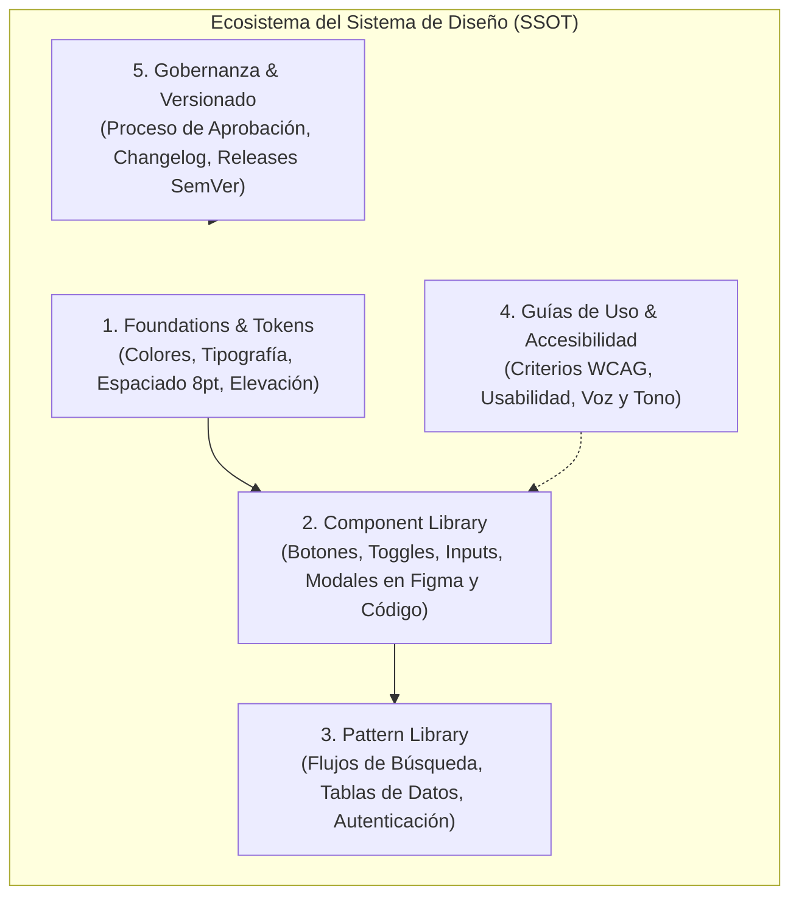
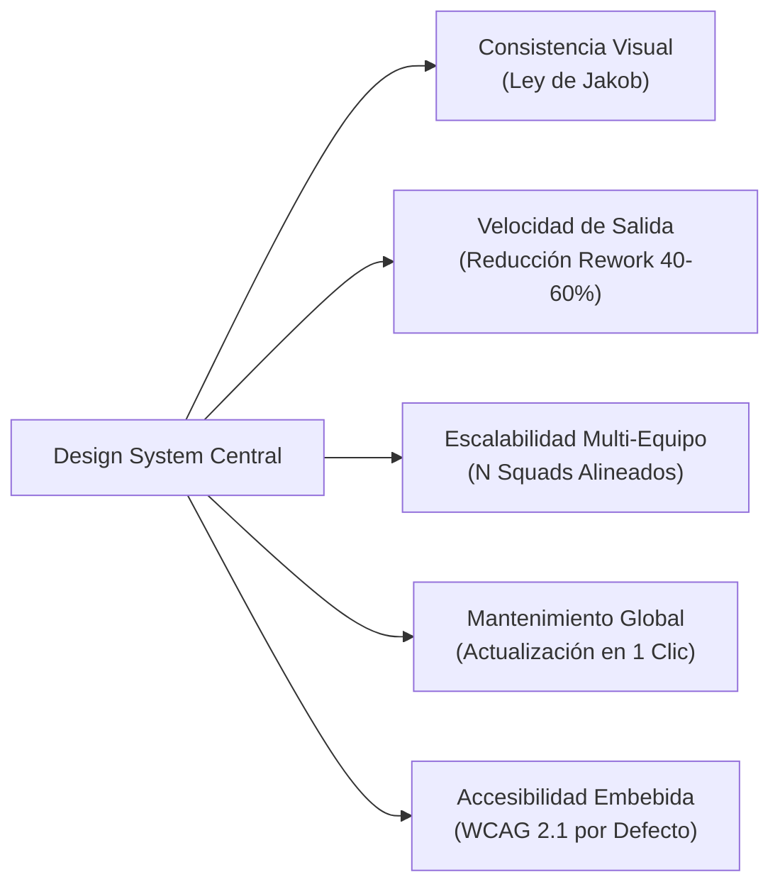
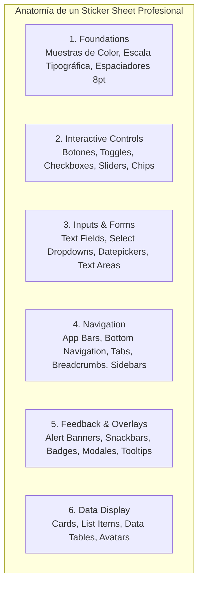
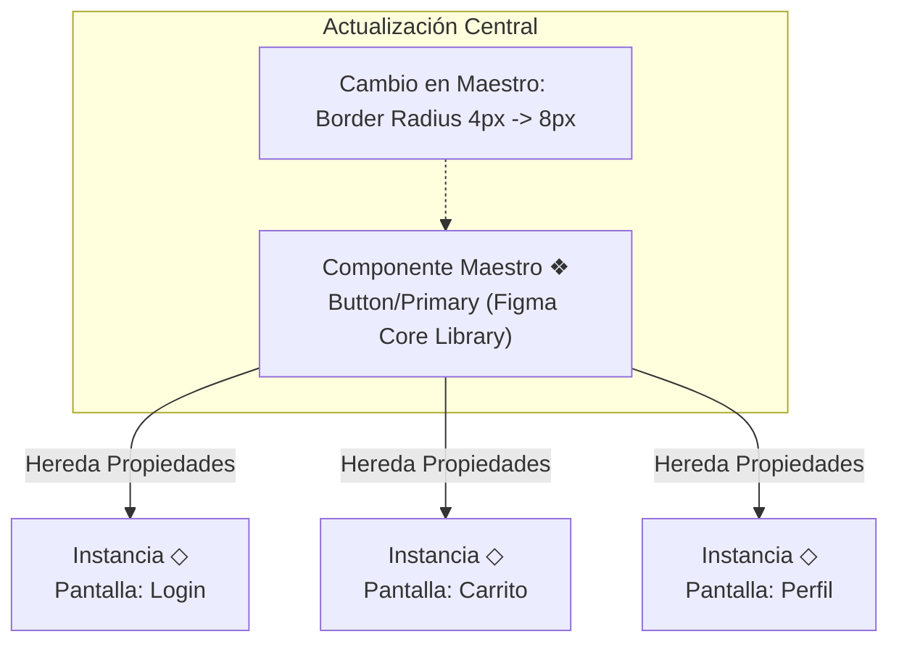
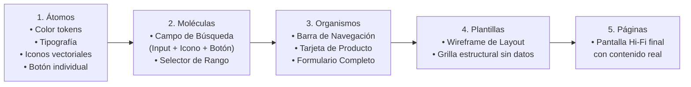
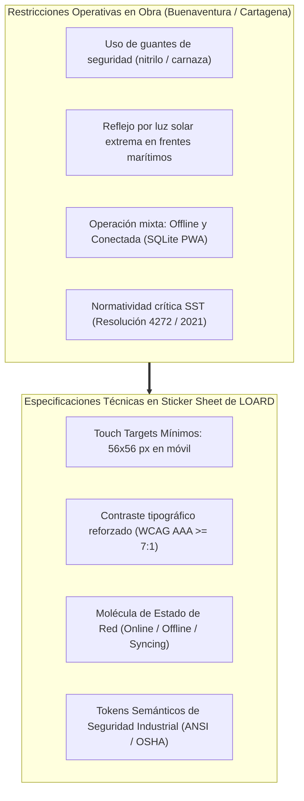

[← Anterior: 08c. Diseño de Mockups: Tipografía, Color y Layouts](./08c_Diseno_de_Mockups_Tipografia_Color_y_Layouts.md) | [Volver a Curso.md](../Curso.md) | [Siguiente: 08e. Feedback de Diseño e Iteración →](./08e_Feedback_de_Diseno_Critica_e_Iteracion.md)

# 08d. Sistemas de Diseño y Sticker Sheets en UI/UX

> **Materia**: Sistemas de Información | **Docente**: PhD Jhon Alexander Garcia Camargo  
> **Semana**: Semana 8 | **Fuente**: [Intro to Design Systems and Sticker Sheets (Google UX Design Certificate)](https://youtu.be/mdz928XXDo0?si=yiPYFpGogNzx4laV)  
> **Términos Core**: `Design System`, `Sticker Sheet`, `UI Kit`, `Single Source of Truth (SSOT)`, `Style Guide`, `Component Library`, `Pattern Library`, `Design Tokens`, `Google Material Design (M2/M3)`, `Shopify Polaris`, `Figma Assets Tab`, `Main Component (❖)`, `Component Instance (◇)`, `Overrides`, `Detach Instance`, `Variants`, `Component Properties (Boolean, Text, Instance Swap)`, `Atomic Design (Atoms, Molecules, Organisms, Templates, Pages)`, `Jakob's Law`, `Design Debt`, `Design-to-Code Alignment`.

---

## 1. Fundamentos de los Sistemas de Diseño (*Design Systems*)

### 1.1 Definición Formal y Ecosistema Operativo
- **Definición**: Ecosistema integral de estándares, directrices, principios, artefactos visuales y componentes de software reutilizables que actúa como la **única fuente de la verdad** (*Single Source of Truth - SSOT*) para diseñar y desarrollar productos digitales a escala.
- **Diferenciación de Conceptos Clave**:
  - **Guía de Estilo (*Style Guide*)**: Manual estático de identidad de marca (paletas de color corporativas, reglas tipográficas, tratamiento del logotipo, tono de voz).
  - **Librería de Componentes (*Component Library*)**: Conjunto de elementos interactivos reutilizables modelados en diseño (Figma) y codificados en repositorios de frontend (React, Flutter, Android Compose, iOS SwiftUI).
  - **Librería de Patrones (*Pattern Library*)**: Estructuras recurrentes de interacción y flujos de usuario (formularios de checkout, barras de navegación, modales de onboarding).
  - **Design System Integral**: Fusión viva y gobernada de:
    $$\text{Design System} = \text{Foundations (Tokens)} + \text{Component Library} + \text{Pattern Library} + \text{Code Repos} + \text{Governance \& Docs}$$

### 1.2 Jerarquía de Abstracción en Diseño de Sistemas
- **Principio de Centralización**: El cambio en un token de diseño base debe propagarse automáticamente hacia componentes, patrones y pantallas finales sin intervención manual pantalla por pantalla.

---

## 2. Beneficios Cuantitativos y Operativos de los Design Systems

### 2.1 Desglose de Ventajas Críticas
1. **Consistencia y Cohesión de Experiencia**:
   - Aplica la **Ley de Jakob**: los usuarios transfieren las expectativas aprendidas en otras aplicaciones; dentro de una suite corporativa, cada control debe operar de forma idéntica.
   - Erradica la fragmentación visual (evita la proliferación de 10 tonos distintos de azul o 15 tamaños de botones).
2. **Eficiencia y Reducción del *Time-to-Market***:
   - Los diseñadores no redibujan interfaces desde cero; ensamblan pantallas a partir de componentes preexistentes validados.
   - Los ingenieros de software ahorran entre un **$40\%$ y un $60\%$ del tiempo de maquetación** al invocar componentes ya probados y testeados.
3. **Escalabilidad Organizacional**:
   - Facilita el crecimiento de equipos distribuidos (*squads* autónomos) garantizando que cada frente desarrolle bajo las mismas reglas arquitectónicas.
   - Reduce drásticamente la curva de aprendizaje (*onboarding*) de nuevos diseñadores y desarrolladores.
4. **Handoff sin Fricción (*Design-to-Code Alignment*)**:
   - Establece un **vocabulario compartido**: el componente Figma `Button/Primary/Medium/Hover` mapea de forma biunívoca al componente React `<Button variant="primary" size="md" state="hover" />`.
5. **Mantenimiento Centralizado**:
   - Modificar un valor nuclear (ej. el radio de curvatura de $4\text{ px}$ a $8\text{ px}$) se publica en la librería y se sincroniza en todos los archivos del producto en segundos.
6. **Accesibilidad Embebida por Defecto**:
   - Los componentes base se construyen certificados bajo **WCAG 2.1 AA/AAA**: contraste cromático $\ge 4.5:1$, dimensiones táctiles $\ge 48 \times 48\text{ px}$, estados de foco visuales (`:focus-visible`) y soporte nativo para lectores de pantalla.

---

## 3. Casos de Estudio de la Industria: Material Design vs. Shopify Polaris

### 3.1 Google Material Design (M2 / M3 - Material You)
- **Filosofía**: Metáfora del papel y la tinta en un espacio tridimensional. Modela superficies físicas con elevación ($z$-index), sombras proyectadas y movimiento intencional.
- **Evolución a Material 3 (M3 / Material You)**:
  - **Extracción Dinámica de Color**: Algoritmo que genera paletas completas y armoniosas a partir del fondo de pantalla (*wallpaper*) del usuario o de una semilla tonal (*source color*).
  - **Roles de Color Semánticos**: Divide el esquema en pares contraste/superficie:
    $$\text{Pair}: \langle \text{Role}, \text{On-Role} \rangle \quad \text{Ejemplos}: \langle \text{Primary}, \text{On-Primary} \rangle, \, \langle \text{Surface}, \text{On-Surface} \rangle$$
  - **Accesibilidad Matemática**: Garantiza contraste mínimo algorítmicamente sin importar la semilla de color elegida por el usuario.

### 3.2 Shopify Polaris
- **Filosofía**: Sistema diseñado específicamente para **comercio electrónico y operaciones mercantiles de misión crítica**. Prioriza la claridad operativa, la densidad informativa y la confianza absoluta del comerciante (*merchant trust*).
- **Características Centrales**:
  - Especializado en dashboards administrativos, tablas densas de inventario, analítica de ventas y procesamiento de pedidos.
  - Diseñado para ser extendido por desarrolladores de aplicaciones externas (*Shopify App Store*), asegurando que cualquier plugin se sienta nativo dentro del administrador de Shopify.

### 3.3 Matriz Comparativa: Material Design vs. Shopify Polaris

| Criterio Técnico | Google Material Design (M3) | Shopify Polaris |
| :--- | :--- | :--- |
| **Dominio Principal** | Consumo masivo, sistemas operativos móviles (Android), web apps globales. | Comercio electrónico B2B/B2C, administración y gestión de operaciones. |
| **Metáfora Central** | Superficies físicas, papel digital, luz, sombras y movimiento cinético. | Claridad transaccional, eficiencia de flujo, pragmatismo mercantil. |
| **Manejo del Color** | Paletas dinámicas extraídas algorítmicamente (*tonal palettes*). | Paletas funcionales estables y predecibles (énfasis en estados de orden y stock). |
| **Densidad de Información** | Media a alta; adaptable a pantallas táctiles de cualquier factor de forma. | Muy alta; optimizado para escritorio y procesamiento veloz de datos tabulares. |
| **Mecanismo de Extensión** | UI Kits universales en Figma, Material Web Components, Flutter, Jetpack Compose. | Librería React de componentes web, Figma UI Kit público, guías de contenido exhaustivas. |

---

## 4. Hojas de Componentes (*Sticker Sheets* / *UI Kits*)

### 4.1 Concepto y Origen Histórico
- **Definición**: Un **Sticker Sheet** es un lienzo o tablero de inventario visual dentro de una herramienta de diseño (Figma) donde residen ordenados, catalogados y listos para su uso todos los componentes e instancias del sistema de diseño.
- **Analogía Física**: Evoca las láminas de pegatinas troqueladas: el diseñador "despega" un botón o campo de texto prefabricado de la hoja y lo "pega" directamente en su pantalla de trabajo.
- **Relación Técnica**:
  $$\text{Sticker Sheet} = \text{Representación Visual e Inventario Operativo del Design System en Figma}$$

### 4.2 Requisitos Estructurales de un Sticker Sheet Eficaz
- **Exhibición de Todos los Estados**: Cada componente interactivo debe mostrar sus estados obligatorios:
  $$\text{Estados} = \{ \text{Default}, \text{Hover}, \text{Pressed / Active}, \text{Focused}, \text{Disabled} \}$$
- **Disposición Espacial Racional**: Uso de auto-layout y grillas con márgenes generosos para facilitar la inspección visual y la extracción rápida sin solapamientos.

---

## 5. Operación Técnica de Componentes y Librerías en Figma

### 5.1 Anatomía del Sistema de Componentes
- **Componente Maestro (*Main Component* - `❖`)**:
  - Definición central y única del elemento. Se distingue por el icono de cuatro diamantes (`❖`).
  - Cualquier mutación en el maestro (color, padding, tipografía) se propaga en tiempo real a todas sus dependencias.
- **Instancia de Componente (*Instance* - `◇`)**:
  - Copia viva vinculada al componente maestro. Se distingue por el icono de un diamante simple (`◇`).
  - Hereda todas las actualizaciones del maestro, permitiendo **sobreescrituras controladas** (*overrides*).

### 5.2 Gestión de Sobreescrituras (*Overrides*) vs. Desvinculación (*Detach*)

| Operación | Mecánica Técnica | Impacto en Mantenimiento | Recomendación UX |
| :--- | :--- | :--- | :--- |
| **Override Permitido** | Cambiar texto, alternar iconos visibles, sustituir imágenes o modificar colores locales. | La instancia permanece enlazada al maestro; recibe actualizaciones futuras de layout y estructura. | **Práctica estándar y segura**. |
| **Reset Overrides** | Revertir la instancia al estado idéntico de su componente maestro original. | Elimina modificaciones locales accidentales; restaura la coherencia con el sistema. | Útil ante desajustes visuales. |
| **Detach Instance (`Ctrl+Alt+B`)** | Rompe irreversiblemente el vínculo con el componente maestro; convierte la instancia en un frame ordinario. | **Provoca deuda de diseño (*Design Debt*)**. El elemento queda huérfano; jamás recibirá actualizaciones globales. | **TERMINANTEMENTE PROHIBIDO** salvo excepciones arquitectónicas de descarte. |

### 5.3 Panel de Activos (*Assets Tab*) y Librerías de Equipo
- **Navegación en Figma**:
  - `Layers Panel` (`Alt+1`): Vista en árbol del documento actual.
  - `Assets Panel` (`Alt+2`): Buscador visual indexado de componentes disponibles locales y de librerías vinculadas (*Published Team Libraries*).
- **Publicación de Librerías (*Publish Library*)**:
  - Permite empaquetar estilos, variables y componentes de un archivo para distribuirlos en múltiples archivos de proyecto.
  - Control de cambios mediante descripciones de versión (*commit message* de diseño) para notificar al equipo sobre ajustes de componentes.

### 5.4 Variantes y Propiedades de Componente (*Component Properties*)
- **Variantes (*Variants*)**: Agrupan múltiples variantes de un mismo componente bajo un único contenedor maestro (*Component Set*). Permiten alternar entre estados (`Default`, `Hover`) y tipos (`Primary`, `Secondary`) desde la barra de propiedades lateral.
- **Propiedades Avanzadas en Figma**:
  - `Boolean Property`: Interruptor booleano (`true`/`false`) para mostrar u ocultar capas secundarias (ej. `showLeadingIcon`).
  - `Text Property`: Permite modificar cadenas de texto desde el panel lateral sin tener que navegar profundamente en el árbol de capas.
  - `Instance Swap Property`: Permite intercambiar subcomponentes (ej. cambiar el icono de una flecha por una lupa) respetando los estilos del contenedor.

---

## 6. Metodología de Construcción: Atomic Design en Sticker Sheets

La metodología **Atomic Design** (Brad Frost) proporciona el marco taxonómico ideal para organizar un Sticker Sheet escalable:

### 6.1 Niveles de la Jerarquía Atómica
1. **Átomos (*Atoms*)**: Elementos de UI indivisibles que no pueden descomponerse sin perder funcionalidad básica:
   - Tokens cromáticos, escalas tipográficas, iconos individuales, inputs nativos, radios y etiquetas.
2. **Moléculas (*Molecules*)**: Agrupación cohesiva de átomos que operan como una unidad operativa simple:
   - *Ejemplo*: Input de texto + Icono de lupa + Botón "Buscar" = Campo de Búsqueda funcional.
3. **Organismos (*Organisms*)**: Ensamblaje de moléculas y átomos que forman una sección visual compleja, autónoma y reconocible de la interfaz:
   - *Ejemplo*: Barra de navegación superior (*Header*) compuesta por molécula de búsqueda, átomo de logotipo, molécula de menú de enlaces y átomo de avatar.
4. **Plantillas (*Templates*)**: Disposición espacial a nivel de página que articula organismos y moléculas en una grilla estructural (el esqueleto sin datos de producción).
5. **Páginas (*Pages*)**: Instancias concretas de plantillas inyectadas con datos, textos, fotos e información de negocio real para pruebas de usuario y desarrollo.

---

## 7. Caso Práctico Aplicado: Sistema de Diseño y Sticker Sheet para LOARD Construcciones S.A.S.

### 7.1 Definiciones en el Sticker Sheet de LOARD
- **Tokens Semánticos de Seguridad Industrial (SST)**:
  - `color-sst-danger`: `#D32F2F` (Rojo OSHA) $\to$ Bloqueo inmediato por curso de alturas vencido o zona ATEX no autorizada.
  - `color-sst-warning`: `#F57F17` (Ámbar Industrial) $\to$ Advertencia de EPP incompleto o calibración pendiente de equipo de soldadura.
  - `color-sst-success`: `#2E7D32` (Verde Seguro) $\to$ Permiso de trabajo en caliente firmado y validado por la Coordinación SIG.
- **Átomos y Moléculas para Trabajo Pesado**:
  - *Átomo Botón de Obra*: Alto mínimo de $56\text{ px}$ con radio de curvatura de $8\text{ px}$ y texto en peso *Bold* ($16\text{ sp}$) para garantizar pulsación precisa con guantes industriales.
  - *Molécula de Registro de Soldadura*: Fila de datos modular (`WeldInspectionRow`) compuesta por etiquetas de número de junta, diámetro en pulgadas, selector de método END (Radiografía / Ultrasonido) y conmutador de estado (Aprobado / Rechazado).
- **Prohibición de `Detach Instance` en Pantallas de Interventoría**:
  - Si un supervisor de obra en Buenaventura requiere un campo adicional de control ambiental, este debe agregarse como una variante en el componente maestro del Sticker Sheet central, impidiendo que los diseñadores creen versiones desvinculadas que rompan el sincronismo con el backend relacional.

---

## 8. Casos Trampa de Examen y Antipatrones Frecuentes

- **El Infierno de las Instancias Desvinculadas (*Detached Instances Hell*)**:
  - *Error*: Desvincular (`Detach Instance`) un botón o tarjeta cuando no se ajusta al contenido inmediato o se desea un color alternativo.
  - *Consecuencia*: Ruptura total de la gobernanza. Al actualizar la identidad de marca o la accesibilidad del sistema, las instancias desvinculadas quedan huérfanas y requieren corrección manual una a una.
  - *Regla*: Toda variación legítima debe resolverse mediante **variantes de componente, boolean properties o slots configurados en el maestro**.
- **Estilos Hardcodeados vs. Tokens de Diseño**:
  - *Error*: Pintar elementos con valores hexadecimales arbitrarios (`#2E64A5`) o márgenes aleatorios (`13px`, `27px`) saltándose la grilla de $8\text{ pt}$.
  - *Consecuencia*: Inconsistencia perceptual inmediata y colapso de la comunicación con los desarrolladores en el handoff.
- **Explosión Combinatoria de Variantes (*Variant Bloat*)**:
  - *Error*: Crear una matriz de 200 componentes individuales para cada combinación posible de icono izquierdo, icono derecho, label y tamaño.
  - *Regla Moderna en Figma*: Usar **Component Properties** (`Boolean` para alternar visibilidad de iconos, `Text` para labels) reduciendo la matriz de variantes en más de un $70\%$.
- **Confundir un UI Kit con un Design System**:
  - *Error*: Descargar una plantilla de interfaz de Figma Community y asegurar que el proyecto "ya cuenta con un sistema de diseño".
  - *Realidad*: Un UI kit es solo un conjunto de gráficos. Un Sistema de Diseño exige **documentación, directrices de uso, tokens semánticos, componentes en código y un equipo de gobernanza**.
- **Desalineación Diseño-Código (*Design-Code Drift*)**:
  - *Error*: Modificar un componente en Figma sin reportar el cambio a los ingenieros frontend, o codificar variantes en React que no existen en el Sticker Sheet.
  - *Consecuencia*: La aplicación en producción diverge visual y funcionalmente de los prototipos aprobados.

---

## 9. Checklist de Verificación de Calidad

- [ ] **Estructura Atómica**: ¿El Sticker Sheet clasifica sus componentes de menor a mayor jerarquía (Átomos $\to$ Moléculas $\to$ Organismos)?
- [ ] **Cobertura de Estados**: ¿Todos los componentes interactivos presentan sus estados (`Default`, `Hover`, `Active`, `Focus`, `Disabled`)?
- [ ] **Vínculo Estricto con Maestros**: ¿Se verificó que los mockups finales contienen cero instancias desvinculadas (`0 detached instances`)?
- [ ] **Uso de Tokens Globales**: ¿Cada color, tipografía y elevación proviene de la librería de estilos/variables y carece de valores hardcodeados?
- [ ] **Accesibilidad Base (WCAG)**: ¿Todos los componentes del Sticker Sheet garantizan contraste $\ge 4.5:1$ y áreas táctiles $\ge 48 \times 48\text{ px}$ ($\ge 56 \times 56\text{ px}$ en entornos industriales)?
- [ ] **Nomenclatura Paritaria**: ¿Los nombres de capas, propiedades y variantes en Figma coinciden con los nombres de props de la librería de código frontend?

---

> **Navegación Semana 8**:  
> [← Anterior: 08c. Diseño de Mockups: Tipografía, Color y Layouts](./08c_Diseno_de_Mockups_Tipografia_Color_y_Layouts.md) | [Volver a Curso.md](../Curso.md) | [Siguiente: 08e. Feedback de Diseño e Iteración →](./08e_Feedback_de_Diseno_Critica_e_Iteracion.md)

