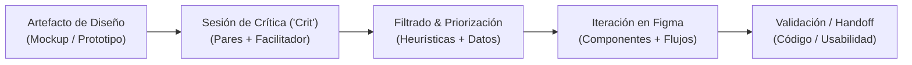
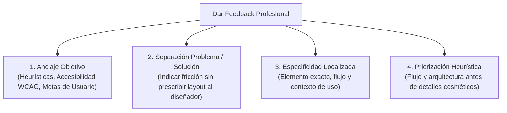
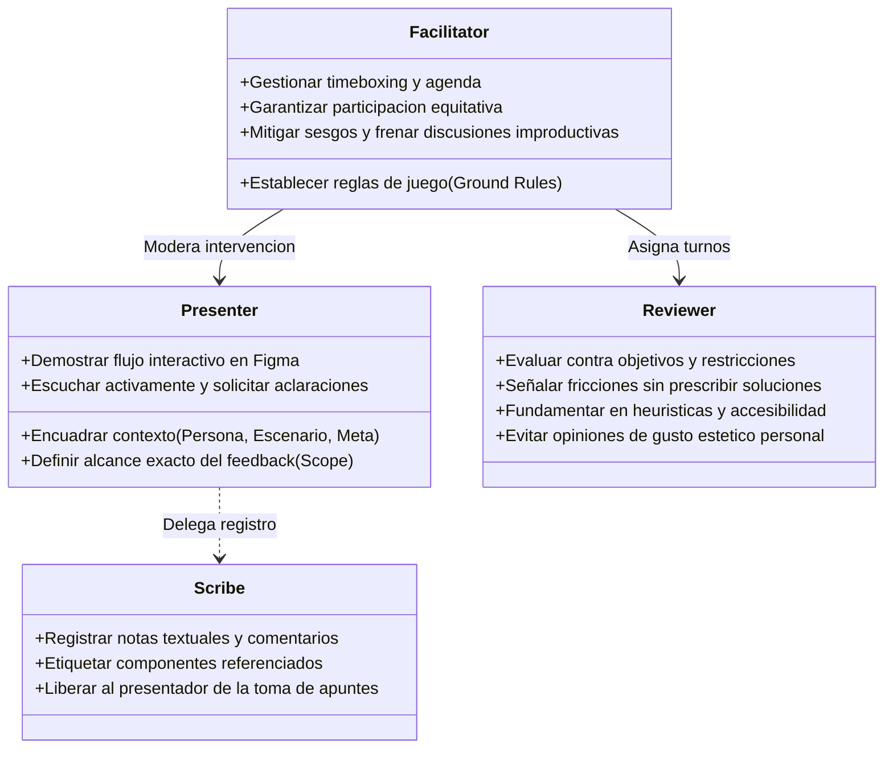
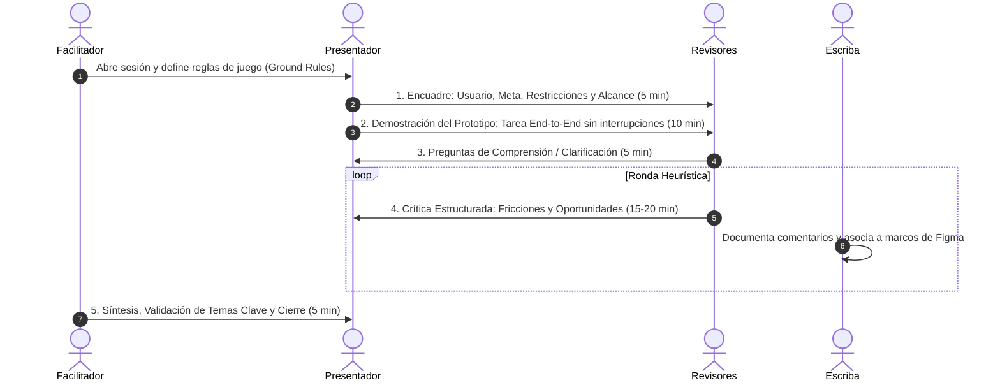
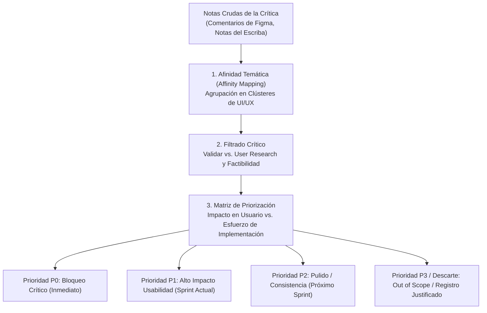
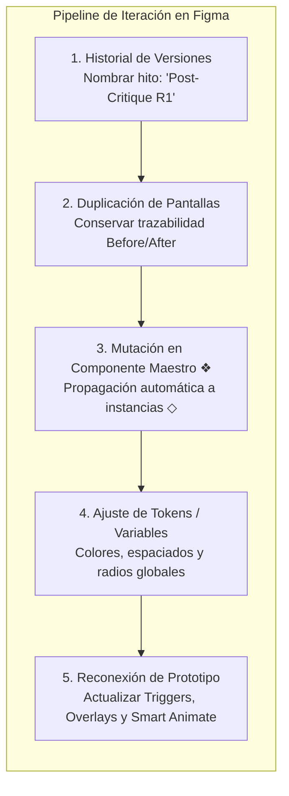
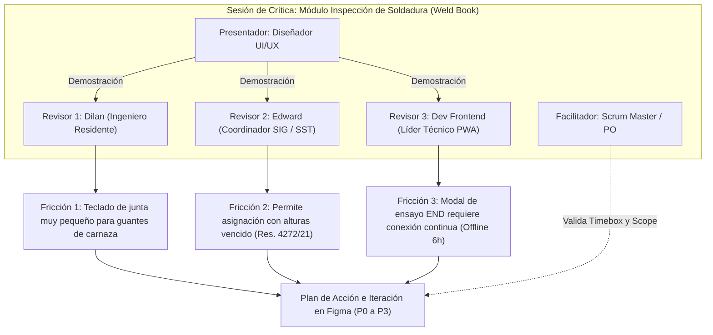

[← Anterior: 08d. Sistemas de Diseño y Sticker Sheets](./08d_Sistemas_de_Diseno_y_Sticker_Sheets.md) | [Volver a Curso.md](../Curso.md) | [Siguiente: 08f. Prototipado Hi-Fi, Gestos y Accesibilidad →](./08f_Prototipado_Alta_Fidelidad_Gestos_y_Accesibilidad.md)

# 08e. Feedback de Diseño en Acción, Sesiones de Crítica e Iteración de Mockups

> **Materia**: Sistemas de Información | **Docente**: PhD Jhon Alexander Garcia Camargo  
> **Semana**: Semana 8 | **Fuente**: [Design Feedback in Action (Google UX Design Certificate)](https://youtu.be/VLwZc0JNAT8?si=uk7wh_lsAHBcmRgA)  
> **Términos Core**: `Design Critique ("Crit")`, `Feedback vs Review`, `Presenter`, `Reviewer`, `Facilitator`, `Scribe / Note-Taker`, `Ground Rules`, `Scope Setting`, `Objective vs Subjective Feedback`, `Problem vs Solution Separation`, `Active Listening`, `Clarifying Questions`, `Framework "I like / I wish / What if"`, `Feedback Sandwich Anti-pattern`, `Affinity Mapping`, `Feedback Prioritization Matrix (P0-P3)`, `Impact vs Effort`, `Design by Committee`, `Bikeshedding (Law of Triviality)`, `Design Defensiveness`, `Figma Version History`, `Component Propagation (❖)`, `Closing the Feedback Loop`.

---

## 1. Fundamentos del Feedback de Diseño y la Sesión de Crítica (*Design Critique*)

### 1.1 Naturaleza del Feedback en Diseño UX
- **Axioma del Diseño de Producto**:
  $$\text{Diseño UX} \neq \text{Expresión Artística Subjetiva} \implies \text{Diseño UX} = \text{Ingeniería de Solución a Problemas de Usuario y Negocio}$$
- **Propósito Operativo**: Someter artefactos en desarrollo (wireframes, mockups, prototipos interactivos) a escrutinio colaborativo para detectar **puntos ciegos (*blind spots*)**, validar supuestos heurísticos y anticipar fallos de interacción antes de iniciar el desarrollo frontend.
- **La Separación Crítica (Ego vs. Artefacto)**:
  $$\text{Feedback sobre el Prototipo} \not\equiv \text{Juicio de Valor sobre el Diseñador}$$
  - El objetivo del feedback es la optimización del producto; la defensa identitaria del trabajo bloquea la evolución del sistema.

### 1.2 Matriz de Diferenciación Operativa: Crítica vs. Instancias Conexas

| Modalidad de Sesión | Objetivo Primario | Participantes Clave | Momento en el Ciclo | Salida / Artefacto Resultante |
| :--- | :--- | :--- | :--- | :--- |
| **Design Critique ("Crit")** | Identificar fricciones, validar heurísticas y recibir perspectivas multidisciplinarias sobre trabajo en progreso. | Diseñadores pares, facilitador, frontend, PO/PM. | Durante la ideación y prototipado (WIP). | Lista priorizada de acciones de mejora (*Action Items*). |
| **Design Review / Approval** | Obtener firma ejecutiva o aprobación formal para pasar a codificación (*sign-off*). | Stakeholders de negocio, directores, clientes. | Hito de cierre de etapa de diseño. | Decisión binaria (Aprobado / Rechazado). |
| **Brainstorming / Co-diseño** | Divergencia; generar la mayor cantidad de conceptos o soluciones posibles sin juzgar. | Equipo de producto ampliado y usuarios. | Descubrimiento temprano (*Problem Space*). | Bocetos rápidos (*Crazy Eights*), mapas conceptuales. |
| **Usability Testing** | Medir comportamiento empírico real ante tareas específicas (tiempo, errores, SUS). | Usuarios finales representativos y moderador. | Prototipos Low-Fi y Hi-Fi terminados. | Métricas cuantitativas y cualitativas de uso. |

---

## 2. Reglas de Oro para Dar y Recibir Feedback

### 2.1 Directrices para Dar Feedback (*Giving Constructive Feedback*)

1. **Anclaje en Objetivos de Usuario y Heurísticas (Objetividad vs. Gusto)**:
   - Prohibido el juicio estético personal descontextualizado (*"No me gusta ese tono de verde"*).
   - Estructuración correcta: anclar en accesibilidad, principios de diseño o tareas del usuario:
     $$\text{Regla de Feedback}: \text{Observación Heurística} + \text{Impacto en Tarea / Negocio} + \text{Pregunta Abierta}$$
     - *Ejemplo*: *"El botón primario en gris claro carece de contraste suficiente frente al fondo blanco ($2.1:1$), violando WCAG 2.1 AA e impidiendo la visibilidad en exteriores."*
2. **Separar el Problema de la Solución (*Problem vs. Solution Separation*)**:
   - **El rol del revisor es diagnosticar la fricción**, no dictar la implementación.
   - *Incorrecto (Prescriptivo)*: *"Mueve esa tarjeta arriba y colócale un borde rojo de 2px"*.
   - *Correcto (Diagnóstico)*: *"Los supervisores de obra no perciben de inmediato el estado de alerta del permiso de trabajo antes de firmar"*. Corresponde al diseñador explorar alternativas de UI.
3. **Framework Estructurado: "I like / I wish / What if"**:
   - `I like...` (Observación positiva anclada en objetivos): Reconoce qué funciona y por qué (*"Me gusta cómo la cabecera condensa los 3 datos críticos de la cuadrilla sin saturar la vista"*).
   - `I wish...` (Fricción o carencia de usuario): Señala el bloqueo o riesgo sin prescribir layout (*"Desearía que el indicador de soldador inhabilitado fuera perceptible antes de iniciar el formulario"*).
   - `What if...` (Apertura exploratoria colaborativa): Invita a divergir al diseñador (*"¿Qué pasaría si probamos un banner modal bloqueante de advertencia?"*).
4. **Anti-Patrón: El "Feedback Sandwich" (Elogio Forzado)**:
   - *Trampa*: Disfrazar un fallo crítico entre dos elogios superficiales (*"Me gusta la tipografía, pero el flujo borra los datos de la inspección, aunque el icono se ve moderno"*).
   - *Riesgo*: Diluye la gravedad de errores P0, genera ambigüedad operativa y se percibe condescendiente.
   - *Práctica Profesional*: Honestidad radical, directa y empática enfocada 100% en el artefacto y las metas de negocio.
5. **Especificidad Quirúrgica y Madurez del Artefacto**:
   - Evitar juicios abstractos (*"La vista se siente pesada"*). Precisar el componente o jerarquía rota.
   - En wireframes Low-Fi: evaluar flujos, arquitectura y modelos mentales.
   - En mockups Hi-Fi: evaluar affordances, tipografía, microinteracciones y tokens de diseño.

### 2.2 Directrices para Recibir Feedback (*Receiving Feedback Professionally*)

- **Escucha Activa (*Active Listening*)**:
  - Silencio deliberado durante la intervención del crítico. Prohibido interrumpir con justificaciones reactivas.
- **Desactivar el Modo Defensivo (*Avoid Design Defensiveness*)**:
  - Cambiar la respuesta automática *"Es que lo hice porque..."* por *"Explícame más sobre dónde viste el bloqueo"*.
- **Desarticulación de Ambigüedades mediante Preguntas Clarificadoras**:
  - Cuando el revisor emite un juicio vago (*"Esta pantalla es confusa"*), aplicar la técnica de sondeo:
    $$\text{Pregunta Clarificadora} = \text{¿Qué obstáculo o duda observas al intentar completar [Acción X]?}$$
- **Soberanía y Arbitraje del Diseñador**:
  - Escuchar todo el feedback es mandatorio; implementar todo el feedback es destructivo.
  - El diseñador pondera las sugerencias contra los datos de investigación con usuarios (*User Research*), los límites técnicos del backend y el alcance del sprint.

---

## 3. Taxonomía de Roles en la Sesión de Crítica

El marco de trabajo de Google UX estandariza una división tripartita formal de responsabilidades para garantizar neutralidad, orden y productividad:

### 3.1 El Facilitador (*The Facilitator*)
- **Guardián del Tiempo (*Timekeeper*)**: Controla estrictamente los bloques de la agenda (*timeboxing*).
- **Control de Fronteras (*Scope Enforcer*)**: Interrumpe desvíos hacia temas fuera de alcance (ej., debates sobre lógica de base de datos o animaciones cosméticas cuando se evalúa navegación).
- **Democratización de la Voz**: Neutraliza dinámicas de poder (*HIPPO - Highest Paid Person's Opinion*); invita a opinar a miembros junior o ingenieros de testing que suelen guardar silencio.

### 3.2 El Presentador (*The Presenter*)
- **Fijación de Alcance (*Scope Setting*)**: Formula al inicio de la sesión qué necesita y qué debe ignorarse:
  - *En alcance*: Flujo de registro de inspecciones y selección de método de soldadura.
  - *Fuera de alcance*: Ilustraciones definitivas, esquema cromático final.
- **Narrativa Orientada a Tareas (*Task-Oriented Walkthrough*)**: No lee pantalla por pantalla; guía a la audiencia simulando el recorrido de una *User Persona* resolviendo un objetivo concreto.

### 3.3 El Revisor (*The Reviewer*)
- Analista crítico que opera como abogado del usuario y del sistema.
- Contrasta cada pantalla contra las restricciones del contexto real (dispositivos de campo, condiciones lumínicas, conectividad).

### 3.4 El Escriba / Tomador de Notas (*Scribe / Note-Taker*)
- Captura de forma imparcial las citas clave, objeciones y consensos, permitiendo que el presentador mantenga contacto visual e interacción continua con la mesa de trabajo.

---

## 4. Protocolo de Ejecución de la Sesión (*Critique Setup & Agenda*)

### 4.1 Fases Operativas de la Sesión

### 4.2 Desglose del Timeboxing Estándar (Bloque de 45-50 min)
1. **Encuadre y Delimitación (5 min)**:
   - Presentación de la Persona, el caso de uso y el problema de negocio.
   - Declaración explícita del **tipo de feedback requerido**.
2. **Demostración Silenciosa del Flujo (10 min)**:
   - Recorrido del prototipo interactivo en Figma de principio a fin. Los revisores observan sin interrumpir.
3. **Preguntas de Comprensión (5 min)**:
   - Preguntas breves orientadas exclusivamente a entender la mecánica antes de evaluarla.
4. **Intercambio Crítico y Análisis Heurístico (15-20 min)**:
   - Discusión guiada por componentes y flujos. Uso de notas adhesivas físicas o comentarios nativos en Figma (`C`).
5. **Síntesis y Próximos Pasos (5 min)**:
   - El facilitador resume los temas cardinales; el presentador define el plan de iteración.

---

## 5. De la Retroalimentación a la Acción (*Turning Feedback into Action*)

Una sesión de crítica genera múltiples observaciones no estructuradas. Procesarlas requiere un embudo sistemático de síntesis y priorización:

### 5.1 Agrupación Temática (*Affinity Mapping*)
Las notas se clasifican en cuatro dimensiones técnicas estandarizadas:
- **Flujo y Navegación**: Caminos sin salida (*dead ends*), pasos redundantes, pérdida del estado anterior.
- **Accesibilidad y Legibilidad**: Contraste insuficiente, tamaños de objetivo táctil ($< 48\times 48\text{ px}$), ausencia de textos alternativos.
- **Jerarquía y Diseño Visual**: Falta de punto focal, desalineación con la grilla de $8\text{ pt}$, violación de consistencia del Design System.
- **Contenido y Microcopy**: Terminología confusa, etiquetas ambiguas en botones, ausencia de mensajes explicativos de error.

### 5.2 Matriz de Priorización de Cambios (Impacto vs. Esfuerzo)

| Nivel de Prioridad | Criterio de Clasificación | Impacto en Usabilidad | Esfuerzo de Diseño / Código | Acción Operativa Inmediata |
| :--- | :--- | :--- | :--- | :--- |
| **P0 (Showstopper / Bloqueo)** | Impide la culminación de la tarea central; viola accesibilidad crítica (WCAG A); induce pérdida de datos. | Crítico / Fatal | Cualquiera | Resolver antes de cualquier otro avance; bloquea handoff. |
| **P1 (Mayor / Alto Valor)** | Genera fricción severa, ralentiza el tiempo en tarea (*Time on Task*) o induce confusión en la llamada a la acción (CTA). | Alto | Bajo a Medio | Programar en la iteración inmediata del archivo Figma. |
| **P2 (Menor / Pulido)** | Inconsistencias cosméticas con el Sticker Sheet; ajustes menores de padding; detalles de microcopia. | Medio a Bajo | Bajo | Atender en bloque de refactorización visual de componentes. |
| **P3 / Descarte Justificado** | Sugerencias basadas en preferencias personales no respaldadas por investigación, o peticiones de alcance no pactadas. | Nulo o Negativo | Alto | Documentar la razón de no implementación y archivar en backlog. |

---

## 6. Iteración de Mockups y Prototipos en Figma (*Iterate Mockups*)

### 6.1 Buenas Prácticas de Iteración en el Entorno Figma

1. **Gestión de Versiones y Preservación de Trazabilidad**:
   - Crear un hito en el **Version History** de Figma (`Ctrl+Alt+S`) etiquetado: `v1.2 - Iteración tras Sesión de Crítica Semana 8`.
   - Mantener marcos comparativos contiguos (*Before vs. After*) para evidenciar el valor del refinamiento ante el cliente o equipo de producto.
2. **Propagación Arquitectónica desde el Componente Maestro (❖)**:
   - Si la crítica identificó que un campo de entrada o botón carece de altura táctil suficiente, **el cambio se ejecuta exclusivamente en el componente maestro** dentro del archivo del Sistema de Diseño o Sticker Sheet.
   - Las instancias (`◇`) en todas las pantallas del producto heredan la corrección instantáneamente, evitando discrepancias pantalla a pantalla.
3. **Ajuste de Variables y Tokens Semánticos**:
   - Si se determinó que el color de advertencia no contrastaba con el fondo de tarjeta, modificar el token de color semántico (`warning-surface` o `warning-text`) en el panel de variables locales.
4. **Revisión del Grafo de Navegación (*Prototype Connections*)**:
   - Ajustar los nodos de conexión en la pestaña *Prototype*:
     - Modificar disparadores (*triggers*) si se detectó que una acción debía responder a `On click` en vez de `While hovering`.
     - Validar que los diálogos emergentes configurados como `Open overlay` conserven habilitadas las casillas `Close when clicking outside` y `Add background behind overlay`.
5. **Cierre Formal del Bucle (*Closing the Feedback Loop*)**:
   - Compartir con los revisores un resumen visual puntual: *"A partir de los comentarios de la crítica, se aumentó el target táctil a $56\text{ px}$, se simplificó el formulario de 6 a 3 campos obligatorios y se ajustó el contraste tipográfico a WCAG AAA"*.

---

## 7. Caso Práctico Aplicado: Crítica e Iteración en LOARD Construcciones S.A.S.

Contextualización de una sesión de crítica de diseño para el sistema de control de obra e ingeniería de LOARD Construcciones S.A.S.:

### 7.1 Matriz de Feedback e Iteración del Caso LOARD

| Revisor / Rol | Observación Crítica Recibida | Clasificación Heurística / Normativa | Prioridad | Decisión Técnica e Iteración en Figma |
| :--- | :--- | :--- | :--- | :--- |
| **Dilan** (Residente de Obra) | *"El selector numérico de diámetro y junta ($48\times 48\text{ px}$) produce pulsaciones erróneas cuando el supervisor está en patio de tanques usando guantes de carnaza."* | **Usabilidad Física / Ley de Fitts**: Target táctil inadecuado para contexto rudo de obra. | **P0** | Rediseñar el componente `KeypadButton` elevando el target a **$64 \times 64\text{ px}$** con separación de $12\text{ px}$. |
| **Edward** (Coordinador SIG/SST) | *"Si el sistema no bloquea de inmediato al operario con certificación de alturas vencida (Res. 4272/2021), la empresa incurre en multas legales gravísimas."* | **Integridad de Regla de Negocio / Prevención de Errores**. | **P0** | Insertar un estado bloqueante (`Overlay Modal / Critical Alert`) con color semántico rojo OSHA (`#D32F2F`) que deshabilita el botón de asignación. |
| **Líder Frontend** | *"El flujo actual asume conexión continua a Internet para subir los informes END en PDF; en Buenaventura no hay señal hasta por 6 horas."* | **Heurística de Visibilidad de Estado y Manejo Offline**. | **P1** | Diseñar la molécula `OfflineQueueBanner` y modelar en el prototipo el almacenamiento local en cola con sincronización diferida. |
| **Interventor Externo (Stakeholder)** | *"Me gustaría que la cabecera tuviera un degradado azul con el logo más grande de nuestra petrolera."* | **Preferencia Estética Subjetiva / Fuera de Alcance**. | **P3 / Descarte** | Descartar amablemente; las pantallas operativas deben maximizar área útil y no contemplan portal de autoservicio externo (Regla de negocio 1). |

---

## 8. Casos Trampa de Examen y Antipatrones Frecuentes

- **El Síndrome del Diseño Defensivo (*Design Defensiveness*)**:
  - *Error*: Percibir cada observación técnica como un ataque a la competencia personal y dedicar el 80% del tiempo de la reunión a justificar el diseño previo en lugar de capturar la fricción.
  - *Impacto*: Se anula la utilidad de la sesión; los revisores dejan de emitir críticas sinceras.
- **Diseño por Comité (*Design by Committee*)**:
  - *Error*: Intentar complacer todas y cada una de las opiniones de los asistentes fusionando ideas incompatibles (*"Hagamos el botón azul pero con borde verde y texto violeta como sugirió cada uno"*).
  - *Resultado*: Un producto incoherente, fragmentado y carente de visión de producto unificada.
- **La Ley de la Trivialidad de Parkinson (*Bikeshedding*)**:
  - *Error*: Dedicar 35 minutos a discutir el radio de curvatura de un icono o el tono exacto de gris de un divisor, ignorando que el flujo de navegación principal tiene una vía muerta que impide al usuario registrar su tarea.
  - *Solución*: El facilitador debe intervenir enérgicamente: *"Ese detalle cosmético se resolverá con el token del Design System; volvamos a la validación del flujo de navegación"*.
- **La Trampa del Voto Mayoritario (*Democracy Fallacy*)**:
  - *Error*: Definir una decisión de arquitectura de información alzando la mano y contando votos en la sala.
  - *Axioma*: La usabilidad no se somete a plebiscito; se resuelve mediante heurísticas, pruebas con usuarios (*Usability Studies*) o datos analíticos.
- **Falta de Fijación de Alcance (*Unbounded Scope*)**:
  - *Error*: Iniciar la presentación diciendo genéricamente: *"Aquí está mi diseño, ¿qué les parece?"*.
  - *Consecuencia*: Avalancha de comentarios caóticos, dispersos y fuera de contexto.

---

## 9. Checklist de Verificación de Calidad

- [ ] **Preparación Previa**: ¿El presentador definió con claridad la User Persona, el escenario de uso y delimitó qué aspectos están en alcance y cuáles quedan explícitamente fuera?
- [ ] **Estructura y Roles**: ¿Se asignaron de antemano los roles de Facilitador, Presentador, Revisores y Escriba para garantizar orden y registro fidedigno?
- [ ] **Calidad del Feedback**: ¿Todas las observaciones emitidas señalan fricciones de uso ancladas en objetivos o heurísticas, evitando opiniones de gusto estético personal y prescripción de soluciones?
- [ ] **Técnica de Indagación**: ¿Ante comentarios ambiguos (*"esto no funciona"*), el equipo utilizó preguntas clarificadoras para aislar la causa raíz del bloqueo?
- [ ] **Síntesis y Priorización**: ¿Se organizaron las notas mediante afinidad temática y se jerarquizaron en una matriz de Impacto vs. Esfuerzo ($P0$ a $P3$)?
- [ ] **Trazabilidad en Figma**: ¿Se guardó un hito en el historial de versiones de Figma antes de editar y se conservó una copia comparativa (*Before vs. After*)?
- [ ] **Mantenimiento del Sistema**: ¿Las correcciones de componentes se ejecutaron sobre los componentes maestros (❖) o tokens del Sticker Sheet para preservar la gobernanza global?
- [ ] **Cierre del Bucle**: ¿Se elaboró y comunicó al equipo el plan de acción con las justificaciones de los cambios implementados y de los descartes técnicos?

---

> **Navegación Semana 8**:  
> [← Anterior: 08d. Sistemas de Diseño y Sticker Sheets](./08d_Sistemas_de_Diseno_y_Sticker_Sheets.md) | [Volver a Curso.md](../Curso.md) | [Siguiente: 08f. Prototipado Hi-Fi, Gestos y Accesibilidad →](./08f_Prototipado_Alta_Fidelidad_Gestos_y_Accesibilidad.md)

