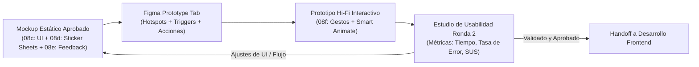
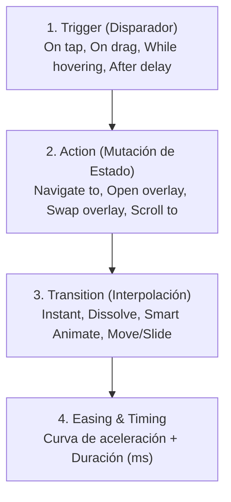
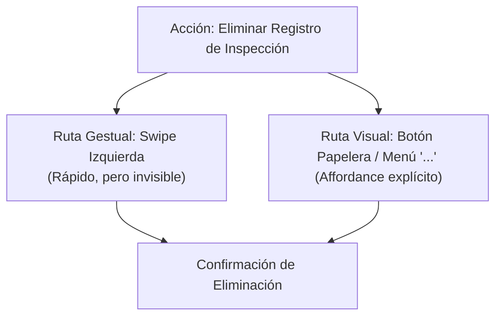
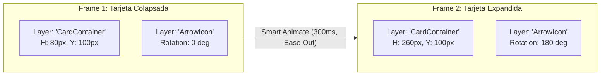
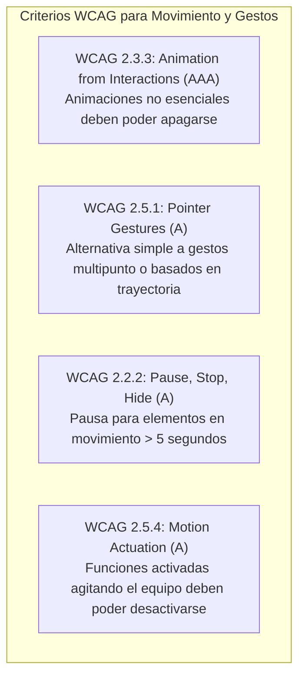
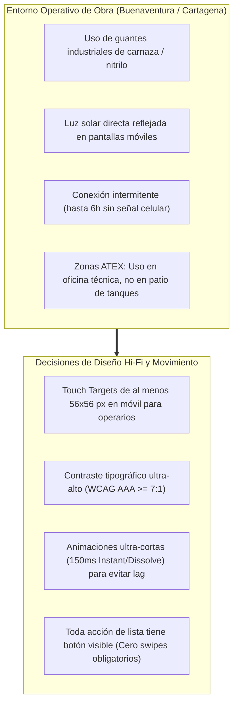

[← Anterior: 08e. Feedback de Diseño e Iteración de Mockups](./08e_Feedback_de_Diseno_Critica_e_Iteracion.md) | [Volver a Curso.md](../Curso.md) | [Siguiente: 09. Sistemas de Diseño de Interfaz →](./09_Sistemas_de_Diseno_de_Interfaz.md)

# 08f. Prototipado de Alta Fidelidad, Gestos y Accesibilidad UX

> **Materia**: Sistemas de Información | **Docente**: PhD Jhon Alexander Garcia Camargo  
> **Semana**: Semana 8 | **Fuente**: [Create a High-Fidelity Prototype (Google UX Design Certificate)](https://youtu.be/Fr-f2NE6B3U?si=l17mpC15to46FwKP)  
> **Términos Core**: `High-Fidelity Prototype`, `Mockup to Prototype`, `Figma Prototyping Tab`, `Smart Animate`, `Layer Matching Hierarchy`, `Interpolation`, `Transitions (Move In, Move Out, Push, Slide In, Slide Out)`, `Easing Curves (Ease In, Ease Out, Ease In and Out, Linear, Spring)`, `Interaction Timing (150-350 ms)`, `Touch Gestures (Tap, Drag, Swipe, Pinch, Long Press)`, `Touch Target Size (48x48 px)`, `Affordance Duplicity`, `Motion Design Principles`, `Spatial Continuity`, `Vestibular Disorders (Vertigo, Cybersickness)`, `Photosensitive Epilepsy (Seizure Threshold > 3 Hz)`, `WCAG 2.1 Criterion 2.3.3 (Animation from Interactions)`, `WCAG Criterion 2.5.1 (Pointer Gestures)`, `WCAG Criterion 2.2.2 (Pause, Stop, Hide)`, `prefers-reduced-motion`, `PEAT Tool`, `Usability Study Round 2`.

---

## 1. Fundamentos del Prototipado de Alta Fidelidad (Hi-Fi)

### 1.1 Definición y Propósito Operativo
- **Definición**: Representación interactiva integral de software que emula con máxima precisión visual, tipográfica, espacial y dinámica el producto digital final.
- **Transición Clave**:
  $$\text{Wireframe (Esqueleto)} \xrightarrow{\text{Diseño Visual UI}} \text{Mockup (Piel Estática)} \xrightarrow{\text{Conectividad + Movimiento}} \text{Prototipo Hi-Fi (Simulación Funcional)}$$
- **Objetivo Central**: Validar en una **segunda ronda de pruebas de usabilidad** aspectos que los wireframes no pueden evaluar:
  - Legibilidad tipográfica y jerarquía cromática real.
  - Percepción de affordances visuales (sombras, bordes, estados *hover/active*).
  - Tiempos de respuesta percibidos y naturalidad de las transiciones.
  - Aprobación ejecutiva y alineación definitiva de *stakeholders* previa a codificación.

### 1.2 Matriz Comparativa: Baja Fidelidad (Low-Fi) vs. Alta Fidelidad (Hi-Fi)

| Dimensión Técnica | Prototipo Low-Fi (Baja Fidelidad) | Prototipo Hi-Fi (Alta Fidelidad) |
| :--- | :--- | :--- |
| **Atributos Visuales** | Escala de grises, cajas esquemáticas, tipografía genérica, sin fotos reales. | Paleta de color definitiva, tipografía de producción, iconografía vectorial, datos realistas. |
| **Foco de Evaluación** | Arquitectura de información, modelo mental, navegación macro, flujo de tareas. | Microinteracciones, affordances, retroalimentación táctil, estética, jerarquía visual. |
| **Costo y Velocidad** | Minutos u horas; costo de descarte cercano a cero. | Días; requiere diseño UI detallado y sincronización de nombres de capas. |
| **Sesgos que Revela** | Falso consenso, sesgo de confirmación sobre el flujo de negocio. | Problemas de contraste cromático, sobrecarga cognitiva, cinetosis/vértigo por animación. |
| **Audiencia Primaria** | Diseñadores, analistas funcionales y usuarios en sesiones exploratorias. | Usuarios finales en pruebas estructuradas, clientes corporativos y desarrolladores frontend. |

---

## 2. Construcción de Prototipos de Alta Fidelidad en Figma

### 2.1 Modelo Formal de la Interacción
Toda interacción en el motor de prototipado de Figma se estructura como una cuádrupla orientada a eventos:
$$\mathcal{I} = \langle \text{Trigger}, \text{Hotspot / Target}, \text{Action}, \text{Transition / Animation} \rangle$$

### 2.2 Catálogo de Acciones y Manejo de Capas Dinámicas
- **`Navigate to`**: Desplazamiento a pantalla completa (*frame-to-frame*).
- **`Open overlay`**: Despliegue de un frame emergente sobre la pantalla actual (menús desplegables, hojas de fondo *bottom sheets*, diálogos modales):
  - *Overlay Positioning*: `Centered`, `Top left/right`, `Bottom center` (móvil), `Manual`.
  - *Opciones Críticas*: `Close when clicking outside` (cierre intuitivo) y `Add background behind overlay` (atenuación o desenfoque con opacidad configurable).
- **`Swap overlay`**: Reemplaza el overlay visible por otro sin reiniciar ni afectar la pantalla base (vital para formularios de varios pasos o pestañas internas de diálogo).
- **`Scroll to`**: Desplaza la vista suavemente hasta una capa o sección anclada dentro del mismo marco.
- **`Fix position when scrolling` (Propiedad de Capa)**: Fija barras de navegación (*app bars*, *bottom nav bars*) o botones flotantes de acción (*FAB*) impidiendo que se muevan con el scroll del usuario.

---

## 3. Gestos Táctiles en Diseño Móvil (*Touch Gestures*)

### 3.1 Taxonomía de Gestos
Los dispositivos móviles dependen de un lenguaje gestual que reemplaza la precisión del cursor por contacto físico directo:

| Gesto | Mecánica Física | Caso de Uso Habitual en Prototipo | Riesgo de Usabilidad |
| :--- | :--- | :--- | :--- |
| **Tap (Toque Simple)** | Contacto breve con un solo dedo. | Botones primarios, enlaces, selección de listas, checkboxes. | Clics fantasma si el target es inferior a $48 \times 48\text{ px}$. |
| **Double Tap** | Dos toques consecutivos rápidos ($<300\text{ ms}$). | Zoom rápido en planos/mapas; marcar favorito (*like*). | Difícil descubrimiento para usuarios con baja alfabetización digital. |
| **Drag (Arrastre)** | Presionar y desplazar contacto continuo sin levantar el dedo. | Deslizadores (*sliders*), ordenamiento de filas, carruseles. | Conflicto con el scroll nativo de la pantalla. |
| **Swipe (Deslizar)** | Desplazamiento lineal veloz con desaceleración. | Navegación entre pestañas, archivar o borrar elementos de lista. | Inaccesible para usuarios con temblores o baja motricidad fina. |
| **Pinch / Spread** | Dos dedos que se acercan o se separan. | Ajuste fino de zoom en planos constructivos e imágenes. | Requiere coordinación bimanual; propenso a fallar en campo. |
| **Long Press** | Presión sostenida ($>500\text{ ms}$) en una posición fija. | Menús contextuales avanzados, selección múltiple de registros. | Carece de affordance visual visible; el usuario no sabe que existe. |

### 3.2 Principio de Redundancia y Affordances Visibles
$$\text{Axioma de Accesibilidad Gestual}: \forall \, \text{Gesto Complejo (Swipe/Pinch)} \implies \exists \, \text{Alternativa Visual Simple (Botón Tap)}$$
- Ninguna acción crítica de negocio (borrar, confirmar, guardar, navegar) debe depender con exclusividad de un gesto táctil avanzado.

---

## 4. Movimiento y Animación en Figma (*Motion Design*)

### 4.1 Principios Heurísticos del Movimiento en UX
El movimiento (*motion*) en interfaces no es decorativo; cumple cuatro funciones cognitivas esenciales:
1. **Orientación Espacial y Continuidad**: Muestra de dónde proviene y hacia dónde se desplaza un elemento, conservando el mapa mental del usuario.
2. **Dirección de la Atención (Foco Visual)**: Guía el ojo del usuario hacia los cambios de estado relevantes (ej. aparición de una notificación de error).
3. **Retroalimentación de Estado (Feedback)**: Confirma en tiempo real que el sistema ha recibido la orden (microinteracción de pulsación, barra de progreso, spinner).
4. **Jerarquía y Escala**: Elementos que crecen o se expanden indican mayor jerarquía o detalle.

### 4.2 Mecánica de Smart Animate en Figma
- **Definición**: Motor de interpolación automática que anima fluidamente las diferencias entre dos marcos que comparten capas coincidentes.
- **Regla de Oro de Smart Animate**:
  $$\text{Capas deben tener el }\mathbf{\text{mismo nombre}}\text{ y residir en la }\mathbf{\text{misma jerarquía estructural}}\text{ en ambos frames}$$
- **Propiedades que Interpola Smart Animate**:
  - Posición espacial: Coordenadas $(X, Y)$.
  - Escala y dimensiones: Ancho ($W$) y Alto ($H$).
  - Rotación: Ángulo $\theta$ (ej. giro de $180^\circ$ en chevron de dropdown).
  - Opacidad: Nivel $\alpha$ ($0\% \to 100\%$).
  - Color de relleno (*Fill*) y trazo (*Stroke*).
  - Radio de esquinas (*Corner Radius*).

### 4.3 Curvas de Aceleración (*Easing Curves*) y Tiempos de Interacción

| Curva (*Easing*) | Comportamiento Cinético | Aplicación Recomendada en UX |
| :--- | :--- | :--- |
| **`Linear`** | Velocidad uniforme constante ($v = \text{cte}$). | Rara vez en UI (antinatural); barras de carga de tiempo lineal exacto. |
| **`Ease In`** | Inicia lento y acelera hacia el final. | Elementos que **salen** de la pantalla (*exit transitions*). |
| **`Ease Out`** | Inicia a máxima velocidad y frena gradualmente. | Elementos que **ingresan** al marco (*entrance transitions*); se percibe ágil y reactivo. |
| **`Ease In and Out`** | Acelera al inicio y desacelera al final. | Elementos que se desplazan **dentro** de la misma pantalla (cambio de posición $A \to B$). |
| **`Spring` (Resorte)** | Rebote elástico basado en física (`Gentle`, `Quick`, `Bouncy`). | Modales lúdicos, conmutadores (*toggles*), microinteracciones de éxito. Evitar en sistemas ERP/industriales. |

- **Ventana Temporal Óptima (Timing Rule)**:
  $$150\text{ ms} \le t_{\text{interacción}} \le 350\text{ ms}$$
  - $< 100\text{ ms}$: El ojo humano no percibe la transición (se siente como un corte brusco).
  - $> 400\text{ ms}$: Se percibe torpe y lento (*sluggish*); genera fricción e impaciencia en tareas repetitivas de negocio.

---

## 5. Accesibilidad en Gestos y Movimiento (UX Inclusivo & WCAG)

### 5.1 Patologías de Riesgo y Salud Ocupacional Digital
- **Trastornos Vestibulares (Vestibular Disorders)**: Movimientos de paralaje excesivo, zooms rápidos o rotaciones 3D producen desajustes entre la visión y el oído interno, induciendo **vértigo, desorientación espacial, náuseas severas y pérdida de equilibrio**.
- **Epilepsia Fotosensible (Photosensitive Seizures)**: Destellos o parpadeos de alto contraste con frecuencia en el rango peligroso:
  $$\text{Riesgo de Convulsión}: f > 3\text{ destellos/segundo (Hz)}$$
- **Sobrecarga Cognitiva y Déficit de Atención (ADHD)**: Animaciones continuas o banners en movimiento sin opción de pausa agotan la memoria de trabajo y distraen al operador de tareas críticas.

### 5.2 Estándares WCAG 2.1 / 2.2 Aplicables

- **WCAG 2.5.1 Pointer Gestures (Nivel A)**: Todo control operable mediante gestos basados en trayectoria (*drag/swipe*) o multipunto (*pinch*) debe ser operable con un solo puntero simple (*single tap/click*).
- **WCAG 2.3.3 Animation from Interactions (Nivel AAA)**: El sistema debe permitir a los usuarios deshabilitar o reducir el movimiento desencadenado por sus interacciones.
- **Implementación Técnica**:
  - En CSS/Web: Respetar la consulta `@media (prefers-reduced-motion: reduce)` sustituyendo desplazamientos espaciales por fundidos estáticos (`Instant` o `Dissolve` breve).
  - En Figma: Probar flujos desactivando animaciones para garantizar que la pantalla permanezca comprensible sin movimiento.
- **Áreas Táctiles Mínimas (*Touch Targets*)**:
  - Mínimo universal: **$48 \times 48\text{ px}$** (Google Material Design) / **$44 \times 44\text{ pt}$** (Apple HIG).
  - Separación entre bordes táctiles: $\ge 8\text{ px}$ para evitar pulsaciones erradas.
- **Herramienta de Auditoría**: Utilizar **PEAT** (*Photosensitive Epilepsy Analysis Tool*) para certificar la tasa de parpadeo de prototipos interactivos.

---

## 6. Pruebas de Usabilidad con Prototipos Hi-Fi (Ronda 2)

### 6.1 Objetivos de la Segunda Ronda
A diferencia de la ronda Low-Fi (que valida flujos lógicos), la ronda Hi-Fi evalúa la interacción bajo condiciones realistas de interfaz:
- ¿Los botones se perciben como clickeables (*affordance clarity*)?
- ¿El usuario entiende el estado del sistema mediante las animaciones de carga?
- ¿La tipografía y el contraste permiten lectura rápida bajo luz solar o en pantallas de baja gama?

### 6.2 Métricas Clave de Evaluación

| Métrica | Definición Formal | Umbral Aceptable en Hi-Fi |
| :--- | :--- | :--- |
| **Task Success Rate (TSR)** | Porcentaje de tareas completadas satisfactoriamente sin asistencia. | $\ge 85\%$ en tareas críticas de negocio. |
| **Time on Task (ToT)** | Tiempo cronometrado en segundos desde el inicio de la instrucción hasta el éxito. | Reducción $\ge 30\%$ frente a la línea base previa. |
| **Misclick Rate (Tasa de Clics Fallidos)** | Clics efectuados fuera de áreas interactivas (*hotspots*). | $< 5\%$ del total de pulsaciones. |
| **System Usability Scale (SUS)** | Escala de usabilidad estandarizada de 10 preguntas (0 a 100). | $\ge 68$ (promedio de la industria); ideal $\ge 80$. |

---

## 7. Conexión Aplicada: Proyecto LOARD Construcciones S.A.S.

- **Diseño para Trabajo con Guantes**:
  - En las pantallas de captura de inspecciones de SST y reportes de avance de LOARD, los botones deben superar los $56 \times 56\text{ px}$. El teclado numérico para registrar metrado de soldadura o personal debe ser de teclas masivas.
- **Rendimiento y Batería en Dispositivos Móviles de Campo**:
  - Prohibido el uso de transiciones complejas basadas en `Smart Animate` con resortes (*springs*) en la PWA móvil; consumen ciclos de GPU y agotan la batería de supervisores en frentes aislados. Priorizar transiciones `Instant` o `Dissolve` de $150\text{ ms}$.
- **Transparencia en Notificaciones de SST**:
  - El modal de bloqueo por curso de alturas vencido (Resolución 4272 de 2021) debe desplegarse como un overlay centrado con fondo atenuado al $60\%$ de negro, indicando claramente la fecha exacta de expiración y el botón de acción para solicitar recertificación a la Coordinación SIG en Bogotá.

---

## 8. Casos Trampa de Examen y Antipatrones Frecuentes

- **Falla de Continuidad en Smart Animate**:
  - *Error*: Crear dos pantallas y nombrar la capa `Card_V1` en una y `Card_Final` en la otra.
  - *Resultado*: Figma no interpola las posiciones; ejecuta un fundido cruzado tosco (*dissolve*).
  - *Regla*: Ambos frames deben tener la capa con el **mismo nombre exacto** y estar en el mismo nivel de agrupación.
- **La Trampa de la Sobregesticulación (*Gesture Lockout*)**:
  - *Error*: Hacer que una tabla de avance de obra solo pueda editarse mediante un gesto de *swipe* horizontal oculto.
  - *Consecuencia*: Infracción grave de WCAG 2.5.1; los supervisores mayores o con dificultades motoras no logran editar el registro.
- **Animaciones Interminables (*Over-Animated UI*)**:
  - *Error*: Configurar duraciones de $800\text{ ms}$ o $1000\text{ ms}$ para transiciones entre vistas de menú.
  - *Consecuencia*: El software de gestión se percibe pesado y lento; se produce fatiga del usuario en jornadas laborales intensas.
- **Ignorar el Modo de Movimiento Reducido**:
  - *Error*: Diseñar interfaces que dependen de transiciones espaciales para comunicar jerarquía sin prever la variante estática para usuarios con trastornos vestibulares.

---

## 9. Checklist de Verificación de Calidad

- [ ] **Estructura de Capas**: ¿Todas las capas animadas mediante `Smart Animate` comparten nombres y jerarquías idénticos entre los frames origen y destino?
- [ ] **Control Temporal**: ¿La duración de todas las microinteracciones y transiciones se ubica estrictamente entre $150\text{ ms}$ y $350\text{ ms}$?
- [ ] **Alternativas a Gestos**: ¿Cada acción ejecutable por *swipe*, *drag* o *long press* cuenta con un botón o enlace accesible por simple *tap* (WCAG 2.5.1)?
- [ ] **Tamaño de Hotspots**: ¿Todos los elementos interactivos en vistas móviles poseen un target táctil $\ge 48 \times 48\text{ px}$ con márgenes de separación $\ge 8\text{ px}$?
- [ ] **Salud y Accesibilidad**: ¿Se descartaron destellos $> 3\text{ Hz}$ y se validó la interfaz bajo la directriz `prefers-reduced-motion` (WCAG 2.3.3)?
- [ ] **Consistencia de Retorno**: ¿Cada overlay cuenta con mecanismo de cierre explícito (`Close overlay` o clic fuera) y cada pantalla posee botón de retroceso (`Back`)?

---

> **Navegación Semana 8**:  
> [← Anterior: 08e. Feedback de Diseño e Iteración de Mockups](./08e_Feedback_de_Diseno_Critica_e_Iteracion.md) | [Volver a Curso.md](../Curso.md) | [Siguiente: 09. Sistemas de Diseño de Interfaz →](./09_Sistemas_de_Diseno_de_Interfaz.md) | `Fin Semana 8`

