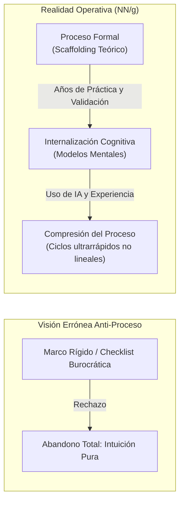
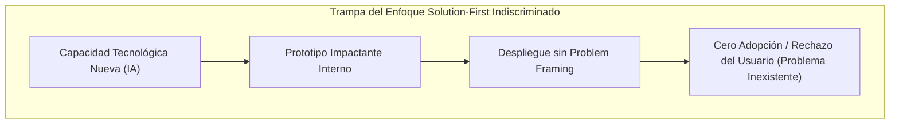
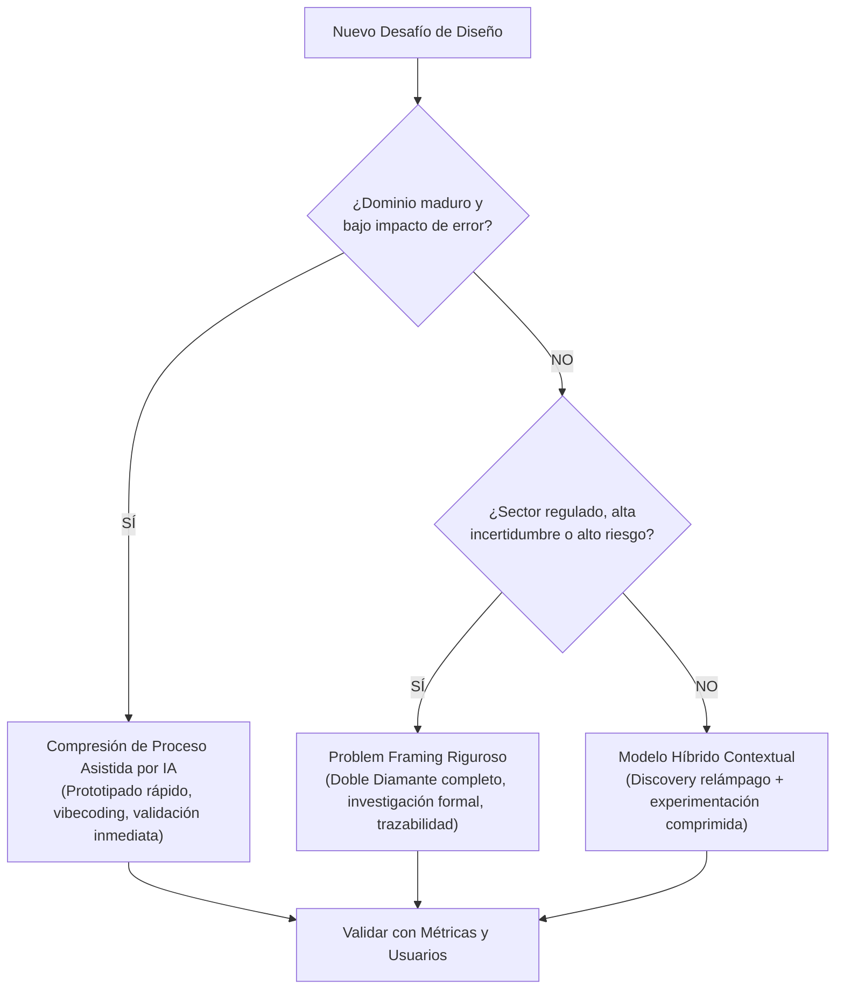

[← Anterior: 09. Sistemas de Diseño de Interfaz](./09_Sistemas_de_Diseno_de_Interfaz.md) | [Siguiente: 09.5b. Las 10 Heurísticas de Usabilidad](./09.5b_10_Heuristicas_de_Usabilidad_UI.md) | [Volver a Curso.md](../Curso.md)

# 09.5a. Compresión del Proceso de Diseño en la Era de la IA

> **Materia**: Sistemas de Información | **Docente**: PhD Jhon Alexander Garcia Camargo  
> **Sesión**: Sesión 9.5 | **Fuente**: [Sesion 9.5. Design Process Isn't Dead, It's Compressed - NN_G.pdf](../Documentos/Sesion%209.5.%20Design%20Process%20Isn't%20Dead,%20It's%20Compressed%20-%20NN_G.pdf)  
> **Autores**: Sarah Gibbons & Huei-Hsin Wang (Nielsen Norman Group, 2026)  
> **Términos Core**: `Compresión de Procesos`, `Design Process Monolith Fallacy`, `Intuición como Proceso Interiorizado`, `Vibecoding`, `Solution-First Design`, `Sesgo de Supervivencia (Survivorship Bias)`, `Mitigación de Riesgo`, `Doble Diamante`, `Design Thinking`, `Jobs-to-be-Done (JTBD)`, `Scaffolding Cognitivo`, `Process Literacy`, `Accountability en UX`, `Sistemas Agénticos`.

---

## 1. El Debate Contemporáneo: Argumento Anti-Proceso vs. Realidad Práctica

### 1.1 La Tesis Anti-Proceso en la Era de la IA
- **Postura Emergente**: Creciente corriente en la industria tecnológica (liderada por figuras como Jenny Wen, *Design Lead* en Anthropic) que promulga:
  - Desechar los marcos formales de diseño (*throw out the process*).
  - Sustituir la investigación de usuarios por la intuición pura del diseñador.
  - Omitir fases de definición formal e iniciar construyendo prototipos directos (*vibe-driven development*).
  - El trabajo sobresaliente no surge de enunciados de problema (*problem statements*), sino de artefactos interactivos acabados: solo tras experimentar una solución tangible se entiende qué problema resuelve (*solution-first*).

### 1.2 La Refutación de Nielsen Norman Group (NN/g)
- **Falacia del Proceso Monolítico**: Tratar al "proceso de diseño" como un bloque burocrático e inflexible de "todo o nada" que deba seguirse ciegamente o abandonarse.
- **La Verdadera Naturaleza de los Marcos Formales**: Ni el *Doble Diamante* ni el ciclo de *Design Thinking* fueron concebidos como listas de chequeo rígidas o recetas secuenciales.
- **Propósito Inmutable del Proceso**: **Gestión y mitigación de riesgo**.
  $$\text{Objetivo del Proceso} = \min \Big( P(\text{Construir la solución incorrecta}) \Big)$$
- Permite mapear problemas desconocidos, explorar alternativas sin sobrecosto y garantizar que el esfuerzo de ingeniería atienda una necesidad real.
- **Scaffolding Cognitivo**: Los marcos formales son andamios educativos y transferibles; enseñan modos de razonamiento estructurado que los profesionales experimentados ejecutan de forma no lineal, adaptativa e intuitiva.

---

## 2. La Intuición como Proceso Interiorizado y Comprimido

### 2.1 Desmitificación de la Intuición en UX
- **Definición Operativa**: Lo que en la práctica se cataloga como "intuición" no es un don innato ni una revelación subjetiva: es **proceso metodológico comprimido e internalizado** a lo largo de años de confrontación empírica con usuarios, mercados y métricas.
- **Insumos Reales de la Intuición**:
  - Conocimiento acumulado del comportamiento humano y modelos mentales de los usuarios.
  - Análisis sostenido de tendencias competitivas y patrones de interacción probados en la industria.
  - Ejecución previa de decenas de estudios de usabilidad y pruebas de campo con equipos multidisciplinarios.
- **Paradoja del Diseñador**: La intuición en la que los diseñadores sénior confían hoy fue forjada y calibrada exactamente por el proceso formal de investigación y prueba que ahora declaran obsoleto.

### 2.2 El Rol Catalizador de la IA y el "Vibecoding"
- **Democratización de la Compresión**: Las herramientas de IA generativa y la programación asistida por modelos (*vibecoding*) eliminan la fricción temporal entre la concepción y la prueba.
- **Colapso del Ciclo Exploratorio**: La secuencia *explorar $\to$ prototipar $\to$ evaluar $\to$ refinar* ahora puede completarse en una sola jornada laboral.
- **Efecto Nivelador**: La IA permite que practicantes con menor trayectoria ejecuten físicamente el bucle iterativo a velocidades que antes requerían décadas de maestría técnica, pero **sin suplir el criterio analítico de formulación del problema**.

---

## 3. Límites Estructurales: Por Qué la Intuición NO Reemplaza al Proceso

La adopción acrítica de la intuición como único motor de diseño introduce cuatro fallas sistémicas:

| Dimensión de Riesgo | Dinámica del Fallo | Consecuencia Operativa / Negocio |
| :--- | :--- | :--- |
| **1. Asimetría de Seniority** | Diseñadores sénior poseen un amplio bagaje institucional y autoridad para tomar decisiones informadas rápidas. Los diseñadores júnior carecen de ese repositorio empírico. | Indicar a un graduado o profesional júnior que "confíe en su instinto" sin exposición previa a datos de usuario ni restricciones de negocio conduce a **adivinación desinformada** y errores costosos. |
| **2. Falta de Rendición de Cuentas (*Accountability*)** | En estructuras corporativas y proyectos de mediana/gran escala, las decisiones requieren justificación técnica y evidencia empírica auditable. | El argumento *"seguí mi intuición"* no resiste el cuestionamiento de vicepresidencias ni auditorías (*"¿Qué evidencia de negocio o datos de usuario sustentan este cambio?"*). |
| **3. Inviabilidad en Sectores Regulados y de Alto Riesgo** | En entornos críticos (salud, dispositivos médicos, banca, aviación, sector público, accesibilidad universal), el proceso formal es una **salvaguarda legal y ética contra daños severos**. | Omitir investigación en la UI de una pizarra virtual de ideación es inocuo; omitir el proceso riguroso en una interfaz de administración de fármacos o control de maquinaria pesada genera negligencia y catástrofes operativas. |
| **4. Sesgo Cognitivo y Puntos Ciegos (*Bias*)** | La intuición consolidada suele arrastrar anclaje (*anchoring*) inconsciente en patrones familiares y desestimar casos borde (*edge cases*) que desafían el modelo mental del diseñador. | A mayor veteranía y éxito previo, más invisible y peligroso se vuelve el sesgo personal. El proceso formal **fuerza los supuestos a salir a la luz** antes de que cristalicen en software desplegado. |

---

## 4. Enfoque "Solution-First": Ámbito Estricto y Sesgo de Supervivencia

### 4.1 Definición y Mecánica
- **Solution-First**: Invertir el ciclo canónico de ingeniería. En lugar de iniciar comprendiendo el espacio del problema (*Problem Space*), se parte de las nuevas capacidades técnicas (ej. modelos multimodales, agentes autónomos) y se trabaja en reversa buscando qué problema resolver.

### 4.2 El Sesgo de Supervivencia (*Survivorship Bias*)
- La defensa de *solution-first* se apoya casi exclusivamente en casos exitosos de empresas hiper-capitalizadas con talento de élite y recursos ilimitados (ej. OpenAI, Anthropic).
- **Lo que la narrativa ignora**: Oculta la gran cantidad de prototipos *solution-first* fallidos: artefactos tecnológicamente deslumbrantes que entusiasmaron a los equipos internos pero que los usuarios finales jamás adoptaron por carecer de utilidad real.

### 4.3 Matriz de Viabilidad Contextual

$$\text{Viabilidad Solution-First} = f(\text{Madurez del Dominio}, \text{Madurez UX del Equipo}, \text{Costo del Fallo})$$

| Criterio | Viable para *Solution-First* (Compresión Extrema) | Inviable / Exige *Problem Framing* Riguroso |
| :--- | :--- | :--- |
| **Espacio del Problema** | Maduro, estable, ampliamente comprendido por la industria. | Novedoso, difuso, con altos niveles de incertidumbre conductual. |
| **Patrones de Interacción** | Estandarizados; el reto es solo diferenciación periférica. | Emergentes; interacciones críticas sin convenciones probadas. |
| **Madurez UX Organizacional** | Muy alta; equipos con profundo dominio empírico del usuario. | Baja o media; conocimiento tácito escaso, sin base de datos de usuarios. |
| **Perfil del Usuario** | Sofisticado, altamente técnico, tolerante a experimentos. | Ciudadano común, usuario corporativo no técnico, paciente de salud. |
| **Impacto de Asunciones Erróneas** | Marginal (fácil pivote, bajo costo económico). | Crítico (pérdidas financieras masivas, daño legal o físico). |

---

## 5. Competencia Clave: Alfabetización de Procesos (*Process Literacy*)

### 5.1 Concepto
- **Alfabetización de Procesos (*Process Literacy*)**: Capacidad analítica y estratégica de seleccionar el método, nivel de formalidad, profundidad investigativa y herramientas precisas en función de la naturaleza particular del problema a resolver.
- **Regla Operativa**: No todo proyecto requiere una fase de descubrimiento de 6 semanas; tampoco todo desarrollo puede resolverse mediante prototipado a ciegas de una tarde. La excelencia radica en la **intencionalidad deliberada** del ajuste.

### 5.2 El Desafío Inmediato: Sistemas Agénticos Autónomos
- A medida que la IA evoluciona desde herramientas de asistencia hacia **sistemas agénticos** que recuerdan contexto de largo plazo, toman decisiones autónomas y actúan en nombre de los usuarios:
  - Omitir la pregunta fundamental *"¿Cómo mapea lo que construimos con el problema real del usuario?"* se vuelve **más catastrófico y costoso que nunca**.
  - La velocidad de cómputo y generación de código amplifica los desastres de diseño si la orientación de partida carece de un encuadre de problema (*problem framing*) sólido.

---

## 6. Casos Trampa y Puntos Críticos de Examen

- **Trampa 1: Confundir Velocidad de Ejecución con Prescindencia del Proceso**:
  - *Error*: Argumentar que como una IA genera interfaces en minutos, ya no se requiere investigar las necesidades del usuario.
  - *Realidad*: La IA acelera la **fase de convergencia y entrega (Delivery / Prototipado)**, pero no puede inferir mágicamente las necesidades latentes, miedos ni modelos mentales contextuales del usuario humano en su entorno real.
- **Trampa 2: Falacia de la Autoridad Subjetiva ("El Diseñador Visionario")**:
  - *Error*: Justificar omisiones metodológicas diciendo que Steve Jobs o diseñadores de Silicon Valley operaban puramente por "instinto".
  - *Realidad*: Dichos líderes operaban en entornos de altísima madurez con retroalimentación empírica constante y equipos de investigación de élite. Asumir esa postura en un entorno corporativo estándar sin datos de soporte lleva a productos fallidos.
- **Trampa 3: Asumir que "Solution-First" Invalida el "Problem Space"**:
  - *Error*: Afirmar que el espacio del problema ya no existe en el diseño contemporáneo impulsado por IA.
  - *Realidad*: Incluso al experimentar con prototipos rápidos de capacidades emergentes, el éxito comercial depende estrictamente de articular qué dolor real (*pain point*) o trabajo por realizar (*Job-to-be-Done*) resuelve dicho prototipo. Sin encuadre de problema, no hay adopción sustentable.

