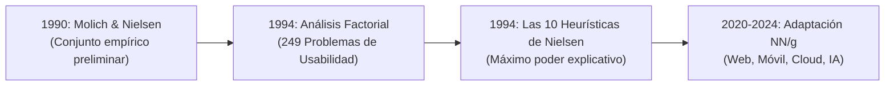
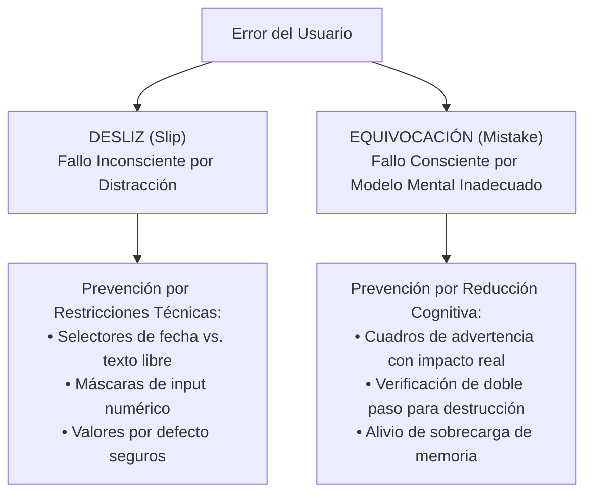
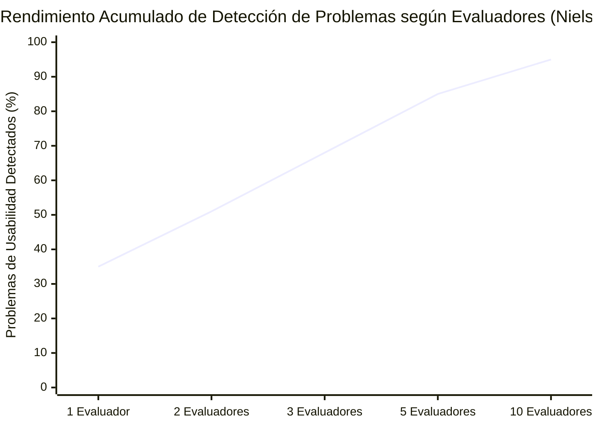

[← Anterior: 09.5a. Compresión del Proceso de Diseño en la Era de la IA](./09.5a_Compresion_del_Proceso_de_Diseno_en_IA.md) | [Volver a Curso.md](../Curso.md)

# 09.5b. Las 10 Heurísticas de Usabilidad para Diseño de Interfaces

> **Materia**: Sistemas de Información | **Docente**: PhD Jhon Alexander Garcia Camargo  
> **Sesión**: Sesión 9.5 | **Fuente**: [Sesion 9.5.10 Usability Heuristics for User Interface Design - NN_G.pdf](../Documentos/Sesion%209.5.10%20Usability%20Heuristics%20for%20User%20Interface%20Design%20-%20NN_G.pdf)  
> **Autor**: Jakob Nielsen (1994; actualizaciones de texto y visuales por Kate Moran, Feifei Liu y Kelley Gordon, NN/g 2020-2024)  
> **Términos Core**: `Heurística de Usabilidad`, `Evaluación Heurística`, `Reglas Generales de Pulgar (Rules of Thumb)`, `Factor Analysis (249 Problemas de Usabilidad)`, `Ley de Jakob (Jakob's Law)`, `Mapeo Natural (Natural Mapping)`, `Visibilidad del Estado`, `Retroalimentación Inmediata`, `Salida de Emergencia`, `Undo / Redo`, `Consistencia Interna y Externa`, `Prevención de Errores`, `Slips vs Mistakes`, `Restricciones (Constraints)`, `Reconocimiento vs Recuerdo`, `Memoria de Corto Plazo (7±2 chunks)`, `Aceleradores`, `Personalización vs Customización`, `Diseño Estético y Minimalista`, `Signal-to-Noise Ratio`, `Mensajes de Error en Lenguaje Natural`, `Ayuda Contextual`.

---

## 1. Fundamentos y Origen Metodológico de las Heurísticas

### 1.1 Definición Técnica de Heurística
- **Concepto**: Principio o regla general empírica (*rule of thumb*) de interacción humano-computador de amplio espectro, aplicable transversalmente a cualquier interfaz digital.
- **Diferencia Crítica vs. Guía de Diseño (*Guideline*)**:
  - Una **heurística** es un principio interpretativo universal de alto nivel (ej. *"hacer visible el estado del sistema"*).
  - Una **guía específica** es una directriz prescriptiva y contextual dependiente de la tecnología (ej. *"un spinner debe aparecer si la petición HTTP demora más de 1.000 ms"*).

### 1.2 Génesis Histórica y Validación Estadística
- **1990**: Desarrolladas inicialmente por **Jakob Nielsen y Rolf Molich** (*Improving a Human-Computer Dialogue*, CACM).
- **1994**: Nielsen ejecuta un **análisis factorial cuantitativo sobre 249 problemas de usabilidad documentados** en proyectos reales para destilar el conjunto con mayor varianza explicativa y ortogonalidad, formalizando las 10 heurísticas definitivas (*Nielsen 1994a, 1994b*).
- **2020–2024**: Revisión contemporánea por NN/g. Se modernizó la redacción y los ejemplos (integrando interfaces móviles, táctiles y en la nube), demostrando su vigencia inalterable durante más de tres décadas.

---

## 2. Desglose Técnico de las 10 Heurísticas de Nielsen

### H1: Visibilidad del Estado del Sistema (*Visibility of System Status*)
- **Principio**: La interfaz debe mantener informado al usuario de forma continua y comprensible sobre lo que está ocurriendo internamente, entregando retroalimentación oportuna en un lapso razonable.
- **Fundamento Psicológico**: La previsibilidad genera confianza en el producto y en la organización. Un usuario que desconoce el estado actual del sistema no puede determinar el siguiente paso operativo ni evaluar si su acción previa tuvo éxito.
- **Reglas Operativas**:
  - Toda acción que implique consecuencias debe ser retroalimentada de inmediato (cambio visual de estado, mensaje o sonido sutil).
  - Umbrales de respuesta en interacción:
    - $\le 100\text{ ms}$: Respuesta percibida como instantánea.
    - $100\text{ ms} - 1.000\text{ ms}$: El usuario percibe la pausa pero no pierde el hilo cognitivo; requiere indicador de micro-espera.
    - $> 1.000\text{ ms} \ (1\text{ s})$: Pérdida de atención inmediata; exige barra de progreso, indicador porcentual o animación contextual de carga.
- **Metáfora del Mundo Físico**: Indicador *"Usted está aquí"* en mapas de directorios de centros comerciales o estaciones de metro.
- **Anti-patrón**: Hacer clic en un botón de "Pagar pedido" y que la pantalla permanezca congelada sin retroalimentación, induciendo al usuario a pulsar múltiples veces y generar cobros duplicados.

---

### H2: Correspondencia entre el Sistema y el Mundo Real (*Match Between System and the Real World*)
- **Principio**: La interfaz debe hablar el lenguaje del usuario, utilizando palabras, frases, metáforas y conceptos familiares para él, en lugar de términos de ingeniería interna o jerga del equipo de desarrollo. La información debe ordenarse de manera lógica y conforme a las convenciones humanas.
- **Mapeo Natural (*Natural Mapping*)**: Disposición geométrica y funcional de los controles que se corresponde directamente con la disposición espacial del resultado en el mundo real.
- **Reglas Operativas**:
  - Nunca asumir que el vocabulario interno de la empresa coincide con el modelo mental del usuario común.
  - La investigación etnográfica y cualitativa debe descubrir la terminología cotidiana y la estructura conceptual que maneja el cliente.
- **Metáfora del Mundo Físico**: Perillas de encendido de una estufa dispuestas exactamente en el mismo patrón rectangular que las hornillas que controlan; la papelera de reciclaje digital que emula el contenedor físico de basura.
- **Anti-patrón**: Desplegar alertas como *"Error de Null Pointer en el DAO de transacciones"* en lugar de *"No pudimos cargar la lista de productos. Revisa tu conexión"*.

---

### H3: Control del Usuario y Libertad (*User Control and Freedom*)
- **Principio**: Los usuarios cometen errores con frecuencia por distracción o exploración. Requieren **salidas de emergencia claramente señalizadas** para abandonar estados indeseados de forma inmediata sin atravesar procesos complejos ni diálogos forzados.
- **Fundamento Psicológico**: La existencia de vías de reversibilidad proporciona seguridad psicológica y fomenta la exploración de la plataforma. La ausencia de salidas genera frustración, ansiedad y abandono definitivo.
- **Reglas Operativas**:
  - Proveer soporte universal y robusto para **Deshacer (*Undo*)** y **Rehacer (*Redo*)**.
  - Incluir botones visibles y unívocos de **Cancelar** en flujos modales y formularios extensos.
  - Permitir el descarte inmediato de borradores sin bloquear el retorno a la pantalla anterior.
- **Metáfora del Mundo Físico**: Señalética luminosa de "Salida de Emergencia" (*Emergency Exit*) en edificios y recintos públicos cerrados.
- **Anti-patrón**: Modales en pantalla completa sin botón de cierre (`X` o `Cancelar`), donde pulsar la tecla `Esc` o hacer clic fuera no surte efecto, atrapando al usuario en un flujo no deseado.

---

### H4: Consistencia y Estándares (*Consistency and Standards*)
- **Principio**: Los usuarios no deben cuestionarse si palabras, situaciones, íconos o acciones diferentes significan lo mismo en contextos distintos. El diseño debe acatar rigurosamente las convenciones de la plataforma y de la industria.
- **Ley Teórica Central: Ley de Jakob (*Jakob's Law*)**:
  > *"Los usuarios pasan la mayor parte de su tiempo utilizando otros sitios web y productos digitales distintos al tuyo. Sus expectativas de comportamiento se forjan en esos otros productos."*
- **Las Dos Dimensiones de la Consistencia**:
  1. **Consistencia Interna**: Coherencia de colores, tipografías, componentes y comportamiento dentro de un mismo producto o suite corporativa.
  2. **Consistencia Externa**: Respeto de los estándares consolidados de la industria (ej. el carrito de compras arriba a la derecha, subrayado para enlaces, atajo `Ctrl+Z` para deshacer).
- **Metáfora del Mundo Físico**: Los mostradores de registro (*Check-in*) en hoteles están ubicados universalmente en la entrada principal; cambiar su ubicación al sótano confunde a los huéspedes.
- **Anti-patrón**: Utilizar en una pantalla un ícono de engranaje para "Configuración" y en otra pantalla una llave inglesa para el mismo propósito, o cambiar la acción del botón primario de azul a rojo sin motivo funcional.

---

### H5: Prevención de Errores (*Error Prevention*)
- **Principio**: Mejor que redactar excelentes mensajes de error es diseñar la interfaz de manera que **impida que el error llegue a producirse**. Se deben eliminar las condiciones propensas a fallas o alertar al usuario antes de que confirme una acción irrevocable.
- **Taxonomía Cognitiva del Error (Norman & Reason)**:

- **Reglas Operativas**:
  - Priorizar el blindaje frente a errores de alto impacto destructivo (pérdida irreversible de datos, cargos financieros).
  - Bloquear estados no válidos en tiempo real (ej. inhabilitar el botón "Enviar" hasta que los campos obligatorios cumplan con su validación formal).
- **Metáfora del Mundo Físico**: Guardarraíles (*guard rails*) en los bordes de carreteras montañosas sinuosas para evitar que los autos caigan al abismo.
- **Anti-patrón**: Permitir que el usuario digite una fecha en un campo libre en formato `DD/MM/AAAA` y arrojar un error bloqueante al final del envío porque el backend esperaba `AAAA-MM-DD`.

---

### H6: Reconocimiento antes que Recuerdo (*Recognition Rather than Recall*)
- **Principio**: Minimizar la carga de la memoria de trabajo del usuario haciendo visibles los elementos, opciones, campos y acciones disponibles. El usuario no debe verse obligado a recordar información de una sección a otra de la interfaz.
- **Fundamento Cognitivo**:
  - La **memoria a corto plazo (de trabajo)** humana posee una capacidad extremadamente limitada: $7 \pm 2$ fragmentos (*chunks*) de información según George Miller (1956), reducida a $4 \pm 1$ en condiciones operativas complejas (Cowan, 2001).
  - El **Reconocimiento** se apoya en pistas perceptivas inmediatas presentes en el entorno; el **Recuerdo** exige una reconstrucción activa y costosa desde la memoria a largo plazo sin soporte sensorial.
- **Reglas Operativas**:
  - Desplegar historiales de búsqueda reciente, sugerencias automáticas y menús contextuales.
  - No usar *placeholders* como sustituto de las etiquetas (*labels*) permanentes de los campos: una vez el usuario empieza a escribir, el placeholder se borra y fuerza a recordar qué dato solicitaba el input.
  - Ofrecer ayuda en el contexto exacto donde se necesita, en lugar de obligar al usuario a memorizar extensos manuales o tutoriales iniciales.
- **Metáfora del Mundo Físico**: Pregunta de opción múltiple (*"¿Es Lisboa la capital de Portugal?"* $\to$ reconocimiento inmediato) vs. pregunta de respuesta abierta (*"¿Cuál es la capital de Portugal?"* $\to$ esfuerzo de recuerdo mnemotécnico).
- **Anti-patrón**: Obligar al usuario a recordar un código de cliente alfanumérico generado en el Paso 1 de un checkout para tener que escribirlo manualmente en el Paso 4.

---

### H7: Flexibilidad y Eficiencia de Uso (*Flexibility and Efficiency of Use*)
- **Principio**: El sistema debe atender con igual solvencia tanto a usuarios novatos como a usuarios experimentados. Se deben incorporar **aceleradores** de interacción (invisibles o no intrusivos para los novatos) que permitan a los expertos ejecutar flujos repetitivos a gran velocidad.
- **Las 3 Vías de Aceleración Operativa**:
  1. **Aceleradores Directos**: Atajos de teclado (`Ctrl+C`, `Cmd+K`), combinaciones gestuales táctiles avanzadas (*pinch-to-zoom*, deslizamiento con tres dedos).
  2. **Personalización del Sistema (*Personalization*)**: Algoritmos internos que adaptan automáticamente el contenido y las funciones a los hábitos y perfil del usuario singular.
  3. **Personalización por el Usuario (*Customization*)**: Herramientas que permiten al usuario configurar activamente la interfaz (organizar paneles de trabajo, configurar dashboards, reordenar columnas).
- **Metáfora del Mundo Físico**: Carreteras principales y señalizadas para conductores casuales vs. atajos y desvíos secundarios conocidos exclusivamente por los residentes locales de la zona.
- **Anti-patrón**: Diseñar un software contable o de facturación intensiva que obligue a los contadores a usar exclusivamente el ratón (*mouse*) para cada campo, sin permitir la tabulación fluida con el teclado ni atajos rápidos.

---

### H8: Diseño Estético y Minimalista (*Aesthetic and Minimalist Design*)
- **Principio**: Las pantallas no deben contener información irrelevante o que se consulte con escasa frecuencia. Cada unidad adicional de información en una interfaz compite con la información relevante y disminuye su visibilidad relativa.
- **Ecuación de la Relación Señal-Ruido**:
  $$\text{Claridad Cognitiva} = \frac{\text{Señal (Datos indispensables para el objetivo actual)}}{\text{Ruido (Decoraciones superfluas + Datos secundarios irrelevantes)}}$$
- **Aclaración Crítica de Nielsen**: Minimalismo estético **no significa diseño plano (*flat design*)** ni empobrecimiento visual; significa mantener el contenido y el diseño estrictamente alineados con los objetivos primarios del usuario, delegando lo secundario a **divulgación progresiva (*progressive disclosure*)**.
- **Metáfora del Mundo Físico**: Una tetera con un diseño ornamental excesivo, cuyo mango es incómodo y su boquilla intrincada resulta imposible de limpiar, sacrificando la usabilidad por mera decoración superficial.
- **Anti-patrón**: Llenar un dashboard corporativo con widgets decorativos no configurables, contadores llamativos pero sin valor de negocio y banners publicitarios internos que ocultan la tabla principal de tareas operativas.

---

### H9: Ayudar a los Usuarios a Reconocer, Diagnosticar y Recuperarse de Errores
- **Principio**: Los mensajes de error deben redactarse en **lenguaje natural y comprensible** (cero códigos técnicos abstractos), describir con absoluta precisión la naturaleza del problema y ofrecer una solución constructiva e inmediata.
- **Anatomía del Mensaje de Error Canónico**:
  $$\text{Mensaje Estándar} = \underbrace{\text{Identificación Clara (Sin jerga)}}_{\text{"Tu tarjeta fue rechazada por fondos insuficientes"}} + \underbrace{\text{Causa Raíz}}_{\text{"El banco emisor no autorizó el cargo"}} + \underbrace{\text{Acción de Recuperación}}_{\text{"[Intentar con otra tarjeta] o [Llamar al banco]"}}$$
- **Requisitos de Tratamiento Visual**:
  - Resaltado prominente: Tipografía en negrita, colores semánticos convencionales (rojo de alerta contrastado bajo WCAG), íconos distintivos de advertencia.
  - Ofrecer atajos directos para reparar el error sin forzar al usuario a rehacer el flujo completo desde cero.
- **Metáfora del Mundo Físico**: Señales viales de "Contravía" (*Wrong Way*) en accesos de autopista: avisan en rojo reflectivo del peligro inminente y señalan la maniobra obligada de retorno.
- **Anti-patrón**: Modal bloqueante que dice simplemente *"Ocurrió un error inesperado. Código de excepción: 0x80040154"* con un único botón que dice *"Aceptar"*.

---

### H10: Ayuda y Documentación (*Help and Documentation*)
- **Principio**: Aunque un sistema óptimo debería poder operarse intuitivamente sin necesidad de manuales, en sistemas de información complejos es indispensable proveer documentación de soporte para completar tareas específicas.
- **Propiedades Técnicas Innegociables**:
  - **Fácil Búsqueda**: Motor de búsqueda indexado con autocompletado y tolerancia a errores tipográficos.
  - **Orientación a Tareas**: Articulada desde los objetivos concretos del usuario (*"Cómo emitir una factura de exportación"*), no desde la estructura interna de las bases de datos.
  - **Brevedad y Pasos Concretos**: Procedimientos numerados, sintéticos y libres de teoría innecesaria.
  - **Presentación Contextual**: Despliegue de la documentación justo en el momento y lugar en que se requiere (ayuda *in situ*, tooltips informativos, preguntas frecuentes desplegables).
- **Metáfora del Mundo Físico**: Módulos y kioscos de información en terminales de aeropuertos, localizados exactamente en los puntos de transferencia o bifurcación de pasajeros.
- **Anti-patrón**: Forzar al usuario que tiene una duda en un formulario a descargar un manual operativo en PDF de 300 páginas y buscar manualmente la solución sin una barra de búsqueda ni enlaces contextuales.

---

## 3. Matriz Sintética: Las 10 Heurísticas de Usabilidad

| # | Heurística | Objetivo Operativo Central | Dimensión Cognitiva / Taxonomía de Error | Metáfora del Mundo Real |
| :---: | :--- | :--- | :--- | :--- |
| **H1** | **Visibilidad del Estado** | Comunicar el estado continuo mediante retroalimentación inmediata. | Certeza de acción y confianza en la plataforma. | Mapa "Usted está aquí" en centros comerciales. |
| **H2** | **Correspondencia con el Mundo Real** | Emplear lenguaje cotidiano del usuario y convenciones naturales. | Mapeo natural de controles; modelos mentales previos. | Perillas de estufa ordenadas como las hornillas. |
| **H3** | **Control y Libertad** | Habilitar salidas de emergencia para revertir fallos involuntarios. | Sensación de seguridad; reducción del estrés operativo. | Puertas de salida de emergencia señalizadas. |
| **H4** | **Consistencia y Estándares** | Seguir convenciones de la plataforma y del sector (Ley de Jakob). | Reducción de la carga cognitiva de aprendizaje. | Mostradores de check-in en la entrada de hoteles. |
| **H5** | **Prevención de Errores** | Blindar el diseño para impedir deslices (*slips*) y equivocaciones (*mistakes*). | Mitigación proactiva antes de confirmación irrevocable. | Guardarraíles en curvas de vías montañosas. |
| **H6** | **Reconocimiento vs. Recuerdo** | Hacer visibles objetos y opciones; no forzar memorización entre pasos. | Límite estricto de la memoria a corto plazo ($7 \pm 2$). | Preguntas de opción múltiple vs. respuesta abierta. |
| **H7** | **Flexibilidad y Eficiencia** | Proveer aceleradores, atajos y personalización para expertos. | Velocidad de interacción sin saturar al novato. | Atajos locales vs. autopistas principales. |
| **H8** | **Diseño Estético y Minimalista** | Optimizar la relación señal-ruido; eliminar lo irrelevante. | Conservación del foco y reducción de la saturación visual. | Tetera ergonómica vs. tetera ornamental sobrecargada. |
| **H9** | **Recuperación ante Errores** | Mensajes de error en lenguaje llano, causa precisa y solución inmediata. | Reparación guiada sin culpabilizar al usuario. | Señales viales de "Contravía" con retorno guiado. |
| **H10** | **Ayuda y Documentación** | Documentación orientada a tareas, contextual, concisa y buscable. | Asistencia operativa *just-in-time* en tareas complejas. | Kiosco de información al viajero en aeropuertos. |

---

## 4. Metodología de Inspección: La Evaluación Heurística

### 4.1 Concepto y Características
- **Método de Inspección de Usabilidad**: Revisión técnica sistemática realizada por especialistas en interacción, quienes examinan cada pantalla y flujo operacional confrontándolos contra las 10 heurísticas.
- **Costo-Efectividad**: No requiere reclutar usuarios finales en fases preliminares; detecta defectos críticos de forma temprana antes de iniciar la codificación o pruebas de campo masivas.

### 4.2 Escala de Severidad de Nielsen (0 a 4)
Para priorizar la corrección de los hallazgos en el backlog de desarrollo:

$$\text{Severidad} = f(\text{Frecuencia de Ocurrencia}, \text{Impacto en la Tarea}, \text{Persistencia})$$

| Nivel | Clasificación | Impacto Operativo | Acción Recomendada |
| :---: | :--- | :--- | :--- |
| **0** | **No es un problema** | Falso positivo o preferencia estética puramente subjetiva. | No intervenir. |
| **1** | **Problema Cosmético** | Defecto superficial; no compromete la finalización de la tarea. | Corregir solo si sobra tiempo en el sprint. |
| **2** | **Problema Menor** | Genera confusión leve o pequeña demora; el usuario se recupera solo. | Baja prioridad; programar en releases futuras. |
| **3** | **Problema Mayor** | Dificulta gravemente la tarea; usuarios novatos suelen bloquearse. | Alta prioridad; debe resolverse en el sprint actual. |
| **4** | **Catástrofe de Usabilidad** | Bloquea totalmente la finalización de la tarea; genera pérdida crítica de datos. | Bloqueante urgente; detiene el despliegue a producción. |

### 4.3 Cantidad Óptima de Evaluadores (Curva de Nielsen)
- Un único evaluador identifica en promedio solo el **35%** de los problemas de usabilidad.
- La combinación de **3 a 5 evaluadores independientes** detecta entre el **75% y el 85%** de los defectos del sistema.
- A partir de 5 evaluadores, el retorno de inversión (ROI) decrece exponencialmente: se descubren los mismos errores repetidos a un costo de horas-hombre significativamente superior.

---

## 5. Casos Trampa y Puntos Críticos de Examen

- **Trampa 1: Creer que la Evaluación Heurística Reemplaza las Pruebas con Usuarios**:
  - *Error*: Afirmar que al realizar una evaluación heurística exhaustiva con expertos ya no es necesario hacer pruebas de usabilidad con usuarios finales reales (*Usability Testing*).
  - *Realidad*: Son metodologías complementarias. Los evaluadores aplican principios teóricos, pero solo los usuarios reales revelan desajustes insospechados en los modelos mentales de negocio y dinámicas imprevistas de uso.
- **Trampa 2: Sustituir Etiquetas por Placeholders en Formularios**:
  - *Error*: Usar el texto atenuado dentro de los campos (*placeholders*) para ahorrar espacio vertical en la pantalla.
  - *Realidad*: Viola simultáneamente **H6 (Reconocimiento vs. Recuerdo)** y **H5 (Prevención de Errores)**. Al hacer foco e iniciar el tipeo, el texto desaparece, forzando al usuario a memorizar qué campo estaba llenando y propiciando errores en campos consecutivos.
- **Trampa 3: "Confirmshaming" y Bloqueo de Salidas como Estrategia de Conversión**:
  - *Error*: Ocultar deliberadamente la `X` de cierre o redactar opciones de salida humillantes (*"No, no me interesa ahorrar dinero"*) para evitar cancelaciones.
  - *Realidad*: Es un patrón oscuro (*deceptive pattern*) que viola de raíz **H3 (Control del Usuario y Libertad)**. Degrada la confianza en la marca y dispara la tasa de abandono definitivo.
- **Trampa 4: Confundir Slips con Mistakes en la Prevención de Errores**:
  - *Error*: Intentar prevenir una equivocación (*mistake*) agregando una restricción de input de texto.
  - *Realidad*: Un *slip* es motor/inconsciente (se arregla con selectores o máscaras); un *mistake* es cognitivo (el usuario cree erróneamente que una acción realiza algo diferente). Los *mistakes* se previenen educando el modelo mental, mediante explicaciones contextuales claras y confirmaciones de impacto real.
- **Trampa 5: Mostrar Códigos Técnicos en Alertas de Error**:
  - *Error*: Asumir que códigos como `ERR_CONNECTION_RESET` o `Code 500` son suficientes porque "el equipo de soporte los necesita".
  - *Realidad*: Viola flagrantemente **H9 (Recuperación de Errores)** y **H2 (Lenguaje Real)**. El mensaje para el usuario final debe ser siempre en lenguaje humano y con una ruta de solución inmediata. Los códigos de telemetría deben registrarse en logs internos o bajo un acordeón secundario de detalles avanzados.

