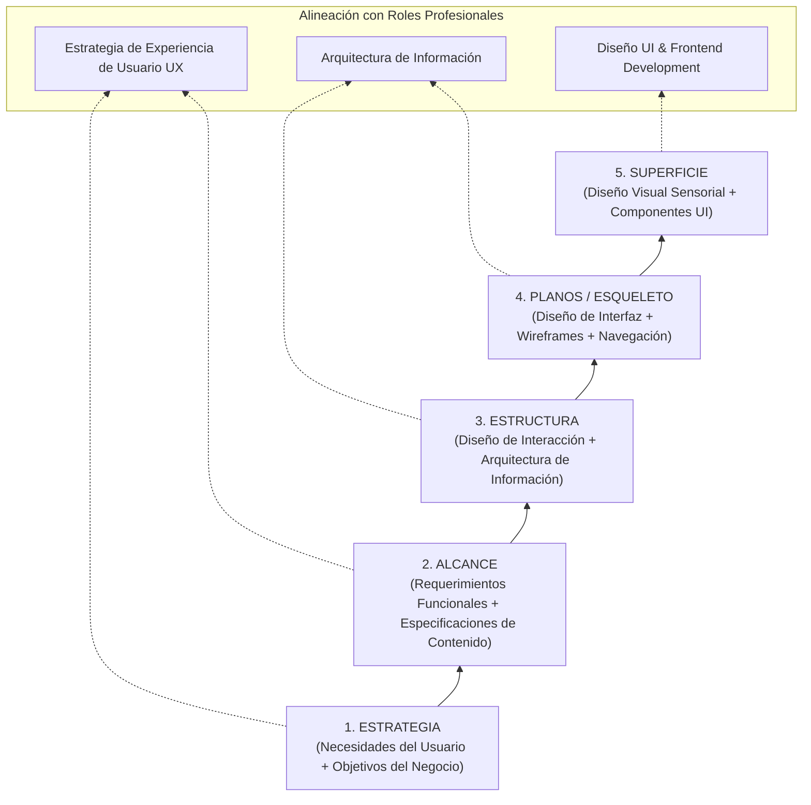
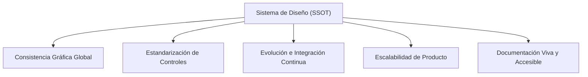
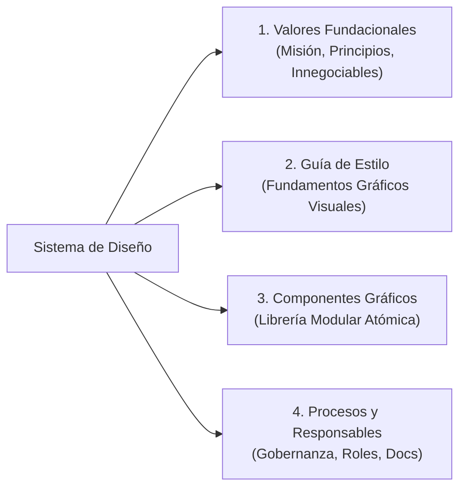
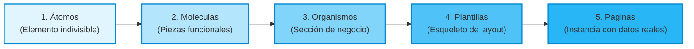

[← Anterior: 08f. Prototipado de Alta Fidelidad, Gestos y Accesibilidad UX](./08f_Prototipado_Alta_Fidelidad_Gestos_y_Accesibilidad.md) | [Volver a Curso.md](../Curso.md)

# 09. Sistemas de Diseño de Interfaz

> **Materia**: Sistemas de Información | **Docente**: PhD Jhon Alexander Garcia Camargo  
> **Sesión**: Sesión 9 (13 de octubre de 2026) | **Fuente**: [Sesión 9. Sistemas de diseño de interfaz.pdf](../Documentos/Sesión%209.%20Sistemas%20de%20diseño%20de%20interfaz.pdf)  
> **Términos Core**: `Interfaz`, `UX vs UI (NN/g)`, `Modelo de Garrett (2002)`, `5 Planos de Garrett (Estrategia, Alcance, Estructura, Planos, Superficie)`, `Sistema de Diseño`, `4 Pilares del Sistema de Diseño (Valores Fundacionales, Guía de Estilo, Componentes, Procesos)`, `Guía de Estilo (Color, Tipografía, Iconografía, Retículas)`, `Layout Grids (Columnas, Medianiles, Márgenes)`, `Sistema 12-8-4 Responsive`, `Diseño Adaptativo / Responsive`, `Diseño Atómico (Brad Frost)`, `Átomos`, `Moléculas`, `Organismos`, `Plantillas (Templates)`, `Páginas (Pages)`, `Referentes de la Industria (Material Design V2/V3, Atlassian, Spectrum, Nordhealth, DESY, Shrine)`.

---

## 1. Fundamentos: Definición de Interfaz, UX vs. UI y Modelo de Garrett

### 1.1 Concepto Formal de Interfaz
- **Definición**: Espacio operativo y de interacción donde dos sistemas, sujetos u organizaciones se encuentran y comunican.
- **Composición**: Conjunto de elementos físicos (hardware, periféricos, pantallas) y técnicos/lógicos (controles gráficos, software) que permiten interactuar con una tecnología y completar tareas de negocio.
- **Importancia Estratégica**:
  - Punto de encuentro primario para canalizar comunicaciones e intercambios transaccionales.
  - Portador semiótico de la identidad y valores de la institución; vector crítico para construir y afianzar la confianza del usuario.

### 1.2 Diferenciación Canónica: UX vs. UI (Nielsen Norman Group)

| Dimensión | Experiencia de Usuario (**UX** - *User Experience*) | Interfaz de Usuario (**UI** - *User Interface*) |
| :--- | :--- | :--- |
| **Definición** | Identificación y diseño de soluciones holísticas que responden a las necesidades, dolores y modelos mentales del usuario final. | Diseño de los puntos de contacto directos, físicos y visuales entre el usuario y la plataforma digital. |
| **Dependencia del Medio** | **Independiente de la plataforma o soporte**; abarca procesos offline, servicios, emociones, flujos y arquitectura lógica. | **Estrictamente dependiente del medio visual y técnico** (resoluciones, pantallas táctiles, teclados, estilos CSS). |
| **Propósito Central** | Maximizar la utilidad, satisfacción global, eficiencia y facilidad de adopción del producto. | Garantizar consistencia visual, jerarquía estética, legibilidad y usabilidad interactiva en cada control. |

$$\text{Producto Exitoso} = \underbrace{\text{UX (Estrategia + Arquitectura + Utilidad)}}_{\text{Resuelve el problema correcto}} \;\cap\; \underbrace{\text{UI (Interacción + Estética + Consistencia)}}_{\text{Resuelve la interacción con claridad}}$$

---

### 1.3 Los 5 Planos de la Experiencia de Usuario (Jesse James Garrett, 2002)
El diseño de software interactivo transita desde la abstracción estratégica pura hasta la concreción sensorial final a través de cinco capas interdependientes:



- **1. Estrategia (*Strategy*)**: Define el porqué del producto; articula las necesidades explícitas e implícitas del usuario con los objetivos de negocio de la organización.
- **2. Alcance (*Scope*)**: Traduce la estrategia en requerimientos funcionales específicos (lo que el sistema debe hacer) y requerimientos de contenido (datos, textos, recursos multimedia).
- **3. Estructura (*Structure*)**: Diseña la arquitectura de información (árboles de navegación, mapas del sitio) y el modelo de interacción (flujogramas de tareas).
- **4. Planos / Esqueleto (*Skeleton*)**: Dispone la distribución física de controles y bloques informativos mediante *wireframes*, estableciendo jerarquías de navegación.
- **5. Superficie (*Surface*)**: Renderiza el acabado visual final perceptible por los sentidos (color, tipografía, iconografía, textura, microinteracciones).

---

## 2. Sistemas de Diseño: Concepto, Beneficios y Entorno Ágil

### 2.1 Definición Canónica
- **Sistema de Diseño (*Design System*)**: Conjunto centralizado y coherente de guías, principios, reglas de estilo y recursos modulares reutilizables que registran formalmente las características visuales y el comportamiento dinámico de los elementos que construyen las interfaces de una organización.

### 2.2 Beneficios Técnicos y Operativos
- **Consistencia en la Línea Gráfica**: Elimina la fragmentación visual entre módulos, submarcas y plataformas (web, móvil, escritorio).
- **Estandarización de Componentes y Funcionalidades**: Garantiza que controles equivalentes (ej. selectores de fecha, botones de confirmación) se comporten de manera homogénea en toda la plataforma.
- **Integración y Evolución Sostenible**: Facilita la actualización de plataformas legadas y la adición fluida de nuevos subsistemas a lo largo del tiempo.
- **Escalabilidad de Plataforma**: Permite el crecimiento exponencial de productos y pantallas sin necesidad de escalar proporcionalmente los equipos de diseño y maquetación.
- **Documentación Centralizada y Consultable**: Provee una única fuente de referencia técnica (*Single Source of Truth*) para diseñadores y desarrolladores.



### 2.3 Entorno Propicio y Sinergia con Metodologías Ágiles
Un sistema de diseño prospera cuando la organización adopta principios ágiles:
- **Adaptabilidad Temporal**: Promueve que los artefactos visuales y de código no sean rígidos, sino que evolucionen por iteraciones.
- **Reorientación del Esfuerzo**: Libera a los equipos de resolver problemas resueltos (evita redibujar botones o inputs), permitiendo enfocar las horas hombre en **resolver problemas de negocio complejos**.
- **Minimización de Duplicidades**: Erradica redundancias en definición de datos, componentes de código duplicados y solapamiento de roles.
- **Caminos Establecidos**: Los desarrolladores no inician desde cero; ensamblan funcionalidades a partir de bloques probados y validados.

---

## 3. Anatomía Estructural: Los 4 Pilares de un Sistema de Diseño

Todo sistema de diseño de nivel empresarial se compone de cuatro dimensiones fundamentales:



| Pilar Estructural | Alcance Técnico | Elementos Clave y Entregables |
| :--- | :--- | :--- |
| **1. Valores Fundacionales** | Filosofía operativa, visión a largo plazo y requerimientos no negociables. | Misión del producto; unidad visual corporativa; accesibilidad y usabilidad universal; optimización de recursos computacionales y humanos; orientación comunitaria. |
| **2. Guía de Estilo** | Fundamentos gráficos e identidad de marca aplicada a medios digitales. | Paleta cromática corporativa y semántica; jerarquía tipográfica; iconografía funcional; sistemas de retículas (*layout grids*). |
| **3. Componentes Gráficos** | Bloques de construcción visuales e interactivos estructurados. | Catálogo de controles modulares codificados y diseñados bajo metodología de **Diseño Atómico** (botones, tarjetas, inputs, app bars). |
| **4. Definición de Procesos y Gobernanza** | Gestión del ciclo de vida, adopción, mantenimiento y versionado. | Proyección de despliegue; asignación de roles (diseño, ingeniería, QA); flujos de contribución y aprobación; repositorio central de documentación viva. |

---

## 4. Guía de Estilo: Color, Tipografía, Iconografía y Retículas

### 4.1 Paleta de Color
- **Jerarquización Cromática**: Establece niveles de importancia cognitiva en la pantalla mediante pesos visuales y contrastes tonales.
- **Llamados a la Acción (CTA - *Call to Action*)**: Reserva los colores de mayor saturación o contraste para guiar la conversión del usuario.
- **Diferenciación Semántica**: Segmenta tipos de información, estados de retroalimentación (éxito, advertencia, error) y categorías de contenido.

### 4.2 Tipografía
- **Alineación de Marca**: Afianza la personalidad, el tono de voz y el estilo formal o informal del producto digital.
- **Control de Jerarquía de Lectura**: Articula títulos, subtítulos, textos de cuerpo y metadatos manipulando:
  - Color y contraste cromático.
  - Peso tipográfico (*font weight*: regular, medium, bold).
  - Espaciado (*letter-spacing* / *kerning* e interlineado / *line-height*).

### 4.3 Iconografía
Los iconos aportan valor cognitivo directo y alteran el comportamiento del usuario mediante tres funciones:
1. **Guiar la Interacción**: Señalizan affordances y destinos de acción rápida (flechas de retroceso, lupa de búsqueda, menú hamburguesa).
2. **Aclarar Información**: Reducen la carga cognitiva al complementar etiquetas textuales con metáforas visuales reconocibles.
3. **Decorar y Entretener**: Humanizan la interfaz y refuerzan la identidad estética de la marca.

---

### 4.4 Layout y Retículas: El Sistema Responsive 12–8–4

#### Fundamentos de la Retícula (*Layout Grid*)
- Aporta balance, orden geométrico y armonía visual; transforma interfaces complejas en sistemas intuitivos y navegables.
- **Las 3 Variables Críticas de una Retícula**:
  1. **Columnas**: Zonas verticales donde se ubica y alinea el contenido.
  2. **Medianiles (*Gutters*)**: Espacios de separación entre columnas contiguas; evitan el solapamiento visual.
  3. **Márgenes**: Espacios vacíos laterales entre el borde exterior de la pantalla y el contenido activo.

```
|<-- Margen -->| [ Columna 1 ] |<- Medianil ->| [ Columna 2 ] |<-- Margen -->|
```

#### Estándar Universal: Sistema 12–8–4 para Retículas Adaptativas

| Factor de Forma / Dispositivo | Ancho Típico / Breakpoint | Número de Columnas | Justificación Técnica de Maquetación |
| :--- | :--- | :--- | :--- |
| **Escritorio (*Desktop*)** | $\ge 1024\text{ px}$ | **12 columnas** | Máxima flexibilidad matemática; divisible entre $2, 3, 4 \text{ y } 6$ para estructurar dashboards y layouts asimétricos complejos (ej. estándar de la BBC). |
| **Tableta (*Tablet*)** | $600\text{ px} \le \text{ancho} < 1024\text{ px}$ | **8 columnas** | Espacio medio; permite agrupaciones de $2$ o $4$ módulos sin saturar la visibilidad táctil. |
| **Móvil (*Mobile*)** | $< 600\text{ px}$ | **4 columnas** | Enfoque lineal mono-columna o de doble bloque; optimizado para interacción con el pulgar. |

#### Impacto Técnico y Comercial del Diseño Adaptativo (*Responsive*)
- **Mejoras Cuantitativas**: Incrementa la tasa de conversión, eleva el posicionamiento en buscadores (SEO amigable con algoritmos *mobile-first*) y consolida la imagen de marca.
- **Eficiencias Operativas**:
  - Reduce radicalmente los costos de desarrollo y soporte al mantener una única base de código fuente.
  - Erradica el contenido duplicado entre versiones web y móviles separadas.
  - Facilita la compartición de URLs universales e impulsa la viralización en redes y plataformas.

---

## 5. Componentes Gráficos de Interfaz

- **Definición**: Bloques modulares tangibles de construcción que median la interacción entre el usuario y la plataforma.
- **Propiedades Fundamentales**:
  - Poseen un objetivo funcional y un caso de uso predefinido.
  - Están regidos por **patrones de interacción convencionales** (la Ley de Jakob indica que el usuario espera que un checkbox o un radio button funcionen exactamente como en el resto de la web).
- **Catálogo de Controles Esenciales**:
  - *Selectores*: Radio buttons (selección única), Checkboxes (selección múltiple), Switches (activación on/off inmediata).
  - *Entrada de Datos*: Inputs de formulario de texto libre, Sliders / Range (valores en rangos numéricos continuos), Dropdown / Select.
  - *Acción y Visualización*: Botones de acción, Tarjetas (*Cards*), Barras de aplicación (*App bars*), Diálogos modales y *Backdrops*.
- **Ejemplo Canónico de Implementación**: Sistema de diseño **Shrine**, desarrollado sobre los principios de Material Design para plataformas de comercio electrónico.

---

## 6. Metodología del Diseño Atómico (*Atomic Design* - Brad Frost)

Metodología de trabajo que plantea la creación deliberada de elementos modulares sencillos para ensamblar de forma jerárquica estructuras de información complejas.

### 6.1 El Espectro Modular: De lo Abstracto a lo Concreto



$$\text{Nivel de Abstracción}: \underbrace{\text{Átomos} > \text{Moléculas} > \text{Organismos}}_{\text{Componentes Reutilizables}} \longrightarrow \underbrace{\text{Plantillas} > \text{Páginas}}_{\text{Estructuras de Pantalla Concretas}}$$

---

### 6.2 Desglose de los 5 Niveles Jerárquicos

| Nivel | Definición Operativa | Características Estructurales | Ejemplos Representativos |
| :--- | :--- | :--- | :--- |
| **1. Átomo** | Elemento más pequeño de la interfaz, indivisible sin perder su utilidad gráfica. | **No tiene sentido operativo por sí solo**; requiere estar acompañado para cobrar valor de negocio. | Etiquetas de texto (*Headers H1-H6*), botón básico aislado, avatar de usuario, input de formulario vacío, iconos vectoriales, botón radial. |
| **2. Molécula** | Combinación de dos o más átomos que actúan juntos como una unidad funcional simple. | Pieza de construcción reutilizable; resuelve una microtarea elemental dentro del sistema. | Grupo de campo de formulario (Etiqueta + Input + Mensaje de ayuda); barra de búsqueda simple (Input + Botón Buscar); tarjeta de producto básica; grupo de pregunta de opción única (Pregunta + Radio buttons). |
| **3. Organismo** | Estructura compleja formada por un grupo cohesionado de moléculas (y a veces átomos). | Construye una sección visual autónoma con un **objetivo específico de interfaz o negocio**. | Encabezado de perfil (*Profile Header*: Banner + Barra de navegación + Avatar + Etiqueta de usuario); sección de noticias (múltiples tarjetas en grid con paginación); formulario completo de checkout con validaciones. |
| **4. Plantilla (*Template*)** | Esqueleto estructural de página que define el layout combinando múltiples organismos. | Modela patrones de **jerarquía, alineación y ubicación espacial** de organismos; **no contiene datos reales** (cajas grises o contenido esquemático). | Wireframe o layout estructural de un perfil de usuario que especifica dónde va el header, dónde el grid de contenidos y dónde la barra de navegación inferior. |
| **5. Página (*Page*)** | Versión específica y tangible de una plantilla poblada con **contenido y datos reales**. | Representación fiel a la experiencia de producción; permite validar la resistencia del diseño frente a datos variables y realizar pruebas de usuario. | Pantalla final con los datos reales: "Laura Gómez, Profesora Lv. 20", avatar con fotografía real, enlaces a asignaturas y métricas de actividad operativas. |

> [!IMPORTANT]
> **Diferencia Crítica entre Plantilla y Página**:
> - La **Plantilla** (*Template*) define el contenedor abstracto y las reglas de disposición espacial (arquitectura y layout sin datos).
> - La **Página** (*Page*) instancia la plantilla con datos reales de producción (nombres reales, imágenes de usuario, variaciones de longitud de texto), siendo el artefacto sobre el que se validan casos borde y usabilidad con usuarios finales.

---

## 7. Referentes de la Industria y Ecosistema de Estandarización

### 7.1 Principales Sistemas de Diseño Públicos

| Referente | Organización / Autor | Características Distintivas |
| :--- | :--- | :--- |
| **Material Design (V2 / V3)** | Google | Metáfora de superficies físicas (*Surfaces* & *Material Environment*), elevación espacial mediante sombras y profundidad, paletas tonales algorítmicas (*Material You*) y componentes multiplataforma (Android, Web, Flutter, iOS). |
| **Atlassian Design System** | Atlassian (Jira, Confluence, Trello) | Optimizado para productividad técnica, colaboración corporativa, flujos de trabajo densos y tableros ágiles. |
| **Spectrum** | Adobe | Ecosistema unificado para aplicaciones de software creativo y herramientas SaaS de alta densidad funcional tanto en desktop como en navegadores web. |
| **Nordhealth's Design System** | Nordhealth | Enfocado en software de gestión veterinaria y clínica; prioriza la legibilidad crítica, fiabilidad extrema y consistencia en entornos de salud. |
| **DESY** | Gobierno de Aragón | Sistema de diseño de servicios digitales públicos; maximiza la accesibilidad ciudadana universal, la transparencia institucional y el cumplimiento de normativas de gobierno. |
| **Shrine** | Google / Material Studies | Caso de estudio y sistema de diseño especializado en tiendas y flujos de comercio electrónico elegante basado en los principios de Material Design. |

### 7.2 Repositorios Globales de Consulta
- **Adele (UXPin)** y **Design Systems Repo**: Directorios públicos abiertos que recopilan y analizan los sistemas de diseño de empresas globales líderes (código, componentes en Figma, principios y estándares de accesibilidad).

---

## 8. Casos Trampa y Puntos Críticos de Examen

- **Trampa 1: Confundir Sistema de Diseño con Guía de Estilo**:
  - *Error*: Afirmar que un sistema de diseño es simplemente un PDF con la paleta de colores y el logotipo.
  - *Realidad*: La guía de estilo es solo **uno de los cuatro pilares**. Un sistema de diseño completo exige además **valores fundacionales, componentes modulares codificados y procesos de gobernanza**.
- **Trampa 2: Dirección del Modelo de Garrett (2002)**:
  - *Error*: Diseñar la superficie visual antes de estructurar el alcance y la arquitectura de información.
  - *Realidad*: El proceso constructivo se rige de abajo hacia arriba (Estrategia $\to$ Alcance $\to$ Estructura $\to$ Planos $\to$ Superficie). Si se altera el orden, se producen interfaces estéticamente atractivas pero operativamente inútiles.
- **Trampa 3: Asignar Funciones a Átomos Aislados**:
  - *Error*: Modelar un átomo asumiendo que puede operar de forma independiente en una pantalla.
  - *Realidad*: Por definición formal, un átomo carece de sentido operativo aislado (un campo de texto sin etiqueta ni botón no permite al usuario entender qué ingresar ni cómo procesarlo); cobra sentido al integrarse en una **molécula**.
- **Trampa 4: Omitir la Retícula Responsiva 12–8–4**:
  - *Error*: Mantener una retícula rígida de 12 columnas en pantallas móviles.
  - *Realidad*: La densidad visual debe adaptarse mediante breakpoints canónicos: **12 columnas en Desktop, 8 columnas en Tablet y 4 columnas en Mobile**. Forzar 12 columnas en un viewport móvil genera medianiles minúsculos y rompe la legibilidad.
- **Trampa 5: UX como Subconjunto Exclusivo del Software**:
  - *Error*: Limitar la definición de UX a la maquetación de pantallas digitales.
  - *Realidad*: Según la definición de Nielsen Norman Group, UX es independiente del medio técnico específico; cubre toda la interacción del usuario con la institución y sus servicios, mientras que UI se circunscribe estrictamente al punto de contacto e interacción.

