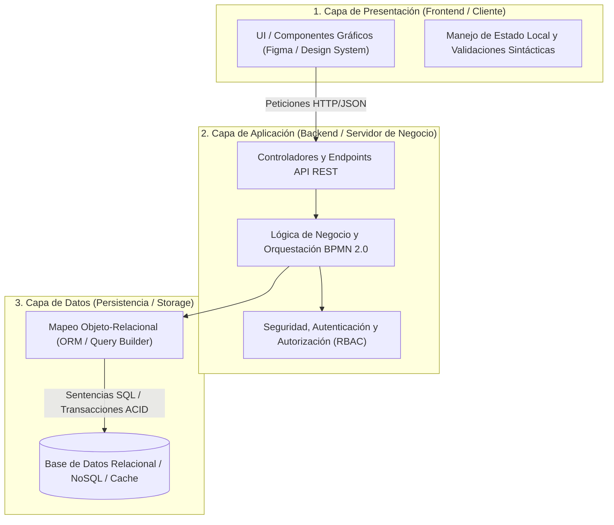
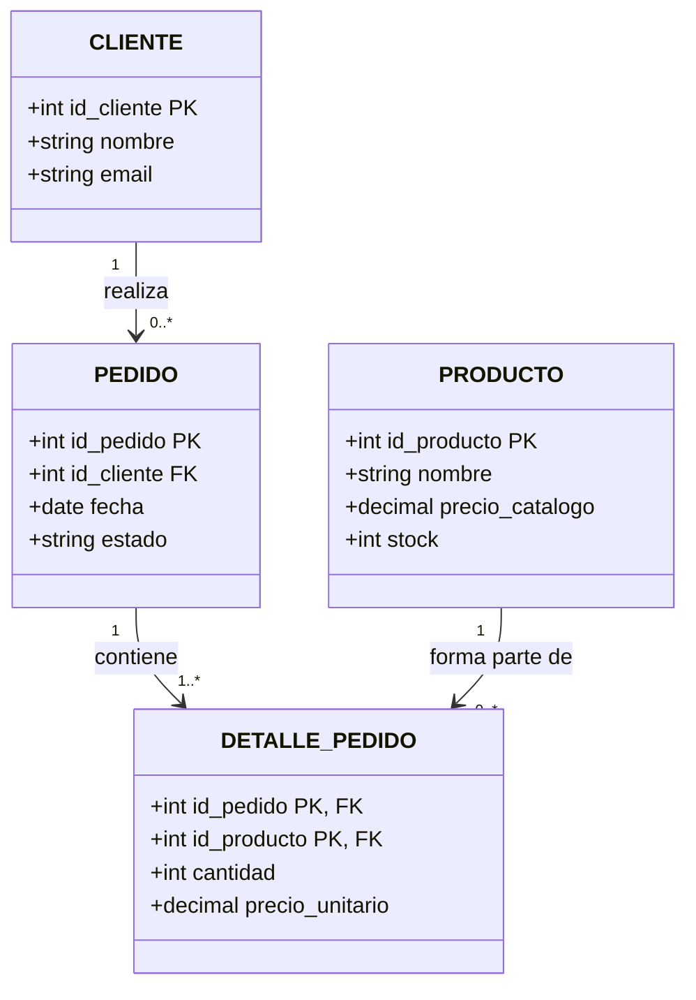
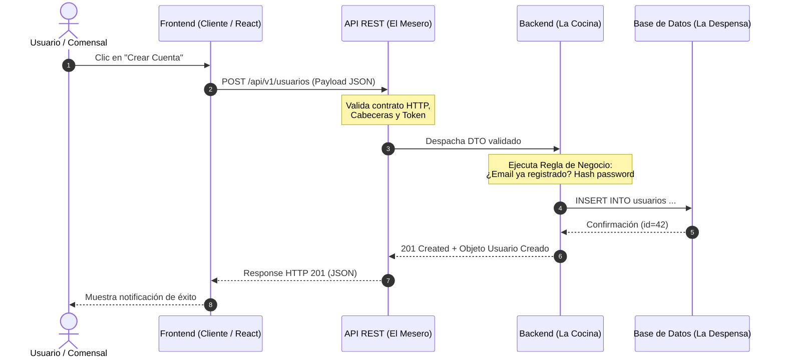

[← Anterior: 09.5b. Las 10 Heurísticas de Usabilidad para Diseño de UI](./09.5b_10_Heuristicas_de_Usabilidad_UI.md) | [Volver a Curso.md](../Curso.md)

# 11. Arquitecturas de Alto Nivel en Sistemas de Información

> **Materia**: Sistemas de Información | **Docente**: PhD Jhon Alexander Garcia Camargo  
> **Sesión**: Sesión 11 (03 de noviembre de 2026) | **Fuente**: [Sesión 11. Arquitecturas de alto nivel en sistemas de información.pdf](../Documentos/Sesión%2011.%20Arquitecturas%20de%20alto%20nivel%20en%20sistemas%20de%20información.pdf)  
> **Términos Core**: `Arquitectura de Alto Nivel`, `Separación de Responsabilidades`, `Patrón Cliente-Servidor`, `Arquitectura de N-Capas (Presentación, Aplicación, Datos)`, `Monolito`, `Monolito Modular`, `Microservicios`, `Serverless (FaaS)`, `Arquitectura Orientada a Eventos (EDA)`, `CQRS`, `System Design`, `Escalabilidad Vertical vs. Horizontal`, `Load Balancer (L4 vs. L7)`, `Reverse Proxy`, `CDN (Edge Caching)`, `Caché Distribuida (Redis, Memcached)`, `Estrategias de Caché (Cache-Aside, Write-Through, Write-Behind)`, `Políticas de Evicción (LRU, LFU, TTL)`, `Cache Stampede`, `Diagrama Entidad-Relación (MER/DER)`, `Entidades Fuertes y Débiles`, `Atributos (Simples, Compuestos, Multivaluados, Derivados)`, `Cardinalidad (1:1, 1:N, N:M)`, `Mapeo MER a Modelo Relacional`, `Clave Primaria (PK)`, `Clave Foránea (FK)`, `Tabla Asociativa / Intermedia`, `Integridad Referencial`, `Normalización (1FN, 2FN, 3FN)`, `API RESTful`, `Analogía Cliente-Mesero-Cocina`, `Métodos HTTP (GET, POST, PUT, PATCH, DELETE)`, `Idempotencia`, `Códigos de Estado HTTP (2xx, 3xx, 4xx, 5xx)`, `Endpoints`, `Payload JSON`.

---

## 1. Arquitectura de Software y Separación de Responsabilidades

### 1.1 Principio de Separación de Responsabilidades (*Separation of Concerns - SoC*)
- **Objetivo**: Desacoplar subsistemas para permitir desarrollo independiente, pruebas unitarias aisladas, mantenimiento modular y escalado horizontal diferenciado.
- **Conexión con el Ciclo de Vida del Curso**:
  - **Capa de Presentación (Frontend)**: Concreción técnica de los prototipos de baja fidelidad y mockups interactivos definidos en **Figma** (Sesiones 8a–8f, 9), aplicando **Sistemas de Diseño** y las **10 Heurísticas de Usabilidad**.
  - **Capa de Aplicación (Backend)**: Ejecución y orquestación de la lógica de dominio y las reglas de negocio formalizadas previamente en los flujos **BPMN 2.0** (Sesión 6).
  - **Capa de Datos (Persistencia)**: Estructuración relacional formal de las entidades y transacciones del sistema (Sesión 7 y Sesión 11).



---

### 1.2 Patrones de Arquitectura de Alto Nivel (Resumen BettaTech: *Todos los Patrones*)

| Patrón Arquitectónico | Mecanismo de Despliegue y Ejecución | Ventajas Clave | Desventajas y Riesgos Críticos | Caso de Uso Óptimo |
| :--- | :--- | :--- | :--- | :--- |
| **Monolito Tradicional** | Todo el sistema (Frontend, Backend, Persistencia) se compila y ejecuta como **un único artefacto**. | Simplicidad de desarrollo inicial; llamadas en memoria ultrarrápidas ($0$ latencia de red); testing integral trivial. | Despliegues de alto riesgo (un fallo crítico tumba todo el sistema); escalado vertical forzado; cuellos de botella en equipos grandes. | MVPs, proyectos tempranos, sistemas de baja concurrencia. |
| **Monolito Modular** | Monolito de un solo artefacto pero estructurado internamente en **módulos estrictamente desacoplados** mediante interfaces públicas. | Mantiene simplicidad de despliegue y bajas dependencias de red; evita el código espagueti; facilita migración futura a microservicios. | Requiere disciplina férrea para no romper los límites entre módulos mediante accesos directos a bases de datos compartidas. | Proyectos en crecimiento con equipos medianos que buscan modularidad sin coste de infraestructura distribuida. |
| **Microservicios** | Conjunto de **servicios autónomos e independientes**, cada uno con su propia base de datos (*Database per Service*), comunicados por red (HTTP/gRPC/Mensajería). | Escalabilidad independiente por servicio; resiliencia de fallos localizada; libertad tecnológica políglota; despliegues continuos autónomos. | Complejidad operativa extrema; latencia de red acumulativa; necesidad de trazabilidad distribuida; transacciones distribuidas complejas (*Sagas*). | Plataformas empresariales masivas con múltiples dominios y docenas de equipos de desarrollo independientes. |
| **Serverless (FaaS)** | Funciones individuales ejecutadas en la nube bajo demanda activadas por eventos (AWS Lambda, Google Cloud Functions). | Costo cero en reposo (*Pay-per-execution*); escalado automático masivo e instantáneo; cero administración de servidores. | *Cold Start* (latencia de arranque en frío); límites de tiempo de ejecución ($15\text{ min}$ máx); *vendor lock-in*; dificultad de depuración local. | Tareas asíncronas, procesamiento de imágenes/archivos, webhooks, micro-APIs de baja frecuencia o picos repentinos. |
| **Arquitectura Basada en Eventos (EDA)** | Productores emiten eventos de negocio a un **Broker de Mensajería** (Kafka, RabbitMQ) y múltiples consumidores reaccionan asíncronamente. | Desacoplamiento temporal y espacial total; alta tolerancia a caídas temporales de servicios consumidores; procesamiento concurrente masivo. | Consistencia eventual; ordenamiento de mensajes complejo; depuración y auditoría no triviales; duplicación potencial de eventos. | Procesamiento de transacciones financieras en tiempo real, streaming de telemetría IoT, sistemas de notificaciones masivas. |
| **CQRS** | Segrega el modelo de escritura (**Commands**: mutan datos y aplican reglas) del modelo de lectura (**Queries**: vistas desnormalizadas optimizadas). | Optimización extrema e independiente de lectura y escritura; lecturas directas desde caché o réplicas sin sobrecargar transacciones complejas. | Sobrecarga de sincronización entre el modelo de comando y consulta; duplicidad de esquemas; consistencia eventual en lecturas. | Sistemas con ratio desbalanceado de lecturas vs. escrituras (ej. $100:1$) como catálogos o redes sociales. |

---

## 2. Conceptos Fundamentales de System Design y Escalabilidad

### 2.1 Topología Integral de Alta Disponibilidad
Un sistema en producción de alta escala interpone capas intermedias para maximizar el *throughput*, minimizar la latencia y eliminar los **puntos únicos de falla (*Single Point of Failure - SPOF*)**:

```mermaid
flowchart LR
    Client["Cliente<br/>(Web / Móvil)"]
    CDN["CDN (Edge PoP)<br/>Archivos Estáticos"]
    DNS["DNS / Route 53"]
    LB["Load Balancer (L7 / NGINX)<br/>Health Checks"]
    
    subgraph AppTier["Capa de Aplicación (Stateless)"]
        S1["Servidor App 1"]
        S2["Servidor App 2"]
        S3["Servidor App 3"]
    end
    
    Cache[("Caché en Memoria<br/>Redis / Memcached")]
    
    subgraph DataTier["Capa de Persistencia"]
        DB_Master[("DB Primaria / Master<br/>(Escrituras)")]
        DB_Replica[("DB Réplica / Read<br/>(Lecturas)")]
    end

    Client -->|1. Petición Estática| CDN
    Client -->|2. Resolución Dominio| DNS
    Client -->|3. Petición Dinámica API| LB
    LB -->|Balanceo Round Robin| S1
    LB -->|Balanceo Round Robin| S2
    LB -->|Balanceo Round Robin| S3
    
    S1 <-->|4. Lectura Rápida / Cache-Aside| Cache
    S2 <-->|4. Lectura Rápida / Cache-Aside| Cache
    S3 <-->|4. Lectura Rápida / Cache-Aside| Cache
    
    S1 -->|5. Escritura| DB_Master
    S1 -->|6. Lectura (Cache Miss)| DB_Replica
    DB_Master -.->|Replicación Asíncrona| DB_Replica
```

### 2.2 Componentes Críticos de Infraestructura
- **Escalabilidad Vertical (*Scale-Up*) vs. Horizontal (*Scale-Out*)**:
  $$\text{Scale-Up: Aumentar CPU/RAM de 1 nodo} \quad \implies \quad \text{Límite físico de hardware, costo exponencial, requiere downtime}$$
  $$\text{Scale-Out: Añadir múltiples nodos tras un balanceador} \quad \implies \quad \text{Alta disponibilidad elástica, tolerancia a fallos, costo lineal}$$
- **Balanceador de Carga (*Load Balancer*)**:
  - **Nivel 4 (Transporte - TCP/UDP)**: Rápido; enruta por IP y puerto sin inspeccionar contenido HTTP.
  - **Nivel 7 (Aplicación - HTTP/HTTPS)**: Inteligente; evalúa cookies, encabezados, rutas URL (`/api/v1/usuarios` vs `/api/v1/pagos`) y realiza terminación SSL/TLS.
  - *Algoritmos de Enrutamiento*: **Round Robin**, **Least Connections** (menor número de conexiones activas), **IP Hashing** (afinidad de sesión).
  - *Sondeos de Salud (Health Checks)*: Pings periódicos al endpoint `/health`; si una instancia falla, se remueve automáticamente de la rotación sin afectar al usuario.
- **Red de Distribución de Contenido (*CDN - Content Delivery Network*)**:
  - Servidores perimetrales distribuidos geográficamente (*Edge Locations / PoPs*).
  - Almacenan en caché activos estáticos (imágenes, CSS, JS compilados, videos) a milisegundos del usuario, reduciendo el tráfico hacia los servidores de origen en más del $70\%$.
- **Caché en Memoria Distribuida (Redis / Memcached)**:
  - Almacena datos volátiles de acceso frecuente en RAM, evitando consultas costosas a disco en la base de datos.
  - **Patrones de Operación**:
    - **Cache-Aside (Lazy Loading)**: El servidor consulta la caché. Si acierta (*Cache Hit*), retorna; si falla (*Cache Miss*), lee de la BD, guarda en caché y retorna.
    - **Write-Through**: Escribe primero en caché y simultáneamente en la BD; garantiza consistencia pero incrementa la latencia de escritura.
    - **Write-Behind (Write-Back)**: Escribe en caché y retorna inmediatamente; un hilo asíncrono actualiza la BD después (riesgo de pérdida de datos si la caché cae).
  - **Políticas de Evicción y Expiración**:
    - **TTL (*Time To Live*)**: Tiempo máximo de vida de una llave antes de invalidarse.
    - **LRU (*Least Recently Used*)**: Elimina los datos menos leídos recientemente cuando la RAM se llena.
    - **LFU (*Least Frequently Used*)**: Elimina los datos leídos con menor frecuencia acumulada.
  - **Riesgo Crítico**: **Cache Stampede / Thundering Herd**: Cuando una clave de alta demanda expira o se invalida súbitamente, cientos de solicitudes simultáneas no la encuentran en caché y golpean la base de datos a la vez, saturándola.

---

## 3. Diagramas Entidad-Relación (MER) y Modelo Relacional (MR)

### 3.1 Fundamentos del Modelo Entidad-Relación (MER / DER)
- **Entidad**: Objeto o sujeto del dominio con existencia independiente y atributos identificables (ej. `Usuario`, `Pedido`, `Producto`).
  - *Entidad Fuerte*: Posee identidad propia y clave primaria autónoma.
  - *Entidad Débil*: Depende existencialmente de una entidad fuerte (ej. `DetallePedido` no puede existir sin un `Pedido` padre).
- **Atributos**: Propiedades que caracterizan a una entidad (obtenidos directamente de los formularios y campos del prototipo UI):
  - *Simples / Atómicos*: No divisibles (`precio`, `codigo_postal`).
  - *Compuestos*: Descomponibles en componentes menores (`nombre_completo` $\to$ `primer_nombre`, `primer_apellido`).
  - *Monovaluados*: Admiten un único valor por registro (`fecha_nacimiento`).
  - *Multivaluados*: Admiten múltiples valores (`telefonos`, `hobbies`); en el modelo relacional **deben** desacoplarse en una tabla subordinada.
  - *Derivados*: Calculables a partir de otros datos (`subtotal = cantidad * valor_unitario`); no se persisten salvo por optimización de rendimiento.
  - *Clave Primaria (PK - Primary Key)*: Atributo o conjunto de atributos que identifica unívocamente a cada registro en la tabla (`NOT NULL` y `UNIQUE`).
- **Relaciones y Cardinalidad**:
  - **$1:1$ (Uno a Uno)**: Un registro de la entidad $A$ se asocia con a lo sumo un registro de $B$ (ej. `Usuario` $\leftrightarrow$ `PerfilFiscal`).
  - **$1:N$ (Uno a Muchos)**: Un registro de $A$ se relaciona con $N$ registros de $B$, pero un registro de $B$ se asocia con un único registro de $A$ (ej. `Cliente` $\xrightarrow{1:N}$ `Pedido`).
  - **$N:M$ (Muchos a Muchos)**: Múltiples registros de $A$ se relacionan con múltiples registros de $B$ (ej. `Pedido` $\xleftrightarrow{N:M}$ `Producto`).

---

### 3.2 Reglas Canónicas de Transformación: De MER a Modelo Relacional



- **Regla 1: Transformación de Entidades**:
  - Cada entidad fuerte pasa a ser una **tabla (relación)** independiente.
  - Cada atributo atómico pasa a ser una **columna (campo)** tipado.
- **Regla 2: Transformación de Relaciones $1:N$**:
  - La clave primaria (PK) de la tabla en el extremo "$1$" se propaga como **clave foránea (FK - Foreign Key)** en la tabla del extremo "$N$".
  - *Ejemplo*: `id_cliente` pasa a ser FK en la tabla `PEDIDO`.
- **Regla 3: Transformación de Relaciones $N:M$ (Regla de Oro Relacional)**:
  - **Jamás se modela directamente en bases de datos relacionales**.
  - Se descompone obligatoriamente creando una **Tabla Intermedia / Asociativa** (ej. `DETALLE_PEDIDO` o `PEDIDO_PRODUCTO`).
  - La tabla intermedia contiene como claves foráneas (FKs) las claves primarias de ambas tablas padre.
  - La PK de la tabla intermedia puede ser la clave compuesta `(id_pedido, id_producto)` o una clave subrogada artificial (`id_detalle`).
  - Esta tabla aloja los atributos propios de la relación (ej. `cantidad`, `precio_unitario_historico`).
- **Regla 4: Transformación de Relaciones $1:1$**:
  - La clave primaria de una de las tablas se coloca como clave foránea en la otra, añadiendo una restricción `UNIQUE` sobre la columna FK.

---

### 3.3 Normalización Básica y Control de Redundancia

$$\text{Objetivo de la Normalización} = \text{Minimizar redundancia de datos} \;+\; \text{Eliminar anomalías de inserción, actualización y borrado}$$

1. **Primera Forma Normal (1FN)**:
   - Todos los atributos son atómicos (sin valores repetidos ni colecciones embebidas como cadenas separadas por comas `tags: "ropa,hombre,oferta"`).
   - Cada columna almacena un único valor del dominio.
   - Existe una clave primaria definida para la tabla.
2. **Segunda Forma Normal (2FN)**:
   - Cumple 1FN.
   - Todos los atributos no clave tienen dependencia funcional completa de la clave primaria (aplica a tablas con claves compuestas; elimina dependencias parciales donde un atributo solo depende de una parte de la PK compuesta).
3. **Tercera Forma Normal (3FN)**:
   - Cumple 2FN.
   - Ningún atributo no clave depende transitivamente de la clave primaria (elimina dependencias transitivas: si $A \to B$ y $B \to C$, entonces $C$ debe moverse a una tabla propia; ej. almacenar el `departamento_nombre` a través del `id_empleado` cuando depende de `id_departamento`).

---

## 4. Interfaces de Programación de Aplicaciones (APIs RESTful)

### 4.1 Definición y la Analogía del Restaurante
- **API (*Application Programming Interface*)**: Contrato formal de comunicación que permite a dos sistemas heterogéneos intercambiar información de forma estandarizada y segura sin necesidad de conocer su implementación interna.
- **La Analogía Canónica**:
  - **Comensal (Cliente / Frontend)**: Envía la orden (*Request*) solicitando un plato específico del menú sin acceder a la cocina ni manipular las ollas.
  - **Mesero (API REST / Endpoints)**: Intermediario que valida el pedido, lo transporta bajo un protocolo estándar (HTTP), lo entrega a la cocina y regresa a la mesa con el plato servido (*Response* en formato JSON).
  - **Cocina (Servidor / Backend)**: Procesa las órdenes, ejecuta las recetas de negocio (flujos BPMN) e interactúa con la despensa de insumos (**Base de Datos**).



---

### 4.2 Arquitectura REST y Restricciones Formales (Roy Fielding, 2000)
1. **Cliente-Servidor Desacoplado**: La UI no sabe cómo se almacenan los datos; el servidor no sabe cómo se renderiza la UI.
2. **Sin Estado (*Stateless*)**: Cada petición HTTP recibida por el servidor debe contener **toda** la información requerida para procesarla (tokens de autorización, datos de entrada). El servidor nunca guarda el estado de la sesión en memoria local.
3. **Cacheabilidad**: Las respuestas deben declarar explícitamente si son cacheables o no mediante cabeceras (`Cache-Control`, `ETag`) para optimizar el tráfico de red.
4. **Interfaz Uniforme**:
   - Identificación de recursos mediante URIs sustantivas (`/productos/10`).
   - Manipulación de recursos mediante representaciones (JSON).
   - Mensajes autodescriptivos con tipos de contenido (`Content-Type: application/json`).
5. **Sistema por Capas**: El cliente no sabe si se conecta directamente al backend o a través de proxys, CDNs o balanceadores intermedios.

---

### 4.3 Métodos / Verbos HTTP y Matriz de Idempotencia

$$\text{Idempotencia: } f(f(x)) = f(x) \implies \text{Ejecutar una operación } N \text{ veces produce el mismo resultado que ejecutarla 1 vez}$$

| Método HTTP | Propósito Semántico | ¿Es Seguro? (*Safe*) | ¿Es Idempotente? | Códigos de Respuesta Típicos | Ejemplo Canónico de URI y Acción |
| :--- | :--- | :--- | :--- | :--- | :--- |
| **`GET`** | Recuperar o leer recursos sin alterarlos. | **Sí** (no muta estado) | **Sí** | `200 OK`, `404 Not Found` | `GET /api/v1/productos?categoria=electronica` |
| **`POST`** | Crear un nuevo recurso subordinado o procesar acción. | **No** (crea nuevos registros) | **No** (ejecutarlo 2 veces crea 2 registros duplicados) | `201 Created`, `400 Bad Request` | `POST /api/v1/pedidos` (con body JSON) |
| **`PUT`** | Reemplazar completamente un recurso existente por el enviado. | **No** (muta estado) | **Sí** (reemplazarlo 1 o 10 veces deja el mismo estado) | `200 OK`, `204 No Content` | `PUT /api/v1/usuarios/42` (reemplaza todos los campos) |
| **`PATCH`** | Modificación parcial de campos específicos de un recurso. | **No** (muta estado) | **No** (en spec RFC general; usualmente implementado idempotente) | `200 OK`, `400 Bad Request` | `PATCH /api/v1/usuarios/42` (modifica solo el email) |
| **`DELETE`** | Eliminar un recurso por su identificador. | **No** (elimina datos) | **Sí** (borrar un recurso ya borrado produce el mismo estado en BD) | `200 OK`, `204 No Content`, `404 Not Found` | `DELETE /api/v1/pedidos/105` |

---

### 4.4 Anatomía de un Endpoint y Formato JSON
- **URI Estructurada**:
  ```text
  https://api.empresa.com/v1/pedidos/508/items?estado=activo&limit=10
  \___________ ___________/\_/\_____/\__/\___/\____________________/
              v            v     v    v    v             v
          Protocolo +   Versión Recurso ID Sub-   Parámetros Query
          Host Base             Padre   Padre recurso (Filtro/Paginación)
  ```
- **Contrato de Intercambio (Payload JSON)**:
  - Formato universal de texto ligero basado en pares clave-valor tipados (cadenas, números, booleanos, arreglos y objetos anidados).
  ```json
  {
    "id_pedido": 508,
    "cliente": {
      "id_cliente": 12,
      "nombre": "Ana Pérez"
    },
    "items": [
      { "id_producto": 101, "cantidad": 2, "precio_unitario": 45.50 },
      { "id_producto": 204, "cantidad": 1, "precio_unitario": 120.00 }
    ],
    "total": 211.00,
    "estado": "confirmado",
    "fecha_creacion": "2026-11-03T18:00:00Z"
  }
  ```

---

### 4.5 Familias de Códigos de Estado HTTP (*Status Codes*)

| Familia | Rango | Significado Técnico | Códigos Críticos que Debes Dominar |
| :--- | :--- | :--- | :--- |
| **1xx** | Informativos | Petición recibida en curso; el cliente debe continuar. | `100 Continue`, `101 Switching Protocols` |
| **2xx** | Éxito | La acción solicitada fue recibida, entendida y aceptada con éxito. | `200 OK` (lectura/actualización exitosa)<br/>`201 Created` (creación exitosa tras `POST`)<br/>`204 No Content` (éxito sin cuerpo de respuesta, común en `DELETE`) |
| **3xx** | Redirección | El cliente debe tomar acciones adicionales para completar la petición. | `301 Moved Permanently`<br/>`304 Not Modified` (el recurso en caché sigue vigente) |
| **4xx** | Error del Cliente | La solicitud contiene sintaxis errónea, faltan permisos o no puede ser procesada. | `400 Bad Request` (payload inválido o malformado)<br/>`401 Unauthorized` (falta autenticación / token ausente o vencido)<br/>`403 Forbidden` (autenticado, pero carece de permisos de rol / RBAC)<br/>`404 Not Found` (recurso o endpoint inexistente)<br/>`409 Conflict` (violación de unicidad en BD, ej. email duplicado)<br/>`422 Unprocessable Entity` (sintaxis correcta pero falla validación semántica) |
| **5xx** | Error del Servidor | El servidor falló al intentar procesar una solicitud aparentemente válida. | `500 Internal Server Error` (excepción no controlada en el código)<br/>`502 Bad Gateway` (servidor de enlace o proxy recibió respuesta inválida del backend)<br/>`503 Service Unavailable` (servidor saturado o en mantenimiento)<br/>`504 Gateway Timeout` (el backend tardó demasiado en responder al balanceador) |

---

## 5. Puntos Críticos de Examen, Anti-Patrones y Reglas de Parcial

### 5.1 Anti-Patrones Comunes en Diseño de APIs REST
- **Anti-Patrón de Verbos en las URIs**:
  - *Incorrecto*: `GET /api/v1/obtenerProductos`, `POST /api/v1/crearUsuario`, `POST /api/v1/eliminarItem/5`.
  - *Correcto*: Los endpoints deben ser **sustantivos en plural**; la acción la define el **método HTTP**:
    - `GET /api/v1/productos`
    - `POST /api/v1/usuarios`
    - `DELETE /api/v1/items/5`
- **Diferencia Crítica de Seguridad: `401 Unauthorized` vs. `403 Forbidden`**:
  - `401 Unauthorized` significa en realidad **no autenticado**: *"No sé quién eres; debes identificarte con credenciales o token válido"*.
  - `403 Forbidden` significa **no autorizado**: *"Sé exactamente quién eres, pero tu rol o nivel de privilegios no tiene autorización para acceder a este recurso"*.
- **Violación de Idempotencia en `POST` vs. `PUT`**:
  - Usar `POST` para actualizar un recurso existente cuando se conoce su ID viola las directrices REST.
  - Usar `PUT` enviando únicamente un campo modificado borra inadvertidamente el resto de los campos si el backend reemplaza la entidad completa (debe usarse `PATCH` para mutaciones parciales).

### 5.2 Errores Frecuentes en Modelado de Datos para Sistemas de Información
- **Relaciones $N:M$ Directas**: Intentar vincular dos tablas muchos a muchos sin crear una tabla intermedia resulta en esquemas imposibles de consultar con SQL estándar y destruye la integridad referencial.
- **Campos Desnormalizados con Múltiples Valores**: Guardar listas de IDs o correos separados por comas en una única columna de texto (viola severamente la 1FN y destruye los índices de búsqueda).
- **Olvidar Índices en Claves Foráneas**: En bases de datos relacionales, crear una FK no crea automáticamente un índice en la mayoría de los motores (PostgreSQL, MySQL); no indexar columnas FK degrada drásticamente las operaciones `JOIN` en consultas de alta concurrencia.

### 5.3 Trampas de Infraestructura y System Design
- **Servidores con Estado (*Stateful Servers*) tras un Load Balancer**:
  - Guardar variables de sesión en la memoria RAM local del servidor web provoca que, si el balanceador envía la siguiente petición a otra instancia, el usuario pierda su sesión.
  - *Regla*: Los servidores de aplicación deben ser estrictamente **stateless**; el estado de sesión debe delegarse a una caché distribuida externa compartida (Redis) o mediante tokens autofirmados (**JWT**).
- **Falta de Políticas de Evicción en Caché**: Desplegar Redis sin configurar directivas `maxmemory` ni políticas `allkeys-lru` ocasiona caídas de servicio por saturación de memoria RAM cuando el tráfico escala.

